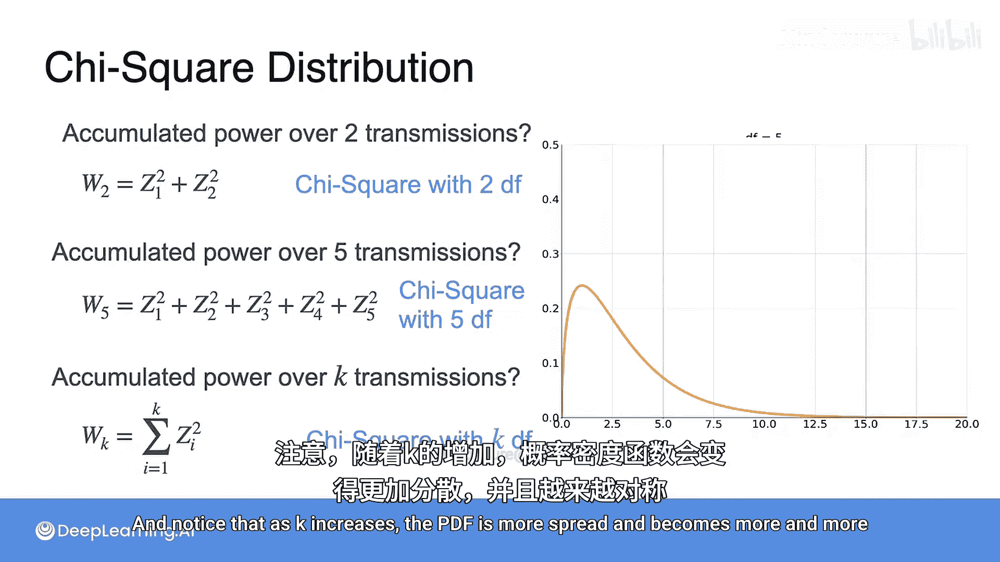

# 【Deeplearning】机器学习和数据科学概率与统计3 ｜ Machine Learning Probability And Statistics 吴恩达 p28 P28_选学卡方分布_01_02_12 -BV1c86VBrE93_p28-

So imagine that you're transmitting bits between 2 and 1。 you send the message 10010。

 The message travels through the air， which in this case is the communication channel。

 The channel has noise which will affect the message you send these noise can come from different sources like interferes from our devices Think of a w-fi router obstructions like walls。

 trees， buildings etc and conditions like rain or high humidity may also affect your signal Also electrical inference for example。

 from neuropar lines and many other factors can influence what actually gets received。 So in fact。

 let's say you receive the message 10010 plus some noise that affected the signal and let's call the noise z which has a random nature。

 one common assumption in communications that the noise Z has a Gaussian distribution with mean mu equals0。

One measure that is very useful in communications is the noise power which is roughly modeled by the square of the noise This measure is important because it is associated with the variance or dispersion of the noise and will determine how hard it is to correctly interpret the receipt signal。

The big question is now what is the distribution of W so for simplicity we're going to assume that z follows the standard normal distribution with p 0 and 1。

 so let's try to see it graphically each value of w can be achieved with two different values of z which are negative square root of w and square root of w even more。

The probability that capital W is S and w is the area under the PDFf curve of the Gaussian between these two numbers。

 so you can get the CDf for w by finding these areas for each possible value w notice that for small values of w you gain area at a much quicker rate。

 this is because the Gaussian distribution concentrates probability around 0。

 this is known as the chi squared distribution with1 degree of freedom。Now。

 since the CDf is the integral of the PDF， then you can easily find the PDF by taking the derivative of the CD。

😊，So this is simply the slope of the CDf at each point Now you can easily see that the rate at which the probability is accumulated is big for small values of w and it gets smaller and smaller as w increases and the reason is that for small values of w this is a very steep curve that grows really quickly but for larger and larger values it grows slower and slower Now what if you want the noise power accumulated over two transmissions that means that the power is now z1 squared plus z2 squared where both of them are normally distributed that is the chi square distribution with two degrees of freedom What about the power accumulated over5 transmissions that is going to be z1 squared plus all the way to z5 squared and that is a chi square distribution with5 degrees of freedom and what about the power over k transmissions Well notice that。

Again， this is the sum of many independent standard normal variables squared and is set to follow a chi square distribution with k degrees of freedom and notice that as k is increasess。

 the PDF is more spread and becomes more and more symmetrical。

