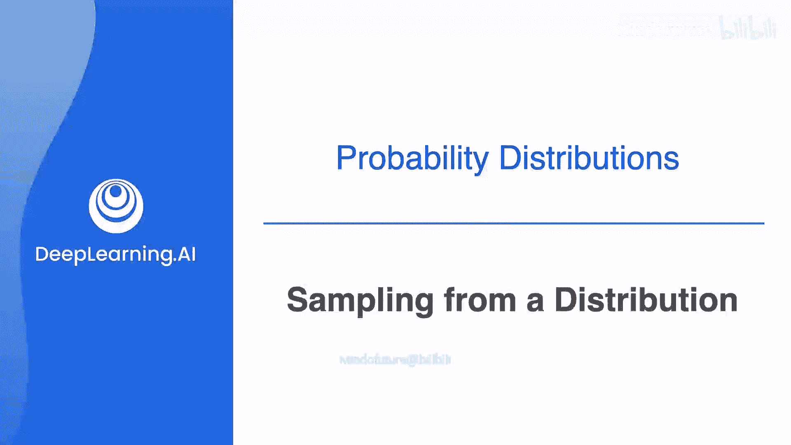
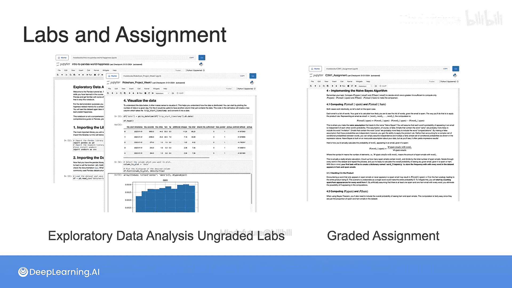

# 【Deeplearning】机器学习和数据科学概率与统计3 ｜ Machine Learning Probability And Statistics 吴恩达 p29 P29_从分布中抽样_01_02_13 -BV1c86VBrE93_p29-

So imagine that you have a data set， for example， heights of people， but you need it to be larger。

 but you can't go and collect more data it's too expensive。

 so what can you do well you can create some synthetic data that looks a lot like the original one。

And a way to do this is to construct a distribution out of this data and then sample out of it。

 and by sampling， I mean picking points that have the probabilities given by the original distribution。

So this is a very important concept in probability and in machine learning。

 sampling from distribution。Let me show you let's say you have a simple discrete distribution of our colors with three positive outcomess。

 green， blue and orange， and you get green with probability 0。3， blue with probability 0。

5 and orange with probability 0。2 and now you want to run an experiment where you want to create a random sample of data that follows the distribution so how do you sample data from the distribution？

Well， as you know the probability of the outcomes add to one so you can stack them up together like this to get a continuous strip between 0 and 1 Now computers can choose a random number from a given interval uniformly so to simulate the distribution you need to follow three steps first generate a random number between 0 and 1。

Second， find out which of the three intervals the generated number belongs to and then third assign the correct color based on the interval that will help you pick a random color between green blue and orange with the probabilities that are given in this graph Now let's say that instead of green blue and orange you assign this outcomes of numbers let's say01 and2 the process will be exactly the same。

 So let's take a look at another way to solve this problem let's create another plot here where we simply rotate the bars and what we're going to do is we're going push them to the right and draw that red line which is actually the commmulative distribution function And now all you have to do is you sample uniformly from the vertical interval so these four points are sampled uniformly and then you simply read out what the value is in the horizontal axis of the commmulative distribution function and then you are picking the numbers according to the distribution on the。

Left。We can also do this for a continuous one and it's actually very beautiful。

 check it out when you have， let's say the Gaussian distribution on the left。😊。

You want to pick randomly from the distribution is not easy because calculating areas is hard。

But if you take a look at the CDF on the right and then you pick uniformly from that gray interval。

 the interval from0 to 1， that's vertical， let's say we pick some numbers here uniformly。

And now all we do is we take a look at where this hits the distribution and where it hits the horizontal axis。

 so these points over here are actually distributed based on the normal distribution on the left as you can see this is the distribution that these points are taken from and when you look at them on the left that's the exact distribution that they're taken from。

So the CDf， both for the discrete and the continuous case。

 is a very useful method when you want to sample from a particular distribution to give you a solid foundation and applied statistics This course includes five exploratory data analysis labs you'll get a chance to get hands on with some data and see how concepts from probability and statistics can help find patterns and make decisions。

 These labs are ungraded， but there are many suggested activities for you in each of them。

 This week you'll have two labs from that series。 The first one is an introduction to pandas。

 which is a widely used Python library for analyzing data This lab is focused on introducing you to the tools from pandas you'll use throughout the other four labs。

 but you'll get a first look at a data set on world happiness you'll see later in the course If you're already familiar with pandas feel free to skim this lab The second lab will get you applying some of the concepts you've learned here in week1 to analyze and visualized data and describe some of its key features。

This lab introduces a data set on right share from the City of Chicago that you'll also see later in the course。

 I hope you enjoy both labs。Afterwards， youll have the graded portions from this week First you'll find a graded quiz covering all the topics of this week Finally。

 you will have a graded programming assignment in which you apply base theorem in order to predict whether an email is spam The assignment will help reinforce much of what you've been studying about base theorem and conditional probability It's also just a great opportunity to see how powerful some of the concepts you've been studying can be when applied cleverly to a real worldor problem you've got your work cut out for you。

 but I know you can do it Good luck finishing out this week。😊。

