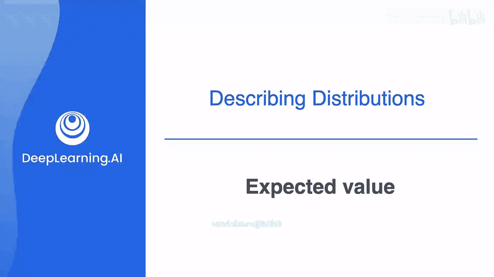
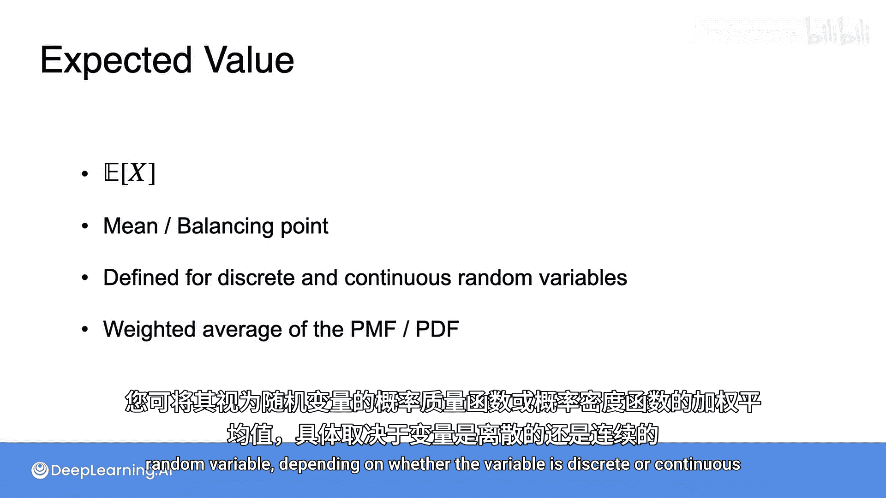

# 【Deeplearning】机器学习和数据科学概率与统计3 ｜ Machine Learning Probability And Statistics 吴恩达 p31 P31_期望值_02_01_01 -BV1c86VBrE93_p31-

Welcome to week2 in the first week youll learn about probability distributions this week you're going to learn about some ways for describing the data and these probability distributions。

 you're going to see how mean median and mode describe the center of the distribution and how variance describes the spread of the distributions。

You will also be introduced to the concept of an expected value。

You're going to see that expected values can be used to describe some interesting properties of variance as well as some advanced properties of probability distributions such as skewness and kosis。

 So far you've seen probability distributions of one random variable。

 but in lesson two of this week you're going to learn probability distributions of more than one random variable Some concepts you'll learn are joint distribution。

 marginal distribution， conditional distributions and covariance。

 These are very useful to describe probability distributions in multiple arrows。

 So let's get started in this video we're going to cover a topic that you may already be familiar with and it's the mean This video will be a quick review of the topic a formalization of how it's thought about in statistics and then application to some of the distributions you've studied。

Let's look again at the example where you looked at a sample of kits of different ages。

 You have three kits of H 0，2 kits of H1，4 kits of H2 and1 kit of H3。

 What is the mean of the distribution before looking at the mathematical meaning of this concept。

 Let's look at an intuitive meaning， the point where the distribution with balance to help。

 I'm going to replace each kit with a ball。 Now that you have just a bunch of equally size balls。

 you can put them on the scale and find a tipping point by trial and error。

 you can find that the scale would balance somewhere here And this is a value of 1。3。 Now。

 let's try to calculate this number。You probably know that the way to calculate the mean is to sum all the kits ages and divide by the number of kidss this way you get the average of kits and that's exactly the point where you have to balance your skill。

 so you have three kits of H 0，2 kits of H1，4 kits of H2 and one kit of H3 and then you divide this by 10 because there are 10 kits in total this sums up to 13 over 10 which equals 1。

3 and that is the average age of a kit in the distribution and also the mean。Now。

 look at how you can rewrite the equation above on the top you have three times 0 plus 2 times 1 plus 4 times 2 plus 1 times 3。

 And all this is divided by 10。 Now， let's distribute that 10 into thenominator of every term to get something like this。

 The new equation looks a lot like probabilitybabilities， right。

 You have3 over 10 probability at the ages 0，2 over 10 probability at the ages 1 and so on。Of course。

 the result is still 1。3 since all I did was rerite the original equation written this way。 however。

 it's easier to see that this equation is the weighted average of the values of the variable where the weights are the probabilities of each possible value。

 This balancing point is the mean of the data set。There is another more formal name for it used in probability and that expected value。

 so when you see the word mean or expected value， no you are referring to the same concept。

In this context， the expected age of a kid is 1。3 years if x is the variable representing the age of a child and the expected value is written like this。

 and it's read as E of x。Let's look at another example where this concept of expected value can be useful this time imagine you play a game with a friend where you flip a coin and if you get heads you get $10。

 otherwise you get nothing。And let's assume that this is a perfectly fair coin， so 5050 chance。Now。

 your friend wants you to pay $6 every time you play the game。 Would you play the game at this price。

 What about if they want to pay you $4 to play this game， Would you play the game then。

 So what would be the maximum you would pay to play this game。So how can you figure this out。

 what is a fair price to pay for the game， you can think of this in terms of probabilities。

 or you can think what is likely to happen in the long term and it's actually the same calculation as you just did with the kids。

So in the long term， you expect to get half of the times $10 and half of the times 0。

 which gives you $5。And this is your expected payoff。 If you imagine the game is a random variable x。

 then this is actually E of x， the expected value， and the calculation you just performed is the same weighted average you calculated when finding the mean age of the kids。

Since5 is the expected payout for the game， this is also the highest amount you would be willing to pay to play the game。

 at least at that price and average， you would break even Ily， you could pay less。

 and you should not agree to pay more。You can also see the expected value in this plot。

 The point where you would balance this on a scale is exactly at 5 as you have already calculated。

And so visually， you can see the expected value as the point that balances the distribution。 Now。

 let's think about another game where you flip  three coins and you win $1 for each hence。

 What is the maximum amount of money you would pay in this case。

Now you have seen this one before you can arrange the possibilities by the number of heads and create a histogram。

 now you can put it on a scale and try to find a point where it's balanced， which is at 1。5。

So the expected number of heads is 1。5。 you can also think of this problem differently。

 you flip three coins and half of them are heads。 What is half of three。It is 1。5。

 which is the result you already have。Finally， you can use the weighted average definition to find the same value。

 18 times 0 plus 38 times 1 plus 38 times 2 plus 18 times 3 will again give you unexpected value of 1。

5。So in general， if you have a discrete random variable x。

 it will have a probability mass function that provides the probability of each possible x can take。

 The expected value will be x times the probability of x summed over all possible values of x。

 This is just more formal notation for the weighted average formula you've seen in the previous examples。

Since you're performing a weighted average of the values the variable can take。

 if every value on your data has the same probability or mass。

 then the expected value will be right on the middle， which in this example is 3。However。

 as soon as one of the values has more weight than the others。

 it will shift the equilibrium point towards it。 in this case， giving an expected value or mean of 2。

3， notice that to increase the probability of one， you had to also lower all the other probabilities because as you might remember。

 that sum of all the probabilities has to be one， so you can just increase one probabilitybil without having to adjust the other ones。

So far we've been looking at discrete random variables now let's see what the expected value or mean of a continuous random variable looks like。

 recall the phone center example from the previous videos when you have a sample of data in order to find them mean you can imagine that each of these bars on the plot has its own weight and all you need to do is balance them on a scale just like you balance the balls in the previous video。

For this case， it balances somewhere around here and this is exactly where the mean of your sample is。

Now we can again go towards continuous distributions just like we did in the previous week。

 you can always talk about the distribution in your sample more precisely and you can break down the intervals into smaller ones。

For finding a mean， this makes no difference， you still just have to balance the left and the right side。

If you keep going until you reach infinitessimally narrow bars， you get a continuous distribution。

 Instead of balancing bars， now you have a continuous shape。

 which you still need to balance for discrete random variables。

 you saw the expression for the expected value。 Use sum overall possible values of the random variable weighted by the value of the probability mass function making it a weighted average。

What happens with continuous random variables， Well。

 there' is actually a formula that looks a lot like the one on the left and it involves using integrals。

If you're familiar with integrals， I will show you the expression here。

 But since this specialization didn't teach integral calculus。 Don't worry。

 I won't expect you to know it in this course。 With that said。

 the symbolic expression here is very similar to the expression for discrete random variables。

 The idea behind integrals is that you are summing the area of bars that get thinner and thinner so that in the limit you are adding an infinite number of very。

 very， very narrow bars。 Even still， all you are calculating is a weighted average。 In both cases。

 you are summing up all the possible values of x。 but in the discrete case。

 you weight the sum using the probability mass function， And in the continuous case。

 you are using the probability density function。Let's see what the expected value for a continued distribution looks like by considering this example。

 Let's say you're taking the bus every day and you look at how much time the bus takes to arrive。

 Let's say the first time it took 15 minutes。 and so I'm going to plot this number here。

You continue collecting data points because you take the bus every single day。

 you take it on the next day， and it took， let's say 32 minutes。

You keep recording every day and you keep collecting these data points Now you want to find the average of these numbers because you want to find the average time that you spend waiting for the bus。

The average of these numbers is 27。833， and that's where you balance these points over。

 Now you can continue collecting data points every single day that you take the bus and now you get something like this and you're expecting that if you're not really planning to take the bus at any particular time。

 And let's say it arrives every hour， then roughly you're going to get a uniform distribution。

 and the average is going to be somewhere around 30 Y 30。

 because the distribution for the time that you spend waiting for the bus is uniform because as you can see。

 the point can land pretty much anywhere in that interval equally。

Where would you balance a uniform distribution between 0 and 1。

 you would balance it in the very middle at 0。5。For a uniform distribution between A and B。

 then you're balancing it in the middle， which is the point a plus b divided by 2。

Now let's look at the expected value for a less well behaved continued distribution again。

 considering the wait times on the phone。Let's say you call。

 and this is how long you need to wait for the first call。

 If you make more calls and record how long you wait。

 you would expect a data set that looks like this with relatively more dots where the probability density function is higher and fewer where the curve is lower。

Where the expected value of the distribution， well again。

 it would be the mean point and it would show up somewhere around here。

This is visually the point on which you can balance the distribution without worrying about the calculus needed to calculate it。

 you can just think of it as the weight and average of the blue probability density function。

Now here's a common misconception， it may seem natural to think that the mean is a place where the data is split in half。

 but that's generally not the case noticeice that 50% of the data is here and the other 50% is here and the mean point is not in the middle This point is actually called a median and you'll learn more about it in the next video。

The mean is actually here。 and notice that if you split the distribution of the mean。

 there is more orange area than there is yellow area。 That is okay。

 The reason is that even though we have more mass here。Here it's more spread out。

I like to imagine this with an extreme example。 Let's say that I have an elephant really。

 really close to the balancing point and a mouse that is many kilometersm away。 Well。

 because the mouse is so far， even though it's much smaller and lighter。

 still balances the weight of the elephant， even though the elephant has more mass。

 The mouse is much， much farther away。 If you like physics， This is the concept of torque。

 which is force time's length。To summarize about expected value， if you have a random variable x。

 then the expected value is written as E of x。It is the mean of that probability distribution and can be thought of visually as the balancing point of that distribution。

 expected values defined for both discrete and continuous random variables。

 and you can think of it as the weighted average of either the Pf or the PDF of your random variable。

 depending on whether the variable is discrete or continuous。

