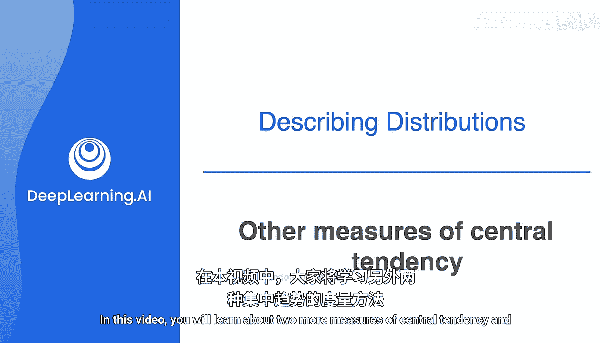
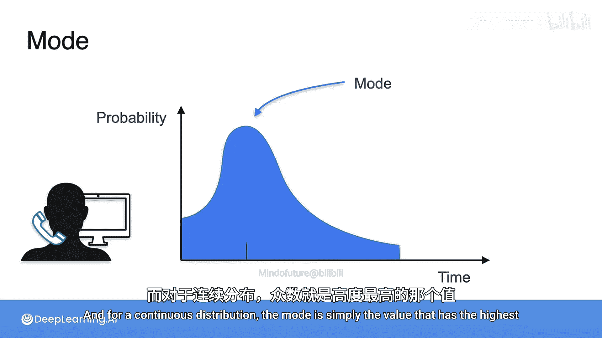
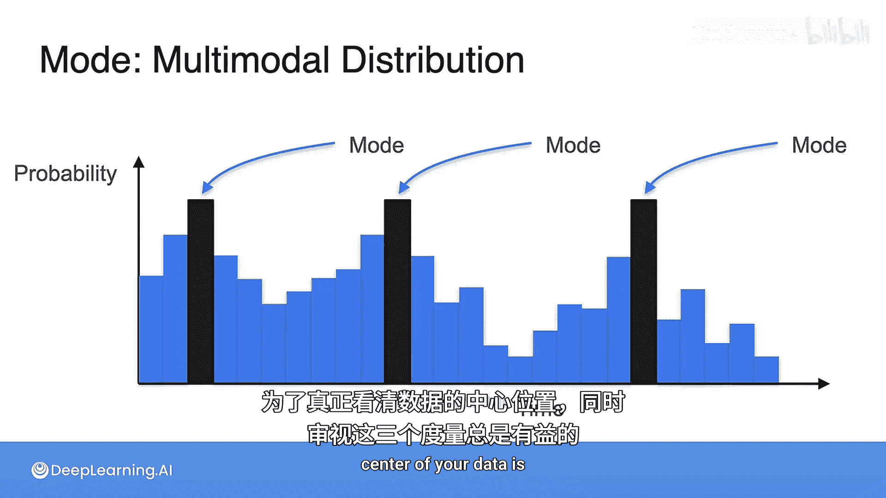
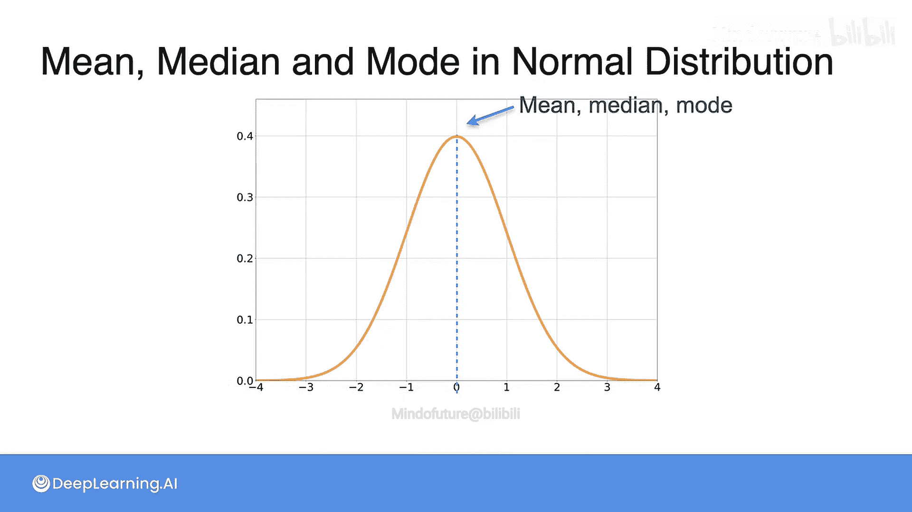

# 【Deeplearning】机器学习和数据科学概率与统计3 ｜ Machine Learning Probability And Statistics 吴恩达 p32 P32_其他集中趋势度量中位数与众数_02_01_02 -BV1c86VBrE93_p32-

In the last video you learn about the expected value or mean of a random variable。

 the mean is not the only way to measure the center of a distribution， however。

 and that is important because there are other ways to measure what are the central or typical values for a probability distribution。

In this video， you will learn about two more measures of central tendency and why they're important。

 So you've seen the mean before， but let me show you an example where the mean may not work so well In the 1980s。

 the starting salary for a geography graduate at the University of North Carolina was actually $250000。

 Sounds like a very， very big salary， especially considering that for the rest of the United States。

 the starting salary for a geography graduate was $22000， So why do you think this happened， Well。

 it could have been that problem was excellent， although I'm sure there were other excellent programs too。

 so that may not be it could have been that the University had great connections。

But you know I'm sure other universities also had great connections， so maybe that's not it。

 or perhaps it was that one student made a lot of money and that was indeed the case Michael Jordan graduated from the geography program at the University of North Carolina in the 80s and he went out and made a lot of money and he brought the average up for everybody。

 so it' was not really that the average student was making a lot of money is that he was making so much money that it looked like they were all making money。

But the average here is a little deceiving。And here's a plot that shows us why the average is theceing。

So imagine that this is a histogram of the salaries so salary is in the horizontal axis and the number of students with that salary in the vertical axis and if you were to balance it it goes over here around $22000 however Michael Jordan is all the way here and then what happens he tips the scale and in order to balance it we have to move it up so he brings the average up for everybody and the average is no longer measuring what the average student makes it got skewed by that one point on the right so how can we fix that well let's consider a different metric。

Let's actually put them all in order by salary so now it's just a position that matters and once we do that we can pick the number in the very middle。

 so the salary in the very middle is the medium and notice that that is no longer so high because now Michael Jordan doesn't contribute a lot of money。

 he just contributes one person to this list。That is the median now if the median were to be in the middle because you have an even number of points。

 then you simply take the average of the two points in the middle so the moral here is when the average is this evening go for the median and you may get a better idea of your data。

There is one more way to describe the center of a distribution apart from the mean and the median and it's called the mode remember a call center example where the probability of the operator picks up the phone in a given time looks something like this mode is simply the value at which the distribution has the highest probability which makes it the most frequent one for example in this case it's this number over here。

 you can see that iss the outcome with the highest probability。

And the same thing happens here in the more granular discrete distribution its a point where the tower is the highest and for a continued distribution the mode is simply the value that has the highest height Now the mode may not be unique you may be in a distribution like this where the maximum value gets repeated many times and that's called a multimodal distribution。

And in places like the uniform distribution， for example， everything is a mode。So in summary。

 you have the mean， the median and the mode， and it's always good to look at the three of them in order to really see where the center of your data is。

Now let's look at a real example， the binomial distribution。

 here is an example of five trials with a probability of one half like Philipping5 fair coins。

 what does this mean well remember that we used to scale the balance distribution in the scale the distribution it's pretty simple to find the balance and it's perfectly symmetric it's over here。

The mean is at a value of 2。5。Now what about the median well same thing is the average of two values in the middle because we have an even number of values。

 so it's also 2。5 and what about the modes， well the highest points in distribution are2 and3 so the modes are  two and3。

Now let's look at an asymmetric normal distribution。

 so three per coin five times and this time the probability of heads is 0。3。

 so you're going to balance in a scale and find out that it's here at 1。5， so that is the mean。

As the blue line shows， median is where half the data to the right and half the data to the left。

 so that one is over here and mode is again the outcome of the highest probability。

 so it's going to be one。Now let's look at a continuous example the normal distribution what's the mean well the mean is the center because that's where you would balance the distribution as it's perfectly symmetrical what about the median well the median is also that point in the middle and the mode is also that point in the middle which is the highest one so for a normal distribution they all match。

