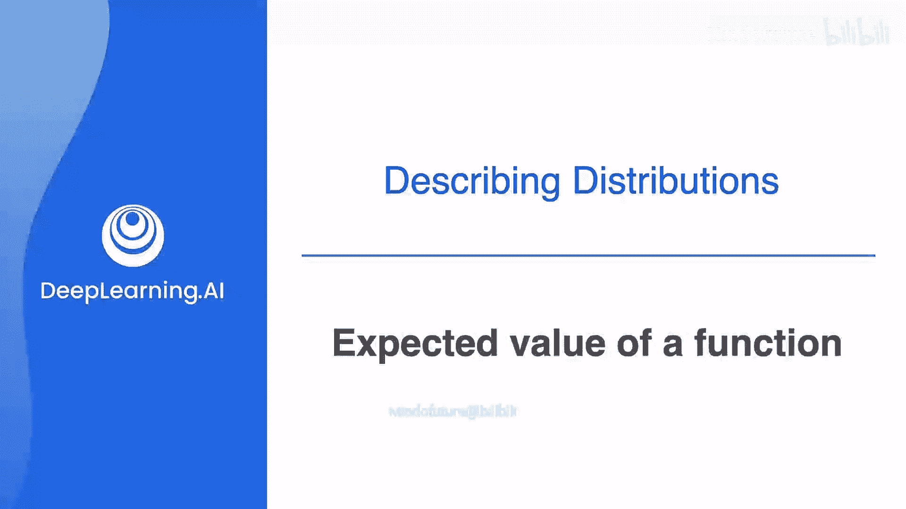
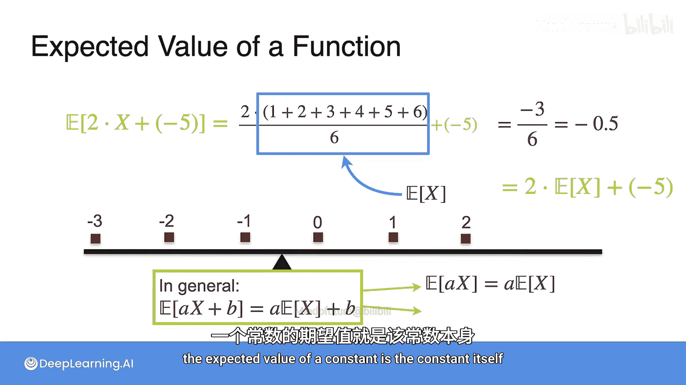

# 【Deeplearning】机器学习和数据科学概率与统计3 ｜ Machine Learning Probability And Statistics 吴恩达 p33 P33_函数的期望值_02_01_03 -BV1c86VBrE93_p33-

You have now learned how to find the expected value of a random variable。

But what if you are looking for something different。

 perhaps the expected value of the square of this variable or the cubed or any other function。

Let me show you how So imagine you have this probability distribution and you get the outcome x1 with probability px1。

 then you get the outcome x2 with the probability p of x2。

 then the outcome x3 with the probability p of x3 and finally the outcome x4 with the probability P of x4 Now how do you find the expected value of the outcome to find the expected value you have to simply take each outcome and multiply by its probability and then sum over outcomes。

So you start with x1 times p of x1， then add x2 times p of x2， and then all the others。

Now what if you're interested in some function of x for example。

 the expected value of x squared or x cubed Well luckily it turns out the result is very similar so if you're interested in the expected value of g of x。

 you need to do a similar summation as before but now you multiply g of x by the probability of x each time so you start with gx1 times p of x1 then add G of x2 times p of x2 and all the others now this may look like a lot but it's actually very simple you just replace the x with G of x and you kept the probability the same。

Now let's look at an example。Imagine a game you play with a friend。

 you roll at dice and your friend gives you the square of the amount you roll What is the fair price to pay for this game？

To answer this question， you can do the same as you did in the previous videos。

 you can plot the distribution of your payoffs and try to balance it on a scale。

And to calculate where the scales should be balanced。

 you can simply take the average of these numbers， which is 91 divided by 6。

So looking at the squares of numbers is nothing harder。

 you just need to think a bit about how to transform it into a problem you already know。Now。

 look at what you've actually done。 You have sum the squares of the rolls times the probability of each roll。

 which is16。 So you have actually calculated the expected value of x squared。

 Imagine now that your frame changes the game， and now they will pay you  two times the number you roll on the dice in order to get in on the game。

 you need to pay up $5。 So at the end of the game， you will have  two times the number you rolled minus the $5 you gave to start the game。

 which means your wins are-3-2-101 and 2。 and negative win means that you lost money。

 How much will you win with this game on average。 Once again， to answer this question。

 you can do the same thing you did in the previous videos。

 You can plot the distribution of your payoffs and try to balance it on a scale and calculate where the scale should be balanced because each of the6 values happens with probability 16。

 you can simply take the average of these numbers， which is negative 3 over 6 or-0。5。 Now。

 remember that each value was obtained by doing two times the value you rolled minus the $5 you started with。

😊，You can see that you have6 times minus5 which you can group together。

But 6 times minus5 divided by 6 is simply minus5。Finally。

 note that you have a common factor of two in all the sums so that you can rewrite the expression this way。

Now 1 plus 2 plus 3 plus 4 plus 5 plus6 divided by 6 is simply the mean or expected value of a dice row。

 notice anything cool here。It turns out that the expected value of 2 times x plus minus 5 is2 times the expected value of x plus minus 5。

In general， no matter the distribution of x， it is true that the expected value of a times x plus b is a times the expected value of x plus B。

 this means that the expectation is a linear operator。

You can have two more takeaways from this general result First。

 expectation of a times x equals a times the expectation of x。

 but also the expected value of a constant is the constant itself。

