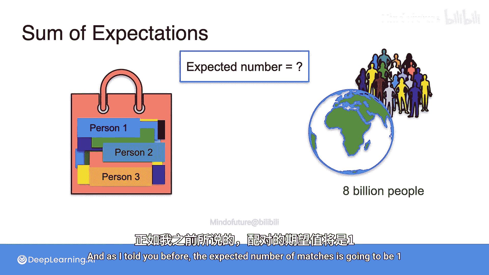
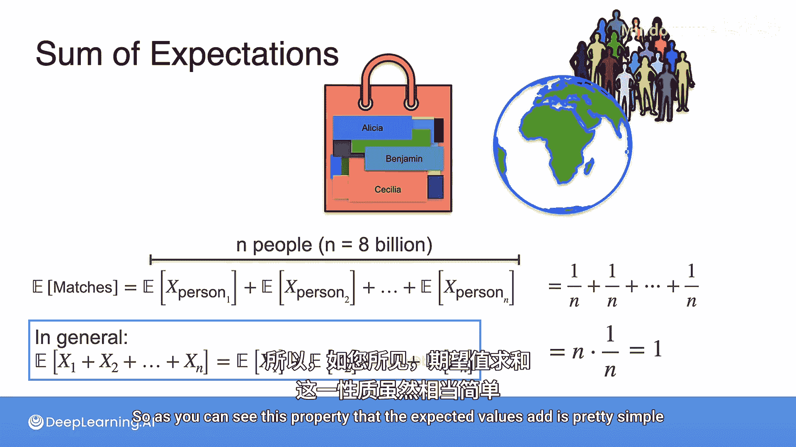

# 【Deeplearning】机器学习和数据科学概率与统计3 ｜ Machine Learning Probability And Statistics 吴恩达 p34 P34_期望值之和_02_01_04 -BV1c86VBrE93_p34-

So imagine a game where you can do two things first you flip a coin and if it lands and heads you win $1 and otherwise you win nothing and then after you flip the coin you roll a die and you win the amount that you rolled so here's a question what is the expected amount that you win for this game？

Well， for the coin to， the expected value we're going to call this variable x sub coin is1 half as you saw before because with a half probability you win one with probability you win 0。

 so each time you play you're winning on average half a dollar and for the second game it's 3。

5 because that's the average of all these numbers。We're going to call x dies the result of the second game。

And E of x， which is the result of both games at the same time。

 is going to be the sum of the expectations of the coin game and the dice game。

 so it's going to be 50 cents plus $3。50， which is $4 and in general。

 if you have 2 variables and you add them， the expectation of the sum of the variables is equal to the sum of the expectations。

Now some of the expectations may be something that seems very trivial。

 but actually it can get us to some pretty and trivial results let's look at the following game you have a bunch of names corresponding to all the people in the world so since there's 8 billion people you have 8 billion names in a bag and imagine that these are a unique names everybody has name and last name and just enough identifiers that each little piece of paper corresponds to one person and only one person in the world now I'm going to travel around the world and grab out of this bag one little piece of paper and give it to each person in the world what is the expected number of correct assignments now I wanted to take a guess here what is the expected number of people that are going get their own name if we play this game with all the people in the world。

And believe it or not， the answer is one， so there's going to be very likely one person bold Bbe Bloop who's going to be given their own name Now why is this the case let me show you in the next video。

So let's play the game but for only three people， Aishha Beto and Cameron so we have the three people and the three names and a bag and we're gonna start giving them to the three of them so let's say we give this person Beto's name and we were wrong because that was Cameron and we give this person Aisha's name so we were correct because that's Aishha and then we give this person Cameron's name and we were wrong so this time we got one right and two wrongs。

 Now let's play this game many times and six possible things can happen and they're mention here these are the six different ways that I can give this three people the three names in the bag and each one has the same probability so let's count how many times we are correct So if we do the first assignment we're correct three times。

If we do the second assignment， we're correct one time for the term we're correct one time for the next two we're not correct at all and for the last one we're correct one time and this is because for the first one we got the three names correct for the second we got Aisha for the term we got camera for the sixth one we got Beto correctly and for the others we got them all wrong so we need to find the average of these numbers that is the expected number of people we're gonna get correct at this game now the sum three plus one plus one plus one is6 and six divided by six which is the total number of times we play the game is one so the average is one so for three people the expected number of correct assignments is going to be one。

Now we can do the same thing for 8 billion people of course this is going to be a pretty difficult average to calculate because there's going to be a lot of possibilities for that game is there anything simpler that we can do so it turns out that yes there is something simpler we can do for this calculation and let me show you。

It's gonna to be a little counterintuitive， but it works really well and it's going be using the sum of expectations。

 So let's call matches the random variable that counts the number of matches in this game and we want to find that the expected number of matches is one Now let's split it into several things let's call a the number of correct assignments that only matter to Asia So the number of times that Asiaia is given her own name Now because she can be given the three possible names then what is E of a the expectation of a Well。

 each name is given to her with probability one thirdd therefore each time we play this game on average she gets her name correct one third of the time therefore E of a is one third。

We can do the same thing with Beto and the expected value of the number of assignments that get his name correct is onetd and with Cameron。

 we do the same thing。 the expected number of assignments that get their name correctly is onet and because the number of matches is equal to the number of matches with Aishha plus the number of matches with Beto plus the number of matches with Cameron then their expected values also add together so therefore expected number of matches is a third plus a third plus a third which is one and that's another way to see that the expected number of matches is going to be one Now that technique is simpler because now we can use it with every person in the world we have8 billion people we're going to play this game with all of them and as I told you before the expected number of matches is going to be one but why well let's say that we have all the people called person one all the way to person。

Where n is a billion or the number of people in the world。

 and the number of matches is going to be the number of matches。For person one。

 plus the number of matches for person 2， etca， etc ceter。

 plus the number of matches for person 8 billion， and now the expected number of matches is equal to be then sum of all those expectations Now the expectation for each one of these is one over n because let's say if you are one person the probability that you get your correct name is one over n。

 So the expected number of times you get your name correctly is one over n。

 and when we add these together， we're adding one over n n times so one over 8 billion 8 billion times and this number is one because in general you have that the expected value of a sum of n variables is the sum of their expected values。

 this result is always valid it doesn't depend on the distribution of your variables and it doesn't matter if they're independent or not it is always true。

 So as you can see this property。That the expected values add is pretty simple。

 but it can also be pretty powerful。

