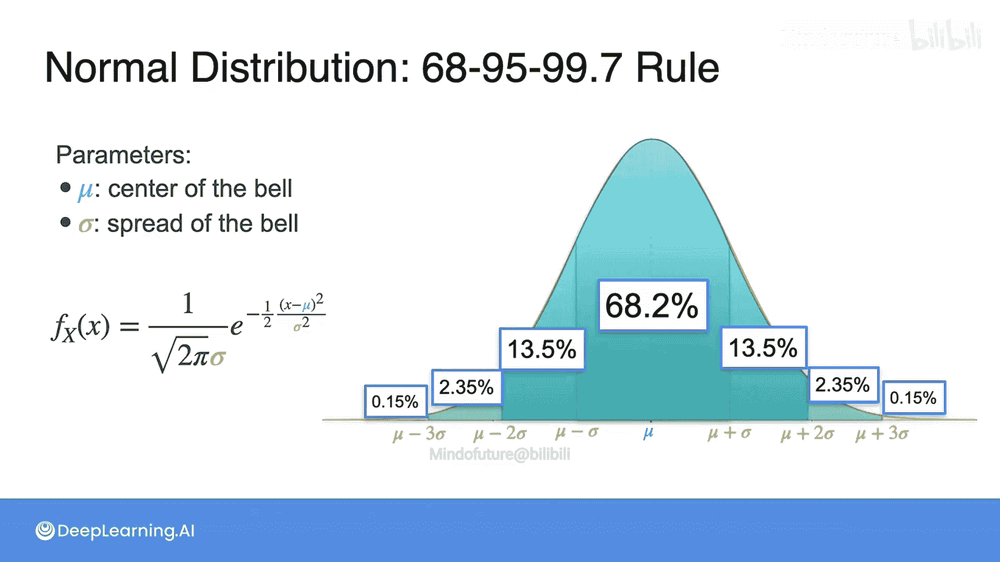

# 【Deeplearning】机器学习和数据科学概率与统计3 ｜ Machine Learning Probability And Statistics 吴恩达 p36 P36_标准差_02_01_06 -BV1c86VBrE93_p36-

So the variance is a pretty useful way to measure the spread of a distribution， however。

 has one small drawback。The units， imagine if your distribution has， for example。

 the height of people。So these heights are measured in meters or feet and the expected value is also measured in meters or feet。

 however the variance is measured in meters squared or feet squared， and this is not useful。

 so what do we do？We take the square root， we call that the standard deviation。

So the standard deviation is a pretty useful way to measure the spread of a distribution using the same units of the distribution so as we saw。

 the variance is the expected value of x minus the mean squared which can also be written as the expectation of x squared minus the squared of the expectation of x Now heres a small problem。

Say that x is measured in meters， maybe it's height or some length。

 then expected value of x is measured in meters， so it would tell us for example the average of the height of the people we're measuring so it's in the same units as the variable that we're measuring however look at the variance。

The expectation of x squared is in meter squared， and the expectation of x all squared is also a meter squared。

 so the variance of x is measured in meters squared。

And that's not so useful imagine if we're measuring people's heights and the variance tells you something in meter squared which measures area so that's not so useful what can we do well a simple solution is to just take the square root of the variance of x and that is now measured in meters so let's call that the standard deviation of x the standard deviation is this square root of the variance of x。

Now in the normal distribution the standard deviation is very useful。

 let's take a look at this be shaped and remember that when we defined it it had two parameters mu which was the center of the bell or the mean or the expected value and sigma which was the spread of the be or the standard deviation and the formula was this one over here that we saw in the previous week well。

A good visual cu to determine the value of sigma is where the bell starts changing concavity。

 and at that point you are at mu plus sigma or in mu minus sigma depending on where you're standing。

And。How much of the area is between mu plus sigma and mu minus sigma well it turns out that 68% of the area is in between those two and when you look at mu plus 2 sigma or mu minus2 sigma so the area between two standard deviations of the mean in both directions there's actually 95% of the curve here and if you look at3 standard deviations 99。

7 of the curve is there so。To be more exact， 68。2 lies in between one standard deviation in these little two strips over here between one and two standard deviations there's 13。

5% and in the next one there's 2。35% and in the tails which extend infinitely but there's still very。

 very very tiny， theres a 0。15% of the area and in statistics is very common to talk about being within one or two or three standard deviations of the mean when you talk about a normal distribution。

