# 【Deeplearning】机器学习和数据科学概率与统计3 ｜ Machine Learning Probability And Statistics 吴恩达 p37 P37_高斯分布之和_02_01_07 -BV1c86VBrE93_p37-

So in this video I'm going to show you an interesting application of what you've learned so far about mean expectations。

 variances and standard deviations， which is adding two Gaussian distributions Imagine you're studying the total response time of a computer system which consist two components。

 the processing time which represents a time taken by the system to process a given task and the network latency which is a delaying communication between the computer system and other network devices like database server or external APIs let's call this variables R T and L so the total response time is the sum of processing time and network latency in other words。

 R equals T+ L。

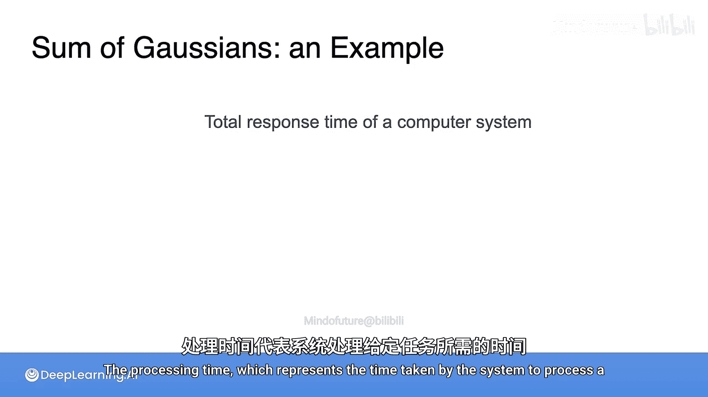

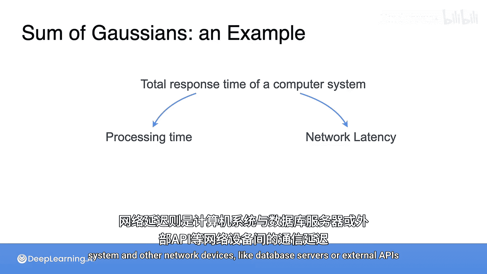

Imagine you can model the pressing time in milliseconds with a Gaussian distribution with mean 10 and standard deviation 2。

And the total latency you can also measure in milliseconds。

 also a Gaussian with mean 5 and standard deviation1。

 and suppose also that these two variables are independent of each other。

 so here are the corresponding densities for the processing time and for the latency。

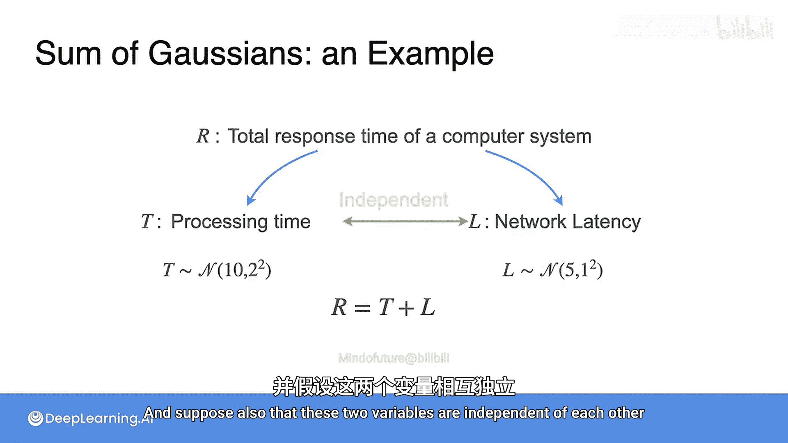

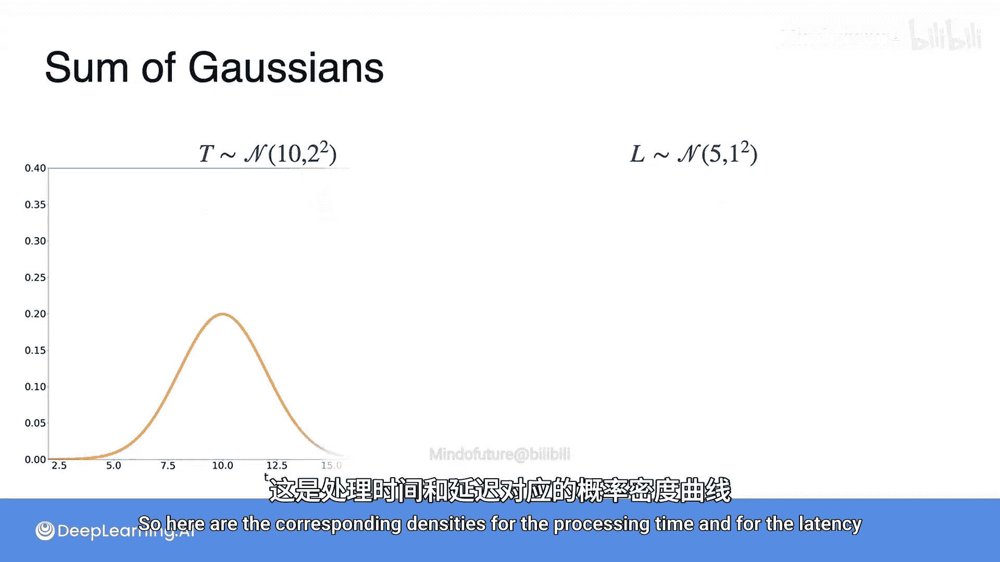

Now sample each variable 10，000 times and draw the resulting histograms。

 they both fit the curves pretty well。

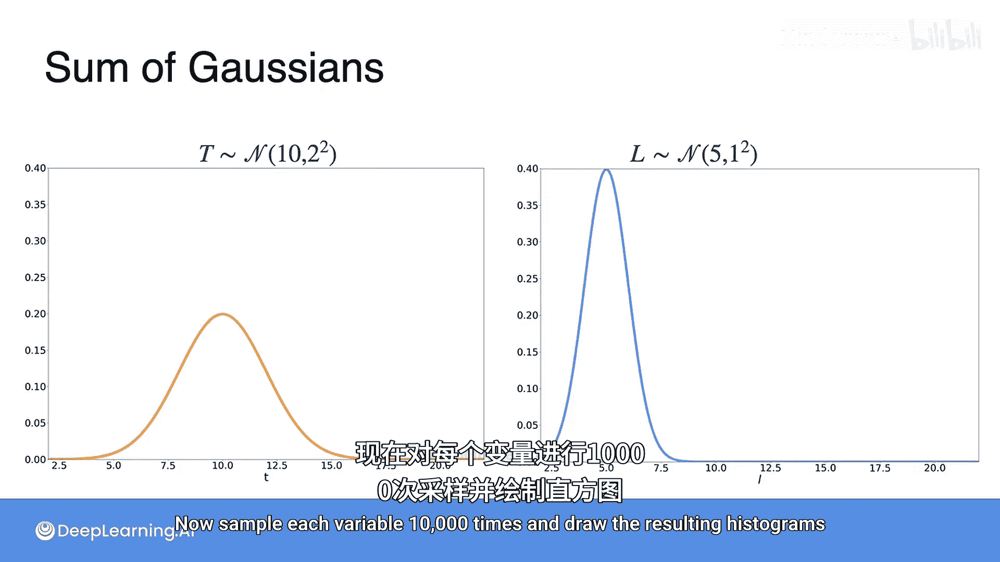

Now with these samples， you can now generate 10，000 samples off the response time， let's do it。

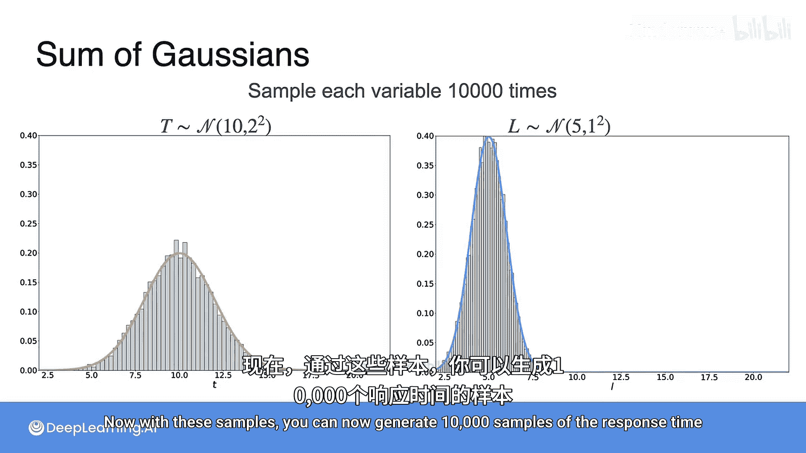

When you generate them， this is how the histogram looks。

 the histogram for the sums of each processing time and each latency and notice that R is still Gausian Now the question is what are the parameters of this Gausian well let's begin with mu。

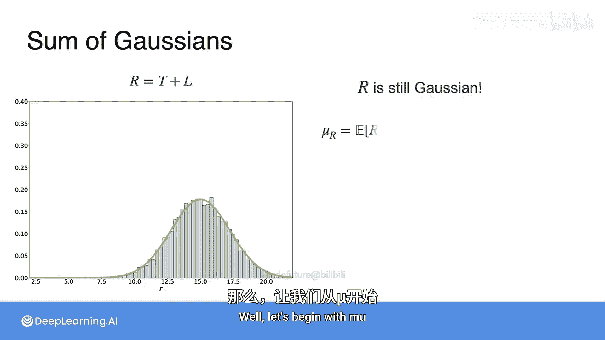

M is easy because it's the expected value of R and that's the expected value of t plus L。

 but since expectation is linear， then that's expected value of t plus expected value of L or mu of t plus mu of L if you remember correctly。

 the expected values were 10 and 5， so this one is 15。😊。

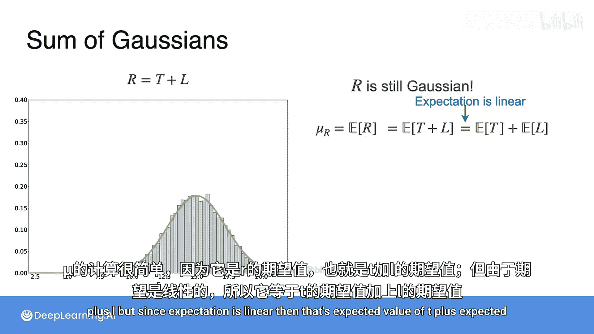

And now let's look at the sigma for this new variable。

 which is the square root of the variance of r again。

 this will be the square root of the variance of t plus L。😊，Now this is not the general result。

 but since T andL are independent， it turns out that the variance of the sum is the sum of the variances。

 so this is variance of t plus variance of R， in other words sigma of r is sigma of t squared plus sigma of L squared。

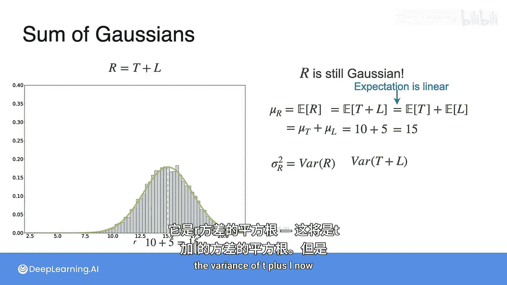

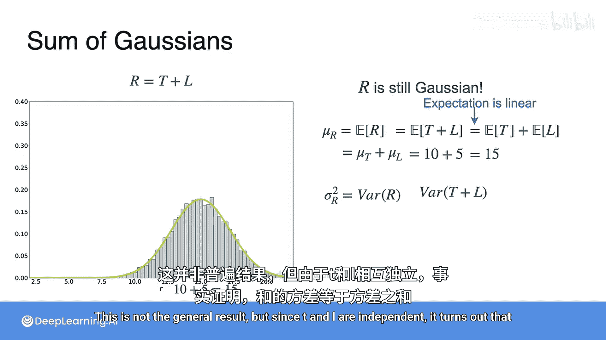

And that's 4 plus1， which is 2。2361 or5。

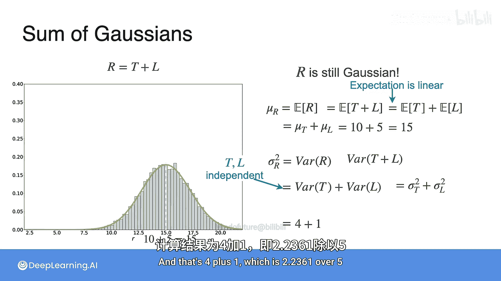

The resulting R is Gaussian where the mean is1 plus 5， the sum of the two means。

 and the standard distribution is5， the square root of the sum of squares of standard distributions。

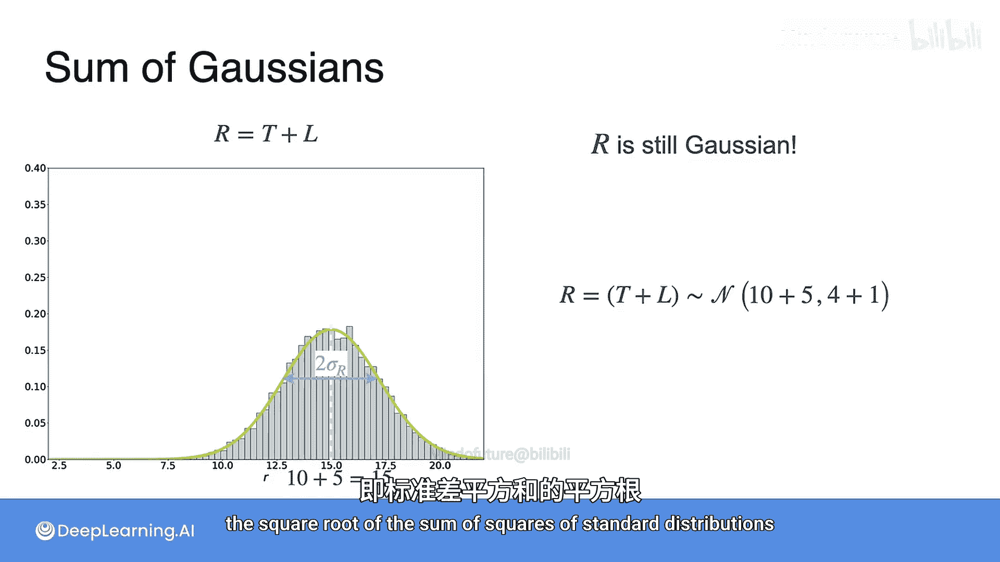

Now， in general， if you have a linear combination of variables where x and y are both Gaussian with parameters。

 mu x sigma x and mu y sigma y， and both of them are independent。

 then the resulting variable follows a Gaussian distribution with mean a mu of x plus b muu of y and variance a squared sigma x squared plus b squared sigma y squared。

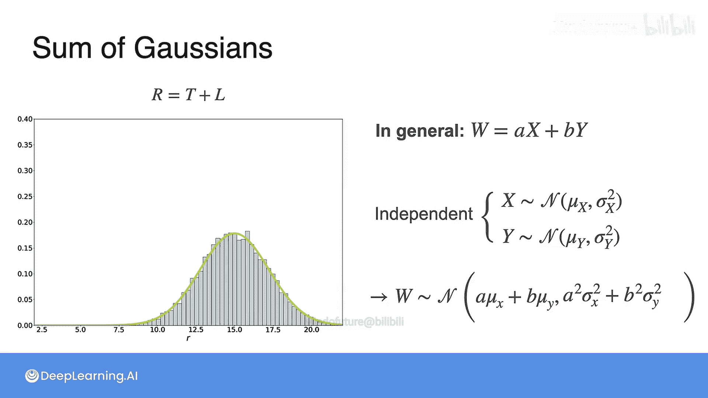