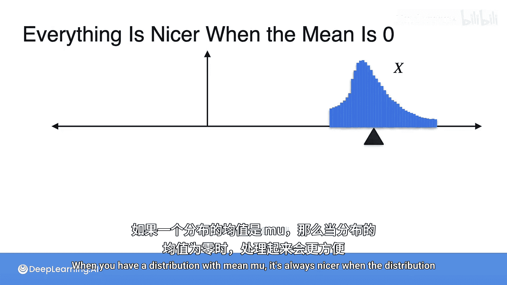
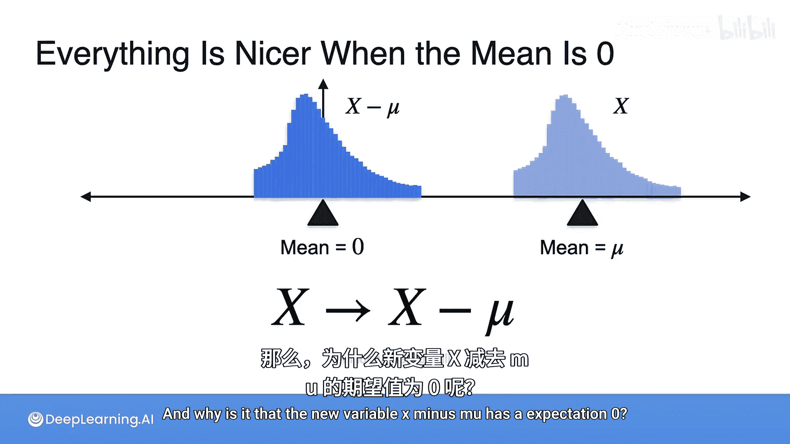
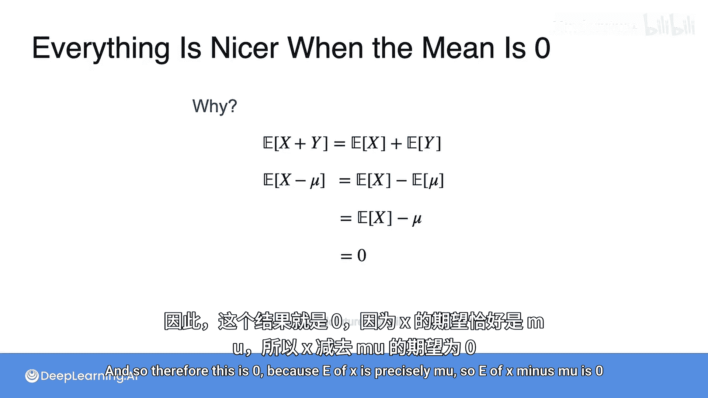
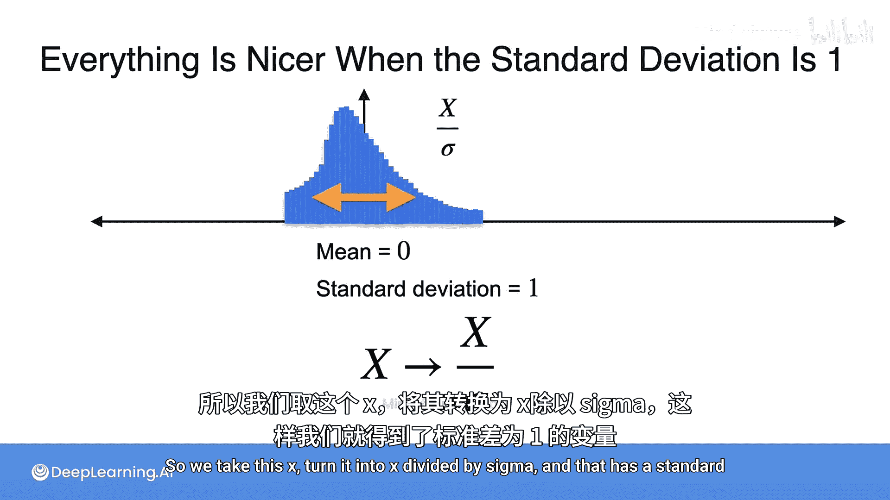
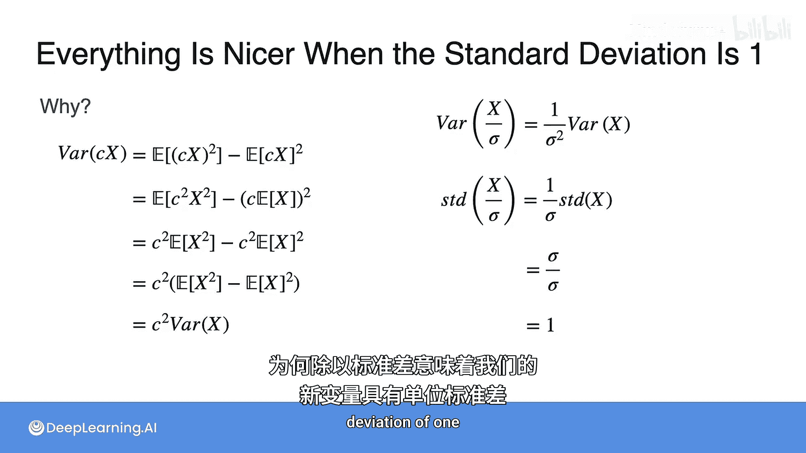
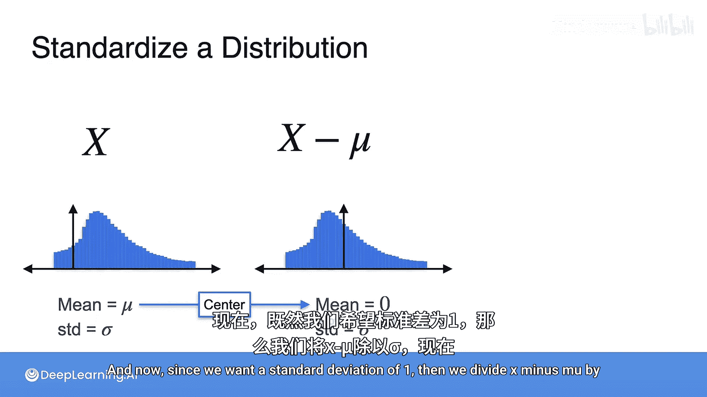
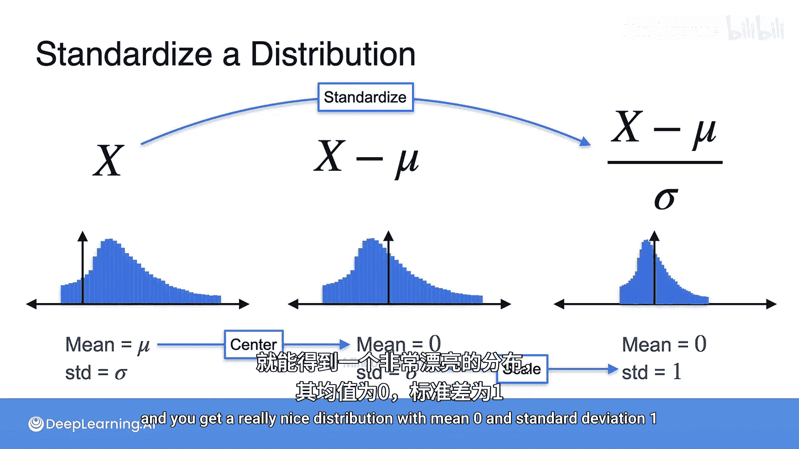
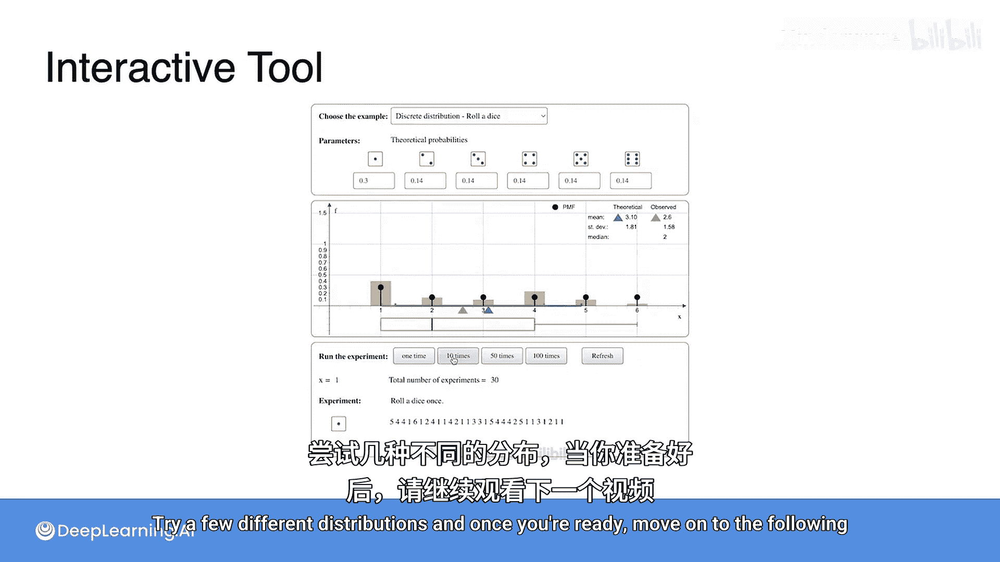

# 【Deeplearning】机器学习和数据科学概率与统计3 ｜ Machine Learning Probability And Statistics 吴恩达 p38 P38_分布的标准化_02_01_08 -BV1c86VBrE93_p38-

So let's formalize something we saw already when you have a distribution with mean mu。

 it's always nicer when the distribution has mean  zero。

 So one thing you can do is subtract mu and get a new distribution with mean zero。

 and this one is simply x minus mu is the variable x minus mu where mu is simply a fixed number which is the mean of the distribution So this is common practice when you have a variable x actually maybe better to consider x minus mu and y is it that the new variable x minus mu has expectation0 Well remember that expectation is linear so you can take the expectation of x plus y as the expectation of x plus the expectation of y。

 therefore the expectation of x minus mu if we let y equals minus mu is the expectation of x minus the expectation of mu but the expectation of mu is simply mu because mu is a constant and so therefore this is0 because e of x is precisely mu so e of x minus mu is0。

 Now here's another trick that。

Very useful When you have a distribution。 and let's say we already have mean equal0。

 and if the standard deviation is sigma that measures the spread。 Well。

 in the same way that we want the mean to be0。 we kind of want the standard deviation to be 1。

 It's always nice when the standard deviation is1。 So what do we do Well。

 if the original random variable with x and has a standard deviation of sigma。

 then x divided by sigma has a standard deviation of1。

 So we take this x turn it into x divided by sigma and that has a standard deviation of1 and the math is the following。

 the variance of Cx where c is a constant is the expected value of cx squared minus the expected value of cx all squared and because we can take away the constants outside。

 then the part of right is C of x squared and we can also take the c squared from the first one So we factor。

C squared and we get E of x squared minus e of x squared。

 and that's c squared variable of x so I can take a constant out of the variance。

 but it comes out as a square。 Now let's take a look at variance of x divided by sigma on the right。

That's one over sigma square variance of x because precisely one over sigma is that constant C in the left。

 and if we take the square root， we have that the standard deviation of x over sigma is 1 over sigma times the standard deviation of x。

Because we took the square root of everything on the right side so the one over sigma square becomes one over sigma and the variance becomes a standard deviation。

 this is sigma divided by sigma which is1 and that's why divided by sorry and that's why dividing by the standard deviation means our new variable has a standard deviation of1 so to summarize this is how is standardized distribution you have the distribution x with mean and standard deviation sigma。

If you subtract mu， you get a new one x minus mu with means 0 and standard deviation still sigma。

 this is called centering a distribution。And now since we want a standard deviation of 1 then we divide x minus mu by sigma and now we have a mean of 0 and a standard deviation of 1。

 and this is called scaling and this whole process is called standardizing so anytime I say standardize a distribution。

 you do this， subtract the mean， divide by a standard deviation and you get a really nice distribution with mean zero and standard deviation1。

Next you'll find an interactive tool that lets you sample from several different distributions and visualize the results。

 you'll be able to see the mean， median and standard deviation of the data you collect and compare those results to the theoretical values you'd expect。

 try a few different distributions and once you're ready， move on to the following video。

