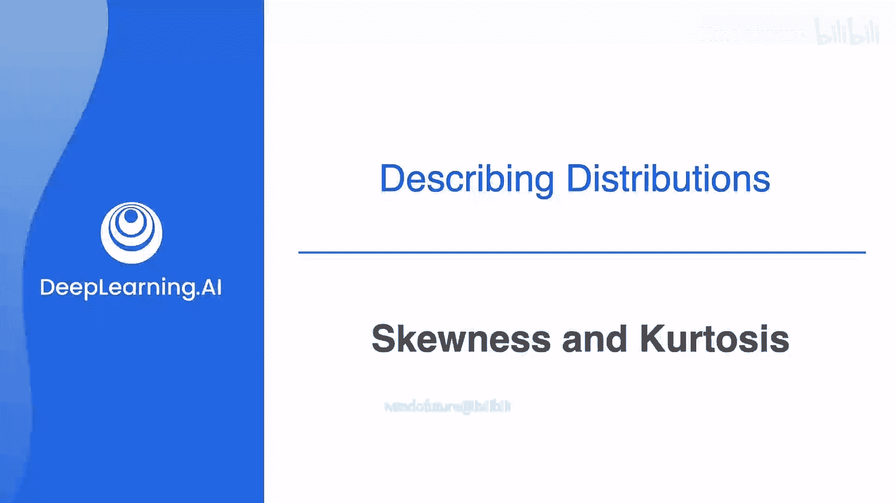
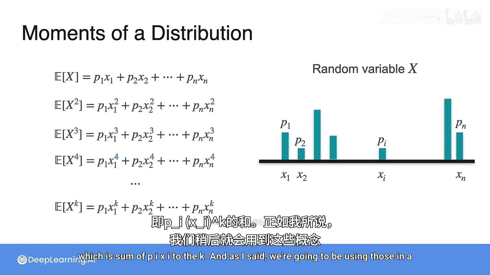

# 【Deeplearning】机器学习和数据科学概率与统计3 ｜ Machine Learning Probability And Statistics 吴恩达 p39 P39_偏度与峰度分布的矩_02_01_10 -BV1c86VBrE93_p39-

So as you can see， the expected value and the variance or standard deviation paint a really good picture of the distribution。

 however， there are a lot of subtleties that are not captured by them。

Some of them are called skewness and kptosis， and let me show you what they are。

So before we get into other ways to measure distribution。

 let me tell you about the moments it's something you already seen， but we can formalize it here。

 so let's say you have a random variable that can take the value minus2 with probability 13。

 the value 0 with probability 16 and the value1 with probability 12 so what is the expectation it's 1 third times minus2 plus 16 times 0 plus 12 times1 whatever that is。

What's the expectation of the variable squared， well it's the same thing except you take the value squared times the probability？

Now those are called the first and the second moment， E of x is the first moment， the expectation。

 and E of x squared is the second moment which is related to the variance not exactly the variance because you have to center but is related to the variance。

What do you think goes next Well， we can continue with the third moment which is e of x cubed。

 the expectation of thearrow cubed and so on， and the case moment is the expectation of the variable to the k。

And those are going to be pretty useful in a bit。So in general。

 if the random variable can take the values x1 up to Xn with probabilities p1 up to Pn。

 then the first moment is sum of pi X， the expected value， the second moment is sum of P X squared。

 third moment is sum of pi X cubed， the fourth moment is sum of pi X to the fourth and so one until the case moment which is sum of P X to the K and as I said。

 we're going to be using those in a bit。

