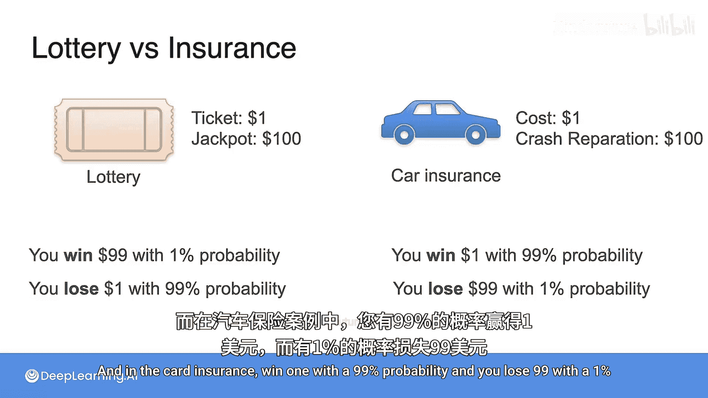
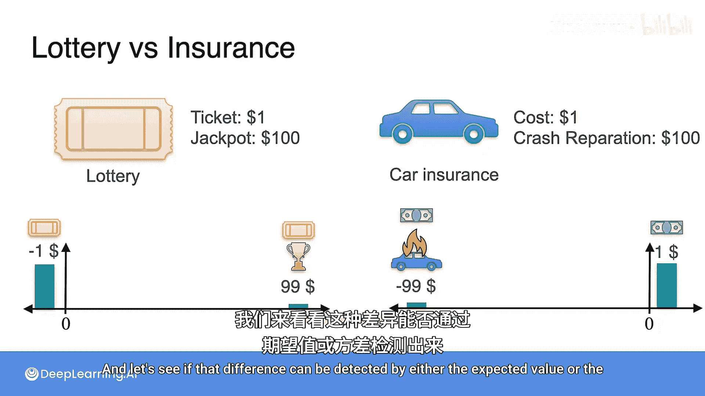
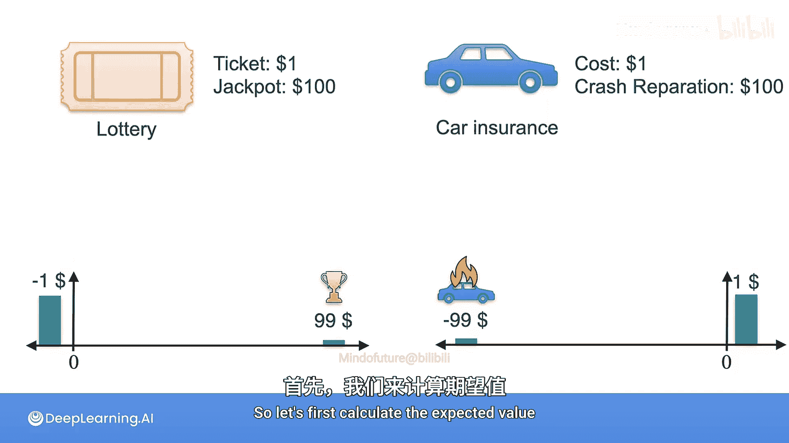
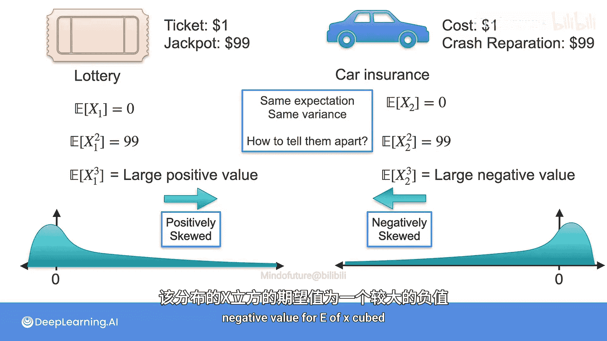
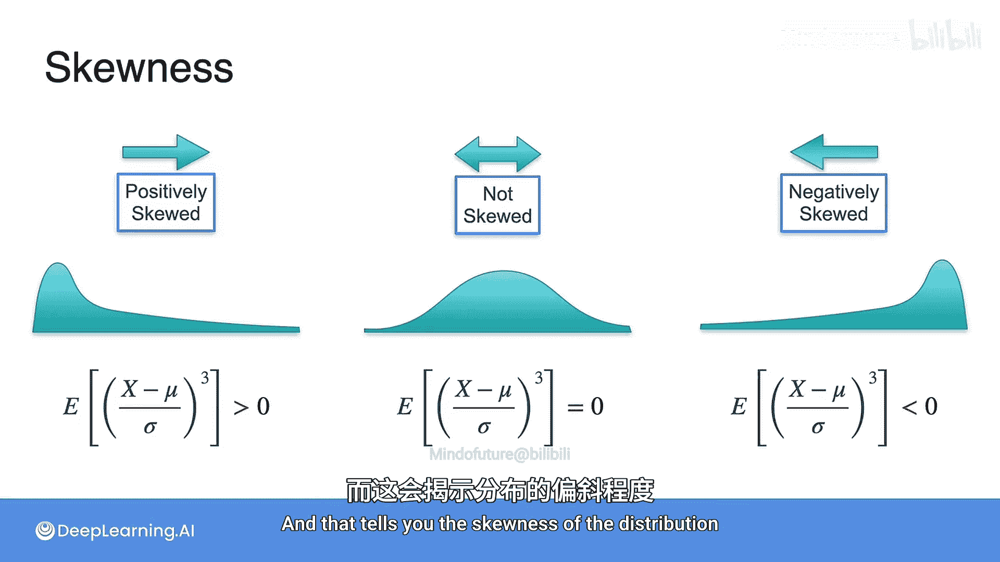

# 【Deeplearning】机器学习和数据科学概率与统计3 ｜ Machine Learning Probability And Statistics 吴恩达 p40 P40_偏度与峰度偏度_02_01_11 -BV1c86VBrE93_p40-

Now， let's actually change the scenario a little bit In one scenario。

 you are going to be playing the lottery and in the other scenario。

 youre going to be the owner of a car insurance company。

And bear with me for the numbers so if you're playing the lottery。

 then you buy a ticket that costs $1 and the jackpot is $100 so you can win $100 and you pay $1 so what can you win well？

If you win the lottery means you paid $1 and you won 100。

 so you won 99 and you win it with 1% probability， the probability that you win this lottery is 1%。

And with 99% probability， you don't win it， which means you lose1 dollar because you paid that dollar in your ticket。

Now keep these numbers in mind now let's say that you sell car insurance。

 you are the car insurance company and people buy car insurance from you。

 so let's say you only have one client and that client buys car insurance and it costs $1。

And the client could crash or not crash， and if the client crashes， then the reparation is $100。

 which means you have to pay 100 to repair the car。And the probabilities are similar as before。

Because the probability that the client crashes the car is 1% so with 99% probability。

 the client will not crash the car and you will win 1 because they paid 1 for the insurance and with a 1% probability you will gain the dollar and lose 100 because you have to pay for the crash reparation so with 1% probability you lose 99 if you look at these two games they are the exact opposite right in the lottery you win 99 with a 1% probability and you lose one with a 99% probability and in the car insurance win one with a 99% probability and you lose 99 with a 1% probability so let's plot them。

Over here in the lottery， here is the dollar you lose if you buy the ticket and don't win the lottery and here's a 99 you win if you buy the ticket and win the lottery。

 and on the car example， here is the $1 you win when they buy insurance from you and they don't crash and here's a 99 that you lose if somebody buys insurance and then they crash。

So as you can see， this is the same game but reflected over the horizontal axis。

 so now let's start calculating things。As you can see。

 these two games or these two scenarios are tremendously different。

And let's see if that difference can be detected by either the expected value or the variance。

 so let's first calculate the expected value。

So when you calculate it， you can see that it's zero because here it is。Exive value of x1。

 the first scenario is going to be called x1， the lottery。

And the expected value is well minus1 times 0。99 because you lose that dollar with probability。

99 plus 99 times 0。01 because you win 99 with a probability of 0。

01 and that's actually 0 and E of x2 the car insurance variable is also 0 because you lose 99 with probability 0。

01 and you win 1 with probability0。99 so these two games have the same expected value which is 0 that means that on average you play this lottery many times you're going to be gaining an average of 0 and if you are the car insurance company and you sell a lot of insurance policies on average you're going to be making 0。

So we did not succeed at telling these two scenarios apart using the expected value。

 so what about the variance？Well， what's the spread of this distribution versus the spread of this distribution They seem to have the exact same spread because theyre reflections of the other one and you can determine this by actually calculating the variance of x1 now the variance is just E of x squared because its already centered so its minus1 squared times 099 plus 99 squared times 0。

01 and that's 99 and the variance of the other one is the exact same calculation which is 99 so。

The variance of these two games is the same， the expected value of these two games is the same。

 but theyre vastly different games， so how do we tell them apart Well remember that the variance is e of x1 squared minus e of x1 all squared and the same thing for x2。

And E of x 1 is 0 and E of x2 is0， so these ones don't really matter。

 so in reality we were looking at the second moment。

So these two distributions have the same first moment and the same second moment。

So how do we tell them apart if they have the same first moment and the same second moment？Well。

 what about the third moment， why don't we calculate the third moment e of x1 cubed。

 that's negative 1 cubed times 0。99 plus 99 cubed times 0。01。

 that's 9702 for the left scenario one of the lottery and for the one of the car insurance。

 it's the same calculation but with negatives on the wrong places， so it's negative 9，702。

So that's it We're going to use the third moment， the expected value of the cube of the variable to tell them apart and what the cube takes into account is that for the first distribution there's some values that are really really far away to the right because at the end of the day is that 99 cube which is making the difference the positive 99 cubed is the one that takes most of this calculation with it and on the other one there's this negative 99 that's the one that dictates pretty much this number of minus 97002 because the other number is very small and that means that some values are very far to the left so in other words the cube of the variable detects if you have numbers that are skewed towards the right or skewed towards the left Let me show this to you in a more continuous example the distribution on the left is going to have a very high third moment E of x1 cubed because it's positively sd positively。

Q is a term we used when there's more values towards the right very far than towards the left so sd towards the right and the other distribution is negatively swed which means it has values very far towards the left and that one has a large negative value for E of x cubed so the magic value here that's helping us is the expectation of x cubed that's almost called a sness we still need to standardize so the sness is the expected value of the centered and standardized distribution so expected value of x minus mu divided by sigma cubed。

So we have three cases when the distribution is positively skewed towards the right then e of x minus mu divided by sigma cubed is bigger than 0 when it's not skewed it means that it looks more symmetric and the expected value of x minus mu over sigma cubed is going to be0 and finally when it's negatively skewed that it has a lot of values towards the left then e of x minus mu divided by sigma cubed is less than0 so the moral of the story is when the first and second moment don't help you go to the third one and that tells you the skewedness of the distribution。

