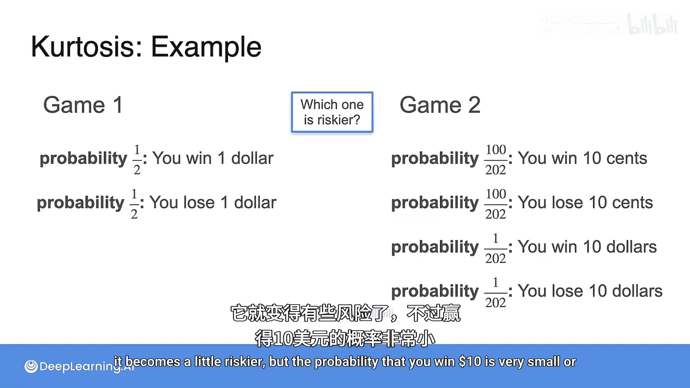
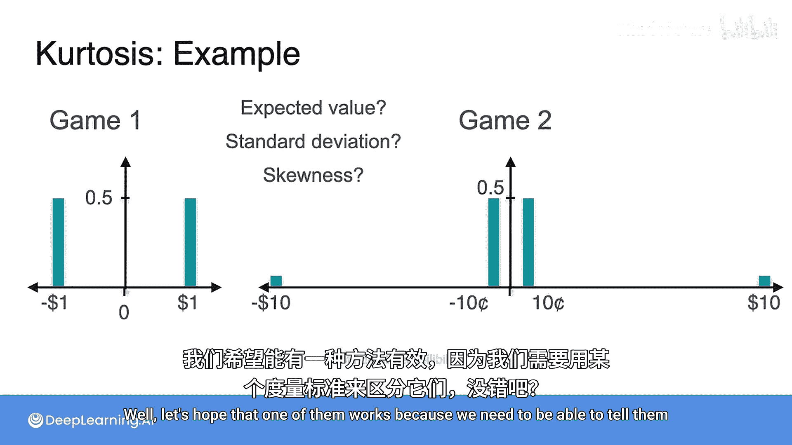
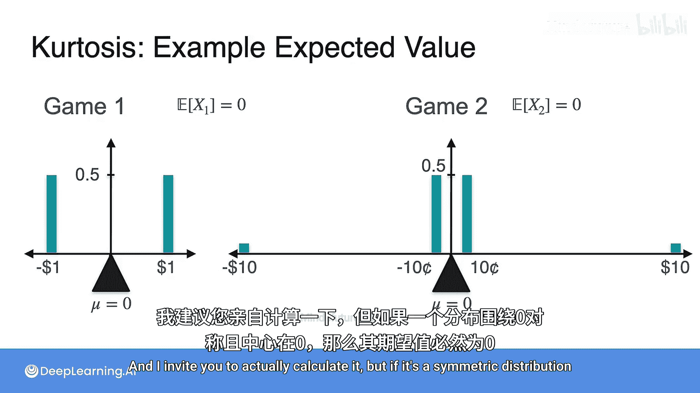
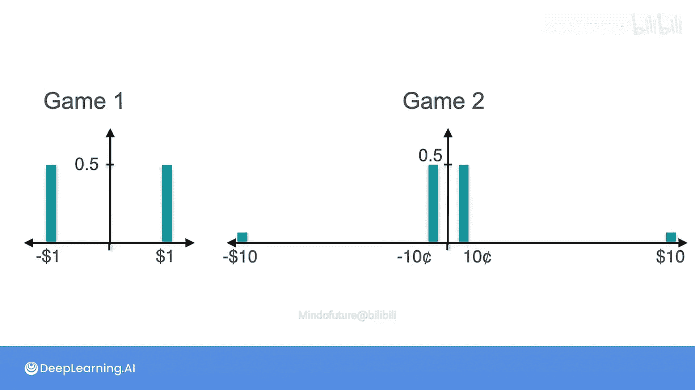
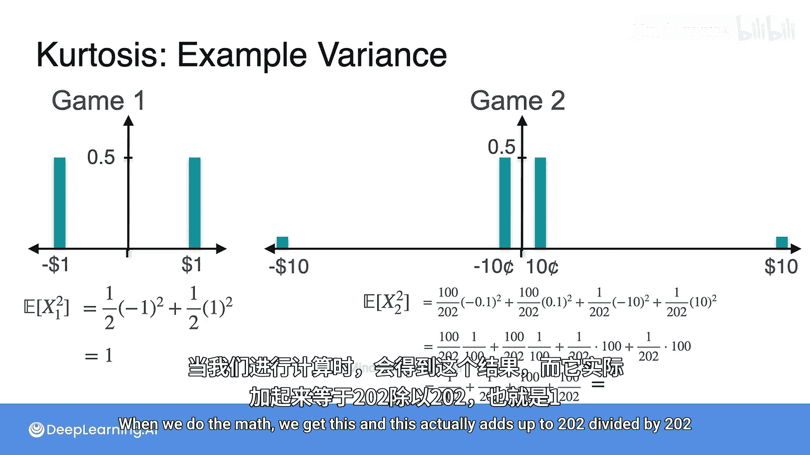
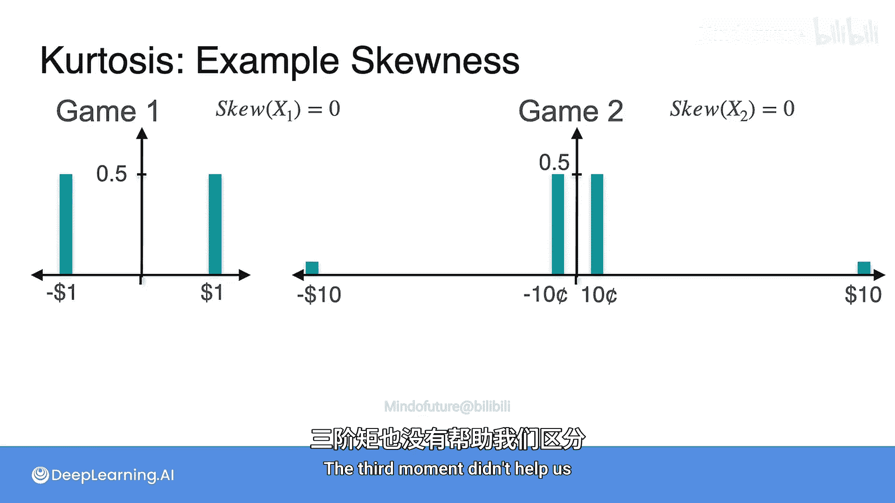
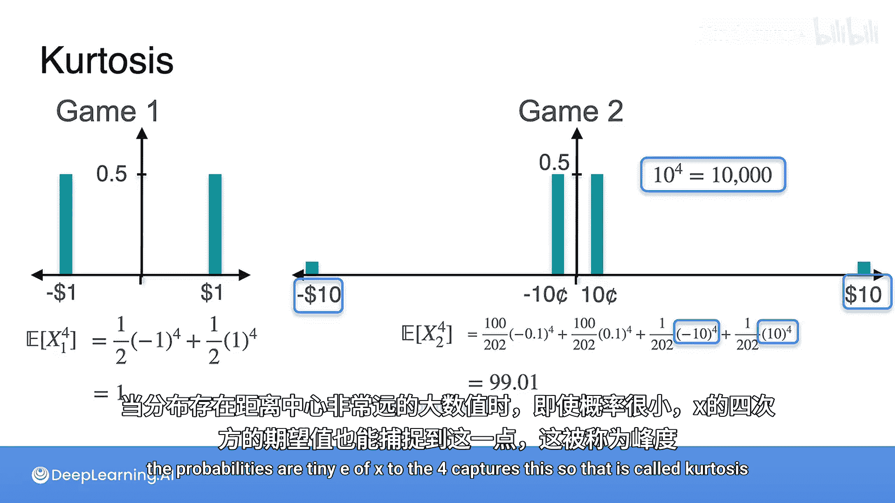
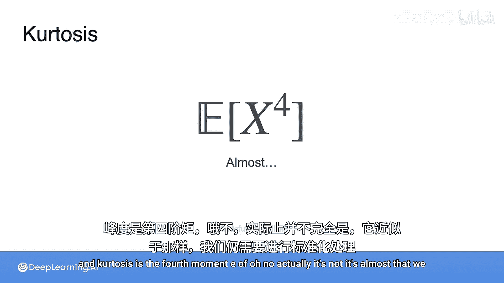
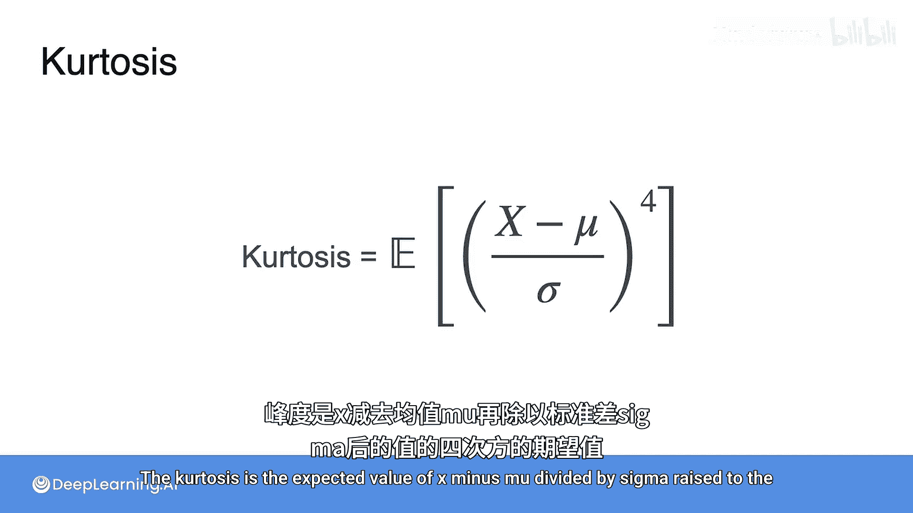
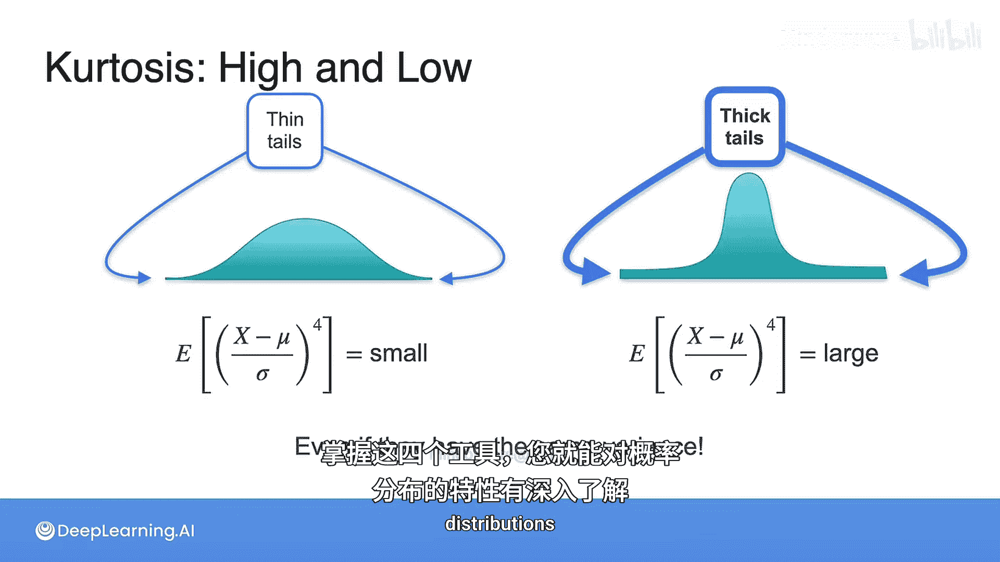

# 【Deeplearning】机器学习和数据科学概率与统计3 ｜ Machine Learning Probability And Statistics 吴恩达 p41 P41_偏度与峰度峰度_02_01_12 -BV1c86VBrE93_p41-

So now that you've learned expected value， variance and skewness。

 let me show you two new games game one is the following with a probability  one half you win 1 and with probability  one half you lose 1 that's like tossing a fair coin。

So that's the game we've seen already many times。Let's have a second game where with probability almost a half。

That's 100 divided by 202， U win 10 cents。With probability 100 over 202。You lose 10 cents。

 so it's a less risky game except that there's a tiny probability that you win and lose a lot more。

 so with probability  one over 202 you win $10 and with probability  one over $202 you lose 10。

So in the game on the left， you win a dollar or you lose a dollar and in the game on the right。

 you could win 10 cents or lose 10 cents with much higher probability。

 but there's also a small chance that you win or lose $10， so here's a tricky question。

 which game is riskier。See， the gain2 seems a lot more conservative with the 10 cents。

 but once you throw in the $10， it becomes a little riskier but the probability you win $10 is very small or that you lose $10。

 so let's calculate the variance。

But before calculating the variance let's actually calculate the expected value。

 in other words let's take a look at the games as distributions。

 so here's game one where you can win a dollar or lose a dollar with probability a half we've seen that one many times。

Gin two， you can win 10 cents and lose 10 cents with probability almost a half。

And then there's a small chance that you make $10 or that you lose $10 Now those two distributions are very different。

 so do you think we'll be able to tell them apart with expected value or with standard deviation or with skewness well let's hope that one of them works because we need to be able to tell them apart with some metric right they are different games。

First let's calculate the expected value and as you can see the expected value is not much hope because it's  zero for both。

 they're both centered right， so for the left one is 0 and for the right one is 0 and I invite you to actually calculate it but if it's a symmetric distribution center around 0。

 then the expected value has to be0。

Now let's look at the variance， what do you think happens with the variance。

 this one' is going to tell us which one is riskier， let's look at e of x1 squared。

So this number is a half times minus1 squared plus and half times 1 squared which as we've seen many times is1。

 but now let's look at e of x2 squared x2 is the amount of money you gain on the second game well this one is 100 over 202 times minus0。

1 squared plus 100 over 202 times 0。1 squared plus 1 over 202 times minus 10 squared plus 1 over 202 times 10 squared because its the sum of the probabilities times the squares of the values。

When we do the math， we get this and this actually adds up to 202 divided by 202， which is one。

 so believe it or not， these two games have the exact same variance。

 neither one of them is riskier than the other one。

Vararianance of x1 is 1 and variance of x2 is 1， so when you take the square root they have the same standard deviation and thats not so convenient。

 we couldn't tell them apart using expected value or using variance。

Do you think we have a hope with skewness well remember that distributions that are symmetric around the midpoint have skewness of0。

 so both of these have a skewness of 0， they're not skewed towards the right or towards the left they're both symmetric。

 so skewness is also not going to help us。So who can help us the first moment didn't help us。

 the second moment didn't help us， the third moment didn't help us， I wonder。

 so to summarize both have a skeness of0， both have a variance of1。

 both have a mean or expectation of zero， however something interesting is happening here。

 how would you tell them apart， how would you describe to someone that these two are different。

 one way to describe it is to say well？

The one on the right has values that are really far away from zero， maybe we can capture that。

So let's go back to moments。 The first moment is 0。 the second moment is 1， the third moment is 0。

 and the same thing happens for x2。What moment should we go for？What about the fourth moment。

 maybe the fourth moment can help us， let's take a look， what is E of x1 to the fourth on the left？😊。

Well， it's a half times minus1 to the fourth plus a half times 1 to the fourth， which is again one。

And what is e of x2 to the fourth Well let's take this calculation。And see what happens， that is 99。

01 that is huge， why is it huge because this minus 10 to the fourth and these 10 to the fourth are 10。

000 and thats a big value。So。When the distribution has very large numbers。

 very far away from the center， even if the probabilities are tiny。E of x to the4 captures this。

 so that is called corosis。

And courtosis is the fourth moment E of E oh0 actually its not。

 it's almost that we still need to standardize。

The kosis is the expected value of x minus mu divided by sigma raised to the fourth power and what does kosis say of a distribution。

 well in a case like this where the tails are very skinny， the kosis is small。

 but in a case like this where the tails are thicker， then we have a large ketosis， so same tails。

 small corosis， thick tails， large kosis， even if they have the same variance。

 the variance may still not be able to pick up。

Because even if you have thick tails you may have a very skinny distribution in the middle。

 but kosis is a much more sensitive measure for the thickness of the tails of the distribution。

 so we've learned many ways to tell distributions apart expected value。

 variance for standard deviation， skewness and kosis with these four tools you'll be able to say a lot about your probability distributions。

