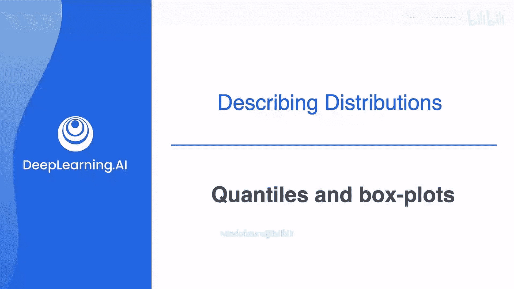
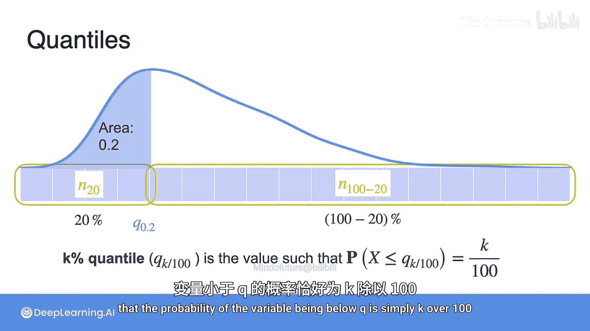

# 【Deeplearning】机器学习和数据科学概率与统计3 ｜ Machine Learning Probability And Statistics 吴恩达 p42 P42_分位数与箱线图_02_01_13 -BV1c86VBrE93_p42-

You've learned several ways to describe your data numerically but for a data scientist it's tremendously important to be able to visualize the data correctly in this video I'm going to show you several ways for visualizing data so let's begin by considering a data set we're considering an advertising sales data set and the newspaper a budget so if you took course two from this specialization you're already familiar with it this data showed the newspaper TV and radio budgets and the sales revenues generated。

For simplicity， let's consider only 12 samples from the newspaper ad budget。

From this small sample you may want to infer the median。

 remember the median is the point that splits your data in half。

 so first you will need to sort the absurd values in increasing order and then since you have 12 data points then you can evenly split the dataset into these two hals with six samples each and the median is simply the average of the two values in the middle。

That is 27。8， we call that the 50% quaile or the second quarile and those names will make more sense in a minute。

So what about the point that leaves one quarter of the data to the left and three quarters to the right？

Or in other words， the average of these two， well， that's 18。

35 and that's the 25% quantile or the first quarile we call it Q1。So it's kind of like the median。

 but it doesn't cut it into half half， but into one quarter， three quarters。

 and we can call it little Q of 0。25 or big Q of 1 for first quartile。And in general。

 you can do this for any percentage， the K percent quantile is the value that leaves K% of your data to the left and 100 minus K% of the data to the right and which is denoted as little Q of k divided by 100。

And some common quailes are the 25% one， the 50% one and the 75% one， 25% one。

 as you saw is the first quartile Q1。The 50% quantile is the median， which is Q2。

 and the 75% quantile is the third quartile， which is Q3。

So let's say your dataset set has npoint and n subk correspond to the first K percent of data。

 so for example n20 here is the first 20% of data and n 100 minus N20 is the last 80% of the data。

 then we have that 20 divide by 100 is n subub 20 over n and that's the probability that the variable you're measuring x is below the K percent quantile in this case is Q0。

2 because that's 20%。And what we're doing is suppose that your data follows some distribution and that has a PDF which looks like the blue curve。

 so then the area under that curve for the K percent quantile in this case the 20% quantile should be k over 100 and so if you're computing quantile from distributions。

 you can say that the K percent quantile is simply the value such that the probability of the variable being below Q is simply k over 100。

