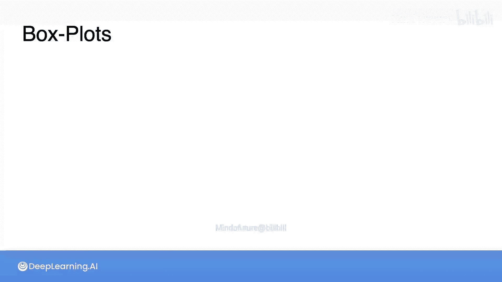
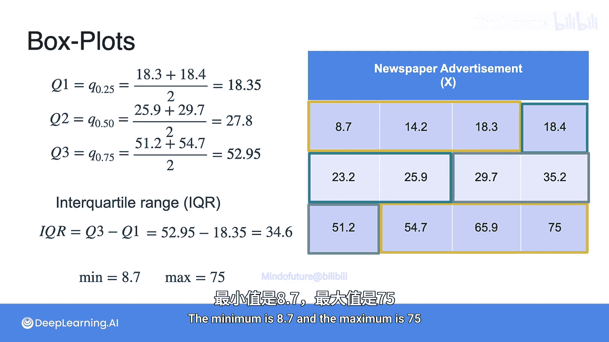
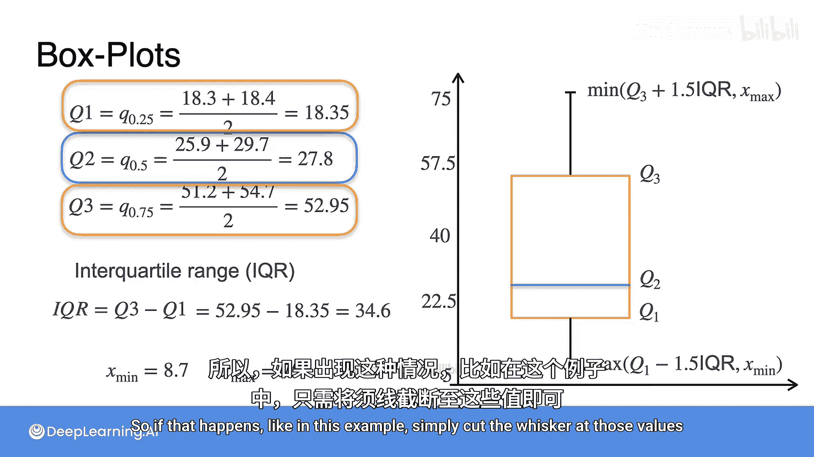
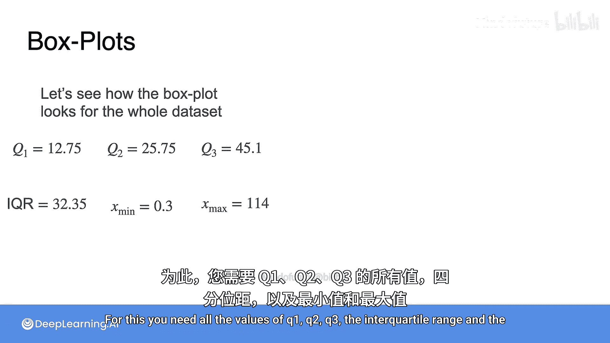
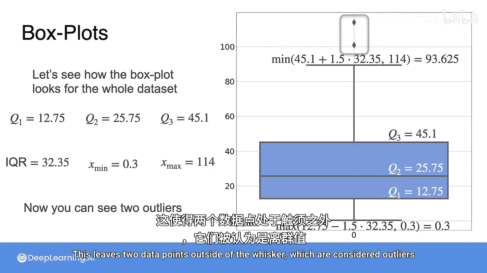

# 【Deeplearning】机器学习和数据科学概率与统计3 ｜ Machine Learning Probability And Statistics 吴恩达 p43 P43_数据可视化箱线图_02_01_14 -BV1c86VBrE93_p43-

Now there's a cool visualization called the box plot or the box and whiskers plot。

 which is a standardized way of displaying the distribution of your data based on five statistics。

 The minimum， the maximum， the median， the first quartile and the third quartile。

 Let's see how it works using our newspaper advertisement example。

 So to create a box plot you need to calculate the 3 quartiles。 That means the 25%1。

 the 50% one and the 75%1。 So let's divide the data into 4 blocks of the same size。

 The first quartile as you saw is the midpoint between 18。3 and 18。4。 The second one is the main。

 between 25。9 and 29。7， and the third one is the midpoint between 51。2 and 54。

7 Those are the 3 quartiles。 Now we're going call the inter quartile range as Q3 minus Q1。

 That's where 50% of your data lies and that's 34。6。

That's that difference between those two。And we're going to look also at the minimum and maximum values of the dataset the minimum is 8。

7 and the maximum is 75 and we're going to put all of that in one plot so let's start with the box it should go from the first to the third quartile that's from 18。

35 all the weight of 52。95 then we draw a line at the value of the median 27。

8 that's2 now it's time to draw the whiskers for this you draw two lines going from the end of the box until Q1 minus 1。

5 times the interquartile range which is the height of that orange box and when going from Q3 plus 1。

5 times the interquartile range which is Q3 minus Q1 however the whiskers should never go beyond the max and the minimum values of the dataset so that happens like it's this example simply cut the whisker at those values。

😊。

Now the box plot is very useful because just by looking at the plot you can get plenty of insight on your data in this case you can easily see that the data is skewed。

😊，Because Q3 minus Q2 is way bigger than Q2 minus Q1 for this small case。

 we can see that there are no extreme points or outliers since both whiskers end at the max and mean values If there are any values that are outside of the whiskers then we say that those are outliers are too far from the center Now the length of the box and the whiskers allow you to analyze the dispersion of the data Now let's take a look at the box plot obtained using all the data sets for this you need all the values of Q1 Q2 Q3。

 the interquartile range and the minimum and the max the minimum 0。

3 and the max is 114 with these values you get these box plot so these are the Q1 Q3 and Q2 notice that the bottom whisker goes from  Q1 to the smallest value of the dataset 03 while the upper whisker actually ands in 93。

6 to6 which is 1。5 times the IqR。

This leaves two data points outside of the whisker， which are considered outliers。

