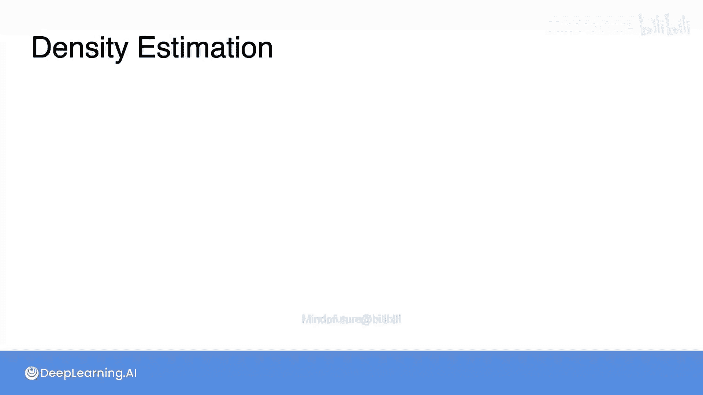
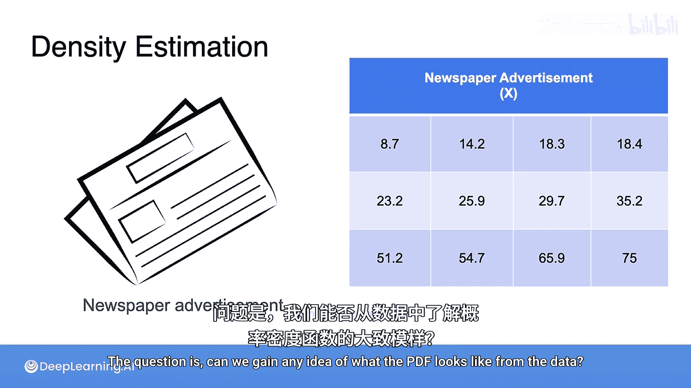
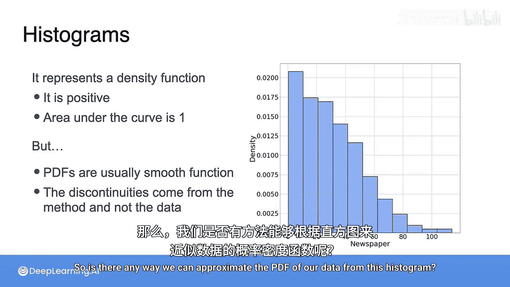
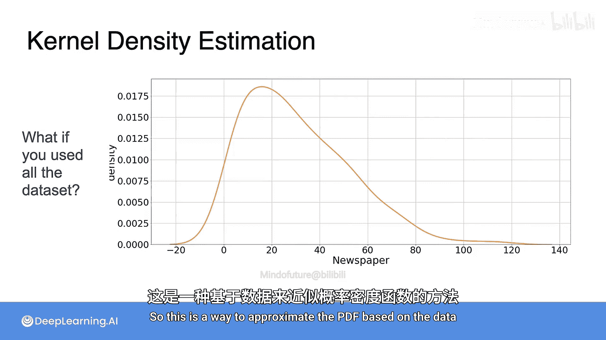

# 【Deeplearning】机器学习和数据科学概率与统计3 ｜ Machine Learning Probability And Statistics 吴恩达 p44 P44_数据可视化核密度估计_02_01_15 -BV1c86VBrE93_p44-

Now let's go back to the advertisement example All these samples seem to come from a continuous random variable you know by now that you can describe your data distribution for continuous variables with the probability density function or PDF The question is can we gain any idea of what the PDF looks like from the data Well I'm sure you're already familiar with histograms since doing a histogram of just 12 values doesn't make much sense let's plot the histogram for the whole data set technicalnly a histogram satisfies all the conditions of a density function It's positive and the area under the curve is one。

However， it's not a great approximation for one PDFs are usually a smooth function and also the discontinuities of the bars appear from the technique used to compute histograms and not from the data itself so in other words the actual distribution where these come from may have a pretty smooth density function but since we're taking a histogram it looks like it has a lot of peaks so is there any way we can approximate the PDF of our data from this histogram。

And it turns out there is and the method is called kernel densityy estimation。

 we start by making our observations in a graph。And then you want each point of your dataset set to have an effect that spreads around the observation point because we want high density where there's a lot of points and low density where there's no points。

 so let's put a little mountain in each of the points that means a small Gaussian curve on top of each data point this is called the kernel。

You could choose other functions than the Gaussian， but we're not going to get into that。

And the value of sigma you choose for the Gaussian density will determine how far the effect of each point spreads。

 it could be thin or it could be wide Now let's get back to the original plot。Lastly。

 all you have to do is multiply everything by one over end and sum all the blue curves。

Notice that since the area under each curve is one。

 the average of the curves must give us an area under the curve of1 and this is what estimation looks like after cleaning up the plot a bit。

 doesn't look so great but that's because you try to approximate a density from just 12 data points but if you try from many points。

 then you're actually going to get a really nice smooth function that actually resembles the PDF well。

 so this is a way to approximate the PDF based on the data。

