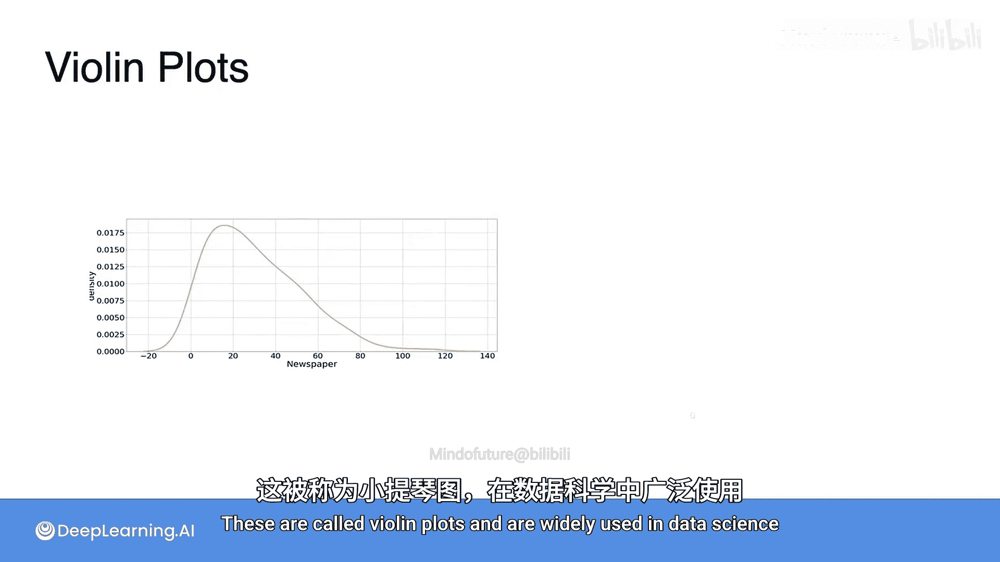
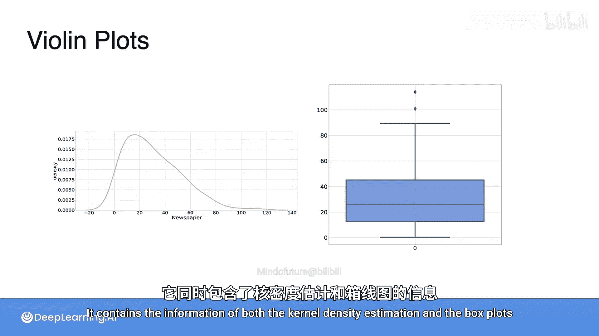
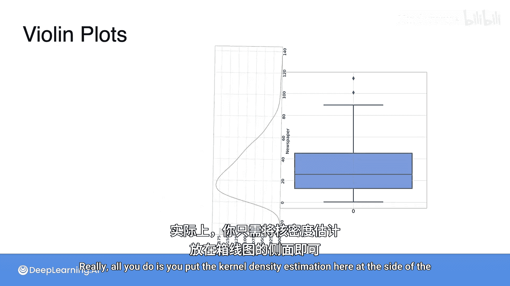
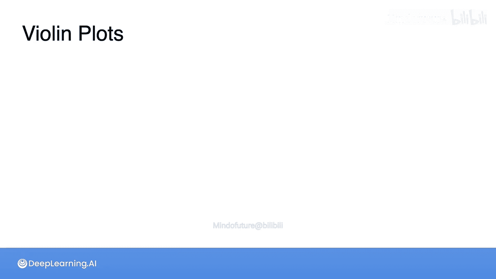
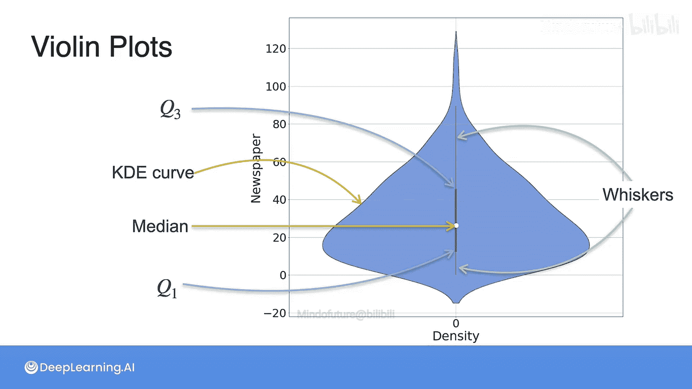

# 【Deeplearning】机器学习和数据科学概率与统计3 ｜ Machine Learning Probability And Statistics 吴恩达 p45 P45_数据小提琴图_02_01_16 -BV1c86VBrE93_p45-

So finally I want to show you one last visualization tool these are called violin plots and are widely used in data science what's so cool of violin plots。

 it contains the information of both the kernel densityti estimation and the box plot。😊。

Really all you do is you put the kernel density estimation here at the side of the box plot。

 let me be more specific， the viol plot looks like this。

Here you have the KDE curve， the kernel density estimation， here you have the mean。

 here you have the quartiles， and here you have the whiskers。

So that is the violent plot and as you can see， it's pretty useful。

