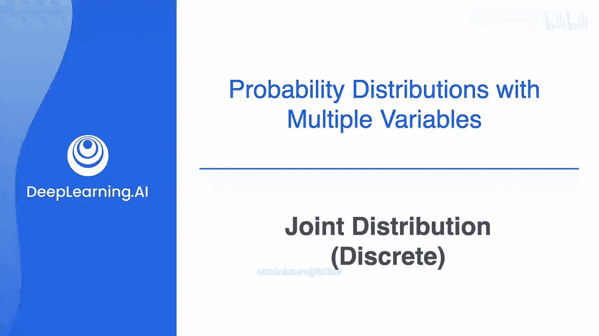
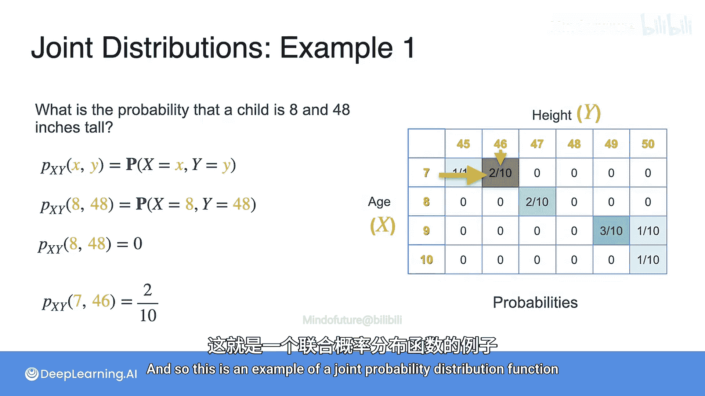

# 【Deeplearning】机器学习和数据科学概率与统计3 ｜ Machine Learning Probability And Statistics 吴恩达 p47 P47_联合分布离散第一部分_02_02_01 -BV1c86VBrE93_p47-

So previously you learned probability distributions for one variable， for example。

 the height of a population， but what if I want to look at two variables， for example。

 the height of the population and the age of the population that's two distributions。

 and I may want to look at them together and see how these two features combine。For that。

 we need a joint distribution， and that's what you're going to learn in this video。

So consider a simple data set of 10 children age 7 to 10， and count the children for each age。

 there's three children of age 7，2 of age 8，4 of age 9 and one of age 10 for a total of 10 children let's plot discount data here on a graph and it gives us this histogram over here where this is the number of children of each age。

Now， if we divide by 10， we can turn these numbers into probabilities， so the probability。

 for example， that a child is age 9 in this data is 0。4。Now， for the same children。

 let's say we capture their height data as follows。These are their heights in inches。

And we're going to generate another table with the number of children of each height rounded to the nearest inch。

And we can put these in a histogram of swell， notice that there's no child of height 48。

 but to complete the axis， let's bring that value back。Again， with a total of 10 children。

 now let's divide the counts by 10 to get the probabilities， so for example。

 the probability that a child is 47 inches is 0。2 in this dataset set。

So we have the data set ordered by these two metrics age and height now here's a question for you。

 what is the probability that a child is 9 years old and 49 inches tall in this data set Well let's see from the probability mass function for age how many children are 9 years old。

And we have four of them and looking at the graph the heights。

 only three of these four children are 49 inches tall。

 so dividing this three by the total of 10 kits， we get three out of 10 and the probability is 310s and we're going to call H H and。

height， y， those are two variables， and so the probability that a child is 9 years old and 49 inches tall。

 which is 3/10s can be written as p of X Y of 949。X， the H has to be 9 and y the height has to be 49。

More generally the joint probability of two discrete variables is denoted by p of capital x capital y。

 the name of the variables， of little x little y which are the values that I want these variables to take the 9 and the 49。

 and thats the probability that x which is age is equal to little x9 in this case， and that y。

 the variable for height is equal to little y which is 49。

But we can calculate this probably easier if we organize the data properly。

 so let's construct the joint counts for two variables and we're going to have something like this。

There's one child whose ages seven and height is 45， we put them here。

Then there's two children of age 7 and height 46 and they're here。

And then we have zeros for the rest of the row because theres no more children hide 7 then some zeros here and two children of H 8 and height 47 and then no more of age 8 and then there's three children of H 9 and height 49 and one of H 9 and height 50 and finally one of H 10 and height 50 and this is the table of counts which we can turn into a probability mass function when we divide everything by 10 and now we have the probabilities for each possible combination of data。

All possible combinations of x and Y are what's called a joint distribution。

 and in this case it's a discrete joint distribution because both ages and heights are discrete variables。

Now let's solve some more questions with this joint distribution。For example。

 what is the probability that a child is eight years old and 48 inches tall？

We call the formula for probability description variables。

 and this is going to be0 because there's zero children of age 8 and height 48， let's do one more。

The probability that the age is7 and the height is 46， that ones over here， which is 2 divided by 10。

And so this is an example of a joint probability distribution function。

