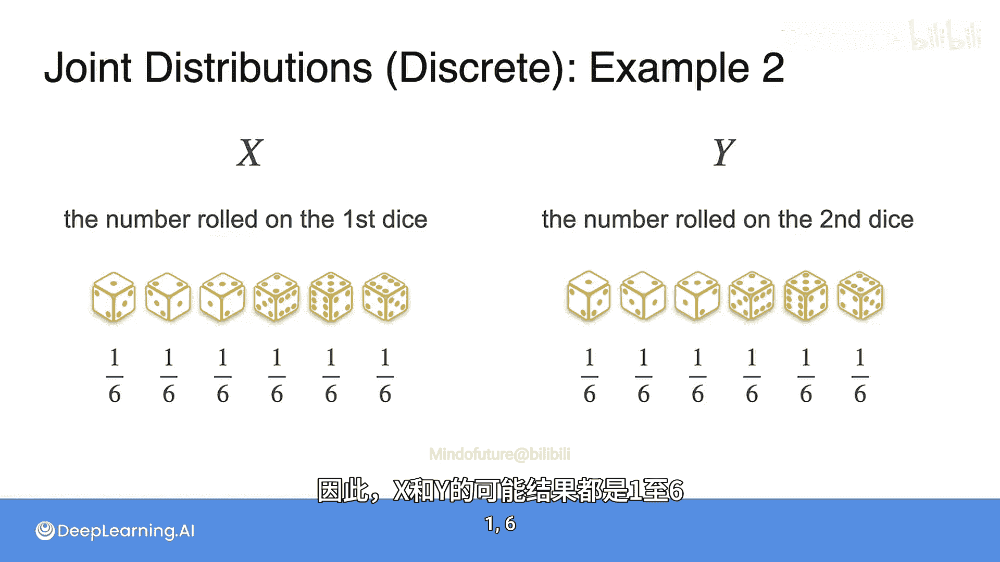
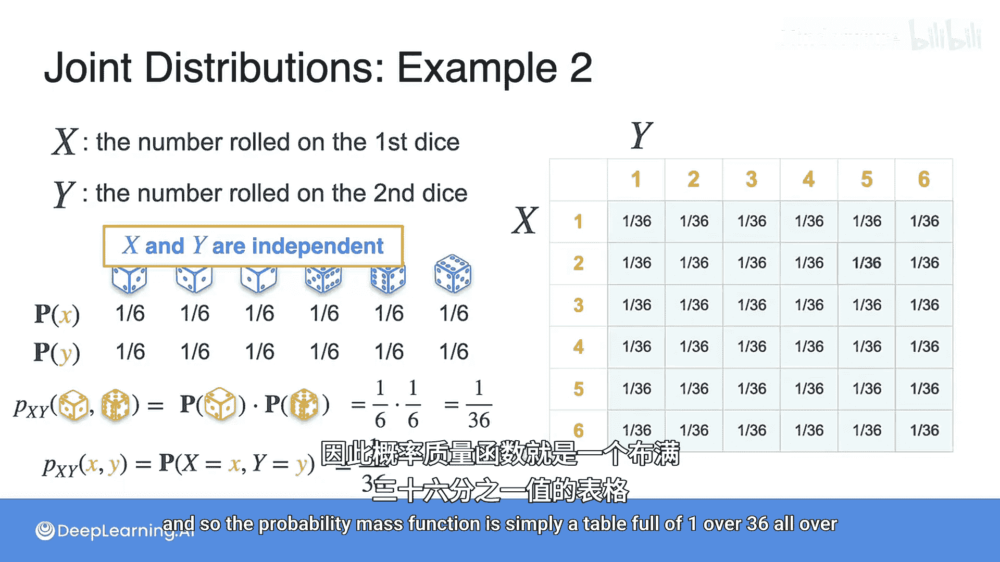
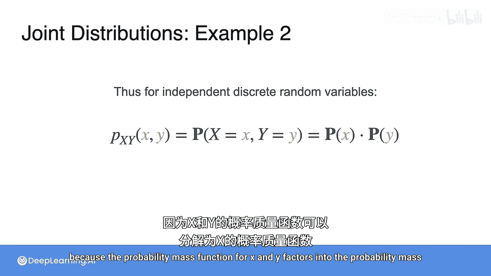
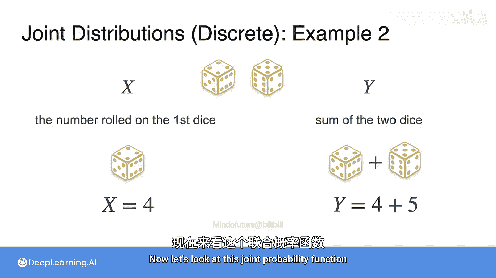
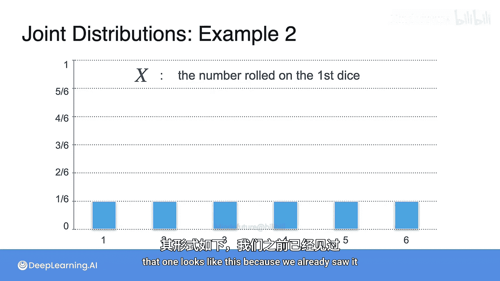
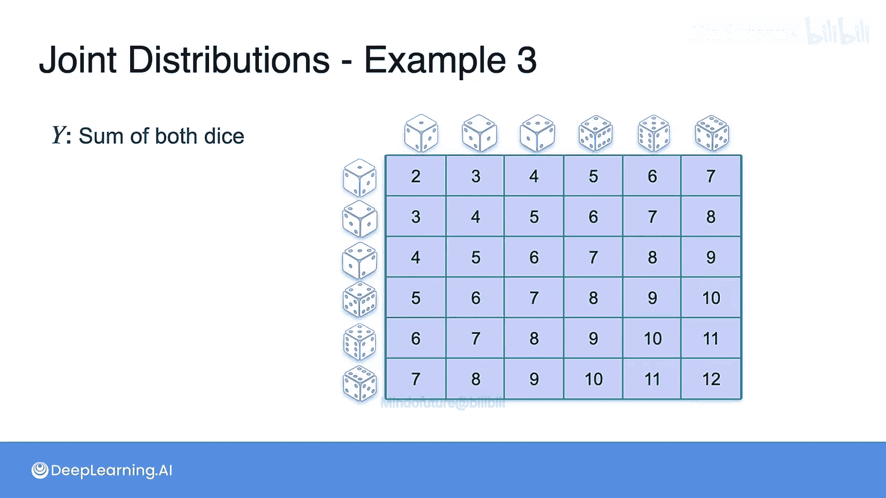
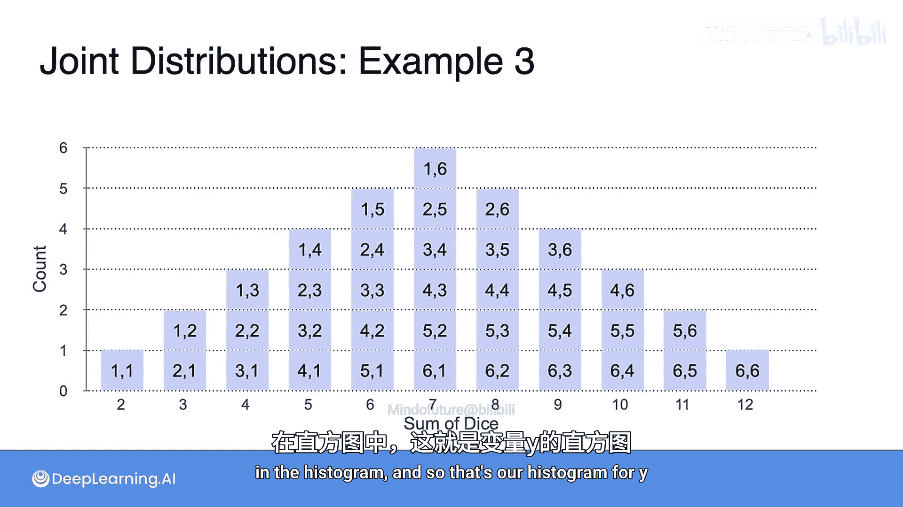
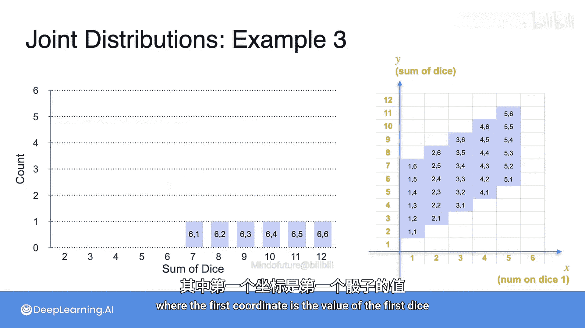
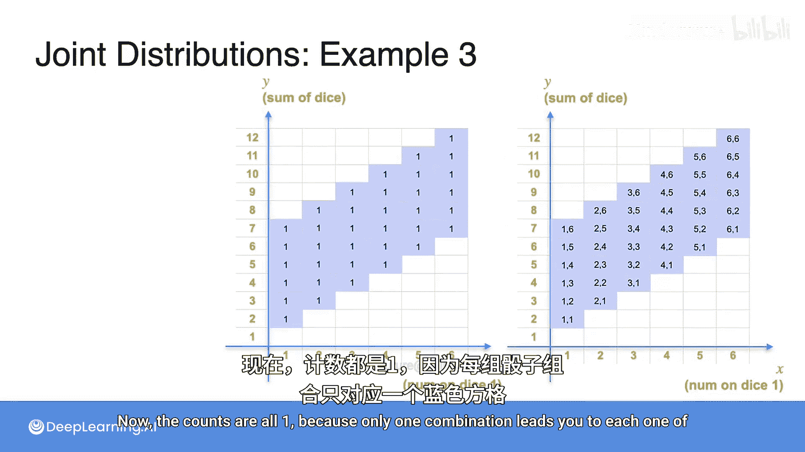
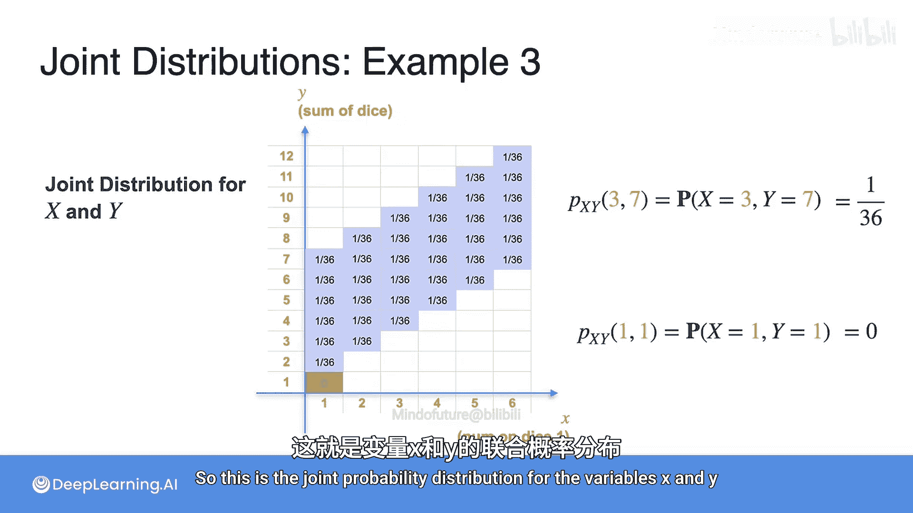

# 【Deeplearning】机器学习和数据科学概率与统计3 ｜ Machine Learning Probability And Statistics 吴恩达 p48 P48_联合分布离散第二部分_02_02_02 -BV1c86VBrE93_p48-

Now let's throw two fair excited dice， let X be the discrete random variable that indicates the number rolled on the first dice。

And why the one that indicates the number rolled on the second ice。

The possible outcomes for x and the possible outcomes for y are all probability 16 and theyre the numbers 1。

2，3，4，5，6 let's put the probability mass function of x and also of y because they're the same thing over here all the probabilities are 16。

So we have x as the number rolled in the first I and y as the number rolled on the second di。

 the individual PMmfs for each variable are as follows and notice that x and y are independent variables。

 so for example the probability。That x is2 and y is 5 is over here and it's going to be the product of the two probabilities 16 times 16 and so it's1 over 36 and that's going to happen for all the pairs because as we said they're all independent and so the probability mass function is simply a table full of1 over 36 all over the place so in the formula we have the following the probability mass function of xy is p of x equals x and y equals y which for independent discrete random variables is the product of the two this obviously is not going to be the case all the time。

 but when the variables are independent this is pretty simple because the probability mass function for x and y factors into the probability mass function of x at times the probability mass function of y。

Now let's look at a more complicated example you again throw a fair6 side dice and now x is the discrete random variable that indicates the number rolled on the first dice so for example here x is equal to4 and y is going to be another discrete random variable but this one is going to capture the sum of the two dice so if the first one is4 and the second one is 5 then y is going to be 4 plus 5 equals9 now let's look at this joint probability function。

So the probability mass function of x is again the number on the first diece and that one looks like this because we already saw it it's 1。

6 for the values 1，2， three， four，5， and6。

What about the sum of both ties Well， well for this one。

 we have the entire table with the values of both ties and。

We have two for11， then we have three，4，5，6，7，8，9， 10。

11 and finally 12 for the value 66 we can put these ones in a histogram2 let's put them over here the sum of dice is on the horizontal axis and the count is on the vertical axis so as you can see the sum that appears more often is 7 and the ones that appears the least often are 2 and 12。

And let's actually write the pair of dis here。In the histogram and so that's our histogram for y now let's look at the table of counts for both x and y。

 so in the horizontal axis we have x which is the value of the first die and in the vertical we have y。

 which is the sum of the values of both dies。

And we're going to put all these numbers here， so first we start with 11。

 which is here because the first die is1 and the sum is 2。Then we have this one over here， one，2。

 which has the first size is1 and the sum is3。And we can continue putting them here， as you can see。

Everyone is plotted on the coordinates where the first coordinate is the value of the first dice and the second coordinates the sum of the two dice。

Now the counts are all one because only one combination leads you to each one of these blue boxes。

 so we have 36 possible outcomes and we divide by the sum。

 then we get that the probabilities are all 1 over 36， and that is the join distribution for x and y。

Now using the distribution， what is P of 37？For example。

 the probability of x equals 3 and y equals 7 well if x equals 3 then it has to be on the third column and if y equals 7 then it has to be on the seventh row it's really just the numbers 3 and 4 and the probability of this is one over 36 because all of them are1 over 36 or 0 what is the probability of 11 for example that the first die is 1 and the sum is 1 well that's impossible because no die is can fall on a0 and so thats shown over here it falls on a square that has a0 on it so that probability is 0。

So this is the joint probability distribution for the variables x and y。

