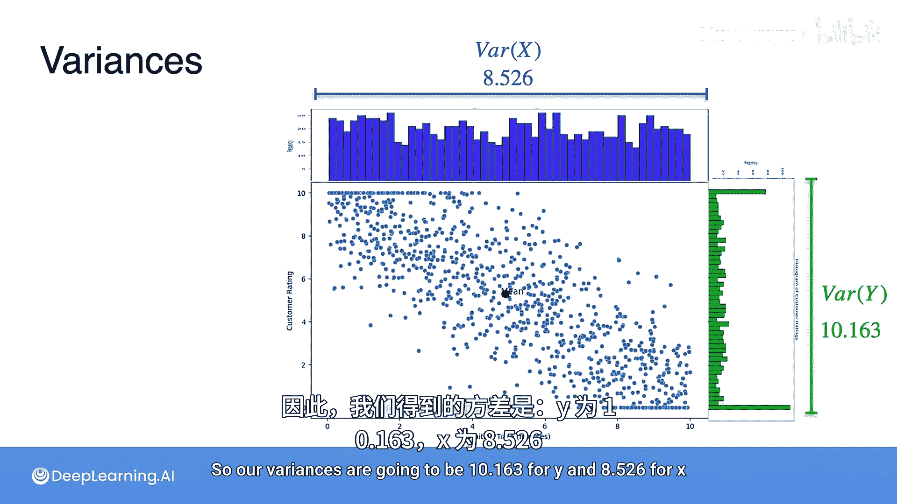

# 【Deeplearning】机器学习和数据科学概率与统计3 ｜ Machine Learning Probability And Statistics 吴恩达 p49 P49_联合分布连续型_02_02_03 -BV1c86VBrE93_p49-

So now you learn what a joint distribution of two discrete variables is。

 Now what if the variables are continuous， It's very similar。

 It's called a joint distribution of continuous variables， and that's what you're going to see next。

So so far all the joint distributions we've taken a look at have been discrete variables。

 for example， the age and height of a child where the height was rounded to the nearest inch。

 the number rolled on the first die on the second dice or the number rolled on the first tie and the sum ofposed dice all of them are discrete however。

 what happens when x and Y continuous random variables and this is what I'm going to show you next jointly continuous distributions。

So recall it in a previous lesson， we had the example of a phone call and we generated the probability distribution of the call waiting similar to this one over here。

Now you learn to find the probability between some interval for a continuous variable。

 and it was the area under the curve as shown。Now let's work with some new data。

 let's say we have two variables x and y， and X as before is the waiting time before a call is picked up by a customer service agent that we can assume is's any number between the range of0 to 10 minutes。

And y is the customer satisfaction rating that also we can assume is a continuous value between0 and 10。

 so it's not going to be 1，2，3， only it can be 1。2 for anything。And so both variables are continuous。

So for example， x can be 2。4 minutes， 1。5 minutes， and y can be a rating of 0。0， 5。7， etc。

Now X is the variable of wideing time between 0 and 10 minutes and after 10 minutes the call ends。

 so it really has to be a number between 0 and 10 minutes and we're going to look at a data set of 100 customers and we get the following histogram。

Now why is the variable of satisfaction rating of a customer and we have 1 thousand0 customers and here's the hissterogram。

 so a lot of customers gave it a0， a lot of customers gave it a 10 and there's some values in between。

Now let's look at both on them at the same time， the x variable of waiting time between0 and 10 and the y variable of satisfaction rating also between 0 and 10 for8000 customers and the graph is the following looking at the distribution of the data we can see that a lot more of the data is in the corners。

So here is a heat map and why is it in the corners well， a lot of customers had a very quick call。

 they got picked up very quickly and theyre very satisfied。

 those are over here and a lot of customers had a very long call of 10 minutes or maybe the service agent didn't pick up and these customers were not very satisfied so they gave a low rating。

When you actually look at the density it's this over here， so these two areas are here。

 theyre strong areas， low time and high rating and high time and low rating and you can actually see this as a three-dimensional plot if you imagine this plot in the right as a mountain seen from the top where the dark areas are high points on the light areas are low points then this is the actual mountain so these areas of high density are over here and those are the areas where we're most likely to find a customer。

So going back to the scatter plot let's actually calculate the mean for both the x and the y variables。

 so when we calculate the mean of x of the amount of time that is spent before the call being picked up that's 4。

903 minutes and the expected value of y which is the average of the rating of the customers is 5。

280 this point is over here， that's the mean that's the place where you would to balance this data set on your finger if you were to balance all these points。

Now let's calculate the variance of each variable， so let's aggregate over every row to obtain the distribution for time and let's aggregate over every column to obtain the distribution for customer ratings and now we have to calculate the variance of x and the variance of y in order to calculate the variance of x we first calculate the expected value of x which as we saw before is 4。

903 minutes and the expected value of x squared which is 32。

561 and now the variance is simply e of x squared minus E of x all squared which is 32。561 minus4。

903 squared which is 8。526 in a similar way we're going to calculate variance of y。

Recall that e of y is 5。280， E of y is squared we can calculate in is 38。

037 and the variance is e of the square y minus the square of e of y， which is 38。037 minus 5。

280 squared and that's 10。163， so our variances are going to be 10。163 for y and 8。526 for x。

