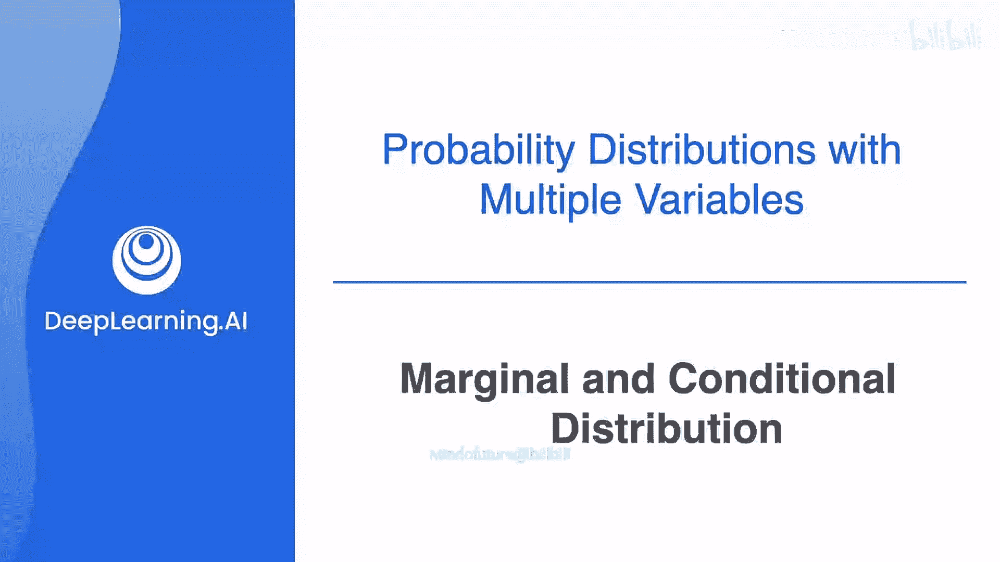
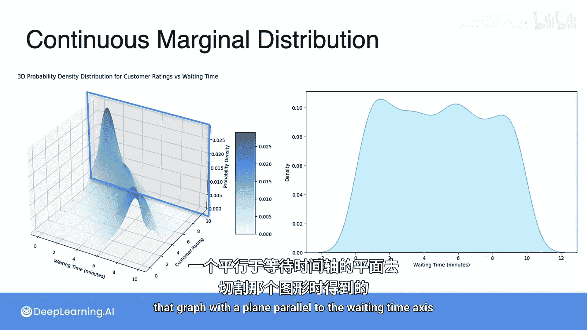

# 【Deeplearning】机器学习和数据科学概率与统计3 ｜ Machine Learning Probability And Statistics 吴恩达 p50 P50_边缘分布与条件分布_02_02_04 -BV1c86VBrE93_p50-

So now that you know joint distributions， let me introduce you to two very important concepts。

 the concept of the marginal distribution and the conditional distribution。

Let's go back to the age and height example， imagine that I have a full distribution of ages and heights of the populations。

 but all of a sudden I don't care about age anymore， I just want the distribution of heights。

 what I have to do is aggregate over all the ages and now I have what's called a marginal distribution。

Another thing I can do is take slices， for example。

 I have the full distribution of age and height and let's say I now only care about the high distribution of people of age 30 for example。

 so what I do is I take a slice and that is called the conditional distribution。

Let me show you more so recall this data set of children with ages and height from which we generated a joint distribution as shown here Now what if all of a sudden we didn't care about age anymore and we only cared about height so we wanted to summarize the behavior of the distribution across only the height variable in order to do this we need to find what's called the marginal distribution of height it's really just a distribution of one variable while completely ignoring the other one these are useful for summarizing the behavior of one variable at a time so to find the marginal distribution for the heights we simply add over each height value all the probabilities so in other words we are adding each column and that value corresponds to each of the heights。

So for example for 45 it's 110 for 46 it's 21s， so 47 it's21s for 48 is0 because the column is all0 for 49 is31s and for50 is110th plus 110 which is 2 tenths and the formula is over here p of y ofyj or yj is the sum of all pxy of X Iyj that's the same as saying that we're taking the sum over each column so here's a small quiz let's find the formula for p of y of 50。

And the formula is the sum over all this column， so it's basically the sum over I of px， Y of X I。50。

And it's actually2 divided by 10 because that's the sum of that column Now let's say we care about H so we forget about the height and we want to find the distribution of H。

 The formula is very similar we're adding over every row and we obtain three tens， two1s。F tenth。

 which is three tenth was 1/10 and1/10， and the formula is p of x of X I。

Equals the summation over all J。That's the elements in the row of the corresponding probability of X I。

Yj。So for example， what is px of 7， well it's going to be three tenths because it's the sum of that entire row。

Now this probability distribution right here is the marginal distribution for H。

 and this one is the marginal distribution for height。

Now let's expand the data set to 50 children and this is the corresponding scatter plot。

 notice that there is shading in the plots because there may be more than one child here。

 so more children are 10 and 50 inches tall hence the darkest spot compared to the one over here with age 11 and 62 inches tall overlaying the plot with a heat grid we can clearly see sections where there are more counts of children for a specific data point。

The marginal age will be obtained by summing across the vertical axis。

 and those for height will be obtained by summing across the horizontal axis。

So earlier we saw an example where x was the number role in the first I and y the number role in the second one。

 and we have this joint probability where it's a table full of 1 over 36 is like this。

When we want to generate the marginal one over x， we simply add over every row and we get 16 and the marginal over y。

 same thing we get a bunch of 16， and that's what we started with right because originally we said that the probability of each value is 1 sixth for the first and for the second di。

But now let's look at a slightly more complicated one。

 the one where x was the number rolled in the first dice and y was the sum of the two dice。

For this one， we have this distribution over here。Now let's say that we want to aggregate over the rows because now we want the distribution for the sum of the two dice。

 so we add over the rows and we get the values one over 36，2 over 36， etc， etc， all the way to。

  one over 36 again， and the histogram is like this because many more pairs add to7 than they add to。

 say 2 or3。So the formula is this one over here and let's see what do you think is py of 10 well when we add over the 10th row we get 3 over 36。

 so the probability that the sum of two dies is 10 is 3 over 36 is something we saw a while ago。

 but now we went to two variables and then back to one。

And this is the histogram for only the distribution Y， which is obtained from that table。

Let's go back to the call center example where we had time on the horizontal axis and the customer rating on the vertical axis and recall that we can find two marginal distributions。

 the one for waitinging time which is obtained by aggregating over every column and the one for rating which is obtained by aggregating over every row Now recall it with marginal distributions。

 the goal is to reduce a highly dimensional distribution into one of less dimensions in other words here we have a two dimensional one which has two variables and we want to bring it back to one dimension has one variable so how do we reduce this in。

 for example， the time dimension for weighting time Well we sum up all the probabilities along the weighting time axis and we get a histogram similar to this which actually gives us this probability distribution so that's the slice that we take if we cut that graph with a plane parallel to the waitinging time axis。

