# 【Deeplearning】机器学习和数据科学概率与统计3 ｜ Machine Learning Probability And Statistics 吴恩达 p51 P51_条件分布_02_02_05 -BV1c86VBrE93_p51-

Now recall the simple data set of ages and heights of children。

 we generate our mod distribution over the x variables H and the Y variables of height。

And with a marginal distribution， we were summarizing the behavior of distribution across only one variable。

 say height， because we just forgot about H and we added all the values of ages for one height。

 but now what if we wanted something different we want to observe one variable given that the value of the other one is known for example。

 let's say that we only care about H 9。

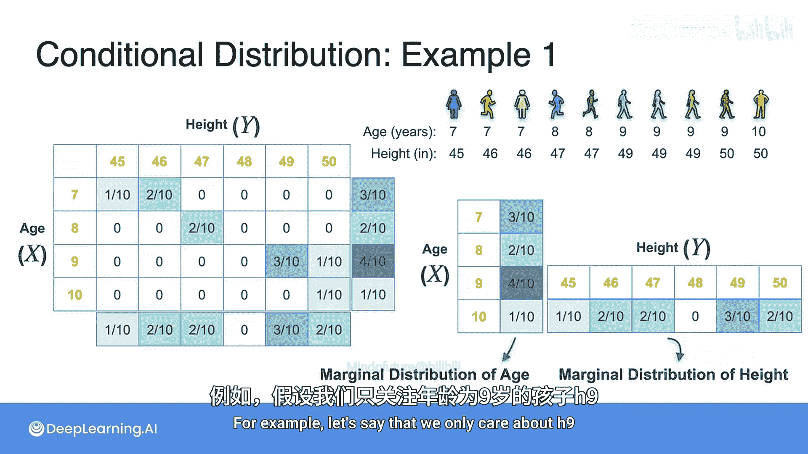

That's the only one we care about， and we want to find the distribution across the height variable that's called the conditional distribution。

And this one is simpler。 All you have to do is take a slice so if you fix x equals 9 that means I'm fixing h equals 9。

 then I'm only looking at this row of the whole table they only care about that row and that is my probability distribution of height for kidss of h9 so if I want to find for example p of y given x equals9 of 49。

 then that's gonna be this value over here。 however there's a small caveat notice that in a probability distribution everything has to add to1 the numbers in this row do not add to1 because they add to4 over 10 that's three1s plus 110 so what can I do well I can normalize I can divide everything by the row sum and I get three quarters and one4 and so my probability that y equals 49 given that x equals 9 is now three quarters now remember that we have。

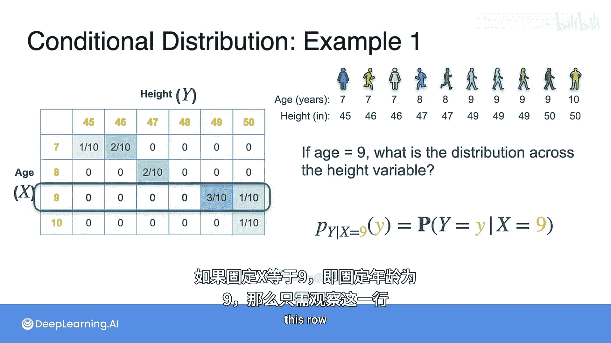

And this formula， the probability of A and B is P of A times B of B。Given A。

If we look at A and B as x equals 9 and y equals 49， then we have this formula over here。

 and we can rewrite it like this where this p of x equals 9 was the rosom。

 so normalizing and divided by the ros sum is actually applying the conditional probability rule。

So in other words， we obtained that p of y equals 49 that's the height， given that x equals 9。

 given that the age is 9 is three tenths over 4 tenth， which is3 over 4。

 that's this three over4 we obtained over here。The general formula is this one P of y given that x takes this value small x of y is the joint probability distribution p of xy of xy divided by the marginal distribution px of x so remember this formula this is the formula for a discrete conditional distribution the top is the joint PDF。

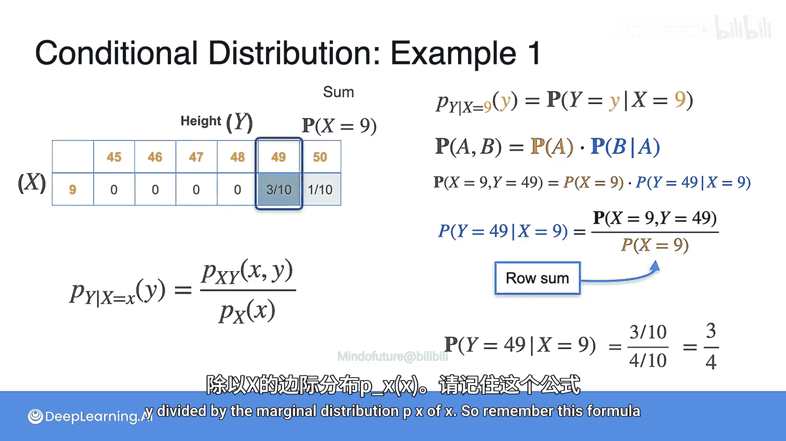

This is the conditional PDF that we're going to call， and this is the marginal distribution of x。

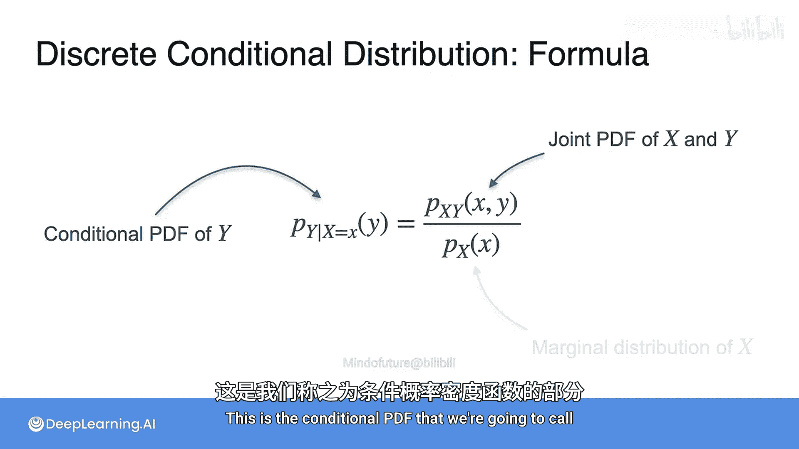

Let's see another example on this example over here。

 very simple example where x is the value of one dice and y is the value of the other one。

 then if we wanted to say， for example， if the first dice takes the value4。

What is the probability that the second one takes the value 1 well it's this formula over here。

 which really means take this row。And forget about the rest of the table。

 but now normalize by dividing by one over 6 to turn the row from one over 36s to one over6es and you get one over6。

 which is precisely what we expect the probability to be。

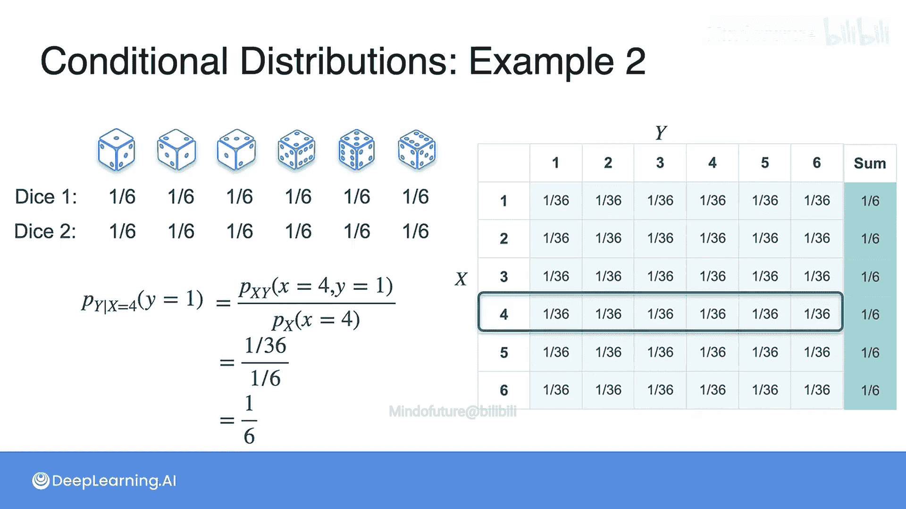

Let's go back to the example of the phone calls with waiting time and customer rating if I want to take。

 for example the marginal distribution over the customers that gave a particular customer rating of say 3。

5， all I have to do is take this slice over here。

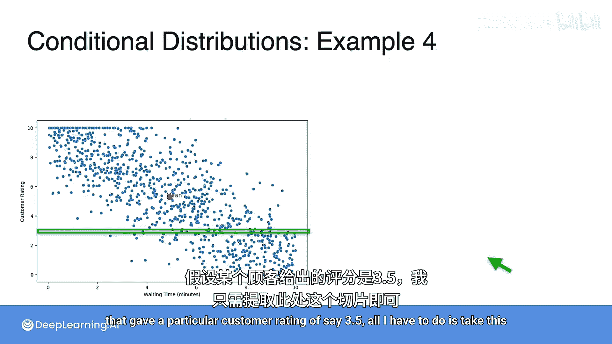

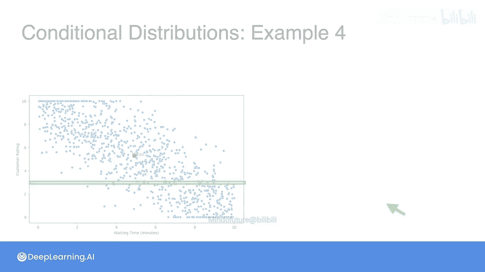

Now remember that the density function was like this， so for example。

 if I want to find the probability distribution for a rating。

 given that the waiting time was say four minutes， what I have to do is take a slice at a waiting time of four minutes and look at the plot in there。

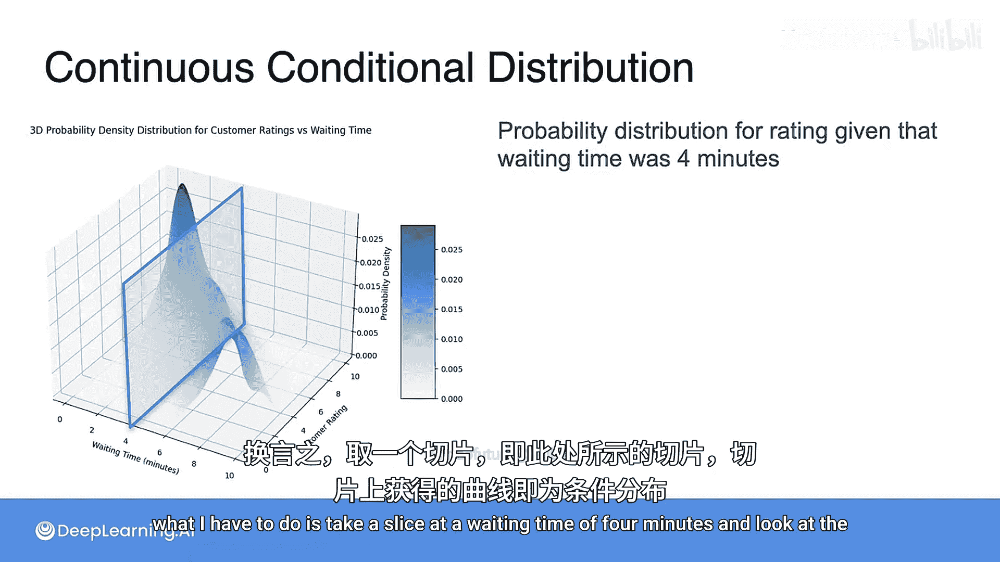

In other words， you take a slice and this is the slice over here and the curve that you obtain。

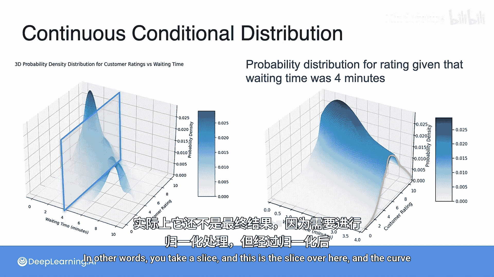

On this slice is the conditional distribution Well actually it's not because you have to normalize it。

 but when you normalize it you actually get the conditional PDF of y given x equals 4 so recall that for a discrete conditional distribution this was the formula where this is a joint PDF this is the conditional PDF and this the marginal distribution of x well the same thing happens for continuous conditional distribution except now we change the probability mass functions to probability density function so we change the P to F's。

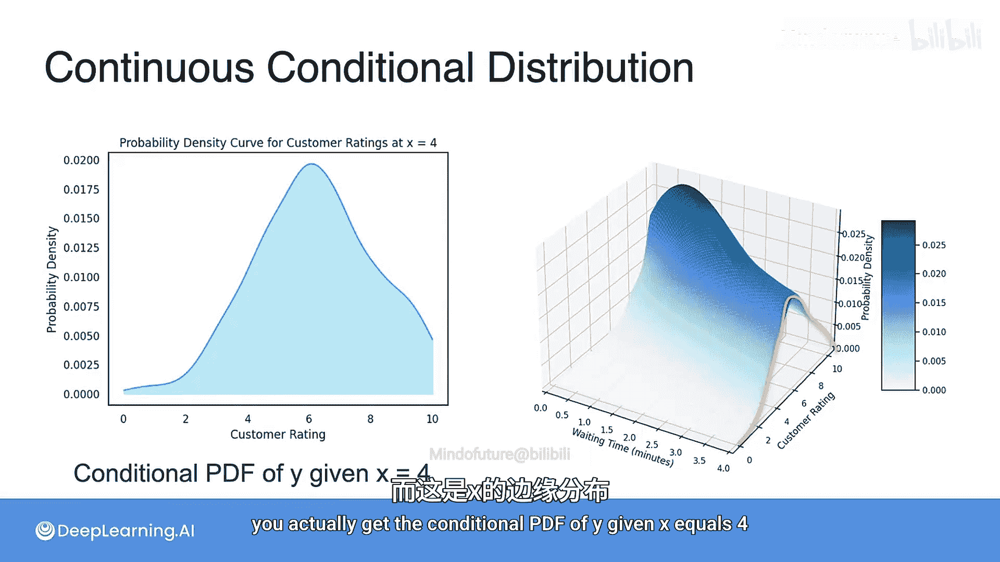

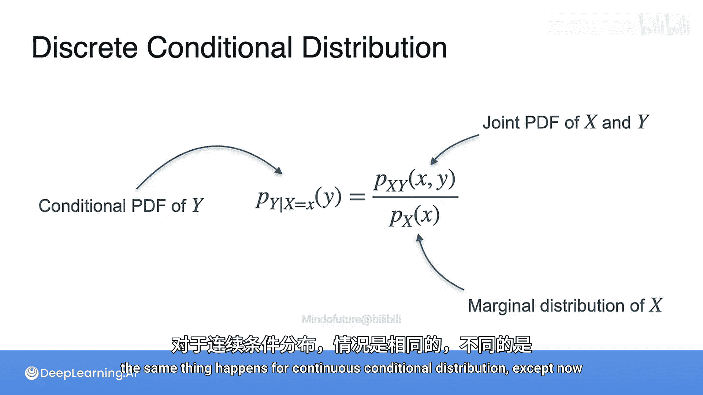

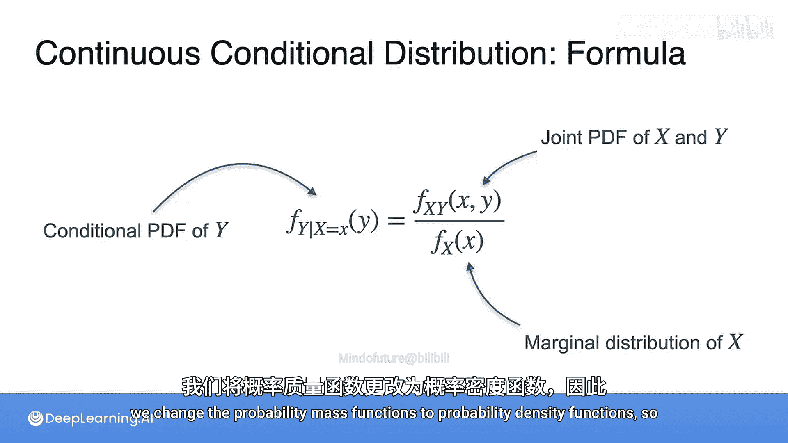