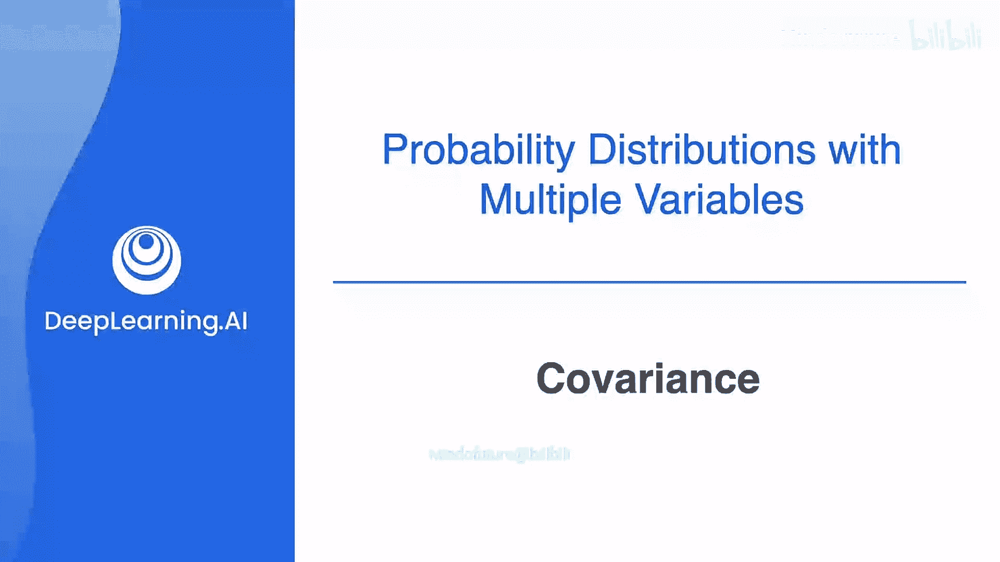
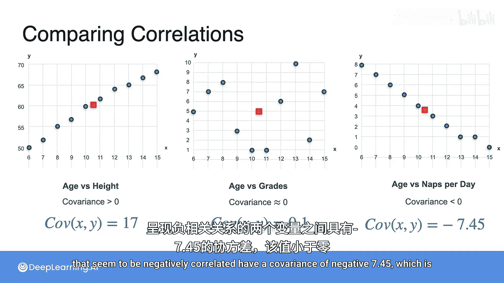

# 【Deeplearning】机器学习和数据科学概率与统计3 ｜ Machine Learning Probability And Statistics 吴恩达 p52 P52_数据集的协方差_02_02_06 -BV1c86VBrE93_p52-

Let's go back to the example of two variables， age and height。

 Each distribution has its own expected value and its own variance。

 but there's something here that we haven't captured， which is a relation between the two。

As you can imagine， age and height are somewhat related because the older someone is。

 the taller they are or similar things。 How do we capture that。

 We capture it with a very important concept called covariance。

 There's also another concept called correlation。This is what you're going to learn in this video。

So sometimes we want to know how two random variables are related to each other。

 having a good understanding of these relations helps us build accurate models and make better decisions。

 so consider the discrete random variable X which is the age of a child and let's consider three random discrete variables Y1 is the height of the child in inches Y2 are the grades in some particular test and Y3 is the number of naps per day。

And we're given some data as follows。And the question is how is x compared to any of the three y variables and how do you compare these relations So to help us better visualize what's going on in each of these data sets。

 let's actually generate scatter plus for each where the horizontal axis is x and the vertical axis is y1 y2 or y3 So the first plot is like this。

 The second one is like this。 and the third one is like this and I'm sure you can start seeing some kind of pattern。

How do you think these relate Well first let's look at some metric。

For the h versus height1 we can look at both of the means， the mean of the h which is 10。

5 and the mean of the heights which is 60 and that's this point in the middle， the point 10。

560 is the point where you would balance these points for h versus grades it's this point in the middle where mean of x is 10。

5 again and the mean of y is 5 and for this one over here H versus naps per day is 10。

5 for the H and 3。7 naps per day as an average。Now we can also look at the variances。

 let's look at the x variance， which means we forget about the y coordinate and calculate the three variances which are 9。

17 because it's the same data set for ages， and now let's look at the y coordinates only and calculate the three variances which are 39。

56， 9。78 and 7。57。So we have some information about each of the means and each of the variances。

 however， I'm sure you see something else going on。

 the H versus height1 is almost a diagonal that goes up to the right。

 the h versus snaps is the opposite it goes to the bottom and the h versus grades is kind of all over the place。

That can be captured in something called the covariance。

 The covariance of the first plot is bigger than0， the covariance of the second plot is almost0。

 and the covariance of the third plot is less than zero and the covariance talks about the relation between the two As you can imagine the older the child is the more height they have and that explains the first plot Agent grades seem to not be very related。

 you can be older or young and have higher low grades， but they're not related。

 and agent naps per day are the opposite， the older you are as a kid。

 the less naps you're going to have per day， so that's what covariance really summarizes。

Now how do we calculate covariance Well， the first step is as usual to center the graphs。

 so let's actually subtract the mean of x from the x coordinates and the mean of y for the y coordinates in order to get this center point to be at the origin and then let's also divide by the standard deviation of x and of y in order to have this really nice plots where the x variance and the y variance are both one Now that we have that let's try to cook up a formula that captures this trend over here and this trend over here and the lack of trends in the middle。

So what would this formula be Well， let's look at the plot in the left。

 it seems that when you move to the right， the coordinates move up。

On the one in the middle there seems to be no rule and on the one on the right if you move to the right。

 the coordinates move down， so let's try to capture this as some numbers that could be positive or negative。

Let's look at H versus height When you move to the right by x。

 you move up by y and when you move to the left by x you move down by a quantity y。

 so the quantities always have the same sign if I move to the right on some sign positive or negative then the points move up or down by the same sign positive or negative。

 let's look at the coordinates in the points in the left some of them have a positive x coordinate and also a positive y coordinate and some of them have a negative x coordinate and also a negative y coordinate。

 In other words， the coordinates of x and y tend to be the same sign maybe not for every point but for the majority the coordinate of x in the coordinate y are the same sign。

The opposite things happen on the left graph when you have a negative x coordinate。

 you have a positive y coordinate and when you have a positive x coordinate then you have a negative y coordinate。

 so they tend to have a different sign。And for the age versus grade ones， the one in the middle。

 nothing seems to happen。 sometimes the x coordinate is positive and the y1 is positive but sometimes the x1 is negative and the y1 is positive。

 it seems like a land with no rules so anything can happen here。

 so now let's look at the product of coordinates because on the left the coordinates normally have the same sign so the product of coordinates is normally a positive number On the one on the right。

 the coordinates normally have a different sign so the product is a negative number because positive times negative or negative and positive is negative and for the one in the middle well we can have both positive numbers and negative numbers because anything can happen。

Now what if I were to add all these products of coordinates for each number Well in the left I'm going to get something positive in the right I'm going to get something negative and in the middle I may get something close to zero maybe positive or negative but probably close to zero because I'm adding things that also cancel with others and this sum is called the covariance。

 so we get to the important formula here which is covariance is going to tell us if one variable makes the other one grow or makes it decrease or if it doesn't do anything to the other variable but it's not exactly the sum of the products X Y it's almost that it's actually this number first you have to center the data and then you take the average of all these products。

And covariance is going to be the one to tell us if the first variable makes the other one grow。

 such as age and height， if the first variable does nothing to the other variable。

 which is age and grades， or if the first variable makes the second variable decrease like age and naps per day。

Now we're ready to do some calculations here is the table of age and height which we it had a covariance bigger than0 this is the mean of ages and the mean of heights and what we're going to do is first center the data so let's subtract the mean of age from all the ages and the mean of heights from all the heights and then multiply these two columns to get this and when we add and take the average we get 1170 divided by 10 which is 17 this covariance is 17 because the data is positively correlated in the sense that when H grows height grows now let's do H and naps per day that's the one that was negatively correlated it has covariance negative。

Here's again the mu of x， the mu of y， here's H， here's naps。

 here's the centered H and the centered naps per day。

 and the product of these two columns is this as you can see all the numbers are negative is a sum of minus74。

5 when we take the average we divide by 10 because there's 10 kids and we get a covariance of negative 7。

45 that is negative because as you know the higher the age the less naps per day and finally we can do the covariance formula for the。

H versus grades distribution here are all the numbers， H， the grades， the centered H。

 the centered grades， the product of the two centered coordinates。

 and that sum is going to be1 and we divide by 10。We get that covariance is 1 over 10 or 0。

1 which is very close to 0， so one of them doesn't have influence over the other one or at least very。

 very little influence for the fact that the covariance is very small。So a small summary。

 we have three pairs of variables， the ones that grow together have a positive covariance of 17 h versus height。

 the ones that look independent from each other have a covariance of 0。1 and very small。

 and the ones that seem to be negatively correlated have a covariance of negative 7。

45 which is less than 0。

