# 【Deeplearning】机器学习和数据科学概率与统计3 ｜ Machine Learning Probability And Statistics 吴恩达 p53 P53_概率分布的协方差_02_02_07 -BV1c86VBrE93_p53-

Consider the following scenario， players X and Y are playing three games to either win or lose a dollar。

In game one there are two possible outcomes both players win $1 each or both players lose $1 each。

 here are the two possibilities either they both win a dollar or they both lose a dollar where the horizontal coordinate is how one player does and the vertical coordinate is how the other player does and each one happens with probability1 half。

In game  two， two things can happen。 The first player can win a dollar and the second one loses a dollar or the first one loses a dollar and the second one wins a dollar and we're callinging this player X and y remember。

 so x is the first player and y is the second player the plot for this one is over here where half the times it happens that one player wins a dollar and the other one loses it and the other half the time one player loses a dollar and the other one wins it。

And both with probability a half so recall that the X coordinate tells you what the first player wins or loses and the y coordinate。

 what the second one wins or loses and in game3 more can happen So actually both players can win1 both players can lose $1 one player can win and the other one loses or the other player wins and the first one loses so four possibilities basically A BC and D。

 all with probability one quarter So here is a question for you how similar are these three games for player X and for player Y Well less examine them。

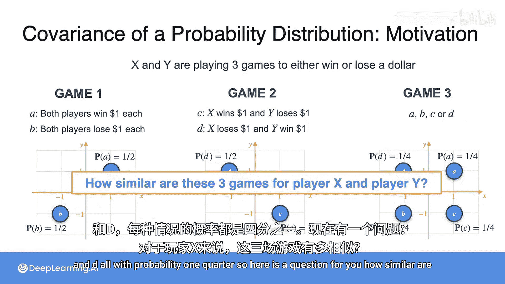

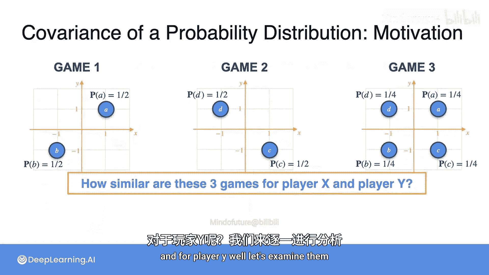

And first we're going to examine them independently。

 so x is how much money in dollars player X wins and y is how much money in dollars player Y wins。

 so let's first look at how much x makes in the first game and as you may imagine it's going to be the expected value and we're only looking at the horizontal coordinate because we're looking at player1 so it can be winning a dollar with probability1 half or losing a dollar with probability 1 half and that's zero so the expected value for the first player is0 and the same thing for the second player they win a dollar or losing a dollar with probability1 half。

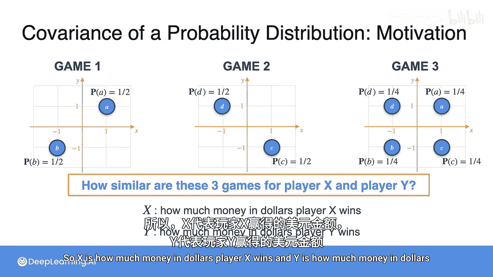

The same thing happens for the second game。Or the second game。For the first player。

 they can win a dollar or lose a dollar， that's zero。

 and for the second player they can win a dollar or lose a dollar， so again it's  zero。

And so this game has the same expectancy for the first and second player。 Now， the third game。

 let's take a look， four things can happen。 you can win a dollar or win another dollar or you can lose a dollar or lose another dollar and that again adds to0 and the same thing for the second player they can win a dollar two times or lose a dollar two times all with the same probabilities so these games are basically the same if you only think of one player at a time in terms of expectancy every player at the end of the day they play many。

 many times they're going to end up winning zero。And so these expectancies don't really tell these games apart now what happens with the variance could it be that the variance can help us well let's calculate the variance of each of the games for the first game this is the calculation of the variance recall that the expected value is0 so all we care is the expected value of x1 squared and that's going to be 1。

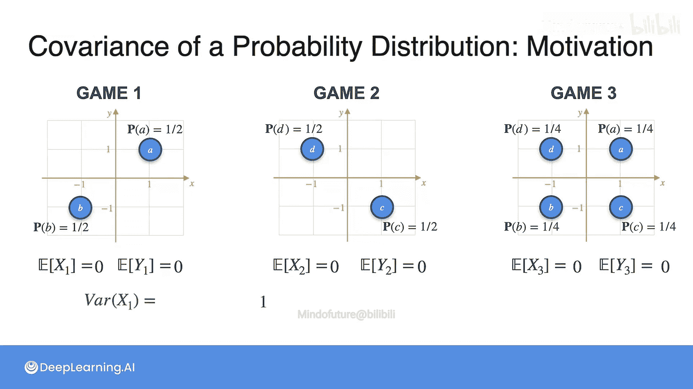

And I'll spare you of the calculations but it's actually going be one for all of these ones。

 so these games are pretty similar in terms of expectancy and in terms of x variance and in terms of y variance but obviously they are different games however where does the difference lie the difference lies in that you have to look at both players at the same time。

 otherwise the game is the same for each player for each player just win a dollar or lose a dollar so we need to look at the covariance。

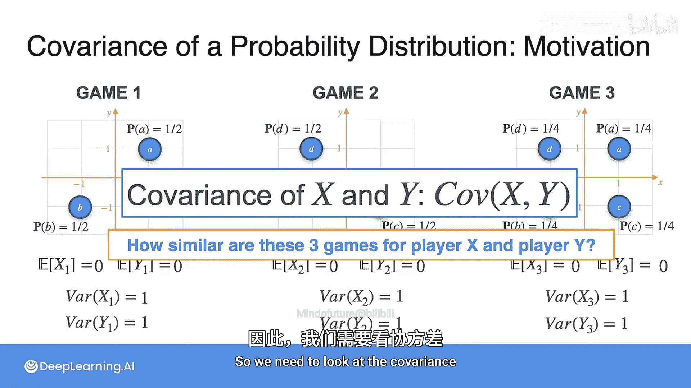

The covariance is going to tell these three games apart and recall that this was a formula for the covariance of a data set and were going to calculate it for the three games so let's do it for game1 here is x and y。

Now we center X and y， which nothing changes because the mu of x and the mu of y are0 and when we multiply them look at what happens。

 we have a one and a1 because either they both win a dollar or they both lose a dollar so the products are one and when we add this we're going to get two。

And the average is going to be one because we have to divide this by two。

So the covariance of the first game is one。And the fact that the covariance is positive shows this correlation here that the more player one wins。

 the more player two wins， so either they're both happy or they both sad。Now let's look at game two。

 which is the complete opposite when one is happy， the other one is sad and one is sad the other one is happy again。

 these are the means they're both zero and in our table then either one wins one and the other one loses one or vice versa。

 the product of these two things is going to always be minus1。

Because one times minus1 is equal to minus1 and 1 times 1 is equal to minus1。

 so when we add them we get minus2 and when we take the average we get minus1 so this one has a covariance of minus1 which is reflected in the fact that they kind of form this pattern over this diagonal and that means that either one is happy and the other one is sad or one is7 and the other one is happy and finally game 3 we're going to do the calculation。

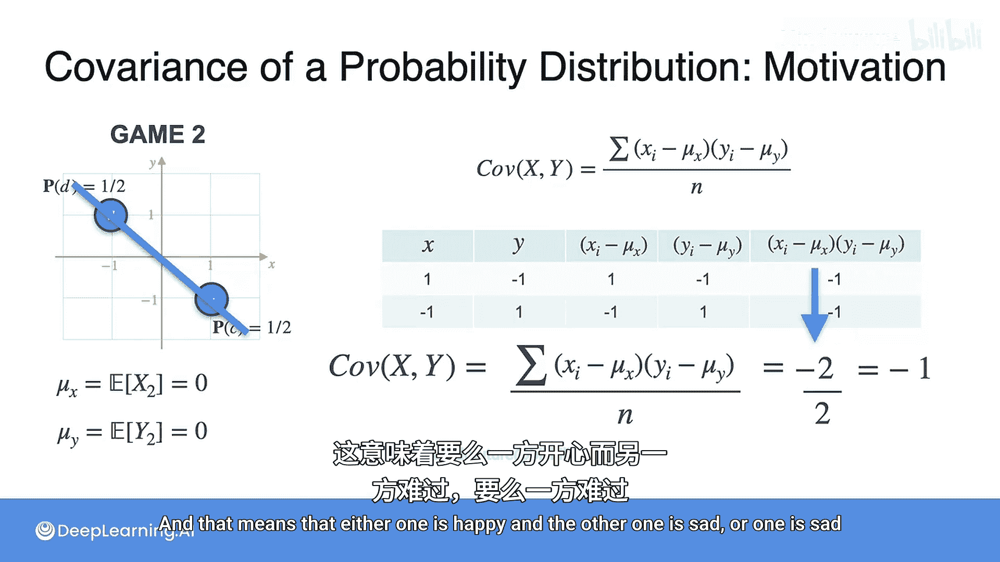

In game 3，4 things can happen， they both win they both lose or one wins and the other loses or vice versa again we saw that the mu are0。

 so we're going to do this table where these are the possible things that happen to x。

 these are the possible things going happen to y centering makes no difference because the means are0 and when we multiply them we get two ones and  two minus1 we get all the possible four scenarios。

 this is going to be0 and when we divide。In order to get the average， we get zero again。

 and so this covariance is0， and that shows the fact that there's not really a pattern among these。

Have all the four possibilities so we can't really infer if we know that one player is happy。

 we don't know if the other one is happy or sad and vice versa because they are more independent of each other。

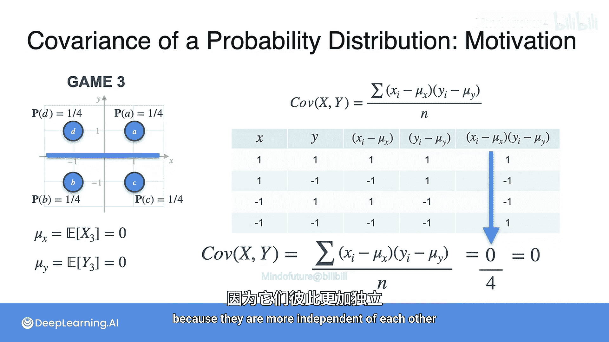

So in other words， we have these three games， game one。

 game two and game3 in game one they both win or both lose at the same time in game two is more of a zero sum game。

 one wins and the other one loses and in game3 anything can happen and in the first game at a covariance of one in the second one a covariance of minus1 and the third one covariance of0。

Now let's introduce one more game， game four。Game4 has the following three outcomes。

 either both players win 1 each or both players lose 1 each or neither player wins nor loses anything。

 so these three things can happen。Both players win a dollar。

Both players lose a dollar and nothing happens， but the probabilities are unequal。

 so the probability of both players win a dollar is1 half。

 the probability of both players lose a dollar is1 third and the probability that nothing happens is 16。

And。😊，These are illustrated over here， so now if we look at only one player， the X player。

 what is the expected value of their gain， well it's going to be the weighted average of the values which is going to be 16 and the same thing for the other player it' going to be 16。

So each player wins on average one6 every time they play this game Now let's look at the variance the variance is calculated like this and。

We can do this calculation， which is a half times1 minus a six square plus a6 times 0 minus a6 square plus a third times minus1 minus a6 square。

Because we have to subtract new and then square and then multiply with the probabilities and get 0。

806。 So the x variance is 0。06， as you can imagine， is the same as the y variance。

 And what's the covariance。 Well， let's calculate it。

 Now we used to say that the covariance was the average of the product of coordinates。

 but that's when we had equal probabilities。 That was way back in the day。

 Now we don't have equal probabilities。 We have that a half a6 and a third。

 So what we have to do is multiply by the probabilities。 So this is what happens in general。

 You simply multiply by the probabilityba。 The product of the x coordinate and the y coordinate covariance of x y can also be expressed like this。

 which is actually very similar to the variance formula except you have a different x and y。

 if you were to say covariance of x X。 you get E of x squared minus e of x all squared。

 and that's the same as the variance。 So if we're going calculate this。

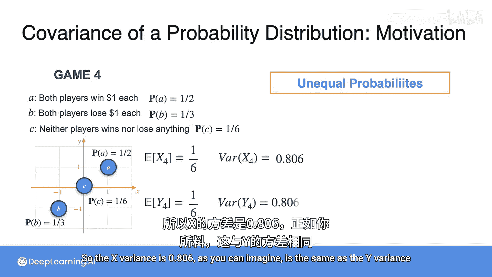

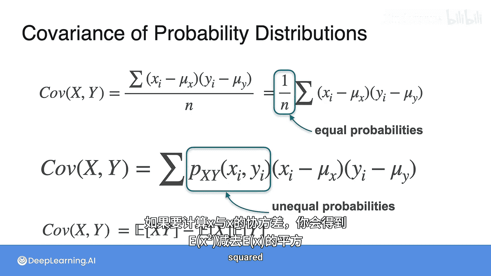

We just do the probabilities times the x coordinate times the y coordinate after centering them and recall that these are the means and the variances。

 so we get this calculation over here。This over here is for the first point。

And the covariance X Y is 0。806， so as you can see it's a positive covariance because they win and lose together so there's that sort of diagonal that shows that the result of layer can help us in further result of layer B Now let's go back to the example of the phone calls with waiting time and customer rating recall that we had two marginal distributions X and Y and now we want to find the covariance so I want you to try to guess do you think this covariance is going be positive or negative。

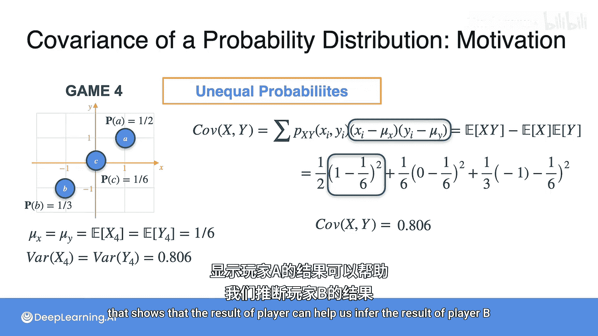

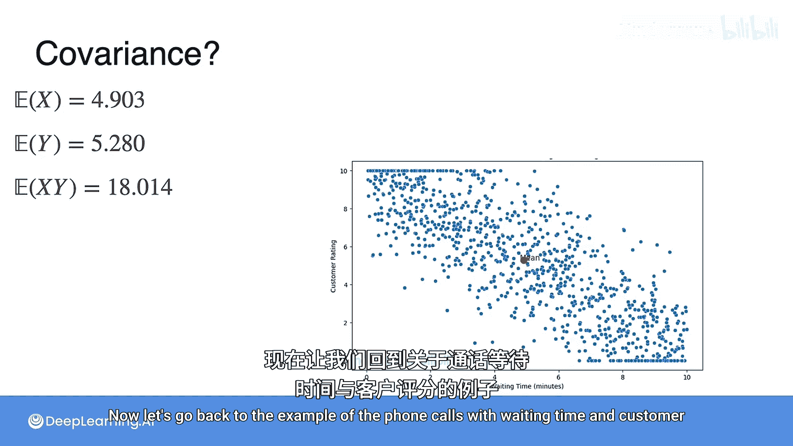

And my guess is that it's going to be negative because as you can see we have sort of a diagonal that goes down into to the right and that means negative covariance because you can imagine that the more you weight the less rating you would put and the less you weight the more rating you would put so these are inversely correlated and therefore the covariance is probably going to be negative but less's actually calculated when we find the expectation of x Y we find it to be 18。

014 minus the product of expectations of x and Y and that's going to be negative 7。

878 so indeed it is negative。

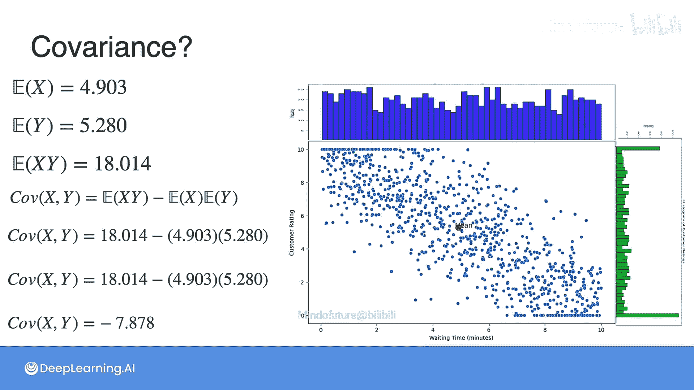

Let me repeat this calculation for clarity here is the formula for covariance。

 and here is what we've calculated to be the two expectations of x and y and the expectation of xy。

 so the covariance is simply e of xy minus Ex E Y， that is minus7。878。

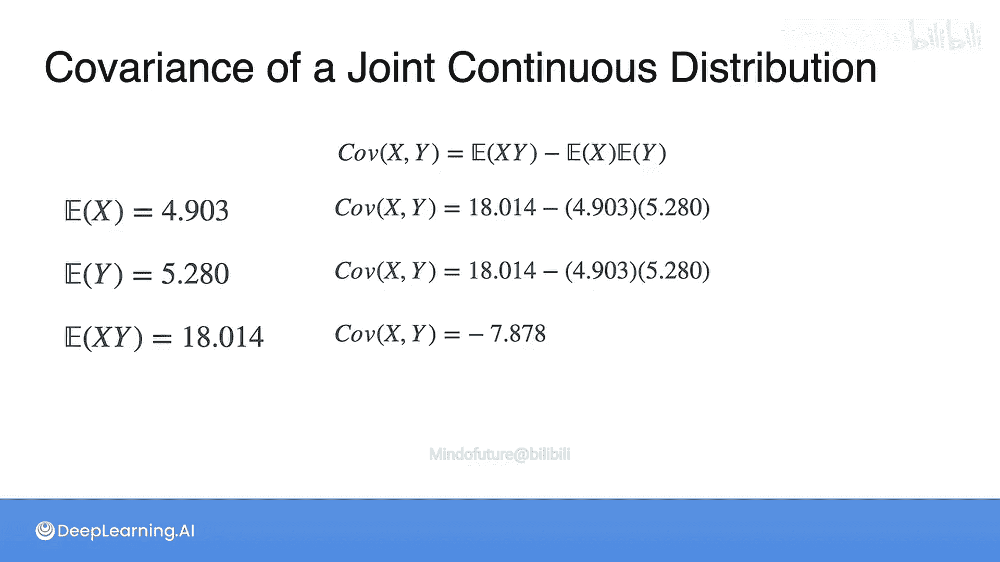