# 【Deeplearning】机器学习和数据科学概率与统计3 ｜ Machine Learning Probability And Statistics 吴恩达 p55 P55_相关系数_02_02_09 -BV1c86VBrE93_p55-

Now consider these two dataset sets shown here that you've already seen before with their variances。

And their covariances we know that the covariance tells us how the variations of the two variables are related when this is a positive value it tells us that both variables tend to increase together and when it's negative it tells us that when one increases the other one decreases but notice that one is a bigger number than the other one forget about the size one is 17 and the other one is 7。

45 does that mean that the correlation is stronger for the one that is 17。

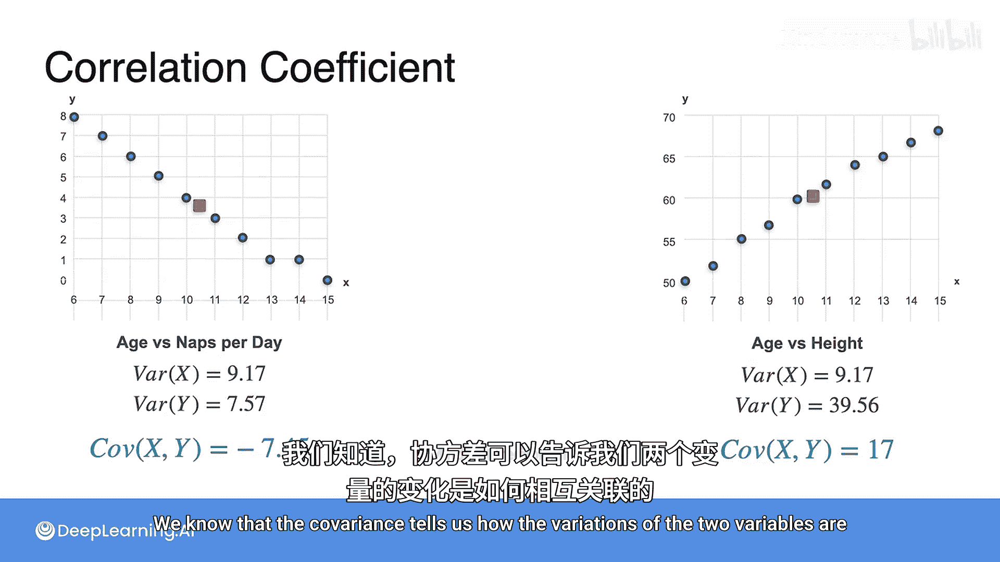

Well， we cannot really tell because the covariance can assume any value with no limited range。

 so consider these two data sets shown here that you've already seen before age versus naps and H versus height。

 H versus naps as a negative covariance and H versus height has a positive covariance and the reason is because the more you age the less naps you take and and here the more you age the more you grow however。

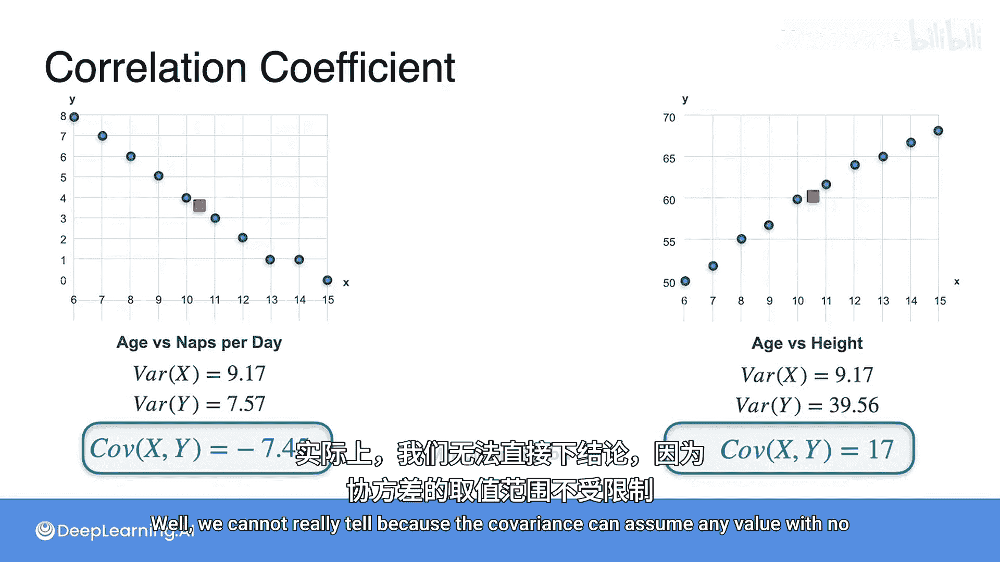

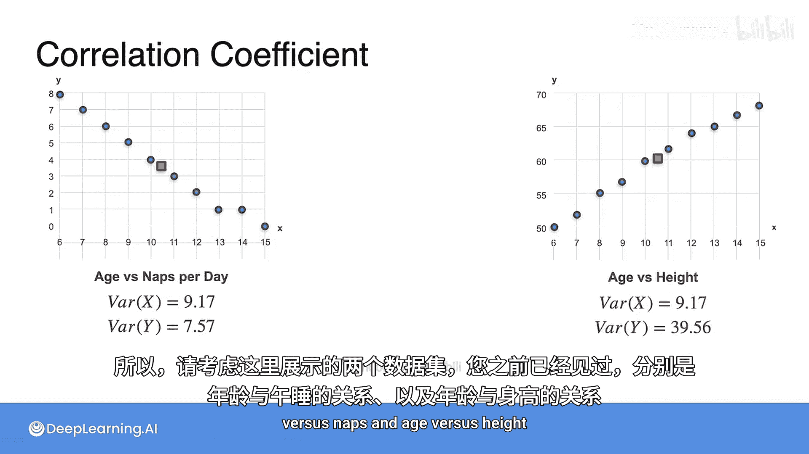

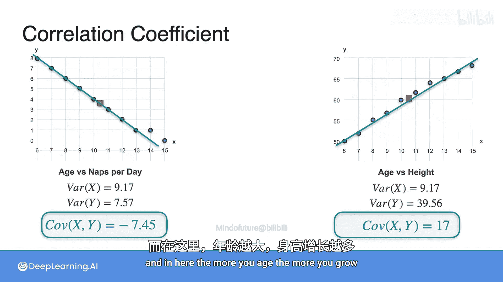

Because of 17 is bigger than 7。45， forgetting about the sign。

 does that mean that the correlation here is stronger and we can't really tell that。

Because it could be that the numbers on the right are just much bigger numbers。

 so the question is how could we tell？The actual correlation between the two So what I'm going to show you is something called a correlation coefficient The correlation coefficient is a number that lies between negative1 and1 negative1 is when you have two variables that are completely negatively correlated positive one is when you have two variables that are completely possibly correlated and0 is when they're completely independent and is's always a number between one and minus1 so these two numbers don't really fit in here but after standardizing they will so let me show you the formula for the correlation coefficient and the correlation coefficient is simply the covariance except divided by sigma X sigma Y so it's a standardized covariance。

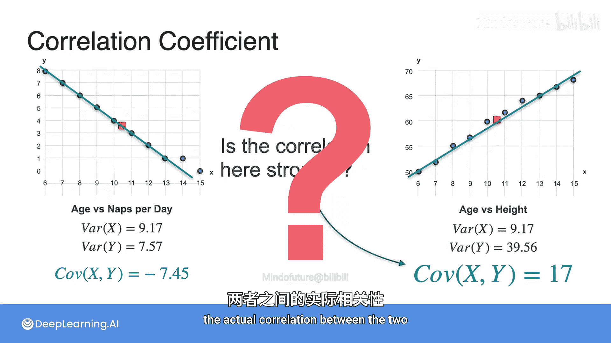

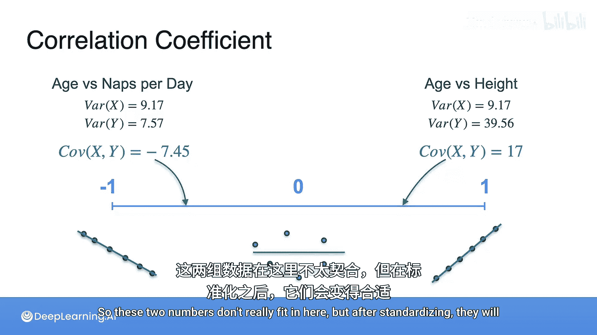

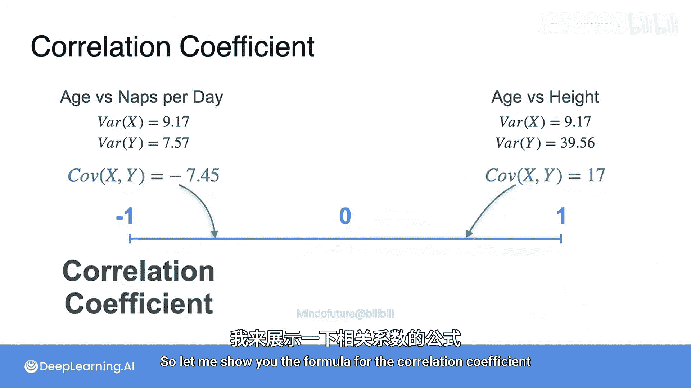

We can also write this as covariance of xy divided by a square root of variance of x square root of variance of y now let's calculate it for this data set over here。

 when we take the covariance and divided by the square root of the two variances， we get negative 0。

894， which is close to negative 1 which means that these are pretty close to being completely negatively correlated。

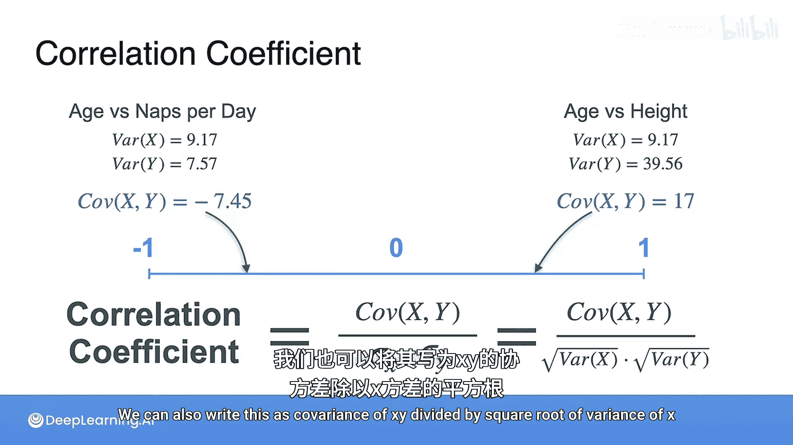

And for H versus height， then we have。That the correlation is 17 divided by square root of 9。17。

 square root of 39。56， and that's 0。893， which means they're pretty closely correlated。

And so we have correlation coefficients of minus0。894 for the one on the left and 0。

893 for the one in the right， notice that despite the big difference in magnitude of the covariances of these data sets。

 the magnitude of the correlation coefficient is always small。

 it's always between minus1 and1 and we can see from the graph that is pretty close to a straight line from the data points so。

The only difference here is the direction of the diagonal。

 which shows the sign of the correlation coefficient。

When we calculate the correlation coefficient for the other example， the one of Asian grades。

 we actually get a very small number， we get 0。1 divided by the two variances， which is 0。

01 showing that these two are definitely uncorrelated。Finally。

 let's calculate the correlation coefficient for the data and waiting times and customer rating。

 that is covariance divided by the product of the square roots of variances， which is negative 0。845。

 which shows that it is indeed pretty negatively correlated。

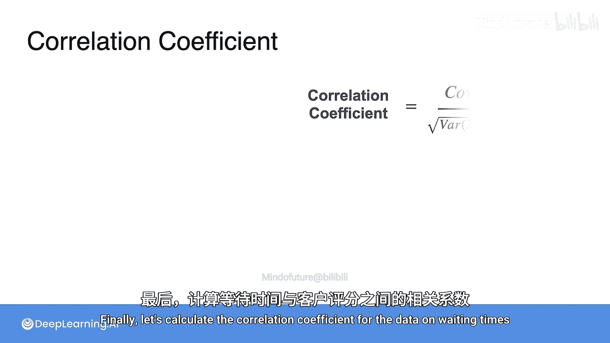

To summarize the correlation coefficient is the ratio between the covariance of the two variables and the product of the standard deviations that is the product of the square roots of the variances。

 it's always between negative 1 and 1， it's negative 1 when we pretty much have the diagonal y equals minus x。

 it's0 when we have something completelycorrelated and it's one when we pretty much have the diagonal y equals x。

Correlation coefficient is very， very useful in statistics when you're comparing pairs and variables。

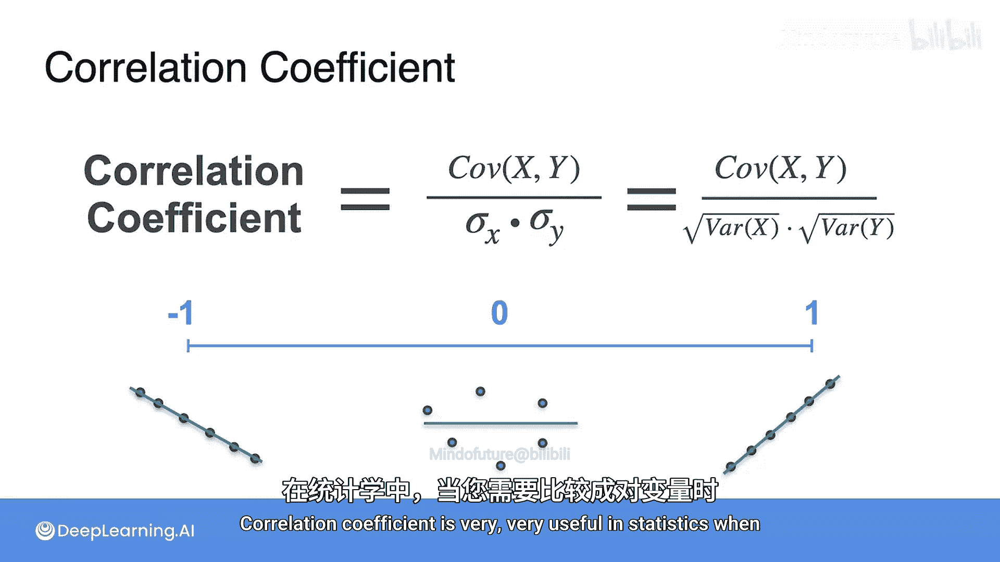

Next you'll find a short lab based on a couple of famous datasets。

 these examples will show you some instances where statistical measures like mean。

 variance and correlation don't tell the whole story。

 enjoy exploring this short lab and I'll see you once you're done。😊。

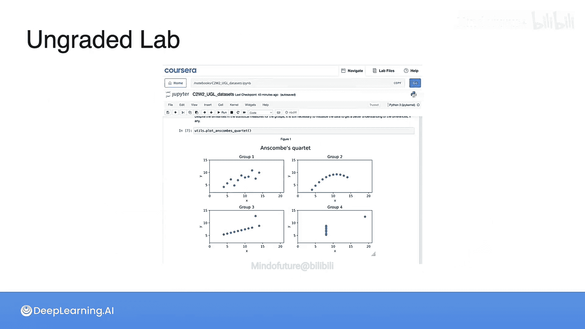