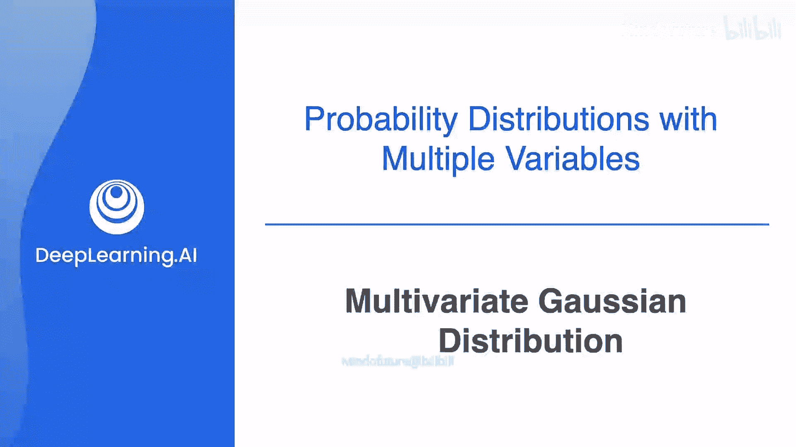
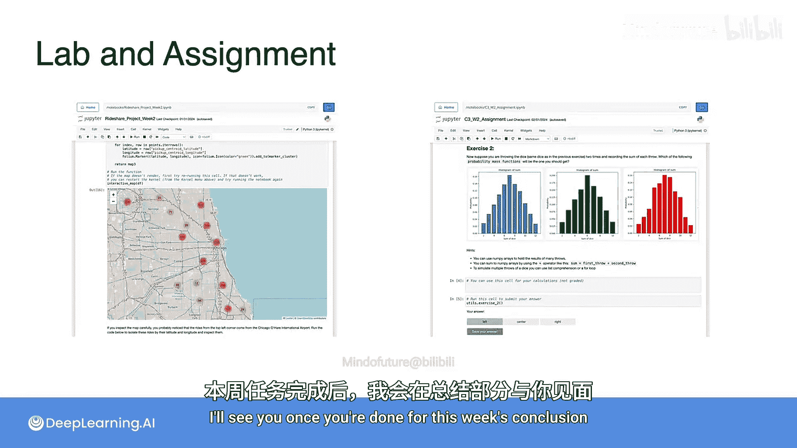

# 【Deeplearning】机器学习和数据科学概率与统计3 ｜ Machine Learning Probability And Statistics 吴恩达 p56 P56_多元高斯分布_02_02_10 -BV1c86VBrE93_p56-

So previously you learned the normal or Gaussian distribution， that was in one variable。

 but you can have the Gaussian distribution in more variables and it's called the multivariate Gausian。

And it looks very nice if you look at it in two variables it actually looks like a bell and this one also appears in many places in particular it appears lot of machine learning so let me show you recall the formula for a Gaussian distribution for one variable giving the following PDF and that had parameters mue the center of the bell and sigma that spread well now here's a question what if you had more than one variable say you had variable x1 x2 of 2 xN。

So let's say we have two variables， for example， H is the height of an adult in inches and w is the weight。

Of an adult impos and if you have a data set of 1000 points with the height and the weight of each person。

 then you can look at the margins and notice that they are both normal or Gaussian distributions with some mean and some standard deviation。

Now， what does the joint distribution look like if the two variables were independent then the joint PDF will be the product of the marginal PDFs。

 and rerrangging the terms a little bit， you would get this expression over here。

But now that is not when you see when you're plotting the density of the dataset。

 both distributions are bell shaped， but in the independent case the distribution is completely symmetric。

 in a dependence case you see that distribution is elongated along a line with positive slope。

And seen from the top， it's like this。 These are the level curves of the distribution。

 So the green curves are high up and the purple curves are down。

 This is like seeing a mounting from the top。 And what is causing the deformation of the joint distribution。

 Well， it turns out that is's the covariance between the two variables。 they are height and weight。

 And people tend to wait more when they are taller。

 So that's where the positive correlation comes in on the left。

 you would have two independent variables， and thus you have those circles。

 So let's do a bit of all direct manipulations to see if we can rewrite this a little better。

 Since H and w are Gaussian， then the product of the densities looks like this。

 where the exponent is the sum of both Gaussian exponents。

This sum of squares can actually be seen as the squared norm of this vector over here。

 which is the same as the dot product between the transpose vector and itself Now the vector h minus mu w minus mu can be written as a subtraction the2 vectors hw and mu H muw。

And in order to get each element of the vector to be multiplied by a different constant。

 you will need to put a diagonal matrix in between。

This is the diagonal matrix This can be finally written as the dot product of the difference transpose times the imverse of the diagonal matrix with the variances in each element of the diagonal times the difference vector this matrix over here is simply the covariance matrix notice that since the variables are independent this has to be the diagonal the vector mu h mu w is the vector mean which we will denote by a bold mu。

And the product sigma H， sigma W is simply the square root of the determinant of the covariance matrix。

So joining everything together， you get this expression over here。

 remember that this is valid only if W and H were independent。Replacing with muune Sigma。

 you can rewrite this expression like this。And what changes in the real case when the variables are dependent well of course is no longer true that the joint distribution is the product of the marginals。

 however both dependent and dependent cases have bell shaped services this general expression is actually valid in the dependent case as well。

 the only difference is the covariance matrix is no longer diagonal and now the of the hangal male correspond to the covariances between variables。

Since you're familiar with the formula of the Univariate Gaussian。

 let's see what the formula for the multivariate Gaussian looks like by just opposing it to what you already know。

 F of x becomes this because now you're dealing with more variables we're still going to have this constant1 instead of dividing by the square root of two pi we divide by two pi to the power of n over2 taking into account the number of variables Now for the unitvariate distribution you have the standard deviation that shows the variation but for the multi1。

 we're going to use the covariance matrixes it tells us the variation in the curve more specifically we work with the determinant of the covariance matrix which captures the volume of the spread the bigger the determinant the bigger the spread Next let's look at the exponent terms so x is a random vector mu captures the population mean of each variable in the space。

The inverse of the covariant matrixes applies to standardize and rescale the variances and covariances Know that because you're dealing with multivariable distributions。

 all scalar valuess are replaced with vector and scalar variances are replaced with covariance mates up next is this week's exploratory data analysis lab in it youll once again be analyzing the rightsha data you saw last week using the skills you learned here in week2 you will now be able to look more deeply at some of the summary statistics you can generate about this dataset as well as visualize them in some interesting new ways After that lab you will have this week's graded quiz covering all the topics in this week Finally you will find this week's graded assignment This week's assignment will challenge you to combine your knowledge of Nmpy with what you've learned about probability distributions to answer questions about a set of loaded dice you'll have to either analytically solve the problems or simulate the scenario in Python you get to choose the approach you like。

with all these end of week assignments， I'll see you once you're done for this week's conclusion。😊。

