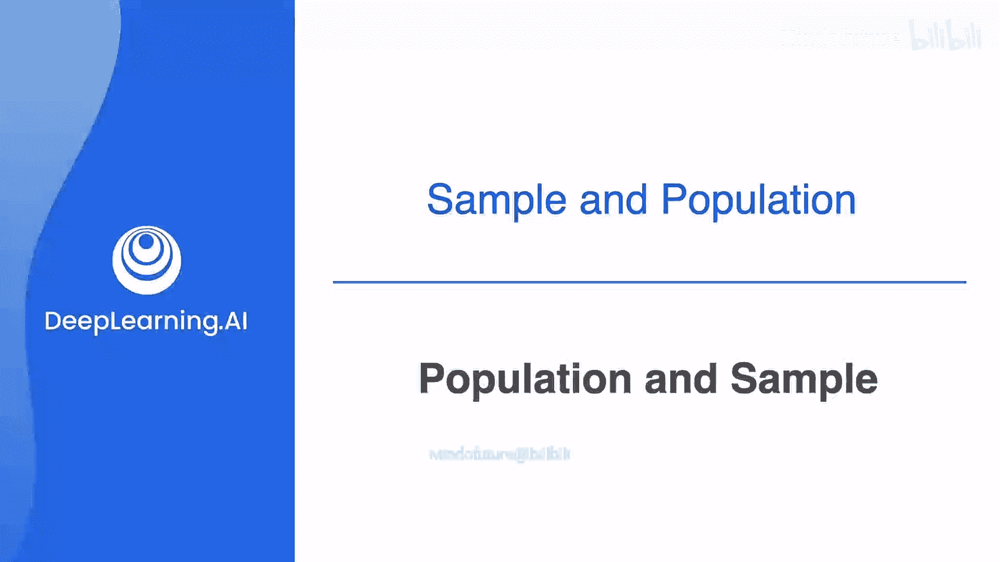
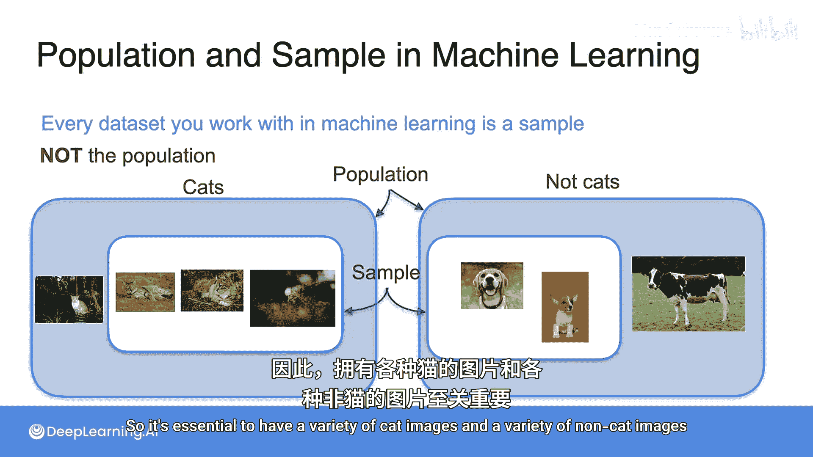
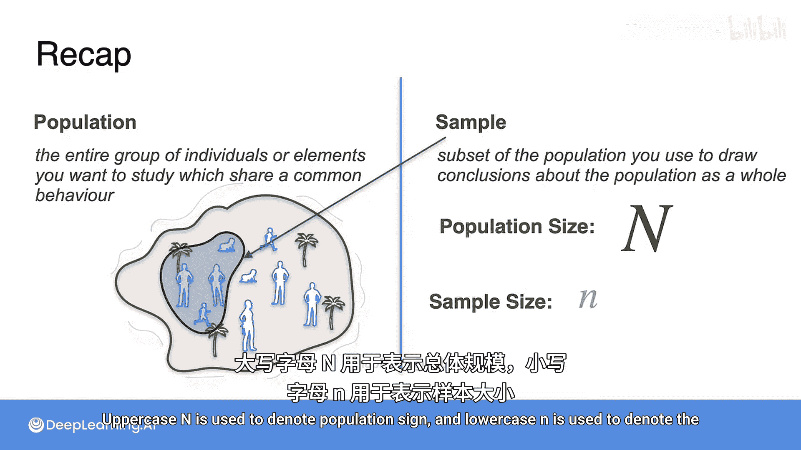

# 【Deeplearning】机器学习和数据科学概率与统计3 ｜ Machine Learning Probability And Statistics 吴恩达 p58 P58_总体与样本_03_01_01 -BV1c86VBrE93_p58-

Hello and welcome back to coursese 3 of the math for Ma learning and data science specialization。

 so this is the first lesson in the third week of the probability in statistics course and we're going to be focusing on statistics for the second half of the course to get us started。

 we're going to talk about two key concepts that are essential to understanding statistics。

 the concept of a population and the concept of a sample。

 a population is the entire group or individuals or items that we want to study。

And a sample is a smaller subset that we actually observe or measure。 So for example。

 if I'm trying to measure the height of all the humans， well all the humans are the population。

 but obviously I'm not going to measure everybody I'm going to take a sample of 100 of them。

 for example， that's our sample in machine learning and data science。

 we often use samples to train models and make predictions because we can't look at the entire universe of data So it's important to understand the difference between the two and how they're relevant to the work we do。

So let's dive in and explore this together。So welcome to the beautiful island of Statopia where you've been hired as a data scientist to help them with all their statistics problem The first task is to find the average height of the people living in Statopia so you think to yourself easy PC lemon squsy I know how to calculate averages I'm going ask everyone on the island for their height and then divide by the total number of people so you check how many people live in the island and you're told that it' 10000 people that's a lot of people so not so easy PC lemon squy anymore。

How do you calculate the average of the heights if there are so many people。

 so you have to change strategies and only ask a few people living on the island in order to estimate the average？

So all the subjects of interest in the study that people living in Statopia are your population。

And if you randomly select a subset of the population， say size 100， then that subset is the sample。

In this example， the population size is 10，000 in order by n and the sample size could be anything smaller from 1 to 9。

999， that's in order by small n and we're going to try to pick a number that is small enough to be manageable but also large enough to be significant。

For simplicity illustration's sake， let's assume that there's only 10 people on Statopia。

 meaning the population size is 10 now you want to take four for your study。

 let me show you two ways to do it the first one is to pick four random people and the second one is to put them on a line from shorter to taller and pick the first four people so which one do you think is good and which one do you think is bad。

So if you thought that the first one was better， that is correct。

 because you always want to take random samples， the second way to do it would probably get you a smaller average because you're taking the shorter people in the line。

Now let me show you another example， let's say you pick four random people and let's say you want to run the experiment again。

 so you take another four people。Well， that's not good。

 why not because you took the first sample set at random。

 but the second one depends on the first one because you couldn't repeat the people and that's not good。

 you can't do that so why is the sample set too not a good sample because it is dependent on the first one。

You have to start all over every time， so people are allowed to be repeated and that is very important Otherwise the second sample set depends on the first one and that ruins your experiment Another thing that you need to make sure is that the samples are identically distributed。

 so whatever rule you use to pick the first one needs to be the same rule used to pick the second one。

If you were to go to a particular part of town where people are taller or shorter。

 then you're not going to get a good sample， so you have to make sure your samples are all independent and identically distributed。

Let's test your knowledge of populations examples with this example。

 The example is the avocado toast trend， a popular trend that involves spreading master slice avocados on top of your toast trends can have a significant impact on the economic value of goods so after the avocado toast trend you decide to study the price of avocados in the US you simply can't check every single purchase of avocados in the US so you randomly pick four stores and record the prices for each avocado sale what do you think is the population in this example。

So the population of the study is all the avocado sold in the US。 now what is the sample？

And the sample is the avocado sold by the four stores you selected。Alright。

 so let's check some implications of populations and samples in machine learning in machine learning。

 every dataset set you work with is actually a sample and not the population no matter how big the data set is for example when working with classification of cat images from all the infinite possible images of cats and not cats your data set is simply a sample it is important to have a representative data though as you also saw in the high example the population of stostopia having a representative data means that distribution of your dataset is the same as the one for the population for example。

 if you're working in a classification model for cats and all your cat photos are cats in grass。

 then when you show a cow standing in the grass and might learn to say it's a cat because it learns to associate with grass or if you see a cat a couch it won't recognize it because it doesn't see grass so it's essential to have a variety of cat images and a variety。

Of non cat images。

Now let's end the session with a recap of the formal definitions of the terms you have learned Population is the entire set of individuals or elements that you want to study and share a common behavior。

 a sample is an subset of the population that you use to draw conclusions about the population as a whole uppercase N is used to denote population sign and lowercase N is used to denote the sample size。

