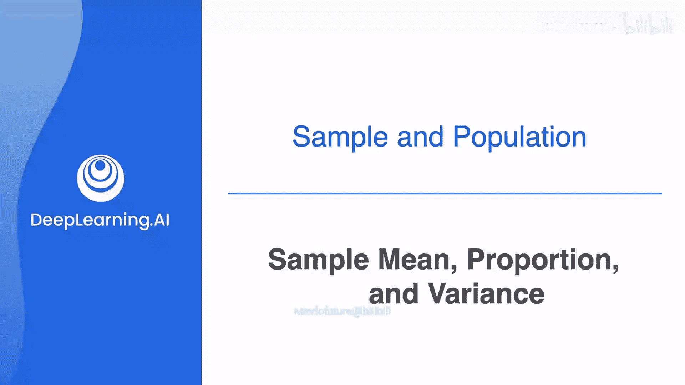
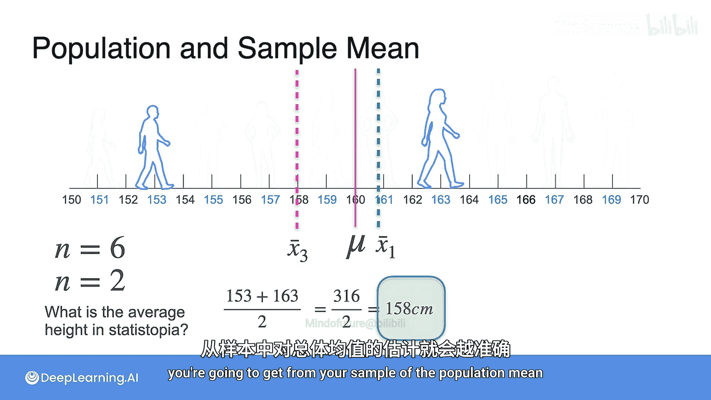

# 【Deeplearning】机器学习和数据科学概率与统计3 ｜ Machine Learning Probability And Statistics 吴恩达 p59 P59_样本均值_03_01_02 -BV1c86VBrE93_p59-

So let's say you have the entire world population and you're looking at everyone's height。

 so if you want to find the average height of the population or at least estimated it。

 you can take a small sample of the population， calculate the average of the heights here。

 and that's an estimate for the average of the height of the total population。

You can do this with other things such as proportions。However。

When you try to do it with the variance， something fails。 if I take a small sample of the data set。

 calculate the variance here。 I don't get the variance of the original data set。

 but I do get something very close。 let me show you。

So let's revisit the island of Statopia again and for simplicity。

 assume that the population size is 10 as shown here and the heights are shown over here now what is the average height in Statopia well we can calculate it like this very easily and get 160 centimeters that is the population mean and we're going to call it mu and that mu lies over here。

Now， what if for some reason you can't record all the 10 people heights。

 so as a result you're only able to get six people and you did so randomly so let's say that your sample size was 6。

Now what is the estimate for the average height in Statopia Well if you pick this six people then it's going to be 160。

97 that is a sample mean which you're going to call x bar and because it is the first sample we're taking let's label this x bar but actually underscore with a1 x1 bar is our first estimate now let's take another sample of six people and let's calculate their heights so this one is going to be 156 centimeters so we're going to call that x2 bar and that's going to go here。

And now let's compare x1 bar and x2 bar， both of these have a sample size of6 but which is the better estimate for the population mean well x bar1 is better and this can be attributed to the fact that we did more random sampling as you can see the second set is formed by the six shortest people so it's not a good sample but what if instead of n equals6 we picked n equals 2 what is the estimated average height in Statopia using n equals 2 well let's pick to random people and we get 158 centimeters that' is going to be called x3 bar。

As you can imagine， x1 bar is a better estimate than x3 bar because x1 bar use6 people and x3 bar only use 2。

 so we're going to explore this phenomenon in more detail in later lessons。

 but for now it's good to know that the bigger sample size。

 the better the estimate you're going to get from your sample of the population mean。

