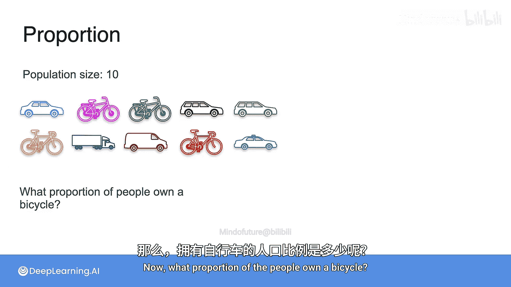
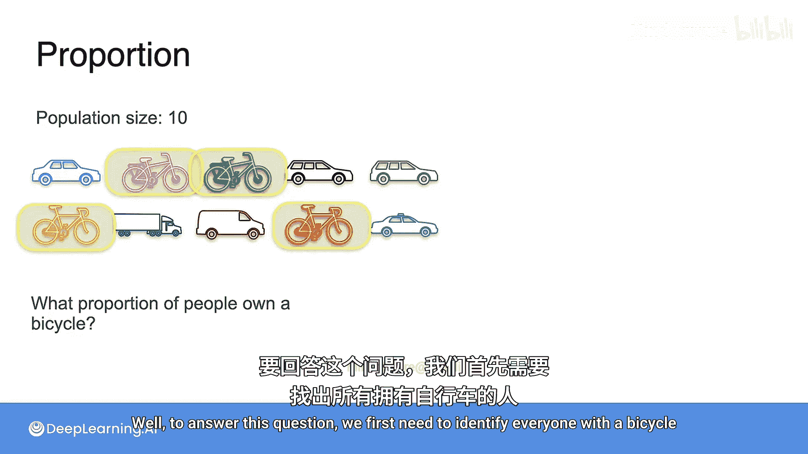
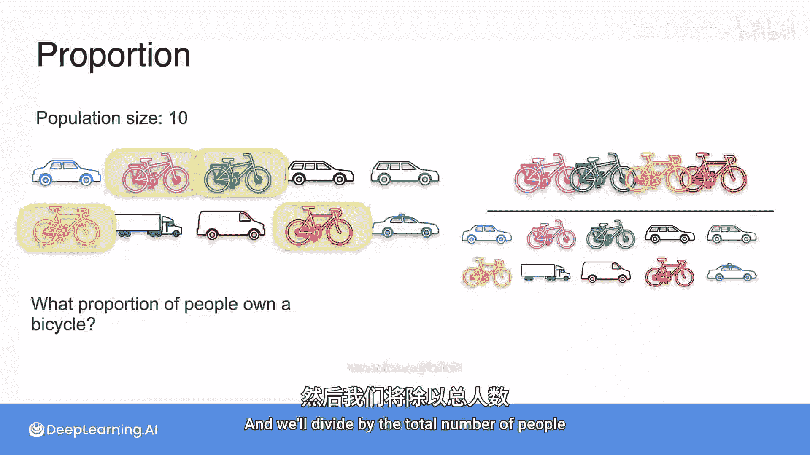
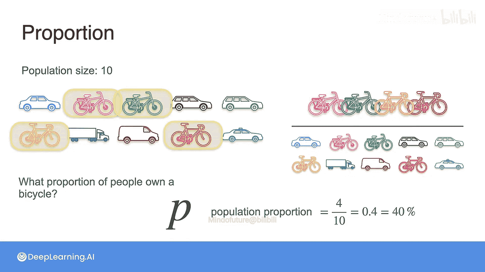
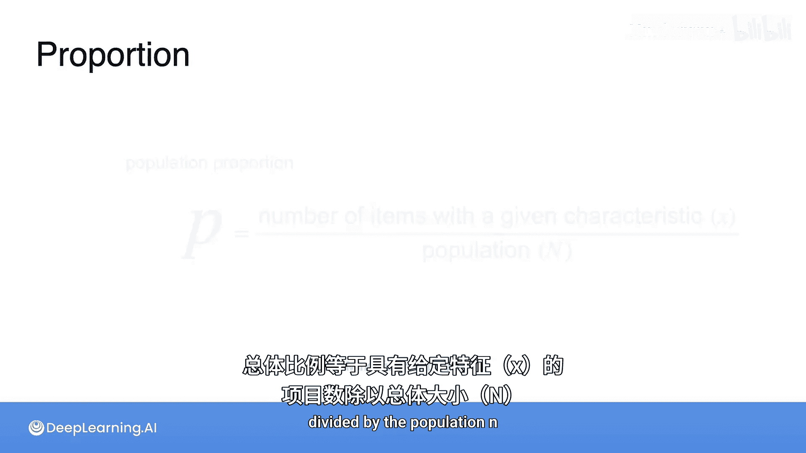
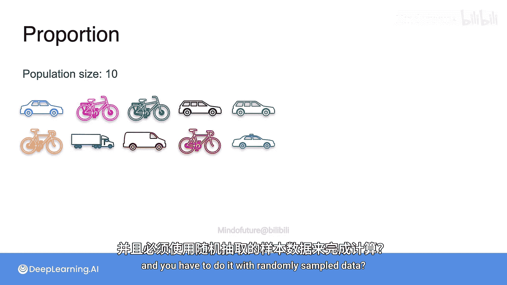
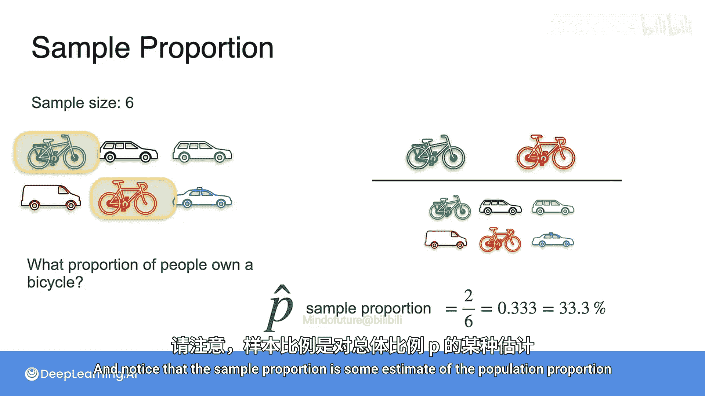
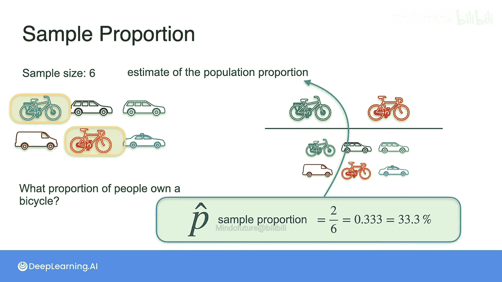

# 【Deeplearning】机器学习和数据科学概率与统计3 ｜ Machine Learning Probability And Statistics 吴恩达 p60 P60_样本比例_03_01_03 -BV1c86VBrE93_p60-

So once again for illustrations sake imagine that there is only 10 people living in stalostopia that means you have a population size of 10 Now everybody has some form of transportation as shown either a car or a bicycle now what proportion of the people own a bicycle well to answer this question weers need to identify everyone with a bicycle those are highlighted here and will divide by the total number of people so that's 4 divided by 10 or 40% 40% is the proportion of the population that own a bicycle。

And of course this is assuming that everybody owns exactly one type of vehicle this metric right here is called the population proportion noted by B。

And the population proportion is the number of items for a given characteristic。

 x divided by the population n。

Now， what if you don't have access to the population size of 10 and you have to do it with randomly sampled data。

 So we're going to take a random sample of six people and。

Let's calculate the proportion here what proportion of people on a bike。

 Well here it is's going to be 2 divided by 6， so 33。

3% this metric is the sample proportion denoted by P hat and notice that the sample proportion is an estimate of the population proportion P。

