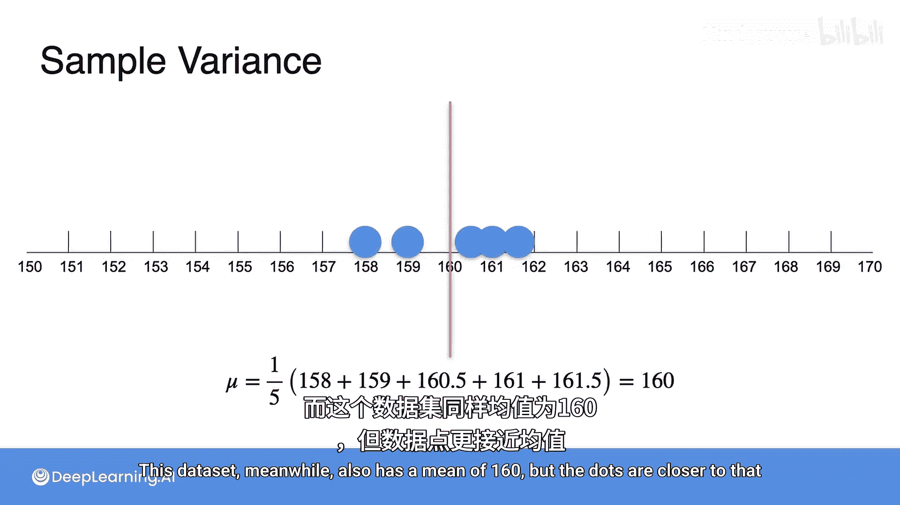
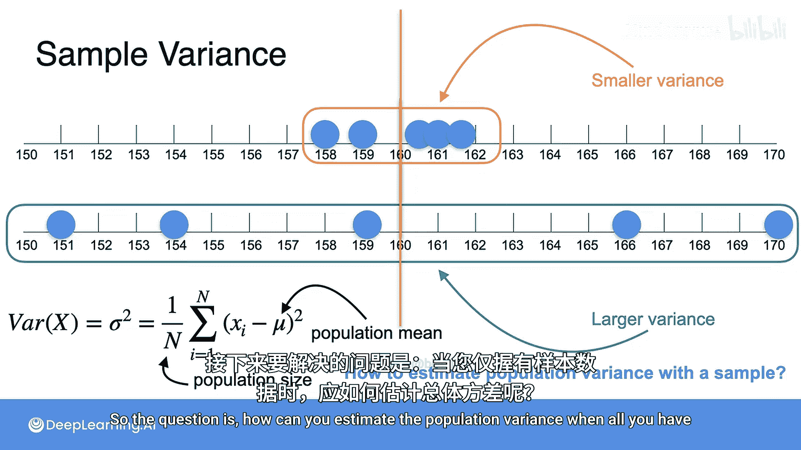
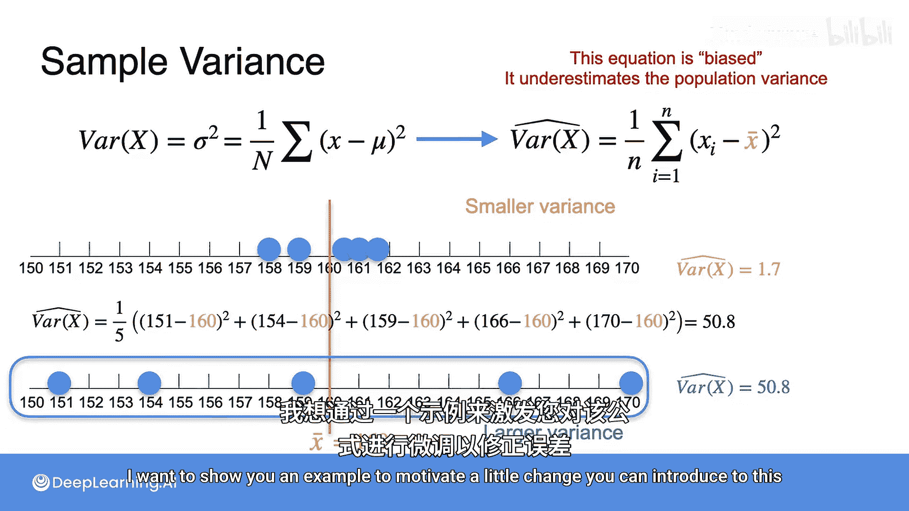
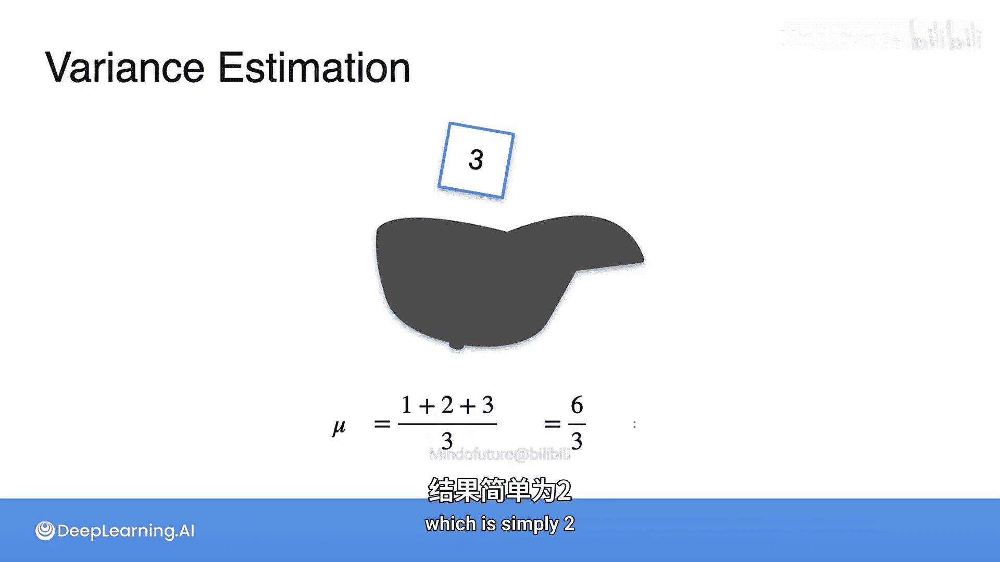
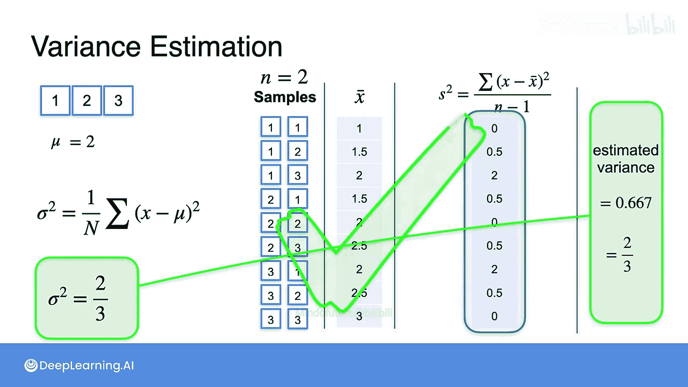
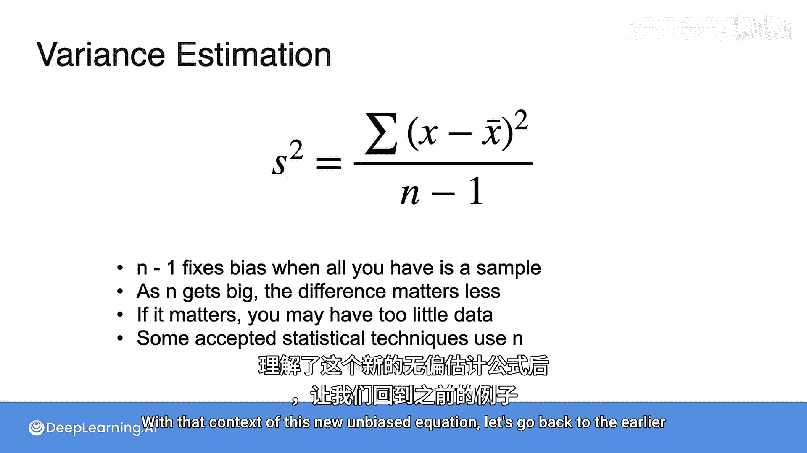
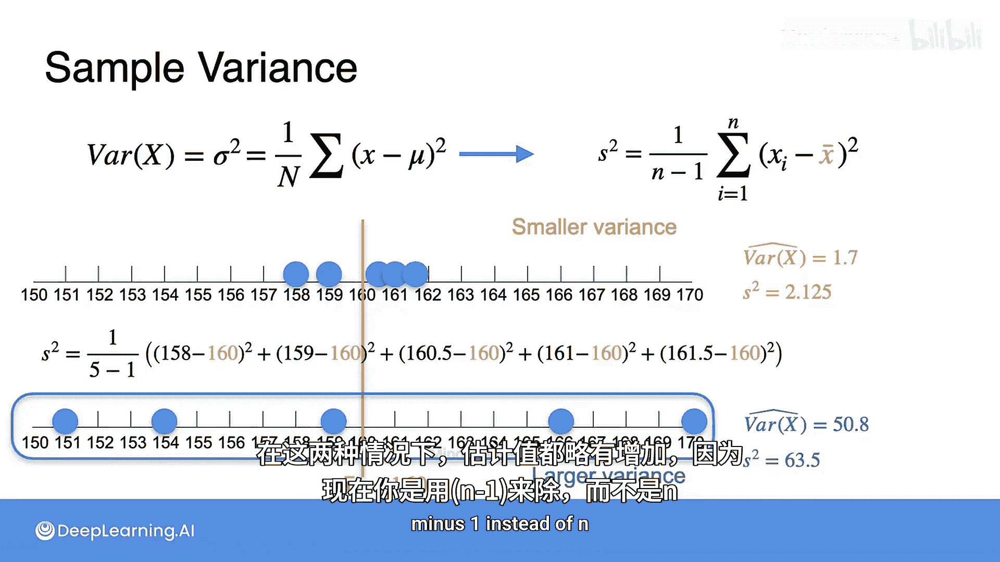
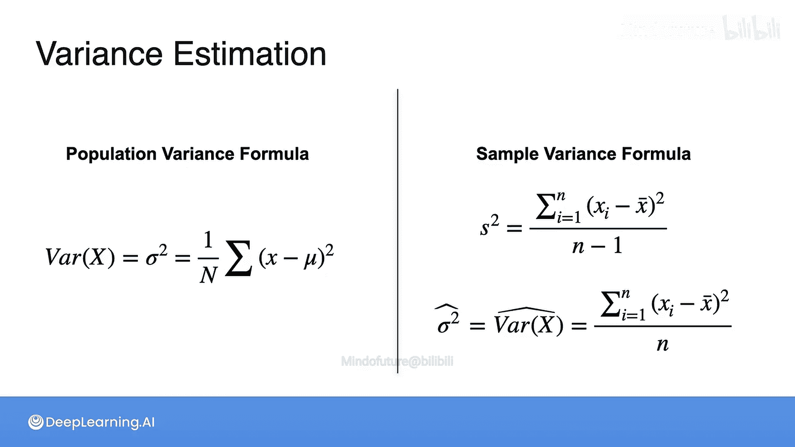

# 【Deeplearning】机器学习和数据科学概率与统计3 ｜ Machine Learning Probability And Statistics 吴恩达 p61 P61_样本方差_03_01_04 -BV1c86VBrE93_p61-

As you learn in week2， variance is a measure of how spread out your data is。

 and it is related to how far points are from their mean。For example。

 consider this data set of the heights of five people in cent。

 each one is represented by one of these five dots。 The data set has a mean of 160。

 and the dots are relatively far away from that mean。This data set， meanwhile。

 also has a mean of 160， but the dots are closer to that mean。

Let's look at those two dataset sets side by side。 The top data set has a relatively smaller variance since all the samples are close to each other。

And the bottom data set has a relatively larger variance since the data points are more spread out。

Now let's look at the actual formula for variance you learn in week2。

 variance is written as var x or sigma squared， and it is the average over the population of size n of x minus mu。

 the quantity squared， where mu is your population mean。

This is also just called the average square deviation from the mean。In statistics， however。

 you usually won't have access to the entire population， youll only have a sample； in other words。

 you won't have mu the population mean， and you won't have capital N， the population size。

So the question is， how can you estimate the population variance when all you have is a sample？

Let's see if we can come up with some estimation for the variance using only the stuff you've learned so far。

 remember the variance is still an expectation so it makes sense that we can use at least some of the techniques you've learned from the sample mean。

Create a new variable y which will be equal to x minus mu squared。

 I know this looks a little arbitrary， but consider this as just another random variable written as a function of the original variable x。

Now you can make a copy of the expression for the variance of x and rewrite it like this。

1 over n multipplly by the sum of all the values of y。

Now notice that this is simply the expected value or mean of the new variable y。

 and that means that this is the population mean of y。

Now that you have written this expression as a population mean。

 you can use the approach you learned before to get the expression for the sample mean。

 specifically if you have little n samples， just average those n values to create the sample mean。

Note that I'm using both uppercase y and lowercase y。

 remember that uppercase y refers to the random variable or population and lowercase y represents observations or individual elements of the population。

Now you can substitute x minus mu squared back to get an expression for the sample variance written only in terms of x。

I let a hat on top of Rx to indicate that this is an estimate。

This expression basically just took the population variance and replaced the big n or total population with little n。

 the size of the sample。 That said， there is still the problem of the population mean mu appearing in this expression。

 It might make sense that if you don't know the population variance。

 that you most likely don't know the population mean either。So for now， I'm going to cheat。

 I will simply replace it with the sample mean。 This expression only uses values you'd have access to with a sample。

 and it seems to make intuitive sense that it would work。

Do you think that I'll get away with cheating Well， let's try it out on the examples you just saw。

If you recall the sample mean for both dataset sets was 160。

Let's begin getting the sample variance off the top data set。 First。

 you'll divide by5 because you have five points。And then you need to add all the square differences between each point and the sample mean or 160 squared。

 which gives an estimated variance of 1。7。Now let's move on to the next dataset before we calculate。

 think to yourself if the previous dataset has a sample variance of 1。7。

 what will the sample variance be in this dataset？If you guess about 50， then you are correct。

 you could calculate it directly using the same formula。

 you could also guess by noticing the points are about 7 away from the sample mean on average。

 so the average square distance from the sample mean will be about 49。

 pretty close to the true value of 50。8。You usually don't need to calculate variances like this by hand。

 but doing them for small data sets can help reinforce the operations that some of these terms stand for。

Now， remember when I said earlier that you could just use the sample mean in your equation。Well。

 actually， it turns out that that introduce some errors and make this equation a little bit biased。

That is determined statistics that just means that the formula here will either over or underestimate the value it's targeting in this case。

 this equation would slightly underestimate the true value of the population variance。

This doesn't mean that our first estimation is wrong。

 but maybe we can improve this undershooting of variant。

I want to show you an example to motivate a little change you can introduce to this formula to correct the error。

Consider a game where you have three sheets of paper with the numbers one， two。

 and 3 written on them。You put them in a hat。And then randomly pull one out。

 use score as many points as are written on the sheet of paper。

If you treat the outcome of this game like a random variable。

 then the population mean here is mu equals 1 plus 2 plus 3 divided by 3， which gives you6 over 3。

 which is simply2。

Using the formula of the population variance， let's see what the population variance of this game would be。

First， I'll list out three values of x。Next， I'll calculate x minus mu for all three values。

 which is just x minus2 since that is the population mean。This gives values minus1，0， and 1。Finally。

 square each of these values to calculate x minus mu squared， this gives 1，0 and 1。

Summing all of these， you get two。Divide by n and you get two over 3。

And that is the value you'll calculate for the population variances。

Now let's say you decide to play the game twice， placing the sheet of paper you drew back after each game。

 the outcomes are samples with little n equals to2。

 you'll use these samples to estimate the variance。

Here's a list of every possible outcome of playing the game twice。

And here's the equation for variance， which you could use to calculate the sample variance for each one of these samples。

You can then average those variances to see if it's a good estimate for the population variance。

 which you just saw it's23。First， calculate the mean of each sample giving you the following values。

Now I add a column where I'll use the proposed estimation to calculate variances。

Note I'll use a little n or sample size of2 in each of these calculations。Finally。

 I'll average all of these sample variances to see what the average estimated variance would be。

It turns out to be 0。333 or 13。But you know that the population variance is supposed to be23。

 so clearly there was an error here。Let's take several steps back to the point where I calculated the variance for each of the samples。

Now， instead of using this variance formula， I will adjust the divr by subtracting one to see the effect。

So now in the various calculation， we're not dividing by n， we're dividing by n minus1 instead。

Let's call this new way to estimate variance s squared。

 since that is the most common way you'll see it in other sources， and Ys well。

 because it's similar to sigma。Here are the new sample variances you would calculate using this formula now taking the average of each of these sample variances。

 you now get 0。667 or 23。And of course， you know that that's the population variance value you were aiming for。

So here is the sample variance expression you'll see most often。

 and the biggest challenge is that n minus1 in the denominator。

I'm not going to rigorously prove why using a minus1 fixes the bias in the sample variance equation I showed you before。

 but just know this approach works in general。If you want your sample variance to be unbiased。

 you will divide by n minus1。That said， as n gets bigger。

 the difference matters less if your sample size is 3 is the difference between dividing by 3 or2。

 which is a large difference。If your sample size is 1000。

 then it's the difference between dividing by 1000 and 999， which is not a very big difference。

In fact， from a practitioner's point of view， if using n or n minus-1 makes a significant impact on your estimated variance。

 then be careful you might have bigger problems than deciding whether to divide by n or n -1。

 because it probably means you have a small sample size and should be wary of making strong conclusions。

Finally， I want to clarify that some accepted statistical techniques use n in the denominator to estimate variances。

 for example， maximum likelihood estimation， which you will see in a coming lesson technically divideised by n。

However， the S square estimate where you divide by n minus1 is the most common estimate of variance and the one you'll see most frequently through the rest of the course。

With that context of this new and biased equation， let's go back to the earlier examples and see how much things change。

Now let's replace 1 over n by 1 over n minus1 to get the S square estimation。

Look into the first dataset in this case， now you go from a 1。7 estimation to an estimation of 2。125。

 and for the second data you go from a sample variance estimate of 50。8 up to 63。5。In both cases。

 the estimate increased slightly because you're now dividing by n minus1 instead of n。

To sum up， if you have access to the whole population。

 then the variance can be found by computing the average of the square difference between each value and the population mean。

However， if you only have access to some data points or a sample。

 then you will most often use the s squared estimate of variance in this estimate。

 you find the average squared difference between each value in the sample and the sample mean。

 but instead of dividing by n， the size of your sample you divide by n minus1。

Dividing by n minus1 corrects for the bias introduced by using the sample mean instead of the population mean。

In a few contexts you may see the estimation where n is used in the denominator I'll call this estimator var hat or sigma squared hat。

 while this estimator has a small bias， which means its expected value is a little difference from the true population variance。

 it is still a pretty good estimation of variance and appears as part of using some common statistical techniques That said。

 the S square estimator will be the most common est of variance you'll see in this course and in practice when you need to estimate the variance of a population from a sample。

