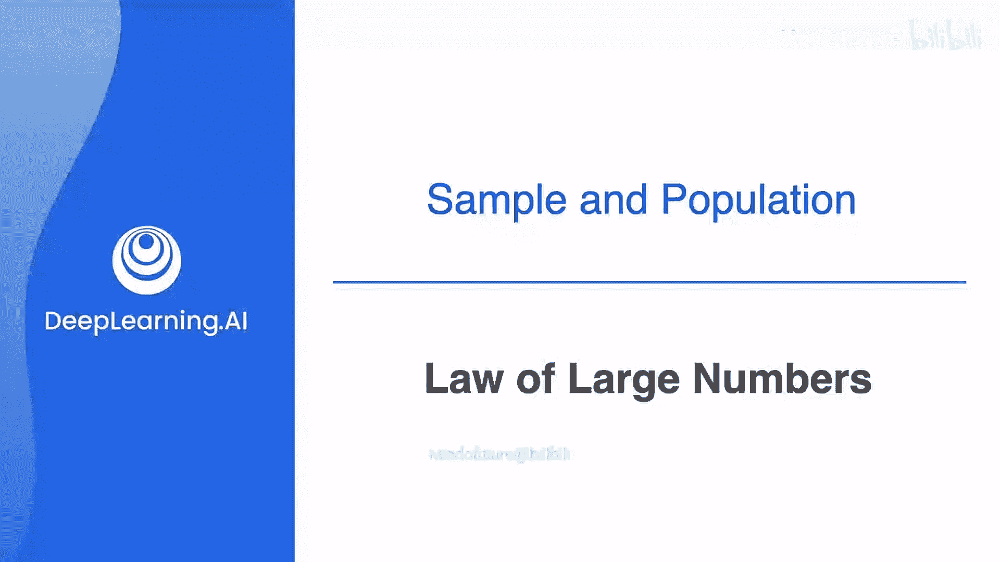
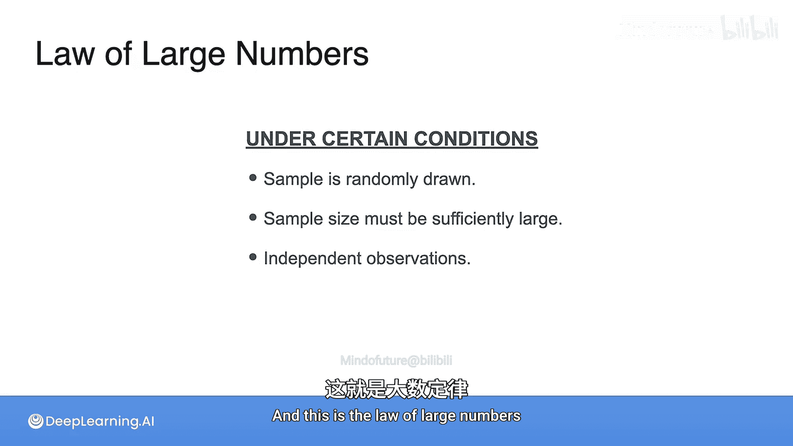

# 【Deeplearning】机器学习和数据科学概率与统计3 ｜ Machine Learning Probability And Statistics 吴恩达 p62 P62_大数定律_03_01_05 -BV1c86VBrE93_p62-

So let's stay with the example of height in the human population。

 Let's say that you want to find a good estimate of the average of the height of all humans。

What's the cheap way to do this？We get one person， we measure them， and that's an estimate。

It's a bit of a noisy estimate， so we can just take like baby two or three people take the average of their heights。

 and that's a slightly better estimate。 I can do it with 10 people and get a better estimate or 100 or 1000。

 The more people I get， the better the estimate is。

 and that happens with other metrics not just expected value。 This is the law of large numbers。

 Let me tell you more about it。 So consider again this fair sightd die whose possible outcomes are 1。

2，3 and 4 and where the mean is 2。5。 Now let's run and experiment again where we throw the dice twice and record the average。

 we get the following 16 outcomes of all the possible pairs of values we can obtain。

 and the average of each possible pair is going to be in this table over here。

The mean of all these outcomes is the general population mean， which is 2。5。Now。

Let's draw samples from this population mean of all possible outcomes one at a time。

 So we start with。4 comma 3， and that gives us an average of 3。

5 and we're going to point out that this is the population average of 2。5。

 So the mean of the first sample was x1 bar， which is over here。 Now let's take two trials，3。

4 and 13 and let's take the mean of those。And now let's take three trials and the mean of those and plot it over here and we can continue four trials we put the mean。

And etc， etc， and notice that the more samples that we take。

 the closer and closer that we get to the population mean。For example。

 if we draw  nine samples we get 2。56 as an average， etc， etc， and notice that over here。

 we're already pretty close to the population mean of 2。

5 this illustration of the law of large numbers which says that as a sample size increases。

 the average of the sample will tend to get closer to the average of the entire population。

So if n is the number of samples and each x subi is a random variable and it represents a sample from the population。

 all x subi must be independent and identically distributed， or IID for short。

 and they all have the same distribution as x。Then as n goes to infinity。

 then this average of the samples actually gets closer and closer and closer to the expected value of x。

 which is mu of x the population mean。In other words as n goes to infinity。

 this mean gets closer and closer to the population mean， and this happens under certain conditions。

 so the conditions are the followings， first is that the samples must be drawn randomly from the population。

 second that the sample size must be sufficiently large。

 the larger the sample size the more accurate the sample mean is likely to be。And third。

 that the individual observations in the sample must be independent of each other。

 and this is the law of large numbers。

