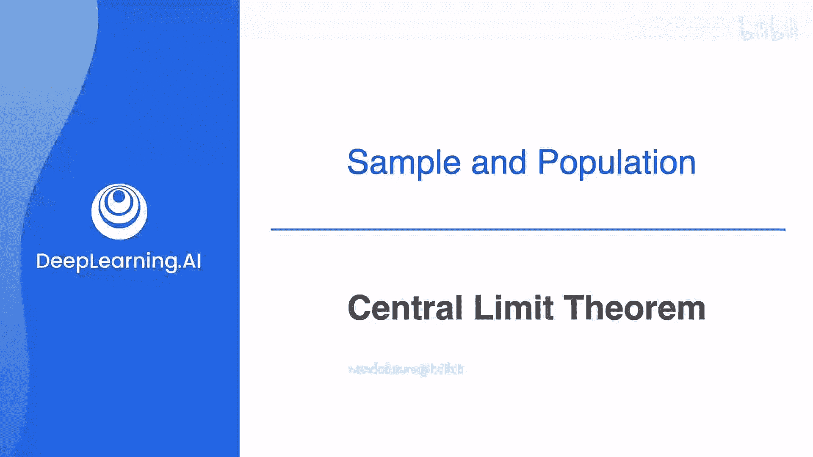
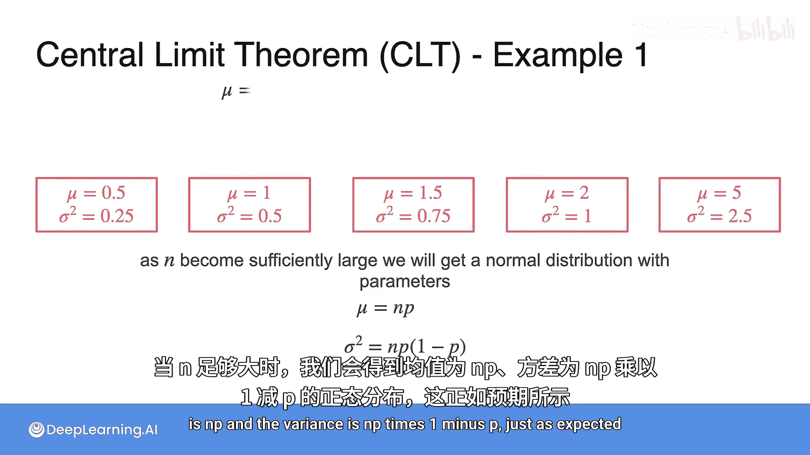

# 【Deeplearning】机器学习和数据科学概率与统计3 ｜ Machine Learning Probability And Statistics 吴恩达 p63 P63_中心极限定理离散随机变量_03_01_06 -BV1c86VBrE93_p63-

So remember I told you before that the normal distribution appears in a lot of places。

 here's one that perhaps you didn't expect， take a distribution any distribution it can be as skewed as you want now take a few samples always the same number and look at the average and do this many times and plot all these average guess what you get。

Yes， you get the normal distribution， no matter what distribution you started with in the first place。

This is a fascinating result and is one of the pinnacles of statistics is called the central limit。

So let's start with an example of a discrete random variable that you've seen a lot of time in this course。

 the probability of heads and tails is the same and the random variable x is the number of heads when a coin is flipped n times。

 so for one coin flip it's x equals 1 for the case of heads and x equals0 for the case of tails that's a discrete random variable with this probability distribution over here。

A half4 x equals 1 and a half4 x equals0 where the number of heads is in the horizontal axis and the probability is in the vertical axis Now what can we say about the probability distribution region when the number of coin flips increases well here's what happens with two coins。

Here's what happens with three coins。With four。And this is with 10。And as you can see。

 this looks a lot like a Gaussian or normal distribution。

 notice that counting the number of heads in end coinin flips is the same as adding n burdenly variables where each variable takes the value 1 if you see heads and0 if you see tails。

 and this is an example of the central limit theorem that says that as you increase the number of variables。

 you are adding the distribution of this sum。Your distribution looks more and more like the Gaussian distribution。

Now recall that in here， when we're tossing n coins with a probability of p， then the mean mu is np。

 which is n times the probability of heads， and the variance is np times 1 minus p。

 which is n times probability of heads times probability of tails。So for the case n equals 1。

 we have that the mean is n times p， which is 1 times 0。5。And that's 0。5。

 that's the case when they have a fair coin。And the variance is n times p times 1 minus p。

 which is 0。25， so let's calculate the minus variance for all these examples for the first one we have 0。

5 and 0。25。For the second one， it's 1 and 0。5。For the third one is 1。5 and 0。75。Then two and one。

And for the 10th one is 5 and 2。5。Now， what are these numbers well， as n becomes sufficiently large。

 we get a normal distribution where the mean is NPp and the variance is NPp times 1 minus p。

Just as expected。