# 【Deeplearning】机器学习和数据科学概率与统计3 ｜ Machine Learning Probability And Statistics 吴恩达 p64 P64_中心极限定理连续随机变量_03_01_07 -BV1c86VBrE93_p64-

So let's see the central limitthereorem in the context of another experiment this time youll consider a continuous random variable let's go back to the tech support line example you saw in week 1 lesson 2。

 once you call the line the operators can answer any time between 0 and 15 minutes after which the call gets disconnected。

You can define a random variable X that represents the wait time for a call to be answered and in the example you saw on week1 the variable follows a uniform distribution with parameters 0 and 15 remember that a uniform distribution model situations where every interval of the same length has the same chance of occurring。

 which leads to a constant probability density function。

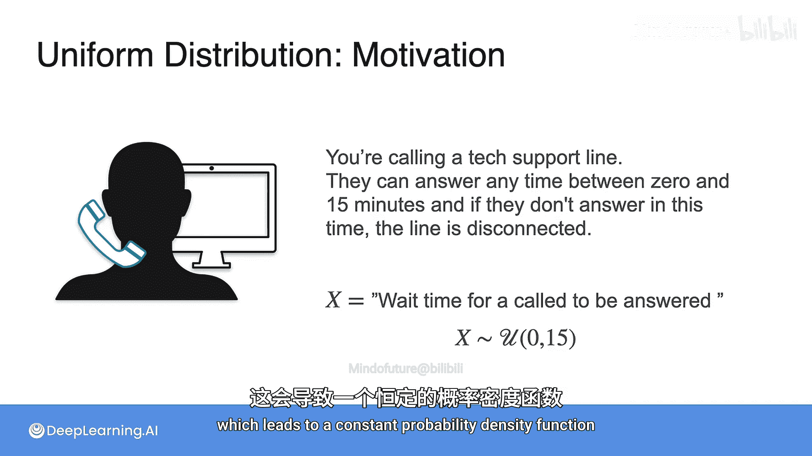

Now youre interested in the mean wait time to try to approximate it you will average the waiting time of different number of calls。

 this means that if you use with just one sample then that sample is the one used to approximate the mean if you use two samples you will average the waiting times for the two calls for three samples you will average the lengths of three calls and so on。

In general， if you record the waiting time on n calls。

 you can define the variable Yn as the average of the wait time for all the n calls。

Can you say anything about the distribution of YN？Well let's start with n equals 1 where you're just averaging one weight time。

 let's repeat this experiment of averaging one wait time many， many。

 many times to get a nice histogram and see the distribution。

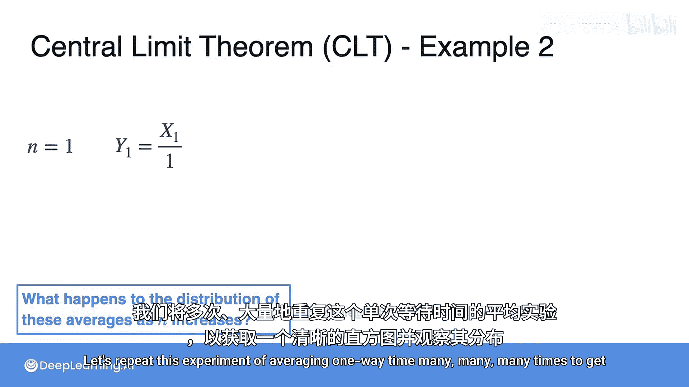

The histogram looks like this， it kind of looks like a uniform density from far away because each sample of y1 comes from a uniform 0 to 15 distribution。

 of course there are ups and downs。

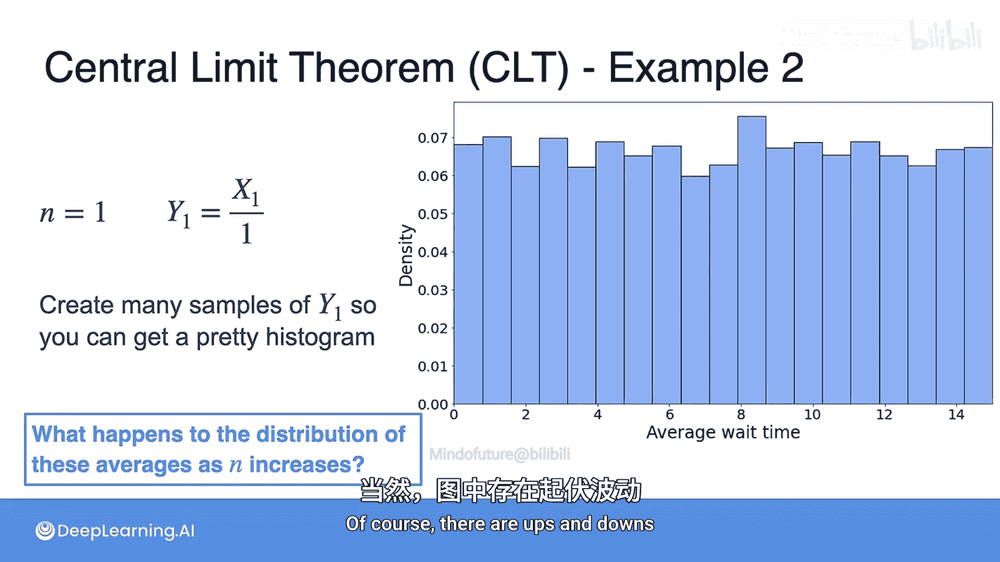

Now what happens for n equals 2 well now again you are averaging the wait times for two calls again repeat this experiment of averaging two wait times many。

 many times and you get a nice histogram to see the distribution Now the density looks like a triangle note that it's almost symmetric around 7。

5 which is the population mean of the wait times now let's move on to n equals 3 in this case you're averaging the wait time for three calls and repeat this experiment many times until you get a nice histogram to see the distribution notice that it's starting to look more and more belt shaped and its still symmetric around 7。

5。

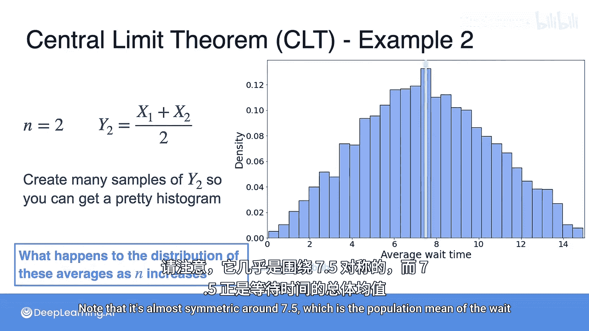

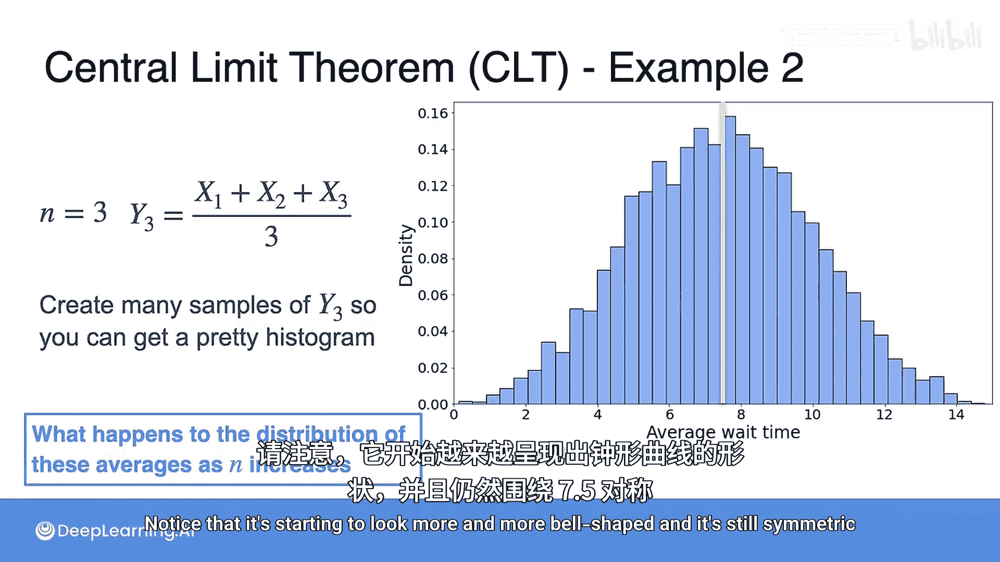

Here it is for n equals4， the population mean of four calls。

 and for five it's more bell shaped and it also has lower dispersion。

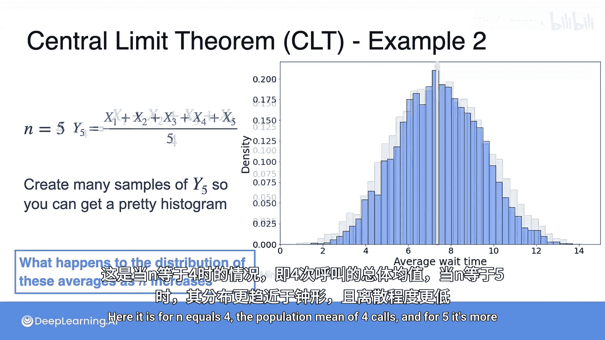

You can even draw the curves fitting the ssterogram。

 the green lines correspond to the kernel density estimation that you learned at the end of the previous lesson。

 as you can see as n increases， these curves look more and more like the Gaussian probability density function。

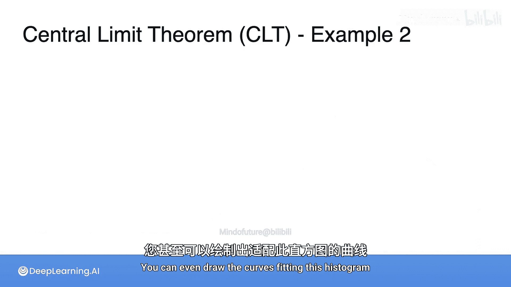

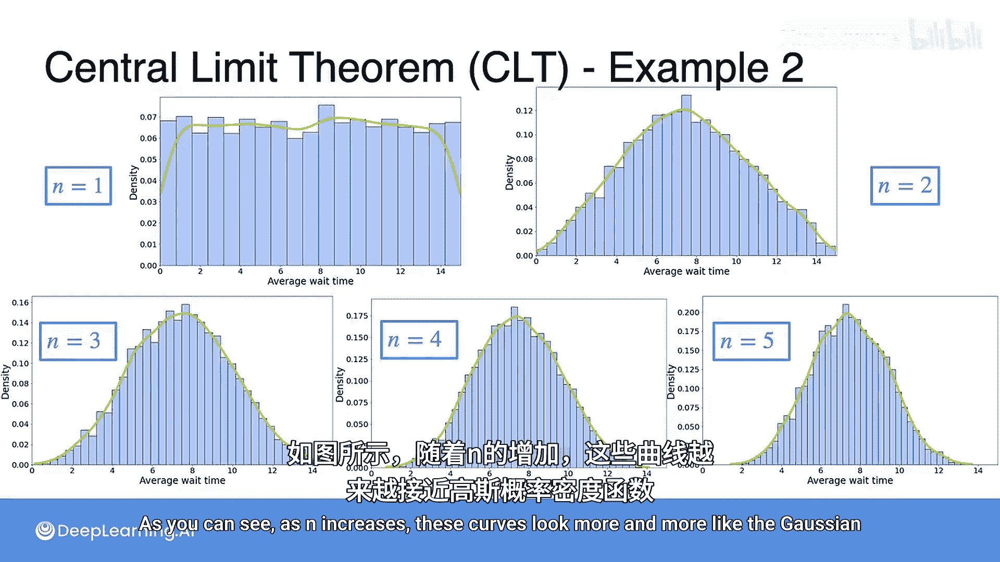

You could also ask yourself， what are the mean variant of these variables YN？

Well let's start with the mean， the mean of yN is by definition the expectation of the average of n variables X。

By linearity of the expectation， this is the same as 1 over n times the sum of the expectations of each of the n variables。

 but since all variables are identically distributed， this is 1 over n times n times the mean of x。

 which is simply the mean of x for the uniform distribution with parameter 0 and 15 this is 7。

5 Now let's do the variance。For the variance， note that the constant 1 over n comes out of the variance。

 but it comes out squared， also because the variables are independent and the variance of the sum becomes the sum of the variances。

 this is not the general case and it's only valid due to independence here。And again。

 since all the X I are identically distributed， this is 1 over n squared times n times the variance of x。

 which is simply the variance of x divided by n for the uniform distribution。

With parameter 0 around 15 you can look up the variance which is 18。

75 it is super interesting to know that as n grows， so does the variance of the average。

 this is exactly what you are seeing in the histograms。

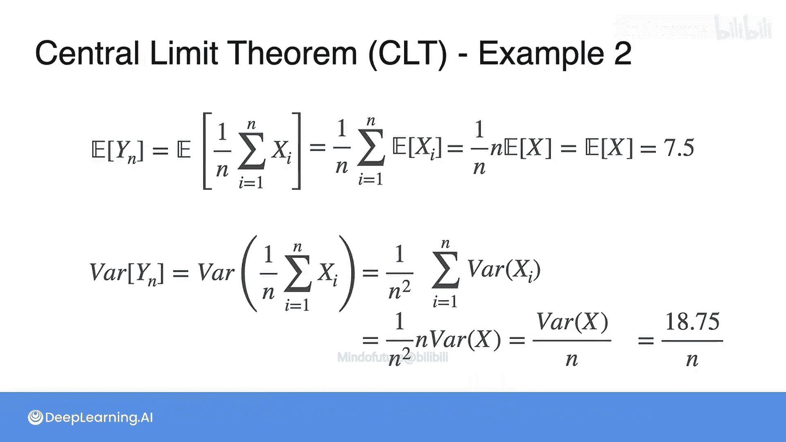

Now let's plot the probability density function for a Gaussian with the same mean and variance Yn The plots over here confirm our suspicion。

 these are the orange plots Look how the green and orange lines fit together more closely as n increases。

They're not so close for n equals one or two， but by the time we get to4 and5。

 they're almost indistinguishable。It is pretty cool to see that we started with the uniform distribution fors one where the density of each point is the same and ended up with an almost Gaussian distribution with center 7。

5 after n is larger， if we were to increase n and the distribution will get narrower and narrower around 7。

5 when you average a large enough number of variables the distribution will approximately follow a normal distribution。

It is worth mentioning at this point that while in this example。

 it seems that even averaging three or four samples is enough to start seeing the normal distribution。

 this is not usually the case。In general， a safe rule is that you usually need about 30 variables before the bell shape distribution comes in。

It all depends on the original distribution of the data if the original population is very skewed then usually need more samples than if you are working with a symmetric distribution in the case of the uniform distribution the Gaussian P curve appears very quickly as you saw in this example Now one of the most common ways to visualize this is by standardizing this is because as you can see the mean is always the same as the population mean but the variance depends on n so it's easier to compare the distribution of yn for different values of n when you standardize this average so by standardizing you see that as n increases the distribution of the average is close to a standard normal distribution there' is also one benefit in standardizing that will become very useful in the next week of content if you don't actually know the value of the population mean variance then you know that as n increases the average will approximately have a Gaussian distribution。

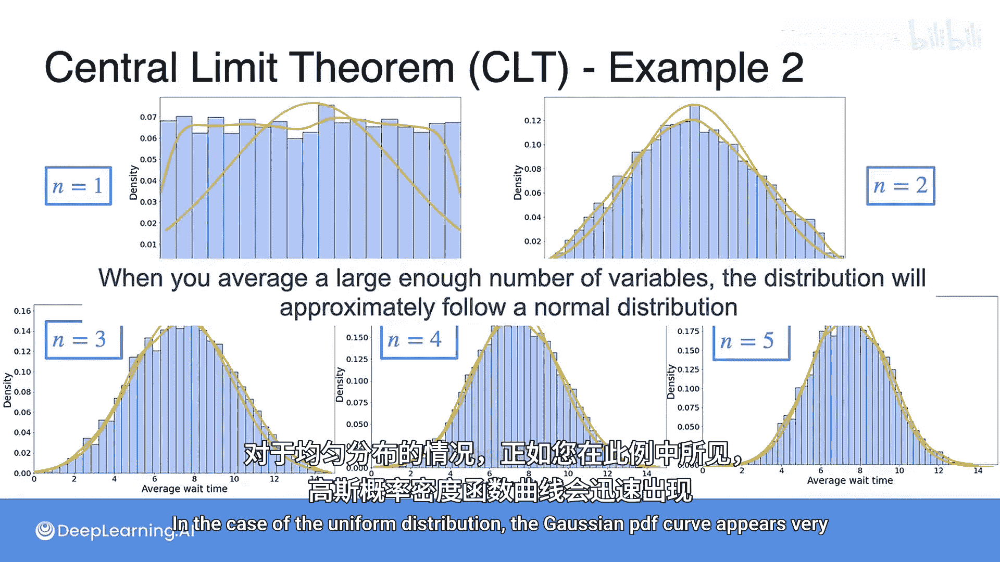

But you don't really know of which parameters now to wrap up。

 whenever you consider the average of n independent identically distributed random variables。

 the mean of Yn is the same as the population mean。

And the variance of Yn is the population variance divided by the number of variables you are averaging。

 so this is interesting， the mean stays the same but the variance gets smaller and smaller and this makes sense because the more variables you take the more likely you're going to be closer to the population mean so there is less spread and less variance。

 this result holds true no matter what the distribution of the original population is。

Now let me give you the formal definition， formally the central limit theorem states that as n goes to infinity。

 the standardized average will follow a standard normal distribution In practice this is usually true for n around 30 or higher sometimes even with smaller samples as the example you just saw Another way you will sometimes see the CLT is in terms of sums rather than averages you can easily arrive to this equation by taking the common factor 1 over n and rearranging terms properly。

So you can also say that n approaches infinity， the sum of n identically independent random variables。

 minus n times the population mean， and all that divided by the square root of n times the population standard deviation also distributes as a standard normal distribution。

And this is the central limit theor。

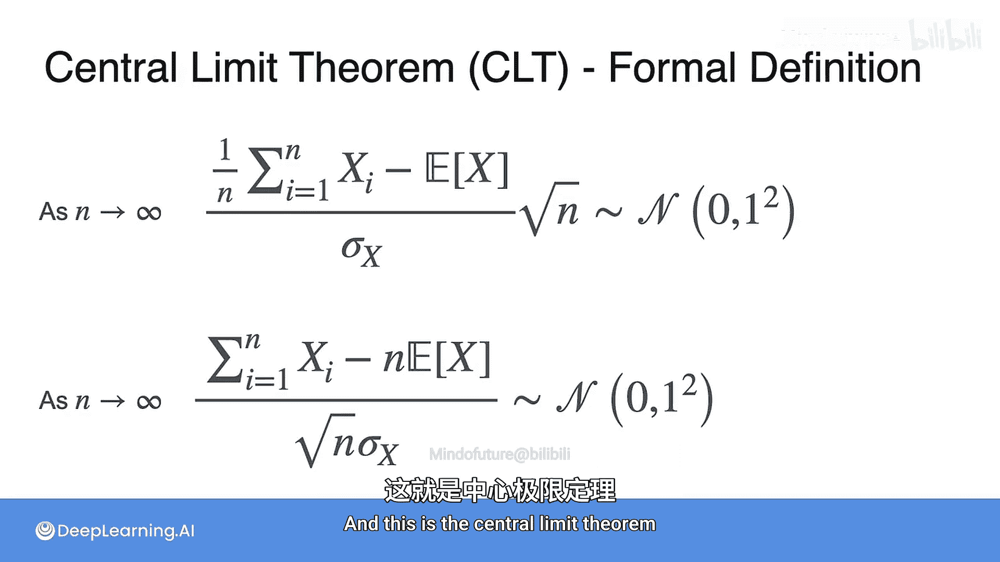

Next you'll find an ungraded lab in which you can see some of these ideas in practice。

 you'll use Python to take samples from many different distributions and see the central limit theorem in action for most well behaveved distributions。

 even a sample of size 30 should lead to a pretty normally distributed sample mean。

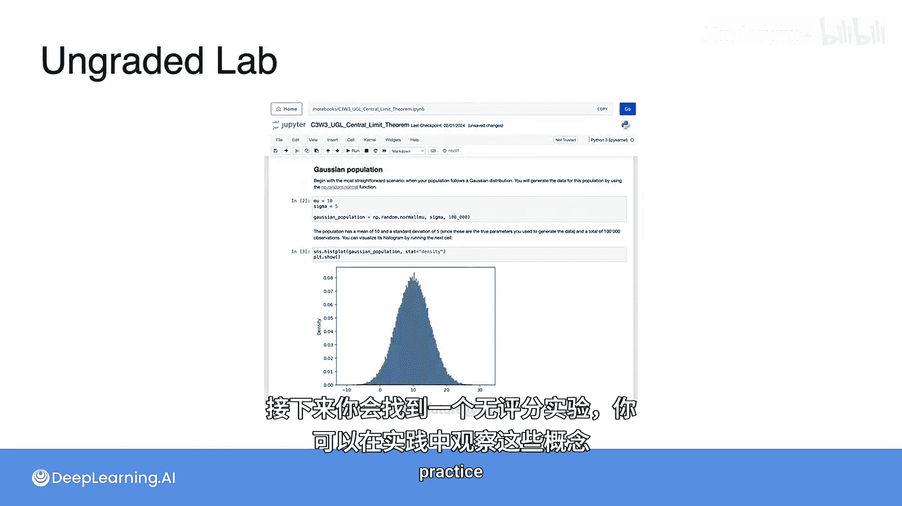

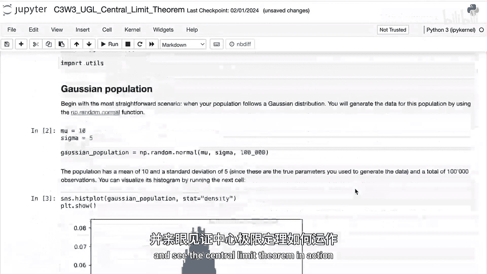

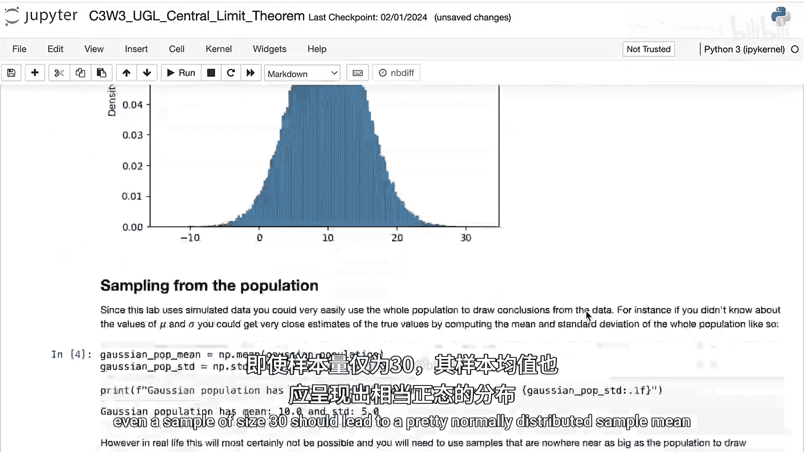

If your data is less well behaved， however， you may need much larger samples to get an approximately normal distribution of sample means the central limit theorem still applies。

 but it does take longer to kick in。Have fun getting hands on with these concepts and I'll see you afterwards for lesson two of this week。

😊。

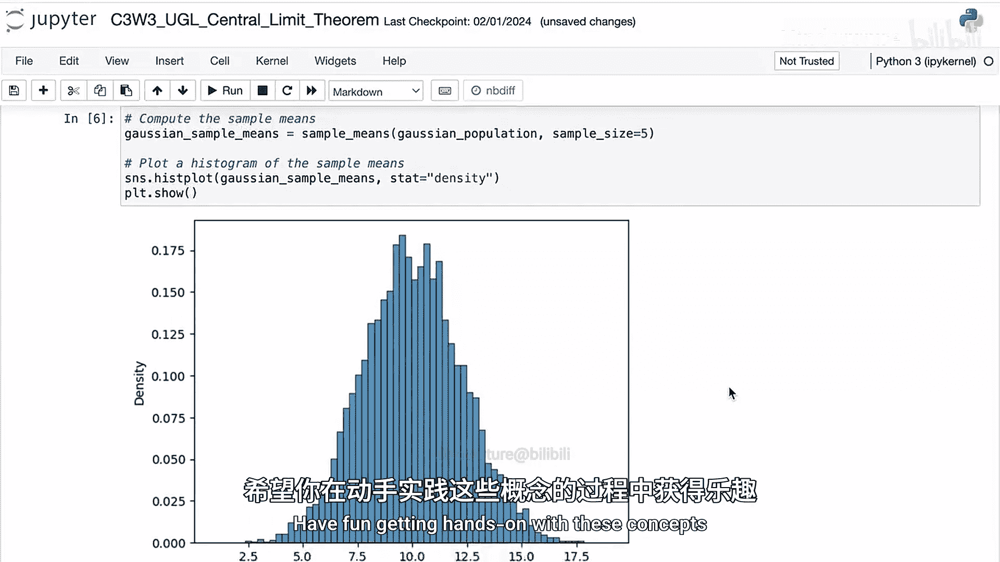