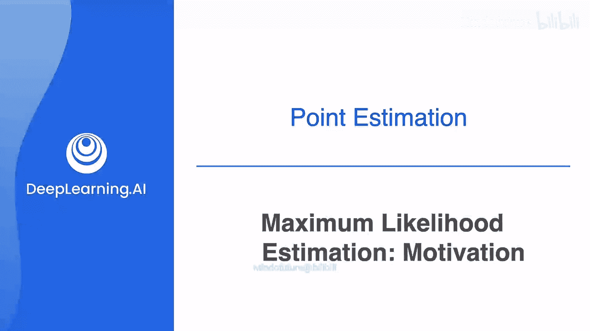
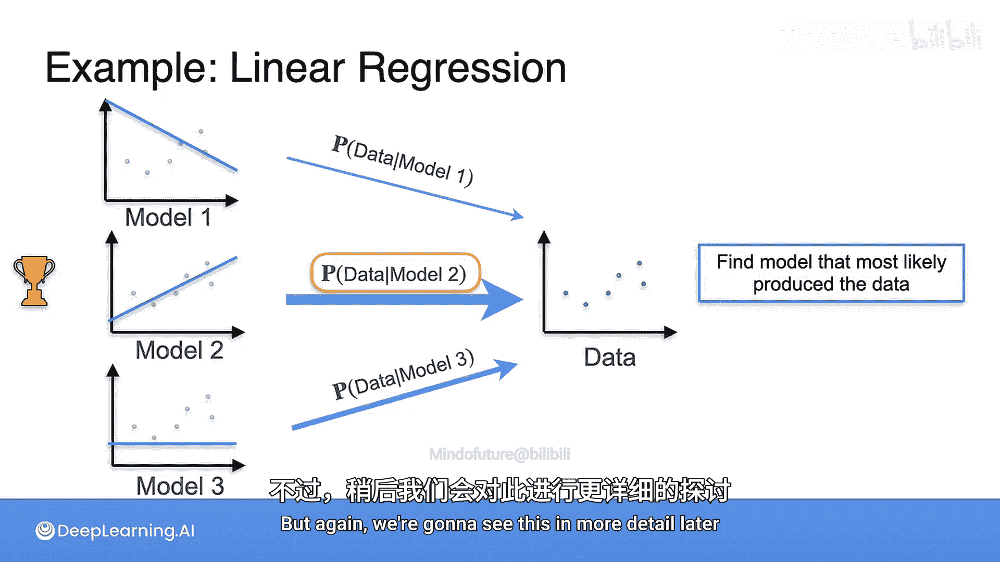

# 【Deeplearning】机器学习和数据科学概率与统计3 ｜ Machine Learning Probability And Statistics 吴恩达 p66 P66_最大似然估计动机_03_02_02 -BV1c86VBrE93_p66-

In this video you're going to learn maximum likelihood estimation or MLE MLE is widely used in machine learning to train models。

 but the concept behind MLE is very simple， imagine that you have some evidence of something and you want to find the scenario that may have led to that evidence so you pick out of all the possible scenarios。

 the one that created the evidence with the highest probability。Let me show you this with an example。

 so imagine that you walk into a living room and you see a bunch of popcorn lying on the floor next to the couch。

 so here's a question for you which one of these events is more likely to have happened。

 people watching a movie， people playing board games or somebody taking a nap。

Which one do you think was more likely to have happened？

Well let's try to look at what led to popcorn with the highest probability。

 the probability that popcorn was on floor to watching movies is high。

For board games it's medium and for taking a nap it's low because taking a nap does not produce popcorn in the floor。

 so we're going to go for whatever created the popcorn with a higher probability and that's movies so we're going to infer that the most likely thing that happened is that people were watching movies。

What we did was we maximize the conditional probability because there's a probability of popcorn given movies and that's high。

 that's the probability of popcorn given board games which is medium and the probability of popcorn given nap which is low so we found the highest conditional probability and what we did in other words is to find the scenario that most likely leads to popcorn in the floor this is called maximum likelihood we picked the scenario that made the evidence more likely。

This is actually what's done in machine learning many times you have a bunch of data and several models that could have generated that data and what you do is you estimate the probability that we see this data given Model1。

 the probability that we see this data given Model2 and given Model 3 and whichever gives the highest probability is the model that we pick the model that most likely produce the data。

 so in other words we're maximizing probability of data， given model。Now。

 why does linear regression fit in here， we're going to get into more details later。

 but to give you a vague idea。Imagine that you have these as your data points and three possible models and imagine that we had a way to generate points based on a line and the points would be generated close to the line。

 so there's a probability that the points appear based on Model 1 based on Model 2 and based on model 3 and the model that gives these points the highest probability is the model that we're going to pick but again we're going to see this in more detail later。

