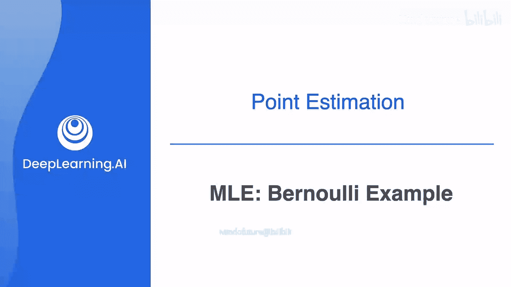
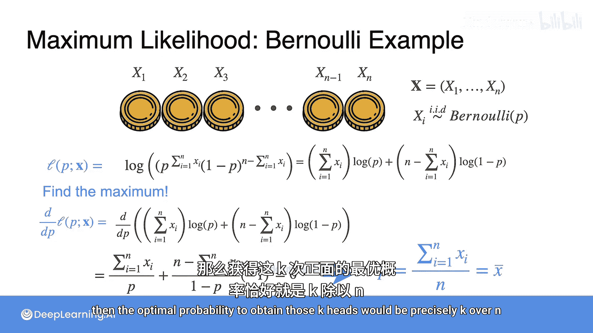

# 【Deeplearning】机器学习和数据科学概率与统计3 ｜ Machine Learning Probability And Statistics 吴恩达 p67 P67_MLE伯努利示例_03_02_03 -BV1c86VBrE93_p67-

Let's go back to the coin example， suppose that you tos a coin 10 times。

 and it lands and heads eight times and entails twice。

Now you have three possible coins that you could have flipped to get these results Co 1 has a probability of heads of 0。

7， Co 2 is a fair coin has a probability of heads and tails of 0。

5 and coin 3 has a probability of heads of 0。3。Now。

 which one do you think was the coin used for these10 tosses。

 or at least which one would you use if you were aiming to generate those10 tosses again？Well。

 let's take a look at the probability that the coin landed in eight heads and two tails for each one of the coins。

 for coin 1 is the product of 0。7 to the 8 times 0。3 squared， which is 0。

0051 it's quite small but let's look at2。2 is 0。5 to the 10 which is 0。0010 much smaller。

 and coin 3 is 0。3 to the 7 for all the heads and 0。7 squared for the tails which is 0。00003。

That's very， very small。 Actually the largest one is this one over here。

 so we conclude that if we had to pick one of the three coins which probably go with coin1 as the most likely one to have generated this what we did here with maximum likelihood we want to generate8 heads2 tails and that's three possible coins that generated coin 1 with 0。

7 probability of heads， Co 2 with 。5 probability of heads and coin 3 with 0。

3 probability of heads and each one generated the data with some probability now what's the coin the most likely produced 8 heads and two tails well is the one that maximizes probability of 8 heads2 tails given coin and that is the first one because this conditional probability is highest for coin1。

So therefore， that's the one we pick。But could we do better Is there a better coin that may work。

 Let's say that we pick some coin with probability P for heads and 1 minus P for tails What's the probability then that this coin generates8 heads and2 tails Well it's p to the 8 times 1 minus P squared which is that product Now we want the P that maximizes the chances of seeing8 heads and two tails。

That's the likelihood the likelihood is the probability of seeing this data based on the model which is a coin with probability P。

Notice that this is a function of P so we have to actually maximize it。

 This is an example that we saw in the calculus class and it turns out that we don't want to deal with products of many things especially when we're talking about small numbers let's take the logarithm which is a pretty standard trick we use to turn products into sums and that turns the product p to the a times 1 minus p squared into8 log p plus 2 log 1 minus p and that's the log likelihood so very often we're not going to try to maximize the likelihood we're going to maximize the log likelihood and maximizing1 is the same as maximizingizing the other one but log likelihood normally is a nicer function so when we take the derivative with respect to p of the log likelihood we get this over here remember that the derivative of logarithm of p is1 over p and for the second term we have a chain rule and that minus1 comes from that chain rule。

If we want to make this equal to0， then the optimal value is be hat equals 8 over 10。

 so actually the best possible coin that would have generated these flips is a coin where the probability of heads is 8 over 10 or 80% and that makes sense right。

 because the data has 8 heads and two tails。For the general case， let's do some math。

 let's say you have n coins and K heads， and each coin is a Bernoulli variable with parameter P。

 that means that it has a probability of P of landing in heads。

And the likelihood is given by this formula。Whi is the product of p to the X 1 minus p to the 1 minus X。

 and that's if X equals 1， we have p and if Xi equals0。

 then we have 1 minus B Now this is the number of heads and this is the number of tails。

And therefore， we can factor this expression like this。

Now the log likelihood is going to be the logarithm of this and the exponents come down and we get this expression。

 and we want to maximize this expression， all we have to do is take the derivative and set it equals to0。

 and that gives us an optimal value of P hat， which is precisely the mean of the population。

So in other words， if we had， for example， k heads among this population of coins。

 then the optimal probability to obtain those k heads would be precisely k over n。

