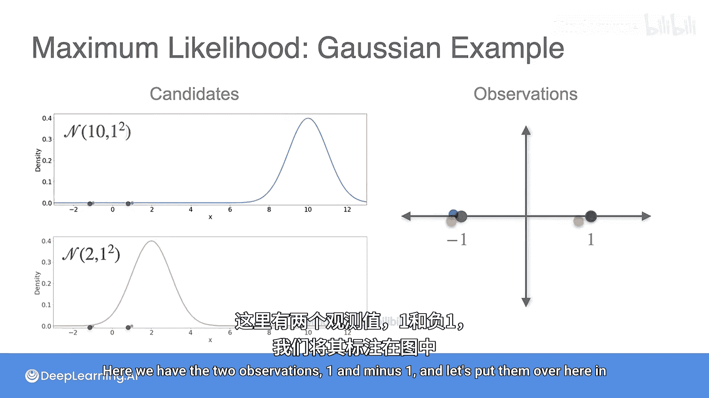
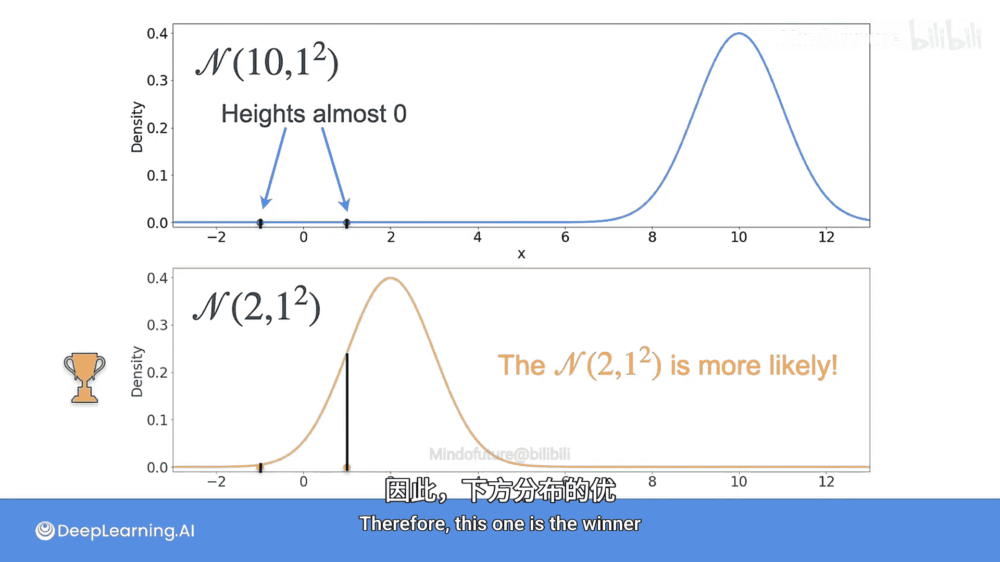
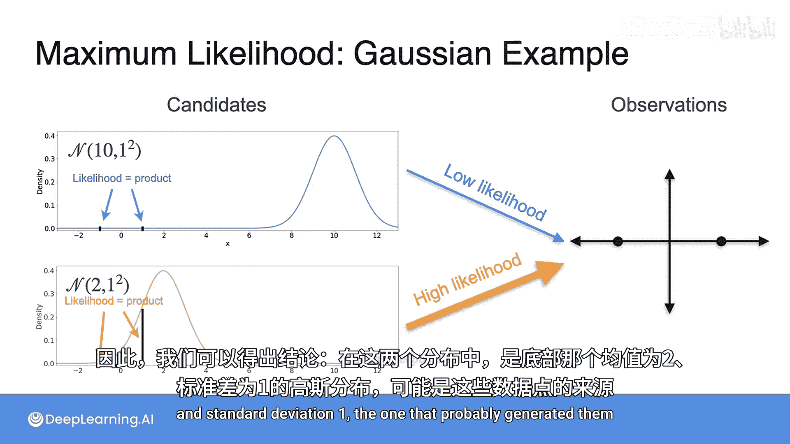
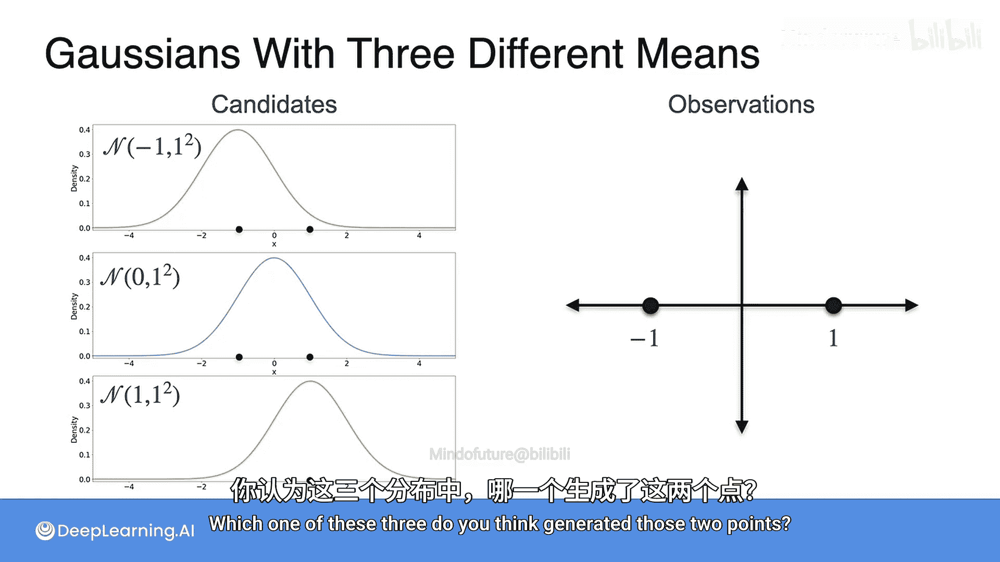
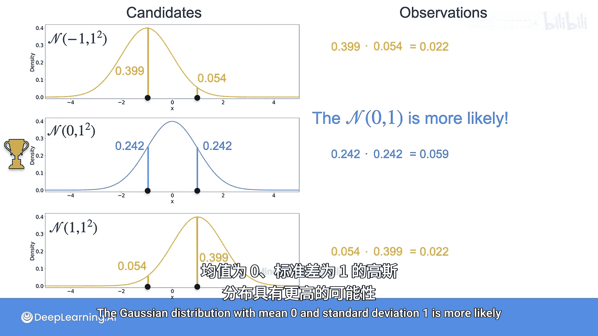
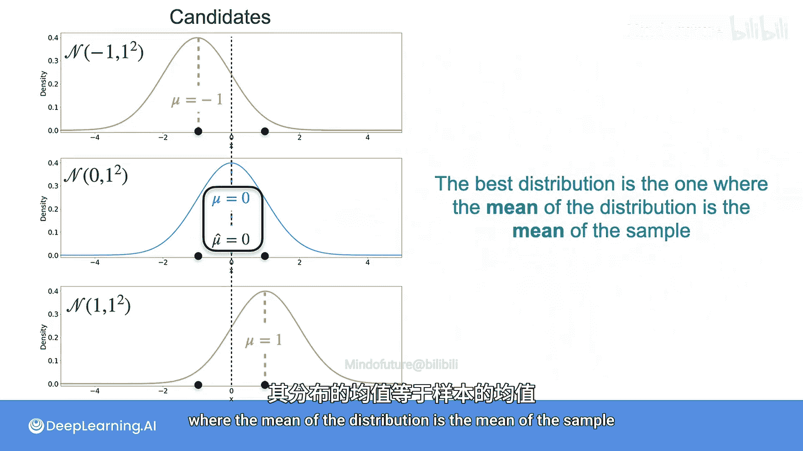
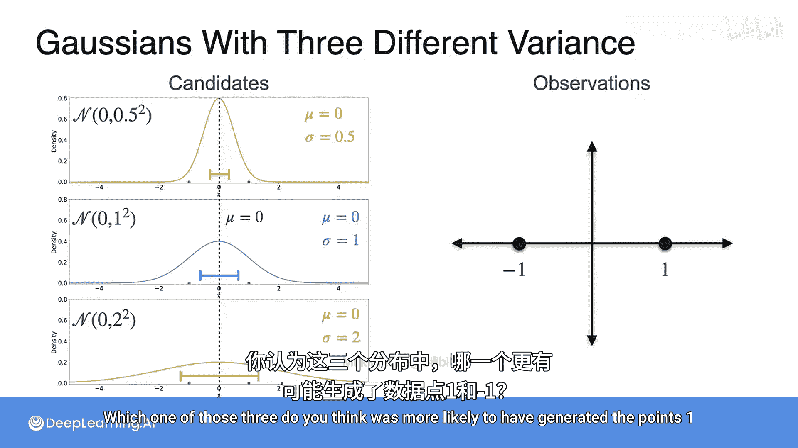
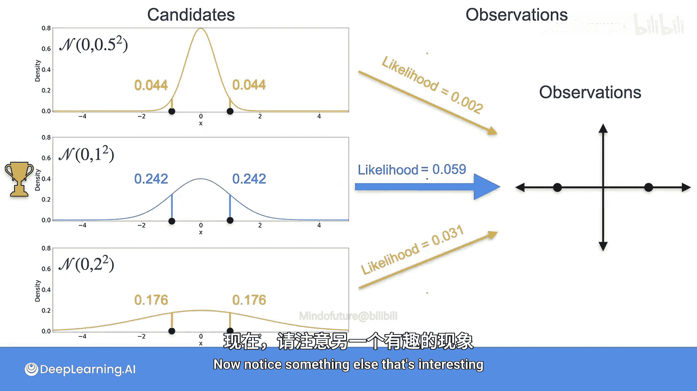
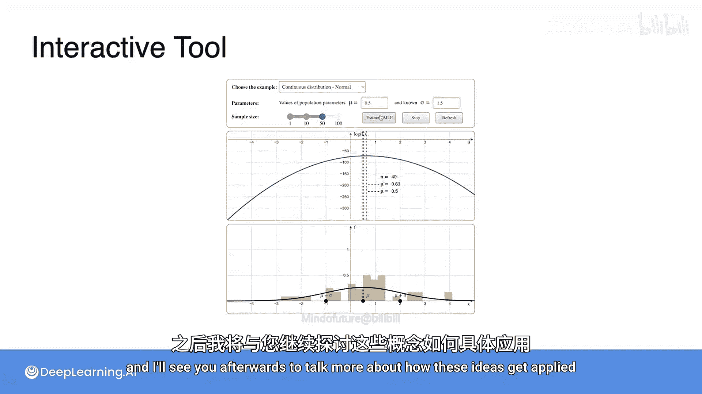

# 【Deeplearning】机器学习和数据科学概率与统计3 ｜ Machine Learning Probability And Statistics 吴恩达 p68 P68_MLE高斯示例_03_02_04 -BV1c86VBrE93_p68-

Now let's look at a similar problem， let's say that you have some observations and they are the numbers 1 and minus1。

 this observation were sampled from some distribution。

And the question is what distribution could they have been sampled from Well let's say we have two candidates。

 a normal distribution with mean 10 and standard deviation 1 and a normal distribution with mean 2 and standard deviation 1 so the question is which one of these two do you think is more likely to have generated the observations？

Well let's take a look here we have the two observations1 and minus1 and let's put them over here in the graph now let's look at the heights at those points of the curve and the heights on top are very low and the ones at the bottom are a little higher now it turns out that these heights are probabilities well not exactly their likelihoods and so you can see that the bottom curve。

 the one with mean two produces both points with a higher likelihood therefore this one is the winner so we're going pick this one among the two candidates。

 the top one generates the data with very low likelihood whereas the bottom one generates it with much higher likelihood so we conclude that among these two it's the bottom Gaussian。

 the one with mean two and standard deviation one the one that probably generated them。

We'm going to look at three Gausians， the one with mean minus1 and standard deviation 1。

 the one with mean 0 standard deviation 1 and the one with mean 1 and standard deviation 1。

 so here are the three plots Now let's test your intuition which one of these three do you think generated those two points。

Well let's take a look at the likelihood well first let's take a look at the Gaussians。

 the first one has a mu of minus1， the second one a mu of 0 and a third one a mu of1 and now let's see which one was more likely to have generated these three points so let's actually plot the likelihoods。

The likelihood are these vertical bars that go from the point to the curve and on the top one the heights are 0。

399 and 0。054 for the middle one they're both 0。242 and for the bottom one they're 0。054 and 0。399。

Now the question is which one of these three do we pick Well。

 if there were probabilities we would multiply them because these two points are independently generated。

 so because the likelihood let's also multiply them let's take the product of these two numbers 0。

022 than the product of these two numbers and the product of these two numbers and which one is higher the higher one is the one in the middle which is 0。

059 so we conclude that among these three the Gaussian distribution with means 0 and standard deviation 1 is more likely this one generated the data with a higher likelihood than the other two so that's the one that wins。

Notice one more thing。The mean for the first one is minus1。

The mean for the second one is0 and the mean for the third one is1 Now what is the mean for the original dataset。

 the dataset that was generated it's 0 it's the same one as the one of the winning curve and the reason is that the best distribution is the one where the mean of the distribution is the mean of the sample Now let's go back to our two observations and now that we've established that the best distribution has to have mean 0 then let's look at several distributions with mean 0 the first one has a standard deviation of 0。

5 the second one a standard deviation of 1 and the third one standard deviation of2 and this is how they look so this are the means and the standard deviations and recall that all of them have a mean of0 and standard deviations of0。

51 and2Now here's a question to test your intuition which one of those three do you think was more likely to have generated the points1 and minus1？

Well let's do the same thing again let's plot the points over here and draw all these heights which are likelihoods and we're going to look at the product of the likelihoods and see which one wins this one over here on top has heights of 0。

044 the second one has heights of 0。242 and the third one has heights of 0。

176 so when we multiply them the highest product is the one in the middle which is 0。

059 and that's the best one so the Gaussian distribution which means 0 and standard deviation 1 is the most likely one to have generated that data among the three is the one that gives the data the highest likelihood。

Now notice something else that's interesting， what is the variance of the observations so the variance of the observations is calculated as the average of the squares of the distances from the mean and that is going to be1。

Now。What is the variance of each one of the distributions， well， the top one has variance 0。

5 squared。The second one， one， and the third one， two squared。

After this you'll find a reading that goes deeper into how MLE is mathematically derived Next there's an interactive tool that shows you how maximum likelihood estimation works you'll be able to simulate samples from both a binomial and a normal distribution and see how maximum likelihood estimation would be used to estimate the population parameters。

 enjoy exploring this tool and I'll see you afterwards to talk more about how these ideas get applied。

