# 【Deeplearning】机器学习和数据科学概率与统计3 ｜ Machine Learning Probability And Statistics 吴恩达 p69 P69_MLE线性回归_03_02_07 -BV1c86VBrE93_p69-

So recall that a way that maximum likelihood is used in machine learning is the following。

 you have a bunch of data。And some possible models that could have generated that data。

And for each one of the models you calculate the probability that the data appears based on Model 1。

 Model 2 and Model 3， and the one that gives the highest probability is the winner。

 that means you find the model that most likely produced that data。

 the one of the highest probability is the winner that's the one that maximizes P of data given model。

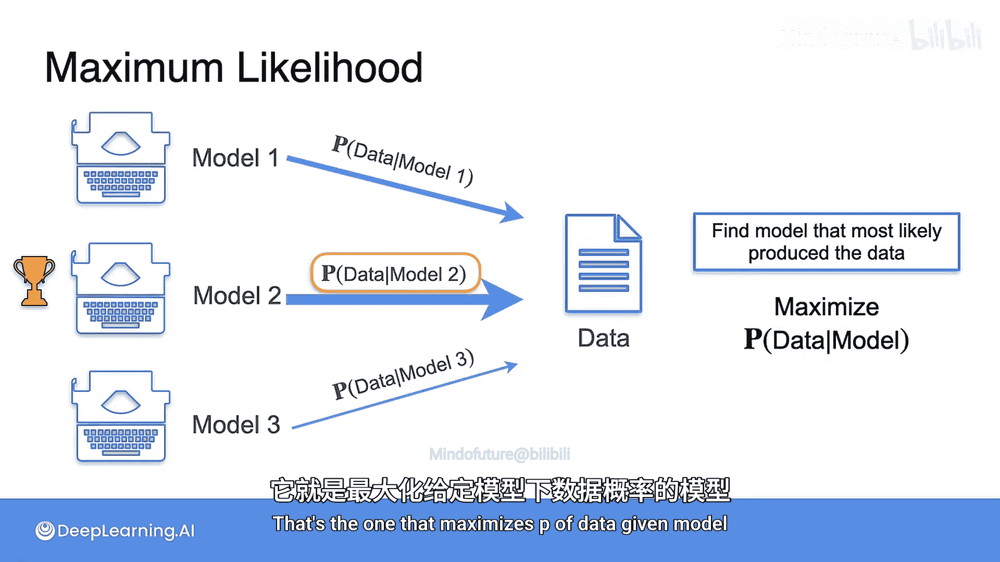

And here's a small example with linear regression， let's say that these are your points and you're trying to fit a line to them。

 but let's not try to fit a line to them， let's try to do it with probability。

The candidates are model1 that's this line， Model 2 which is this line and Model 3 which is this line。

 so first of all let's think which one looks like the best fit。

And the best fit is going to be the one that's going to give the highest probability。

 so the first one generates the data with some probability。

The second one with some higher probability and the third one with some medium probability and the one that wins is this one。

However， I haven't yet told you how a line can generate points， so let me tell you that next。

 the idea is that these lines generate points close to the line。

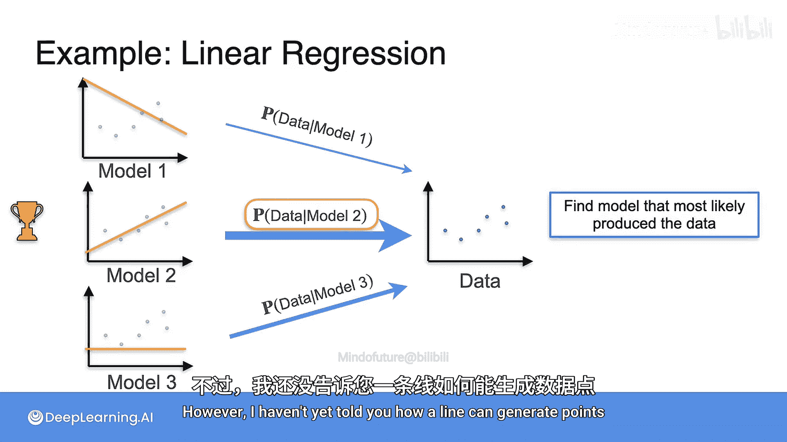

Imagine it as a road。If you have that road being the yellow line and you start building houses。

 the houses are likely to be built close to the road and not far from it， so if the road is Model 2。

 then the houses are likely to be in these points and if the road is model 3 then the houses are likely to be around here。

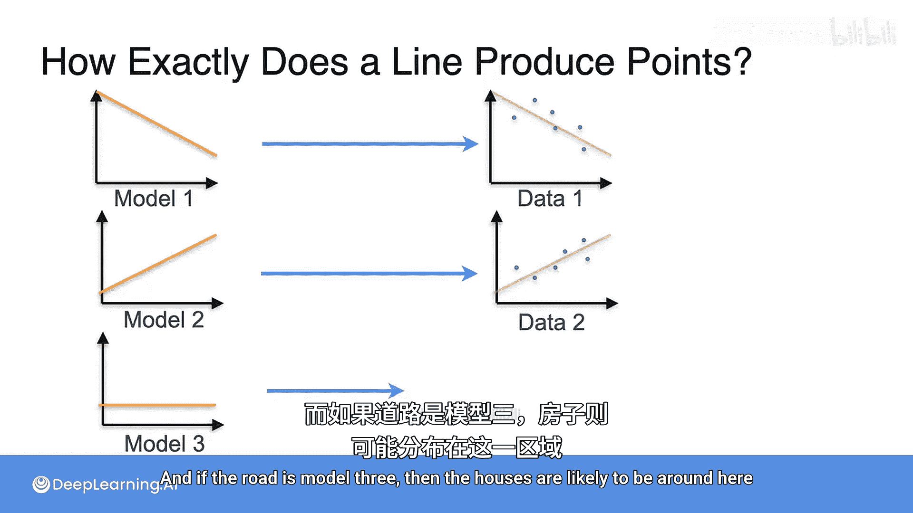

But let me put some numbers here， let's say that this is your model and this is a point X and the point of line is over here。

 so you're going to generate a point close to the line using a Gaussian。

 so we put a Gaussian and we center it at the point where the line meets the horizontal line。

And we're going to sample out of that Gaussian so we sample this one over here。

 so that's the same as saying we're going to build a house that is likely to be close to the road and it's going to be sampled from that vertical Gaussian over there now if we have a bunch of points x1 up to x5 then we have five Gaussians all centered at the point on the blue line and from each one of these we're going to sample some point and those are the five points that we're sampling based on these blue line and now all we have to do is find the line that best produced the points the one that most likely produce these points and coincidentally that's going to be the same best fit of a line from linear regression。

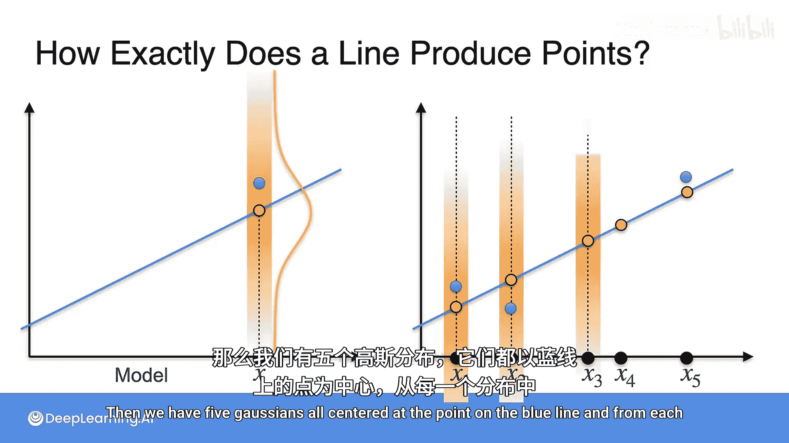

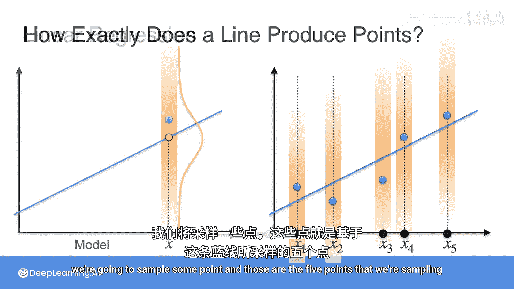

Why is this the case， well， let's do some math。

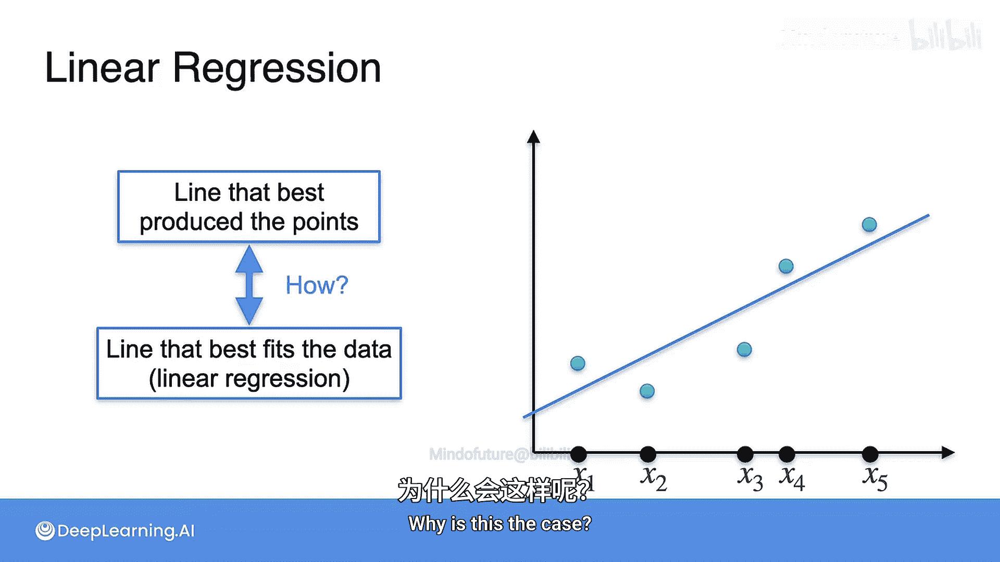

Let's say that the line has equation y equals mx plus b。

 and these are the points of intersection with the line。And these are the generated points。Now。

These distances are going to be called D1， D2， D3， D4， and D5。And first。

 let's calculate the likelihood of generating this point since we have a Gaussian。

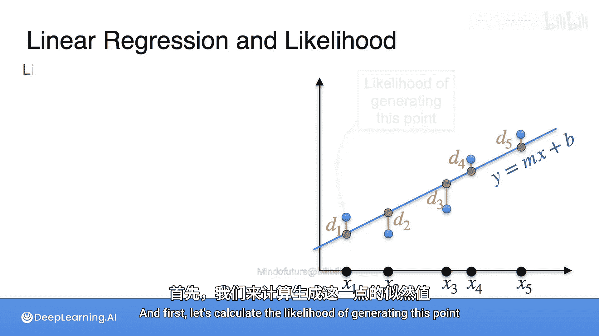

Then what really happens is that the Gaussian is centered at the point where x1 intersects that blue light。

And we're generating this other point over here now if we assume that it's a Gaussian with standard deviation 1 and mean equals0。

 then the likelihood of generating this point is given by the formula of the Gaussian。

 which is1 hour squared root of 2 pi e to the minus 12 d1 squared。

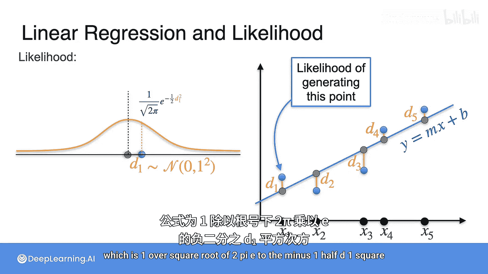

That is the likelihood of changing the first point。And we're looking at all of them。

 so that's the product of the five likelihoods that's what we have to maximize。

 we have to maximize the likelihood of the line generating all those points and since they're independent then we have to look at the product now a bunch of these things are constants this one over square root two pi so let's forget about them and let's maximize this over here。

Now we can factor this as E to the minus a half times the sum of the squares of the D ice。

And notice that if were max something that's the same as maximizing the logarithm so we can get rid of this E and also to the1 half because that would just be multiplying by  two。

 but let's remember that we have a negative number here。

 so that means we have to minimize the sum of squares。

And minimizing the sum of squares is precisely the least square error。

 this is exactly what linear regression is in linear regression you want to find the blue line that minimizes the sum of square distances from the point。

 so this shows that finding the line that most likely produce a point using maximum likelihood is exactly the same as minimizing the least square error using linear regression。

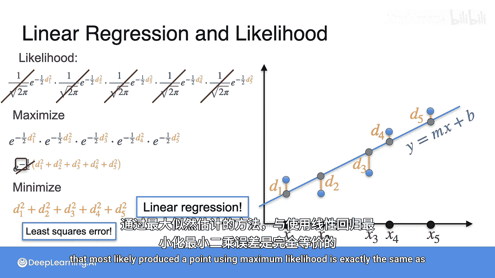

Here are three examples of lines and the Gaussians that they generate at each point。

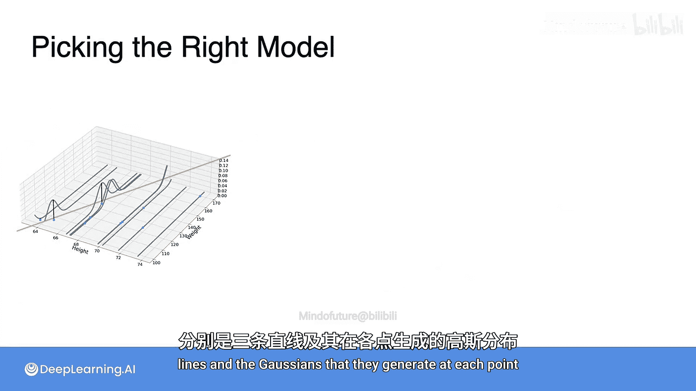

And as you can see， when we calculate the likelihoods for the actual data set of blue points。

 the winning one is the one in the middle， which we can see is the best line fit for the dataset。

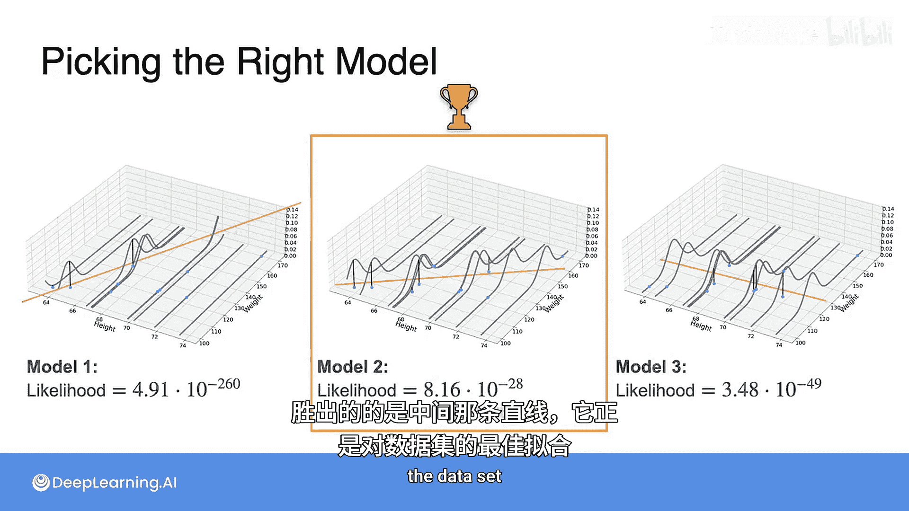