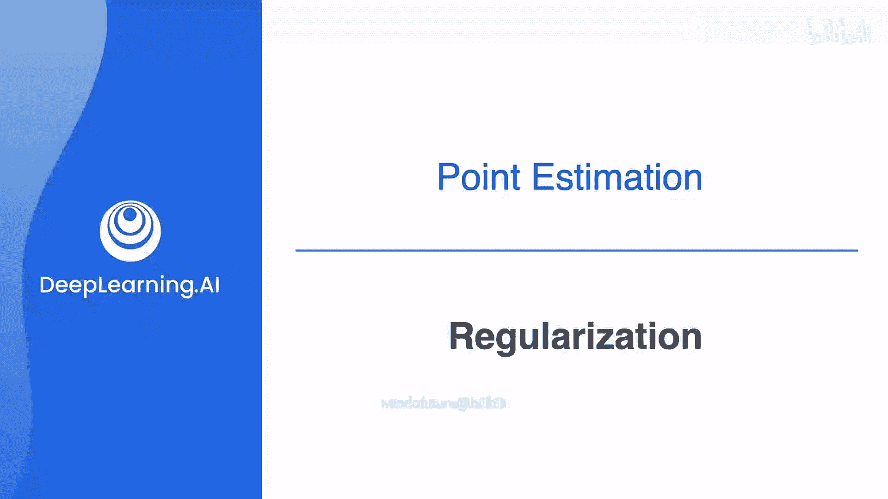
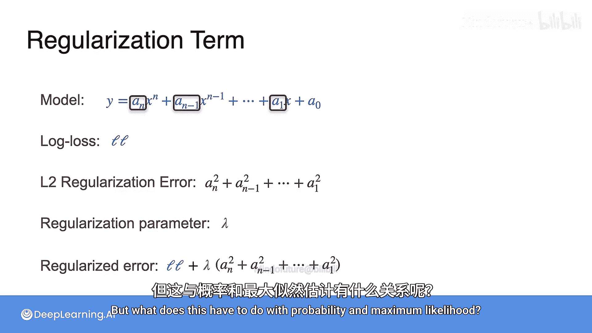

# 【Deeplearning】机器学习和数据科学概率与统计3 ｜ Machine Learning Probability And Statistics 吴恩达 p70 P70_正则化_03_02_08 -BV1c86VBrE93_p70-

So first let me tell you about regularization， imagine that this is our dataset and we have three models that could have generated that data or that could fit that data。

 however you want to think about it， one is linear。

 the other one is a quadratic polynomial and the other one is a polynomial of degree 10。

And in order to find out which one was more likely to generate it or which one is the best fit。

 we look at loss which could be the squared error Now let's imagine that the losses here are 102 and 01 because as you can see the first model didn't fit the data really well the second model fitted a little better and the third one fitted really really well so the third one is the one that wins however something tells us that it's not the third one that wins is more the second one。

And what we're going to do is we're going to apply regularization to。

Help us not pick that model3 which is a little chaotic even though if it's data pretty well so let's look at the equation and I'm going to throw in some numbers。

 let's say that the first one is the line y equals 4 x plus3 the second one is the quadratic 2 x squared minus-4 x plus 5 and the third one is this polynomial of degree 10 So what we're going to do is we're going apply a penalty to each one of these models and the more complicated the model。

 the higher the penalty and in that way we're trying to penalize model 3 a lot in order to not use it because as you can see Model 3 is so chaotic that it fits the data really well。

 but it doesn't really generalize well it doesn't really get the point of the data which is kind of a quadratic that points upwards。

So what's the penalty well we're going to call it the L2 penalty。

 L2 regularization is what we're using here， and it's going to be the sum of the squares of all the coefficients of the polynomial except for the constant one so this one is four squared。

That 16， this one over here is two squared plus minus4 squared。

 which is 20 and this one over here is the sum of all these squares which is going to be 26060。

And now the new loss is going to be the sum of the old loss and the penalty so here's 26 here it's 22 and here it's 262。

1 so now the winner is model 2 so what we did here is we modified the loss and we penalize the models that are too complex and in that way we're sort of trying to find the simplest model that fits the data well。

In general， if the model has this equation of a polynomial and the log loss is， for example， LL。

 then the L2 regularization error is the sum of the squares of the coefficients that are not the last one that are not the constant one and we're going to have something called the regularization parameter because sometimes we don't want to apply the full penalty we want to multiply by a small number in order to not be too drastic here。

 and the regularized error is simply the log loss plus the regularization parameter times the L2 regularization error。

 so that is in a nutsll what regularization is。But what does this have to do with probability and maximum likelihood。

 let me show you soon。

