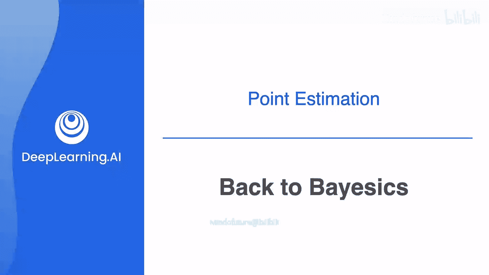
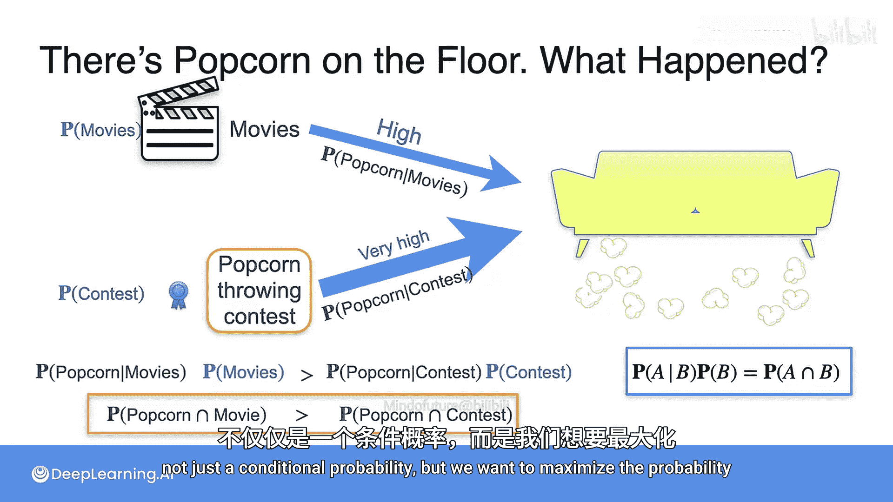

# 【Deeplearning】机器学习和数据科学概率与统计3 ｜ Machine Learning Probability And Statistics 吴恩达 p71 P71_回归贝叶斯基础_03_02_09 -BV1c86VBrE93_p71-

So let's go back to an example where we had some evidence which was popcorn in the floor and three possible scenarios and we're trying to investigate which scenario happened The first one is movies which creates the popcorn with a high probability。

 the second is board games which creates popcorn with a medium probability and the thirdborn is a nap that creates popcorn with a very low probability。

 so we went for movies which is the one that generated the evidence with the highest probability。

But however that's not the whole story imagine that now we have two different candidates。

 one is that we were watching movies and the other one that there was a popcorn throwing contest。

 so movies create popcorn in the floor with high probability but a popcorn throwing contest would create popcorn in the floor with a very。

 very， very high probability it's almost for sure that if you have a popcorn throwing contest that you ended up with popcorn in the floor so that's the winner。

However， something tells us that movies should be the winner and not popcorn， why？Well。

 one reason is that it's it's likely that you could have been watching movies。

 a popcorn throwing contest is not very likely。It's a very unlikely event。

So even though it's more likely to have generated the evidence。

 it's less likely to have happened on its own and that should matter。

 and that should mean that we want to pick movies， but let's put some math here。

Before what we did is maximize the probability P of。

Popcorn given scenario so we figure out that P of popcorn given movies was higher than P of popcorn given contest。

 however， the probability that you were watching in a movie by itself is actually higher than the probability that there was a popcorn contest is actually much higher and so we should factor this into the equation so we should actually multiply them。

And when we have the product， then the inequality goes in the other direction。

 and it turns out that it's more likely to have watched a movie。Now notice that this looks familiar。

P of popcorn B movies times P of movies resembles P of A given B times P of B。

 which as we know is the probability of a intersection B。

 the probability of A and B happening at the same time。So therefore。

 we're trying to maximize the probability that there's popcorn and a movie and the probability that there's popcorn and a contest。

 that's really what we care about。And that makes more sense because that's actually what we want to maximize。

 not just a conditional probability， but we want to maximize the probability that those two things happen。

