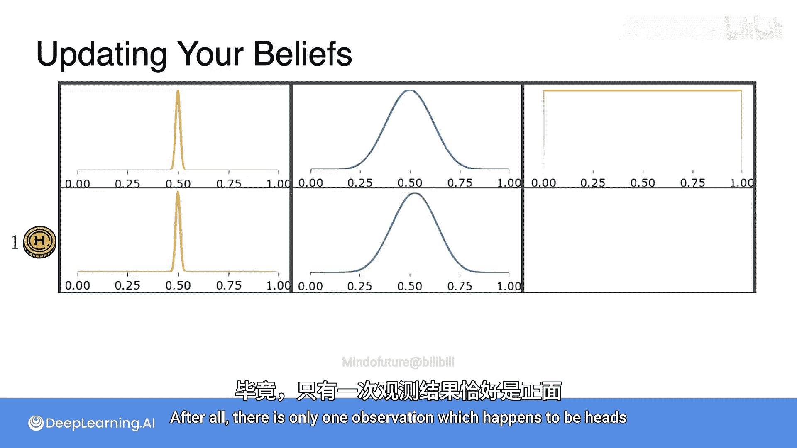
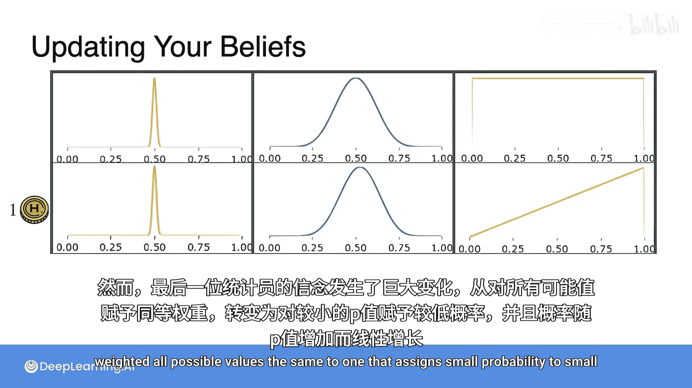
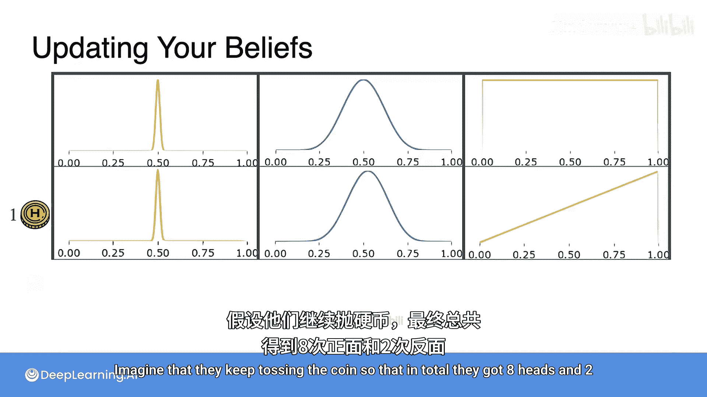
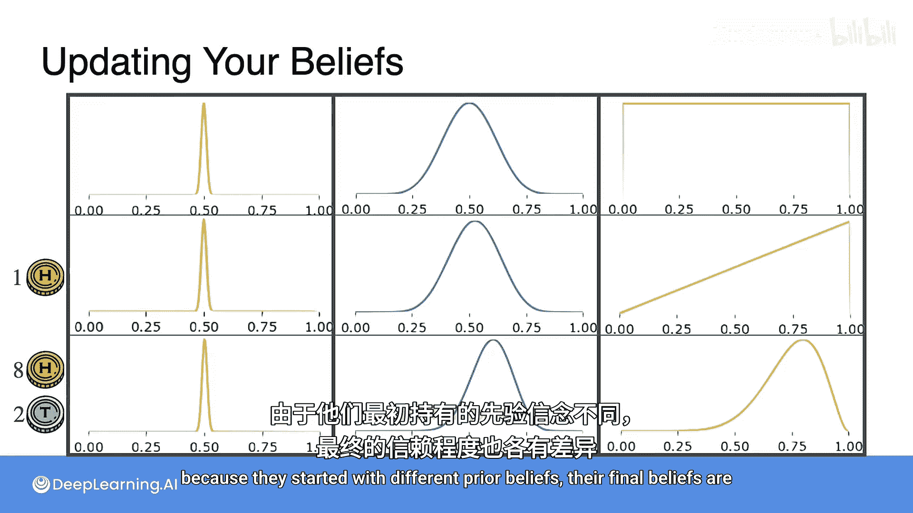
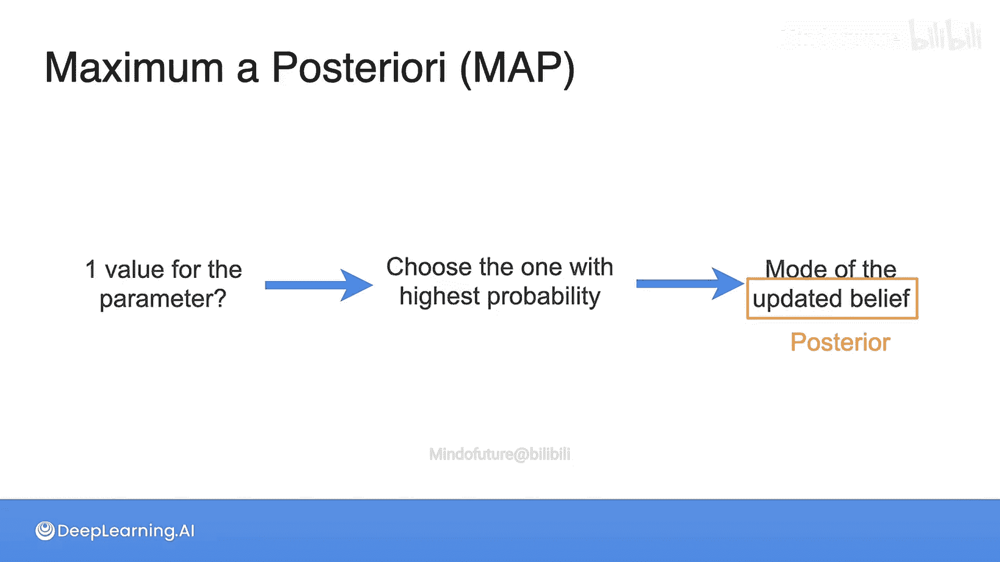
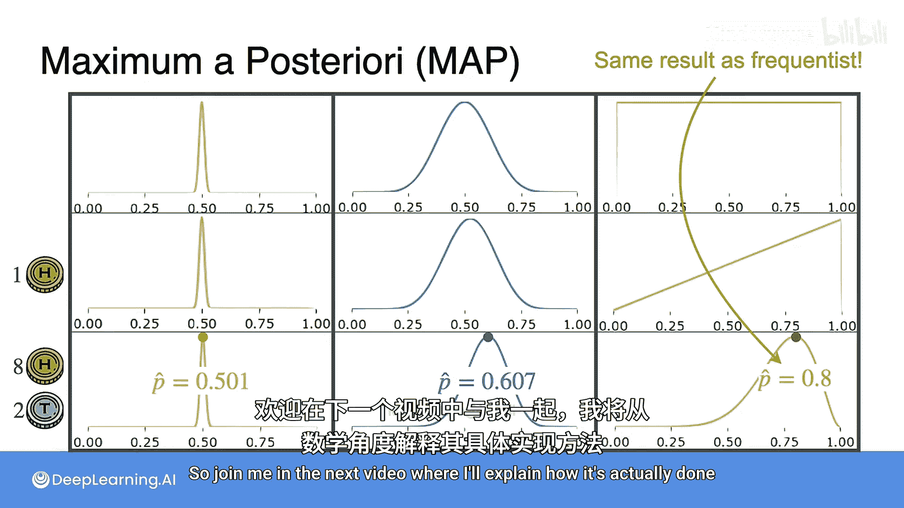

# 【Deeplearning】机器学习和数据科学概率与统计3 ｜ Machine Learning Probability And Statistics 吴恩达 p73 P73_贝叶斯统计最大后验估计_03_02_11 -BV1c86VBrE93_p73-

Imagine now that three patientss play the same game where they just found a coin on the street and want to figure out the probability of the coin landing heads。

The first one is absolutely convinced that the coin should be fair and thus choose a prior that is very narrow centered around 0。

5。The narrow curve represents a strong belief that the coin is heads 50% of the time with very quick drop off to0 in either direction。

The second patient still thinks the coin should be fair。

 but they're willing to believe the coin might have a bias one way or the other。Thus。

 they choose a prior that is also greatest at 0。5， but more spread out than the first one。 Lastly。

 the final batch doesn't want to assume anything， so they assign the same weight to each possible value。

 This is called a non informativeative prior since it doesn't add any information。

What happens to each of the statisticians beliefs if after one coin tos they see heads？

The Conservative one almost doesn't shift their beliefs。 In fact， to the naked eye。

 you would probably say that nothing has changed。 The one in the middle updates their belief。

 but also very slightly。 After all， there is only one observation which happens to be heads。

The last one， however， changes their beliefs drastically going from something that weighted all possible values the same to one that assigns small probability to small values of P and increases linearly as P increases。

 Imagine that they keep tossing the coin so that in total， they got 8 heads and  two tails。

 Let's see what happens for each of our statisticians。

 The first one is still super tight to their beliefs。 The curve hasn't moved 1 B。

 The second one who had a milder stance has now started shifting their belief。

 Notice that the curve looks narrower and it no longer peaks at 0。5。 but rather around 0。65。

Finally， the third statistician is the one who changed its belief the most。

 they went from not having any information to being pretty sure the probability of heads should be around 0。

8。Don't worry about how these updates were made for now you'll learn all about it in the next video。

 I just wanted you to get a sense of the effect your prior has on updating your beliefs down the road。

Even though all three patientss observed the same data。

 because they started with different prior beliefs， their final beliefs are different。

These curves representing beliefs can be very informative to look at。

 they show not just one likely outcome but how strongly aba believes every possible outcome is to be the true underlying value。

However， many times you still want to have one representative value for the parameter。

 How can you do that from your updated beliefs？There are actually many criteria to choose this value。

 but one of the most useful ones is to choose the value with the highest probability。

This means taking the value of the parameter that maximizes your belief。In other words。

 just take the mode of your updated beliefs。The updated belief is also called your posterior beliefs。

Just as your original belief is called your priors because they are your beliefs prior to observing the data。

 the updated belief is called a posterior because it represents your belief after seeing the data。

Because the updated belief is called a posterior。This estimation of the parameter is called maximum a posteriory or map for short。

If you want to know about other estimations you can get from the posterior。

 there is a reading piece at the end of this section。

Now let's go back to our coin example and see what the map estimation looks for each case。

For the very conservative patient， the map estimation for the probability of heads is 0。501。

 As you can see， it almost didn't bud from the original assumption that the coin is fair。

 The second statistician would say that the probability of seeing heads is 0。607， As you can see。

 it has significantly changed， but is still not too extreme。

 even though they were presented with 8 heads and two tails。

 which from a frequent approach could suggest an even more biased coin。Finally。

 the third statistician would say that the probability of heads is 0。8。 This result sounds familiar。

 right， It should， because it's the same conclusion of frequencies would come to。 In fact。

 any time you use map estimation with an uninformative prior that weights all possible values equally。

 the result is identical to what you would get from a frequentist approach。

 This reinforces how important and unique the inclusion of priors is with invasion statistics。

If you don't show up with any meaningful beliefs， map will end up being a cumbersome way to essentially do frequency statistics Alright that's enough introduction to the concepts underlying patient statistics。

 so join me in the next video where I'll explain how it's actually done mathematically。

