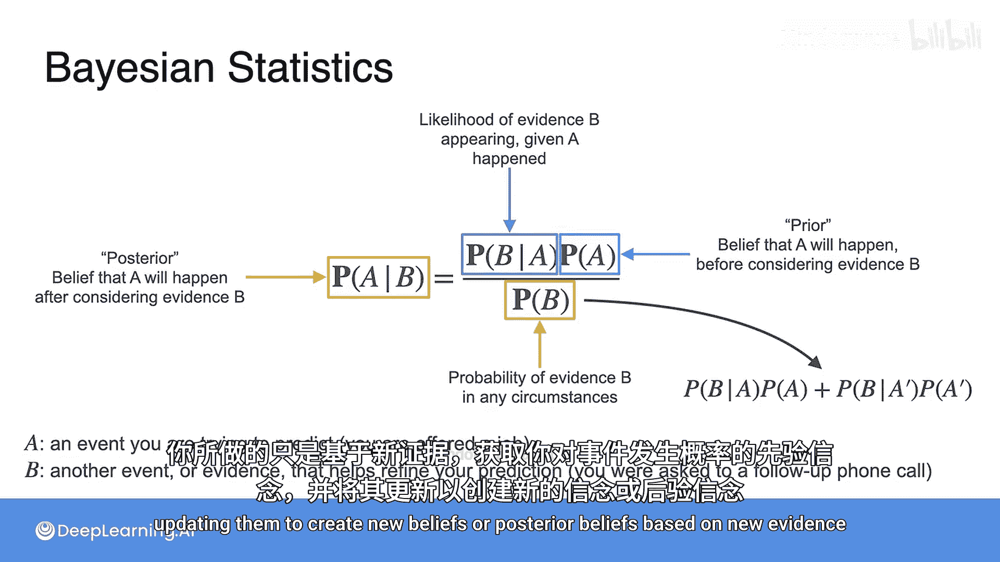
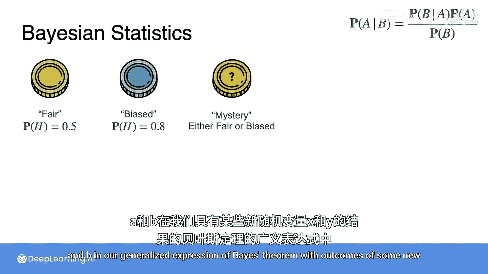
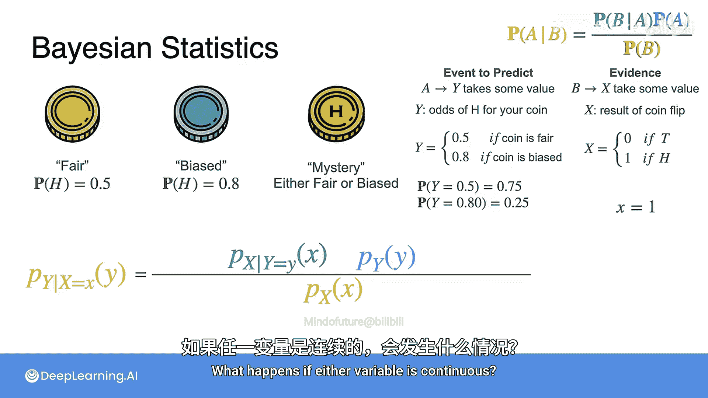
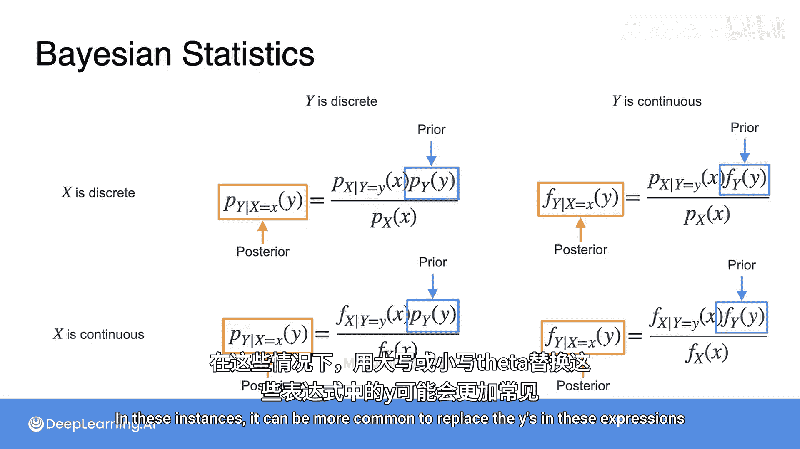
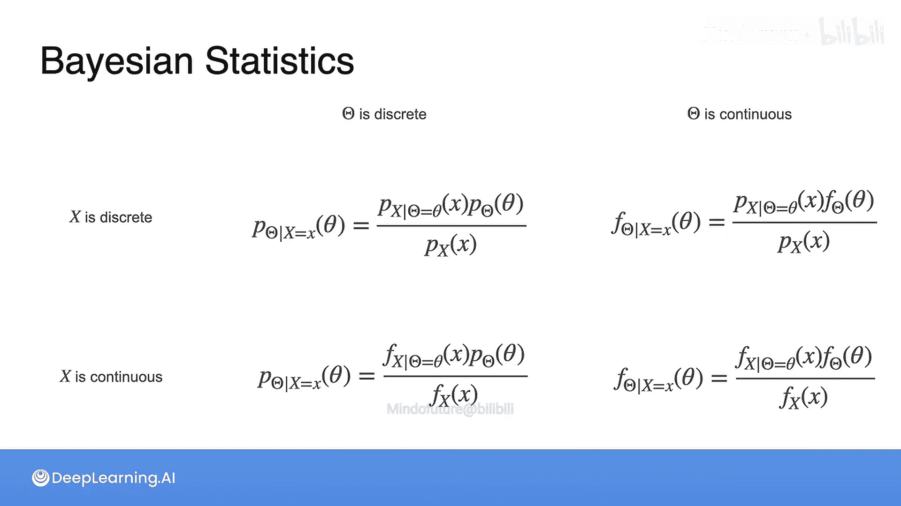

# 【Deeplearning】机器学习和数据科学概率与统计3 ｜ Machine Learning Probability And Statistics 吴恩达 p74 P74_贝叶斯统计更新先验_03_02_12 -BV1c86VBrE93_p74-

Now that you have a pretty good intuition of how things work in Ba statistics。

 let's learn how to actually perform on the belief updates you will see that you already studied the math involved。

It starts with base theorem recall that given two events A and B。

 base theorem states that the probability of a given B equals the probability of B given a times the probability of a divided by the probability of B。

 This equation might be a little hard to understand without some example。

 so let's define AMB here in the way they are typically used in patient statistics A is typically some event that you're trying to predict Ily you would know its probability with perfect certainty。

 For example， whether you will be offered a job that you applied for。

B is another event or some evidence you can observe that helps refine your ability to predict A。

For example， whether you were asked to attend a follow up phone call。The left side of this equation。

 the probability of A given B is what you're solving for， it's called the posterior。

And it represents the updated or refined probability of A once you account for the information provided by event B。

In this case， what is your likelihood of getting the job now that you know you ask to a followup phone call。

 the right side of this equation has three terms， the first is the prior， the probability of A。

 you can think of it as the probability of event A prior to event B happening。In this example。

 your priors would be your belief of the likelihood you offered the job prior to receiving the request for the follow up phoneal。

 the other two terms are what update your prior and create the posterior。

The top term is the likelihood of evidence B appearing， given a happen or will happen In this case。

 it is the likelihood of getting askeds for a follow up phone call given that you will be offered the job。

The last term is the probability of evidence B appearing at all in this case。

 it is the likelihood that you would be asked to a followup phone call。

 whether you will or won't be offered the job。 Usually you need to calculate the probability of B using this expression。

 you usually calculate the probability of B and A and B and not a using the general product rule and add them together So stepping back to look at how all four parts of this equation work together。

 All you're doing is taking your prior beliefs on the probability of an event and updating them to create new beliefs or posterior beliefs based on new evidence。

 Now let's go back to the example of determining whether you have a fair or biased coin and let's see how this expression is actually used In this example。

 you know there are two possible types of coins。 The first one is fair。

 which means the probability of flipping aheads is 0。5。

And the other type is biased。 This type of coin liness and heads with a probability of 0。8。

 You don't have a mystery coin。 It can be either fair or biased， but you don't know which one it is。

 The only way to figure this out is to flip it。I'll set this experiment up in the way abaian would。

 and one of the first steps will be to replace A and B in our generalized expression of base theorem with outcomes of some new random variables x and Y。

First， A， which is the event you want to predict， will be replaced with the event that a new random variable y takes some value。

Y will be the odds of heads for the kind of coin you have。 Why cannot output two possible values， 0。

5 of your coin is fair and 0。8 if your coin is biased。

 The probabilities of these two outcomes are unknown， so you start with some priors In this case。

 let's say you believe that most coins are fair。 So you assign a 0。

75 probability that the coin is indeed fair。 That means that y will be 0。5。 and a 0。

25 probability that the coin is biased。 That means that y will be equal 2。8。

 now you need some evidence to help update your priors In this case。

 you will replace event B with the outcome of a new random variable X。

X will be the result of flipping your mystery coin。

 so it will give a0 of the flip is tails and a one of the flip is heads Now you're ready to update your priors based on the outcome of flipping your coin。

So let's flip it。 The outcome of this flip is a heads， so I'll write down that little x is equal to1。

 Now let's use base theorem to update those prior beliefs to start。

 I'll show you how to calculate your posterior belief that the coin is fair first write your posterior this is the probability that y is equal to 0。

5， given that x is equal to 1 or in other words， the probability that you have a fair coin given that you flipped heads。

Next， you need the probability of getting heads given that you have a fairCo。Now you need P of a。

 that's the probability that y equals 0。5 or that your coin is fair。Finally， divide by P of B。

 this is the probability of your evidence or the probability of flipping aheads to do so you will need the expanded expression to calculate the overall odd of flipping heads。

 whether your coin is fair or biased。Now replace each of these probabilities with the actual values。

 the probability that xs 1， given y 0。5 is just 0。5， a fair coin will land on heads half of the time。

The probability of y equal 0。5 comes from your priors， you believe coins are fair 75% of the time。

 so replace this value with 0。75。Finally， this expression says that there's a 50% chance of heads with a fair coin and an 80% chance of heads with a bias coin。

 using your prior to weight these two outcomes you can calculate the overall chance of flipping a heads which is 0。

575。Complete this calculation and you get a probability of 0。652 and you're done。

 this is your new posterior。Compare this value to your earlier belief and you can see what happened。

 you used to think there was a 75 chance your coin was fair but after flipping your heads。

 you change your belief slightly Now you believe that there's only a 65% probability that your coin is fair while I wont walk you through the math here。

 a very similar approach would lead to a new posterior belief that the probability the coin is biased increases to 0。

348。Notice that the sum of these two beliefs is still one， which makes sense。

 you know that the coin is either fair or biased， so the sum of your belief in these two outcomes should still be one。

The example is very discrete with only two possible values of y and two possible values of x。

 but let me start writing it in a more generalized way that uses probability mass functions。

The first term in orange is actually the conditional probability mass function or PMmF of y。

 given that x equals 1 evaluated in 0。5 next you have the probability that x equals1。

 given that y is 0。5 this is the conditional Pmf of x， given that y equals 0。5。

The prior is simply the PMf of y evaluated at 0。5。And finally。

 this last expanded term can also be rewritten in terms of probability mass functions。

Though remember， it also is just the probability that x is 1， which is the PfF of x evaluated or 1。

Now that I'vewritten this equation in terms of the PMFs of X and Y。

 I can take one more step to make it more general， instead of the specific values of X and Y I've shown here。

 I'll rewrite it so you could update your priors for any possible prior outcome。

 little Y and any possible event， little X。What you're left with is the general expression for base theorem when you have two discrete random variables for a given event。

 little y and a given evidence little X， this expression will allow you to update your priors。

This is a useful generalized formula， but notice that it is designed for instances where both the event and the evidence are discrete。

What happens if either variable continuous， that's what I'll show you next。

There are four combinations you need to consider， depending on whether x and y are discreteor continues。

 the example you saw is for when x and y are both discrete。

The next obvious instance is when both x and Y continues random variables。In this case。

 the formula looks pretty much the same， just replace the probability mass function by the probability density function for both variables。

In the remaining two cases， you again just use the probability mass function if a variable is discrete and the probability density function if it is continuous。

Even though the expressions are different， these terms are all the posterior since they represent the updated probability after accounting for the data that was observed。

 and these are all priors or the beliefs about y before knowing anything about x In many machine learning context you are solving for the probability that a parameter in a model takes a certain value In these instances。

 it can be more common to replace the Y's in these expressions with capital or lowercase data that looks like this。

Again， all that has changed here is the notation with the letter Y being replaced by theta。

 but the underlying concepts are identical， depending on the combination of discrete and continuous variables you have in your context。

 you will use one of these four equations to update your priors。In the next video。

 you'll get to see one more example of this inaction。

