# 【Deeplearning】机器学习和数据科学概率与统计3 ｜ Machine Learning Probability And Statistics 吴恩达 p75 P75_贝叶斯统计完整示例_03_02_13 -BV1c86VBrE93_p75-

In this final video on Bay statistics， I'll show you a more complete worked example where you collect more data and iteratively update your priors。

 Suppose this time you tos your coin 10 times to collect more data。

 You see 8 heads followed by two tail。 How can you use this data to update your beliefs about your coin。

 Well， you will need to start framing the situation using base de。

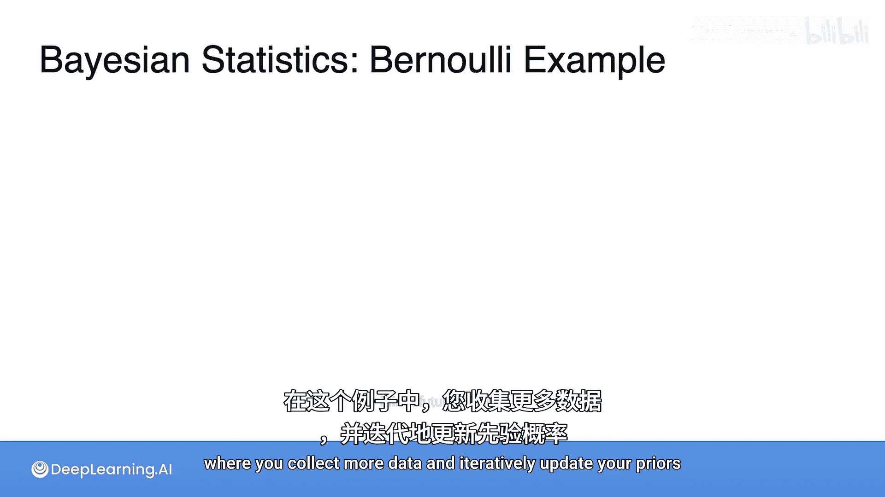

First， you know how your coin has some probability of coming up heads， but for now it's a mystery。

 you can therefore think of your coin's probability of coming up heads as a random variable。

Which you'll call Theta。Your goal will be to collect data to learn more about the probability density function of the。

 in other words， learn more about how likely your coin is to come up heads。

Now create a random variable X for the data you've collected in this case。

 you can view X as actually containing 10 separate coin flips to help distinguish the differences here。

 I will write x in bold and use subscripts 1 to 10 to denote each individual flip You can actually say a lot about each of these flips Xi。

Each one outputs a1 if the flip is heads or a0 of the flippers tails In other words。

 if you knew exactly how likely your coin is to come up heads you could model each of these flips as a Bernoulli distribution to capture this data。

 you can say that if your random variable big theta took a particular variable little theta。

 then each X is a Bnoulli distribution for that value， little theta。

X is a joint distribution of discrete random variables， which means it is itself also discrete。

As a result， this is the version of base theorem you'll use with the probability density function for theta and the probability mass function for x。

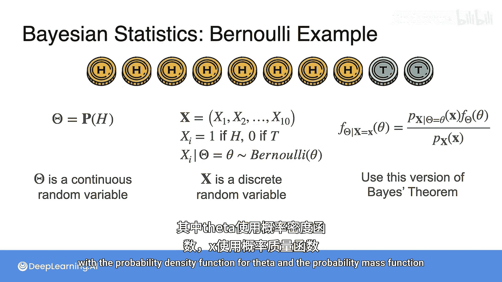

Now， your first step will be to calculate the likelihood of seeing these flips given a particular value of data。

 so I'll write that down here。

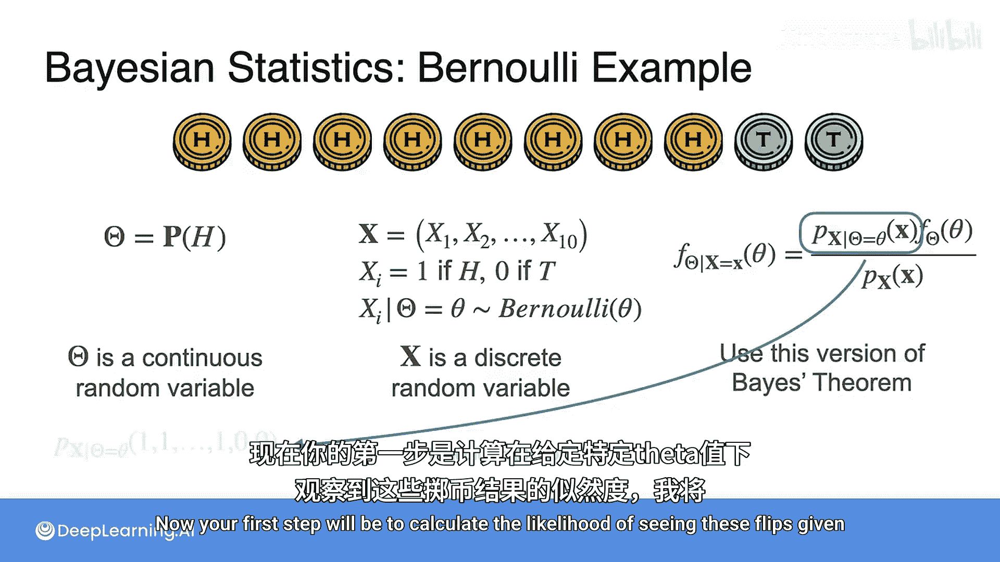

Now I'll expand that expression because this is really the likelihood of seeing those timber newly random variables end up with eight heads or once in a row followed by two tails or zeros。

What's the likelihood of each of these outcomes well for the heads its theta and for the tails is1 minus theta。

 which I'll write below each coin。And finally， we need the joint probability of this outcome。

 since each flip is independent from every other， you can just multiply the probabilities across。

 given the final probability of theta to the eighth power times 1 minus theta squared。

Now you can move on to filling in the other terms of base Deem。

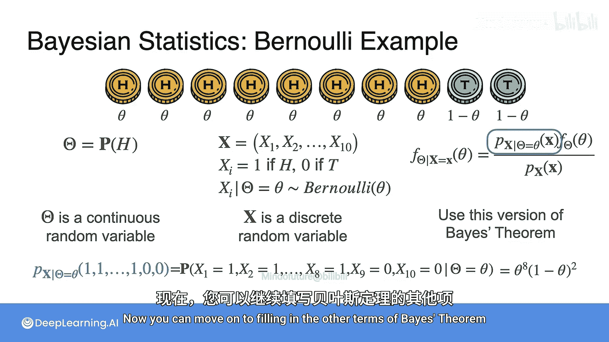

I'll collect all the important information you've calculated so far。

 you know each X I is a benoulli distribution and you've calculated the odds of the data you observed given a particular value of the Next up you need to choose your priors which you will express as a PDF for the variable big theta。

Let's suppose you truly don't have any prior beliefs about the probability the coin comes up hences any value between 0 and 1 seems equally likely。

In that case， you would choose a uniform distribution which is written like this。

Now you have all the ingredients to solve the problem。First， write your posterior。

 which is the distribution you are solving for。Next。

 adding the conditional probability of observing the data。

 which you just calculated was theta to the eighth power times 1 minus theta squared。

Next multiply by your priors， which in this case is just a number1。

 I've cheated a little bit here because I've dropped this zero less than theta less than 1。

This is still part of the prior， and so also the posterior。

 but since the has always been a probability between 0 and1。

 I'll drop it here to make the notation simpler。 Finally。

 divide by the probability of observing the data you saw this last value can be tricky to solve for。

 but recall it is going to be some constant value that ensures the total area under the Pdf is equal to one。

 As I'll show you in a moment， you can typically ignore this constant。In this instance。

 I actually know that the distribution you have here is one called the beta distribution。

You haven't studied the distribution， but technically you could find that the constant in this instance is 8 factorial times 2 factorial divided by 11 factorial。

 feel free to read more on the beta distribution in the references at the end of this video or even on Wikipedia going back to this problem。

 however， I'll just ignore the precise value of this constant。Putting all these pieces together。

 you're able to solve for the final PDF for theta， which is the expression here。

And these are your posterior beliefs， this is the conditional PDF of theta given the data you observed。

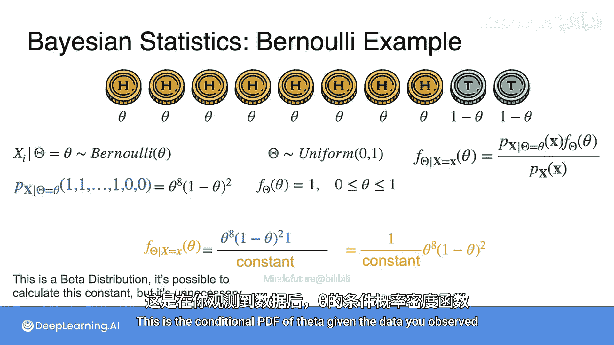

Now let's look at how your beliefs changed after considering the data。

You went from a uniform prior belief which visually is just a flat line to this posterior which is definitely a lot more informative。

 it's telling you the values of the probability of heads under their 0。

5 are very unlikely while leaning towards bigger values， having a peak summer around 0。8。

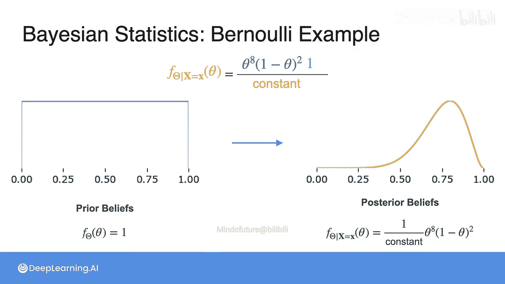

Now let's look a little more closely at this result。

 I'm going to completely remove the constant terms。

 so this new expression just says the posterior Pf on the left is proportional to the product on the right。

 Here's why I can do that。 First remember that if you choose some value little theta。

 you could call that a model of your coin where it comes up heads with a probability little theta。

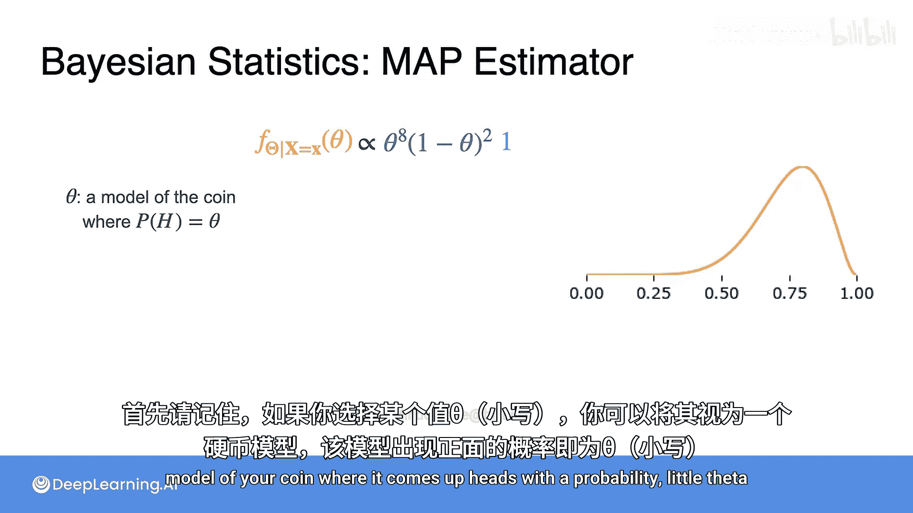

Then you can think of this first expression as the probability of the data given that model of the coin little theta。

The second expression meanwhile， measures how likely that model is， in this case。

 you assign the same likelihood to each value of data with a density of1。The result was itself a PDF。

 a new set of beliefs about every possible value of data between 0 and 1。

 and that's what's shown on this chart， but what if you want to summarize this set of beliefs with a single number？

Well， that's going to be the map estimate you learned about before。

 the maximum a posterior value of theta。Remember that the map estimate is simply the mode of the posterior distribution or in other words。

 the value of theta that made the posterior maximum。

 and this is why you can ignore the constant All that constant and the denominator did was scale the curve of your new PDF。

 including this constant won't change the shape of your curve and most importantly。

 it won't change which value of theta gives the maximum。

Now let me show you another interesting fact about the map estimate in mathematics。

 you refer to the input to a function that maximizes the output as its agon max。In this case。

 it's the value of theta， theta hat that maximizes your posterior PDF。

 doinging so typically requires calculus and you may even recall some techniques if you completed that course in this specialization In this example。

 the maximum value occurs when theta is equal to 0。8 or 8 over 10。Sound familiar well it might。

 because this would be the exact answer of a frequentist。As I mentioned earlier。

 if you have a non informativeative prior like in this case， then the map is the same ML estimation。

 when you think about it， it makes sense why。Uninative priors are just constants。

 and just like the constant in the denominator， they don't affect the shape of the curve or the location of the maximum so you can ignore them。

The only term youre left with is the probability of the data given the model and maximizing that probability is all MLE does。

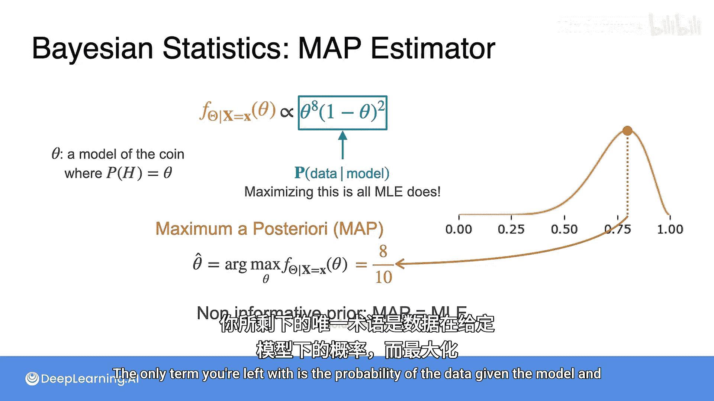

Now what happens if your prior is informative Well an easy way to see would be to just keep going with this example。

 let's flip your coin 10 more times this time you get a sequence with six heads and four tails。

 remember that after the first 10 coin flips you went from a uniform prior to this new distribution。

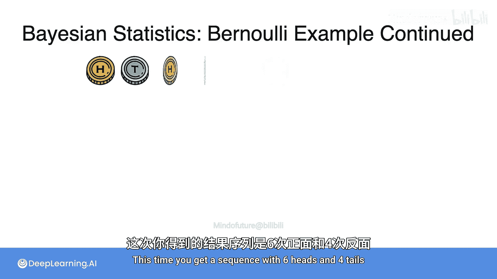

Well， if you want to keep updating your beliefs， then you can consider this probability density function as your new prior。

 After all it is your most recent belief This is the standard way of updating models in Ba statistics When you want to incorporate new data you just make your posteriors your new priors and repeat the process from before。

Next you need the probability of getting this sequence of coin flips given a particular value of theta for each head。

 you have probability theta and for each tail you have probability 1 minus theta。

 which you multiply because all variables are independent to get theta to the6 power times1 minus theta to the fourth power。

Now repeat the process from last time to update your beliefs。

You first have the probability of observing your coin flips multiplied by the new prior。

 and again everything is divided by a constant， just like the last time this is another beta distribution。

 but just like the last time I am going to ignore solving for the constant since it won't change our results。

So you have that the posterior after the second set of10 coin flips is theta to the 14 times 1 minus theta to the6 divided by a constant。

 let's see what the curve looked like this time you started from this prior on the left which you developed after seeing 10 flips。

8 of which were heads。

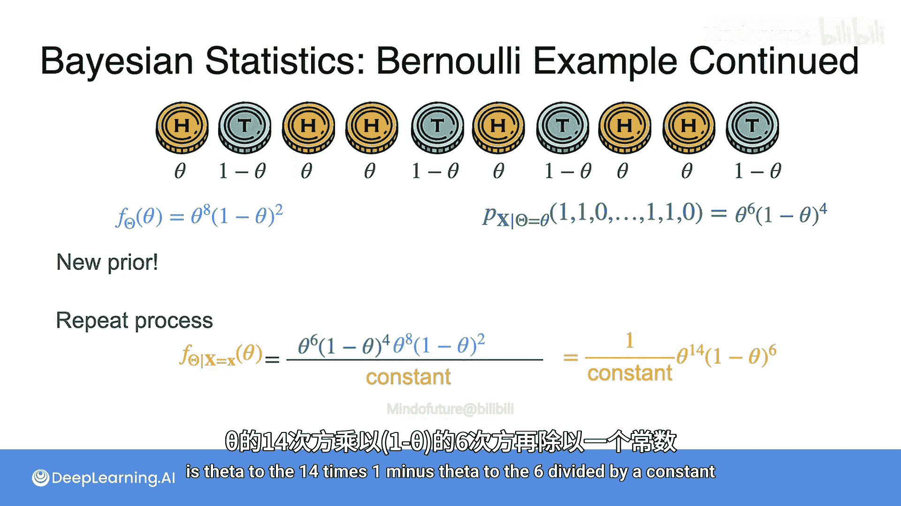

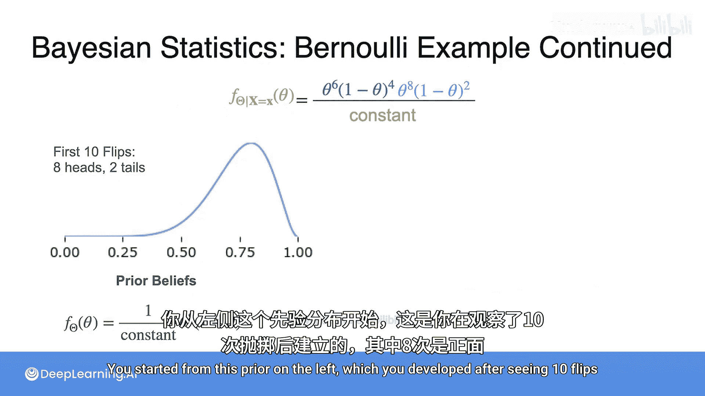

Then you flip your coin 10 more times this time getting six heads and four tails。

 I've written the equation for each curve below each of them。

What is the map estimate of data for your new curve。

 it is still the highest point in the posterior distribution， which is now 0。7。Now。

 this is a really interesting result for two reasons。

 and it highlights two important elements of patientian statistics。 First， these time。

 your priors were informative， and they clearly mattered。

 If a frequentist only saw that second set of 10 flips， they would conclude that theta is 。

6 because 6 out of 10 flips were hences。 your priors influenced your results， though。

 and you concluded that the most likely value of theta is 0。7。

A second interesting fact is that out of 20 total flips，14 were heads。 So after seeing all 20 flips。

 a frequentist would have also concluded that the is 0。7。 In fact。

 aation starting from an informative priors would also conclude the same。

 What this shows is that it didn't matter that you incorporate your data in two chunks 10 flips at a time。

 This property actually holds in general forb statistics。

 whether you incorporate all the data at once or in chunks。

 your final posterior beliefs will be the same。

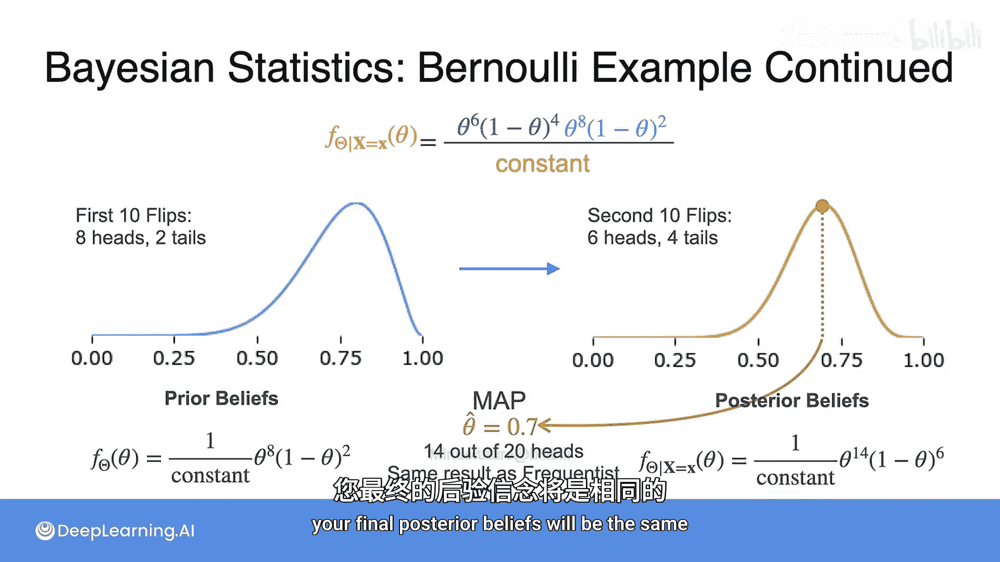

This concludes the investigation of patient statistics so let me summarize some key points the main idea behind patient statistics is to update your prior beliefs using data as you collect more data。

 your old posterior beliefs become your new priors and you update them using the new data。

If your priors aren't informative， Ma is actually just a complicated way to do the same thing as MLE。

If there's no useful information in your priors， it's all coming from the data。Next。

 assuming you don't have wild poorly behaved priors。

 MLE and map estimates will converge as you collect more data。

You can think of this as the new data slowly watering down the influence of your initial priors。

This brings up to why statisticians tend to choose patient approaches。

 they are best for instance where you either have limited access to data or strong prior beliefs if you're going to collect a lot of data anyway。

 frequentist approaches are probably fine。A potential downside of patient statistics is that if your priors are wrong。

 you can make wrong conclusions， especially with limited data。

 your priors will have a strong influence on the conclusions you draw。

So now that you understand the difference in philosophies。

 what do you think are you a patientian or a frequentist， I suppose if youre having trouble deciding。

 you could always flip a coin。

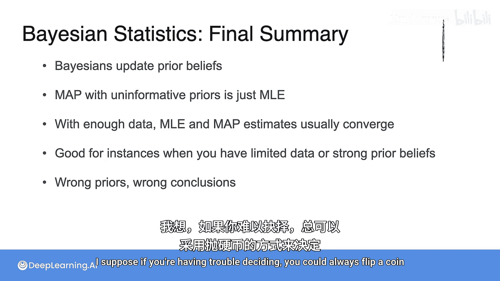