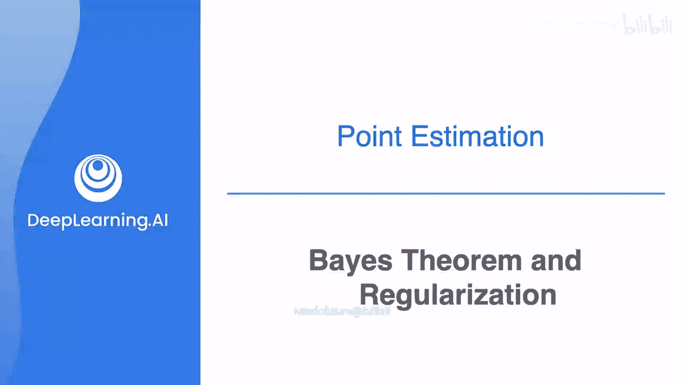
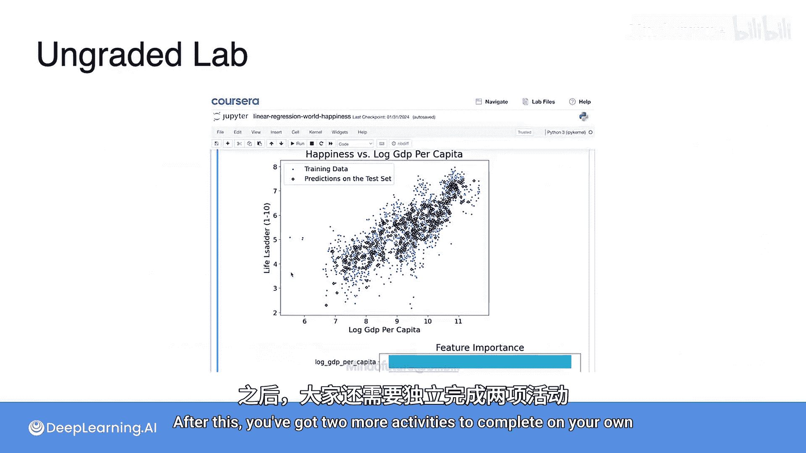
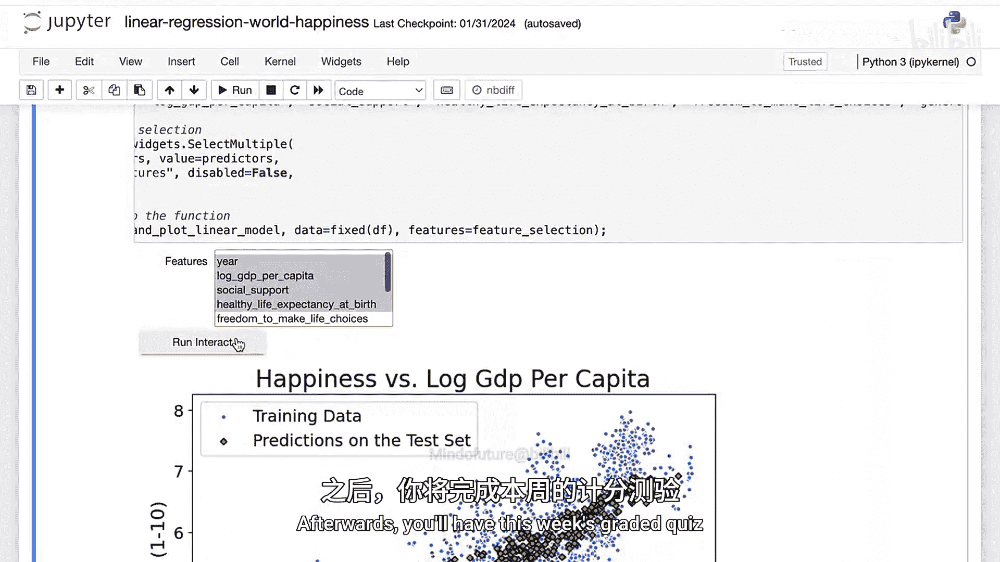

# 【Deeplearning】机器学习和数据科学概率与统计3 ｜ Machine Learning Probability And Statistics 吴恩达 p76 P76_MAP_MLE与正则化之间的关系_03_02_14 -BV1c86VBrE93_p76-

So in this lesson you've learned several different things。

 you learn maximum likelihood estimation and maximum a postteririi estimation。

 and you also learn regularization in machine learning。Now in this video。

 I'm going to show you how they combine。So in this video I'm going to show you how regularization and maximum likelihood actually match。

 so let's say you have the data and you have three models that could have fit that data。

And each one of them generates the data with some probability and remember that a model can generate the data as we saw before by simply creating a Gaussian at every point on the line and generating points close to the line or to the curve。

The first one generates the data with some probability。P of data given model 1。

 the second one generates the data with higher probability。

 and the third one since it's the best fit， generates the data with the highest probability。

 so we're going to pick this one。But just like before with the popcorn throwing contest and the movie。

 we also have to take into account the probability that the model has been picked。 Now。

 the simpler the model， the more likely to have been selected。

 and I'm going show you that in a minute。 But the idea is that a simple model like model 1 is very likely to occur。

 a slightly more complex model like model 2 is not likely to occur。

 and a model that's really complex like Model 3 is very unlikely to occur。

 So what we're going do is we're going multiply these probabilities。

 and now the winner is not the third one。 Now perhaps the winner is the second one。

 And so this is the winning model。 Now let me show you how maximum likelihood and regression with regularization actually cooperate Now in regression。

 you're going have some loss that could be the square loss， for example。

 and in maximum likelihood you're going to maximize the probability that the data was created。

The model now if we add base here， then we have to multiply here by the probability of the model Now if we do regularization and regression then to this we add the regularization term now how do we turn the left into the right Well what's a good way to turn products into sums we take logarithms right。

And that is how we turn the argument in the left with probabilities into the argument in the right with a loss and a regularization term。

 However， there's an elephant in the room here。 I haven't yet told you what I mean by probability of a model so that's what I'm going tell you next。

 So what do I mean by the probability or more exactly the likelihood of a model。

 let's say we have Model 1 Model 2 and Model 3， and there's a high probability for Model 1 and smaller of Model2 and a really smaller for Model 3。

 Well， let's say that these are the equations for the model and we're going to do is we're going pick this coefficients out of a standard normal distribution So a1 a2 and all those up to a10 are going to be selected from a standard normal distribution What is the likelihood of。

 for example AI Well， it's going to be one over squared of2 pi times e to the minus1 half AI squared。

Therefore， the likelihood of this model is exactly that number。

Now what is the likelihood of the second model， well we need to pick these two coefficients。

 so it's this product and the likelihood of the10th model is going to be the product of all these numbers。

 the product of all the likelihood。So now let's go back to trying to fit the best model if these are our points then let's say that this is a model that fits。

 we want to maximize p of data given model times p of model and what are they well we established previously that if these distances are d1 up 2 d5 then p of data given model is going to be this product over here and what's of model well the equation of the model is this。

 then p of model is。1 over squared2 pi e to the minus1 a1 squared times the same thing with a2 squared Now we want to maximize the product of these two and there's a lot of constants so we don't really need those。

 we can divide by the constants and maximize the rest and let's take a logarithm like we did before we take logarithm here we get minus a half times the sum of the I squared and we take a logarithm here。

 we get minus a half times a1 squared plus a2 squared and the product becomes the sum under the logarithm。

And now we have to maximize this。We can multiply by minus a2。

 and now that means we have to minimize the sum of squares of the distances。

 which is the square loss plus the regularization term。

 so that's where the regularization term comes in。Therefore。

 when we try to pick the model out of Model1， Model 2 and Model 3， then。

Maximizing the probability of the model is the same as minimizing the sum of squares of the coefficients and maximizing the conditional probability of the data given the model is the same as minimizing the square loss。

 so the new loss is going to be the sum of the two。

 and that is how you train a model using regularization based on a Bay approach。

That brings us to the end of lectures for this week After this you've got two more activities to complete on your own first there is this week's Exploratory data analysis La this week you will dive deeper into the world happiness dataset set you saw in week1。

😊。

You'll use linear regression to try to find which features of a country best predict that countrys reported happiness level I especially like some of the interactive portions of this lab where you can choose which features to include in the model and see which features are actually most important afterwards you will have this week's graded quiz Good luck and I'll see you when you're done to close out this week。

