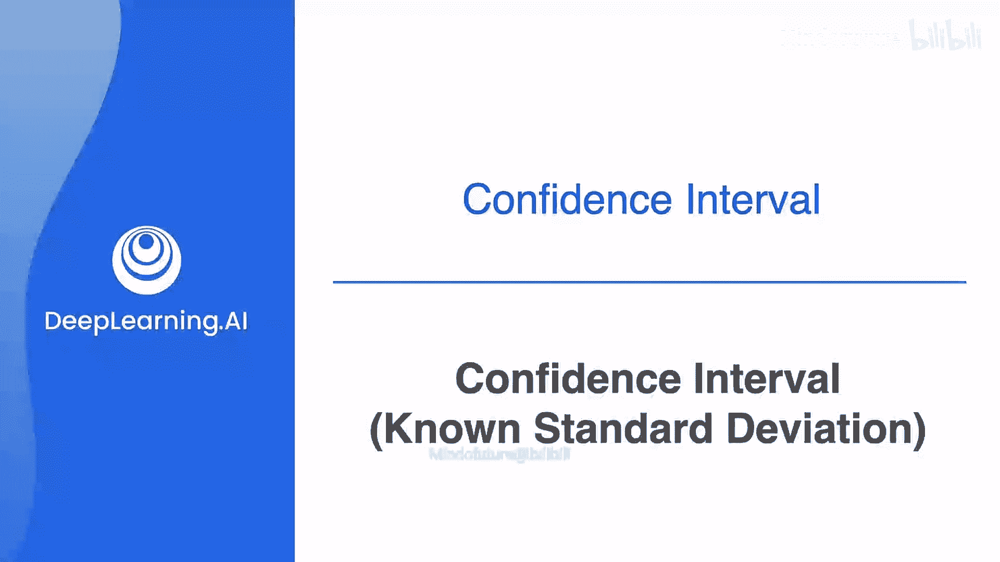
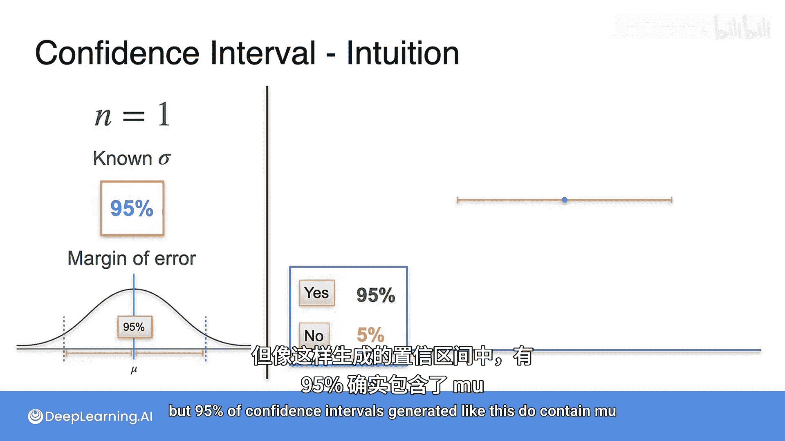

# 【Deeplearning】机器学习和数据科学概率与统计3 ｜ Machine Learning Probability And Statistics 吴恩达 p78 P78_置信区间概述_04_01_01 -BV1c86VBrE93_p78-

So the people of Statopia have some population average height mu and you've seen how to take samples from this population to estimate it。

 There are some things you can do to make sure you get good samples like random sampling。

 taking larger sample sizes and making sure that the samples are independent and identicalally distributed。

 but even with these practices， you know you can't expect any particular sample to be perfectly accurate。

 After all， you get a different sample mean every time。

 since you'll never be able to measure the height of everyone in Statopian and calculate the true population mean。

 All you have is a sample mean。 and you'll always have some degree of uncertainty about how accurate it actually is a natural question then is whether you can use a sample mean with at least some degree of certainty。

 Statisticians do this using something called the confidence interval In short。

 a confidence interval is an interval of values。 that is a lower and upper limit which contain the population parameter。

 for example， mu with some degree of certainty。Before showing you confidence intervals with a probability distribution。

 let's build some intuition about how they work。Imagine your day you're walking along a road to visit your friend。

When you get to your friend's house， you realize you've dropped your keys somewhere along the road。

 That's okay。 your friend says， I'll help you look for it。

 you get in your friend's car and then drive back out to the road where you dropped your key。

 while you're driving over， you and your friend talk about how you look for your key。 First。

 you'll park the car at your best guess of where you dropped it。

 Then you'll both walk the same search distance in either direction along the road to look for the key。

You need to decide this distance before you search so that you know you'll meet back at the car at the same time。

You could always choose a different place to park the car and that will shift the entire range of the road you'll search。

 but where you park is always going to be a guess the thing that will have the biggest impact on whether you find the key will be your search distance so the big question is how large should your search distance be？

To decide your search distance， you think about how confident you need to be that you will actually find the key。

Which you express as a percentage。 let's say you think with this search distance。

 your 80% confidence you'll find the key。 What if you left your oven on。

 then you really need to find that key Well then you'd need to agree to a bigger search distance。

With a search distance is big， you're 95% confident you'll find the key。 Of course。

 you'll also have to search a much larger portion of the road。

 Let's say you only have a little bit of time to look Well you could always shrink your search distance。

But your confidence level is also going to drop， there's a trade off here。

 if you want a higher level of confidence， you're going to need a larger search distance。

You can think of a section of the road you and your friend will search as a single interval with a lower and upper limit。

 That said， I think it's really important to remember the way the interval was constructed。

 at the middle is your best guess of the true location of the key。

 And then you add a buffer on each side to account for the fact that。

 you know your guess is probably wrong。 That said， this orange line is the overall confidence interval。

I use this example from the physical world because it helps reinforce an idea that can be tricky to remember when you're looking at probably distributions。

 The key never moves its location is unknown but fixed。 The interval meanwhile。

 is randomly generated with a desired certainty or if you prefer uncertainty that it contains the key。

I say randomly generated because one of the ingredients of the interval is that best guess you made of where to start looking。

 Yes， you can always add a bigger search distance to either side of it。

 but at the heart of your interval is just a guess。

 Many people look at confidence intervals and say something like 50% of keys fall inside this interval。

 but hopefully you can see why this is wrong。 After all。

 there is only one key and it's always been in the same location。

 talking about a lot of keys randomly appearing in one place or another makes no sense。Instead。

 you should say 50% of the guesses are within a search distance of the key。

 this makes it clear that the best guess of where to park the car is the source of the randomness and the uncertainty。

So this is an introduction to the ideas now let's see what they actually look like when you've got a probability distribution okay so let's go back to Statopia and let's apply those ideas about confidence intervals to the question you were facing before what is the mean height across the population。

Let's assume that heights in Statopia follow a normal distribution with a mean mu。

 which is unknown and a population variance sigma squared， which for now we'll assume is known。

It might seem a little weird that you would know the variance。

 but would not know the mean of your distribution， and you are right。 Usually。

 you are a little uncertain about both of them For now， though。

 I'll set up a problem in the simplest possible way where only the mean is unknown。

 and later in the course， I'll show you how to handle the situation where you don't know the variance either。

Thinking back to the example of the last key you just saw the true value of mu is the key mu has a fixed but unknown value。

 you will randomly generate a confidence interval to estimate where it is located。To do that。

 you will take a random sample from your population to make things simple。

 Let's start with a sample of size1。 That is one person。

 You're going to measure the height of one random person and you that to estimate the population mean。

 Since your sample has only one person in it， their height will also be the sample mean。

 which I will call little x bar。 Let's create a random variable。

 big x bar to describe the probability of selecting different sample means。

 It's actually going to be identical to x a normal distribution centered of mu with a variance sigma squared。

 This doesn't mean you suddenly know the true value of mu。

 but you do know x and x bar have the same mean。 Now you're wondering about your sample little x bar。

 Is your person a little taller than average or a lot shorter。 While you can't know for sure。

 you do know something about the probability distribution of x bar。

 So let's think about this in a different way。 How far our most sample means from the true population mean mu。

After all， if your sample is typical， it will also be within that range to do this。

 you need two related concepts。 You will need a margin of error。

 which is a distance on either side of mu and a confidence level。

 which is the probability that your sample mean is within that margin of error。

To set these two values you actually normally start with a third one called the significance level。

 which is thenot with a Greek letter alpha， that is the probability that your sample mean falls outside your margin of error here let's set alpha to 0。

5， which is a very common choice。From alpha， you'll calculate your confidence level。

 which is 1 minus alpha。 This is the probability that a randomly generated sample mean is within the margin of error Since alpha is usually a small number。

 one minus alpha is usually close to1。And in this case， it will be 0。95。

 leading to a conference level of 95%。Now you can increase the size of your margins of error until 95% of all randomly generated sample means will fall within the shaded portion of the distribution curve。

Notice that since the normal distribution is symmetric around its mean， you can say that 2。

5% of the time， your sample mean will lie outside the margin of error because it's too big and 2。

5% of the time because it's too small， that is alpha divided by 2。Okay。

 you're finally ready to see the formula for your confidence interval。😊。

It's just your sample mean plus or minus v margin of error。

 What this is saying is that if your sample mean is one of the 95% of all sample means that is relatively close to mu。

 then mu is also relatively close to the sample mean In other words。

 confidence intervals are a be they are saying unless I got really unlucky and my sample mean is uncommonly large or uncommonly small。

 then mu should be pretty close to my sample mean。This is still a tricky idea to get your head wrapped around。

 so let me show you some more examples。Let's build a few confidence intervals。

 assume you want a confidence level of 95% and have already calculated how big your margins of error need to be。

I'll draw the true value of me but remember you won't actually know it now you'll take your first sample like x1 bar。

 which is the height of one randomly chosen person。

Draw the margins of error on either side of X bar to create your first confidence interval。

 Does this interval contain the population mean？No， this person is much shorter than average。 Now。

 take another sample x2 bar and generate the interval around it。 This time。

 the interval does contain mu。 And here's a third example with a confidence interval around it that also contain mu。

 Now， let's refine the illustration and make the intervals that contain mu green and those that do not contain mu red。

You can repeat this process many times each time checking to see if the interval you generated contains the population mean。

You will find that when your confidence level is 95%。

 95% of your confidence intervals will contain the population mean， and 5% of the time they will not。

 This is what's meant by a 95% confidence interval。

 It means that the recipe you're using to cook up your interval will result in one that contains the population mean 95% of the time。

Remember， however， you're not going to generate hundreds of confidence intervals and you're not going to actually know mu Instead。

 you will generate a single confidence interval， Does it contain you， Well。

 you can never be perfectly sure， but 95% of confidence intervals generated like this do contain mu。

