# 【Deeplearning】机器学习和数据科学概率与统计3 ｜ Machine Learning Probability And Statistics 吴恩达 p79 P79_置信区间调整区间_04_01_02 -BV1c86VBrE93_p79-

You just saw how to develop a 95% confidence interval when your sample size was1。

 let's look more closely at Xbar to think about ways you could improve this result。

You saw that X bar the sampling distribution of the sample means was normally distributed with mean mu and standard deviation Sigma。

In fact， it had the exact same distribution as the overall population。Before moving on。

 it is useful to remember why you know this first， you know mu of x bar or the expected value of the sample mean always equals mu the population mean。

This is true， no matter how many observations are in your sample。

Now consider the standard deviation of the sample means sigma of x bar。

 you learn that it will be equal to the populations standard deviation divided by the square root of the number of samples N In this case。

 it does vary with sample size。 however， since for now n is 1。

 the two standard deviations are the same。

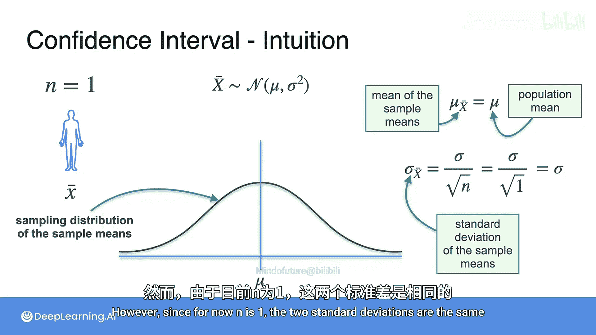

Now， what if you increase your sample size， so n is now2。As mentioned before。

 the mean of the sample means doesn't depend on sample size， it will still be the population mean。

The standard deviation， however， does depend on the sample size。For a sample size of 2。

 this will be sigma divided by the square root of 2。

The distribution of the sample means is now a normal distribution with the same mean。

 but a smaller standard deviation。It will look more like this。 The curve didn't move left to right。

 but it got taller and skinnier。 Now， let's see how this change in sample size affects your margins of error。

 At first， you had a sample size of one and were aiming for a confidence level of 95%。

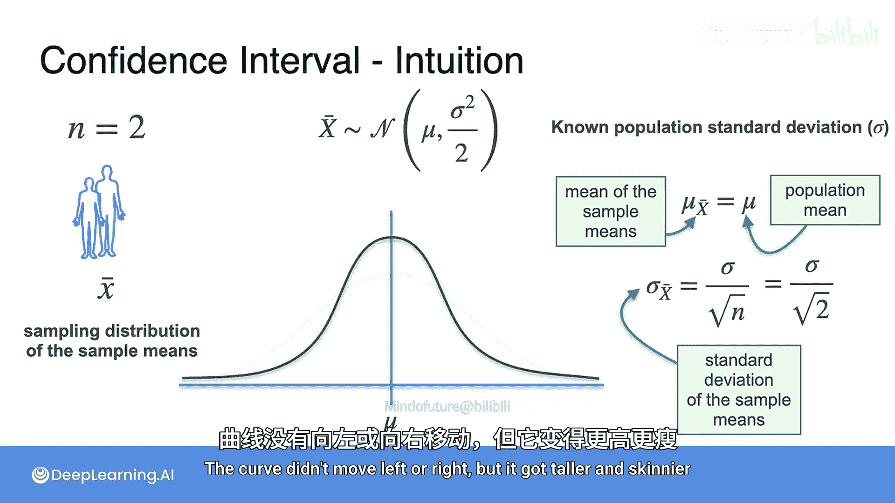

When your sample size is2， your distribution is narrower with outcomes more closely concentrated around the mean。

As a result， you don't need as large a margin of error to either side of new to account for 95% of distribution。

 your margins of error shrink， and this pattern continues if you keep increasing n。 for example。

 what do you think happens if you increase n to 10？Once again。

 the margin of error and thus the confidence interval become even smaller。

Let's generate some more confidence intervals for these larger sample sizes。

 Start with n equals 2 and a 95% confidence interval。

 it'll generate some samples and draw the confidence intervals around them。

 here's the first one x1 bar。And here is the confidence interval around it。For this first sample。

 the confidence interval does not contain the population mean mu。

 the same confidence interval around x2 bar however， does include mu， and so does the one for x3 bar。

Now we'll generate some samples when n is equal to 10。 Here's the first sample x1 bar。

 and here are the margins of error around its sample mean。

 noticeice how the margins of error are smaller。 given a shorter overall confidence interval。

 while the margin of error is smaller， you also expect the sample means here to be closer on average to the true population mean。

 the reason for this is that with larger samples， you get greater accuracy。

So even with smaller margins of error， the confidence interval around x1 bar does contain mu。

 the same is true for the second sample x2 bar， but the confidence interval around this third sample does not contain mu。

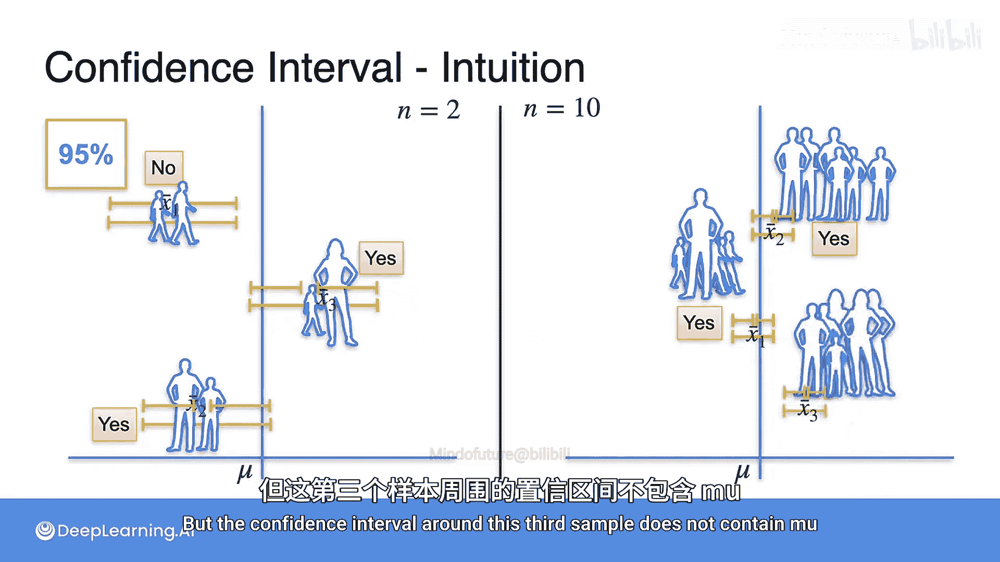

Now I'm going to simplify these illustrations and again color than green if they do contain the population mean and read if they do not。

 and just like before， let's generate many confidence intervals of both types。

Here are many intervals when the sample size is2。And here are a bunch when the sample size is 10。

Since in both cases the confidence level is 95%， roughly 95% of the confidence intervals off the left and 95% of the confidence intervals on the right should contain the population mean。

And in both cases， about 5% of the confidence intervals do not contain the population mean。

While all the confidence intervals have the same 95% chance of containing the population mean。

 the ones in the right are definitely more desirable， and that's because theyre smaller。

 In other words， you have a more precise estimate for the true value of mu while maintaining the same level of confidence that you're correct。

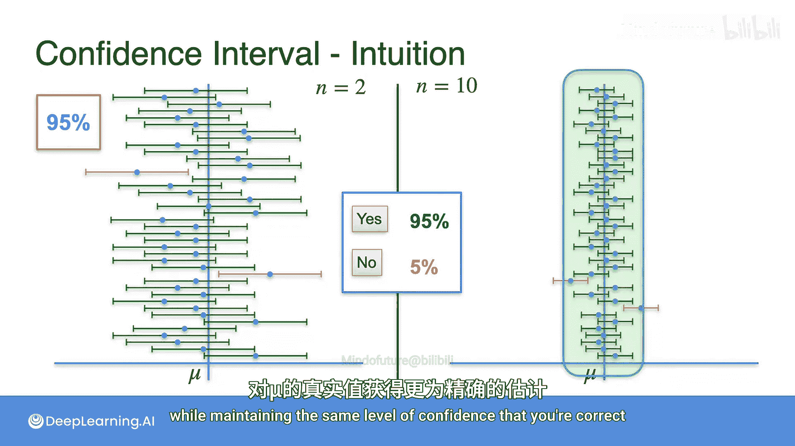

Let's examine the effects of the sample size more closely with this mock simulator。

Using the MA simulator， I'll quickly construct a sampling distribution for sample means of size1 that follows a distribution as shown。

And I'll make these limits indicate the margin of error to be used to construct the confidence interval。

 keeping the confidence level constant at 95%， I'll change the sample size and see the effects on the margin of error。

If I increase it to 10， as expected， the distribution became taller and narrower to capture 95% of the sample means。

 you don't need to go as far to the left and right of the mean。

 And so the overall interval shrinks more generally as n， the sample size increases。

 the confidence interval shrinks。 In other words， as you collect more data。

 you can make more precise estimates of mu without dropping your confidence level。

 you've seen the effect of the sample size on the confidence interval。 Now。

 let's see what happens if you're willing to aim for a different confidence level。

 I will keep the sample size constant at one and keep the same sample distribution that you've seen throughout this video。

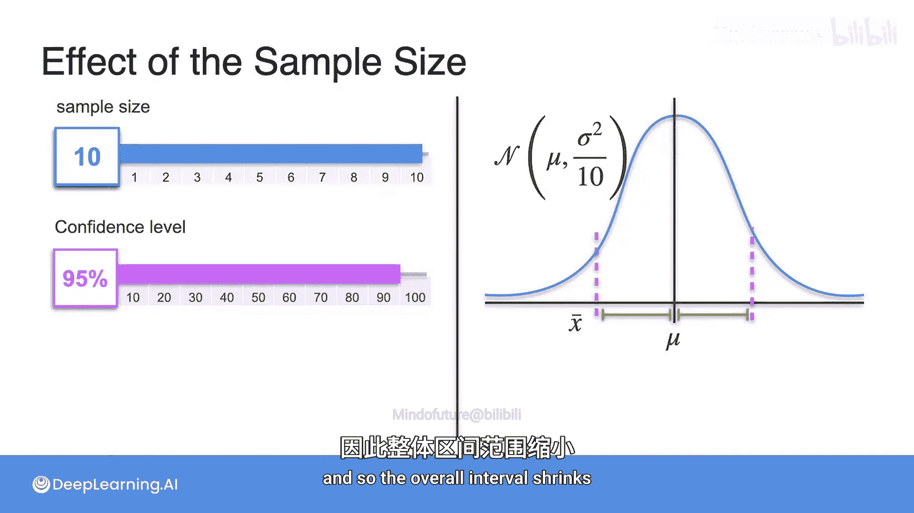

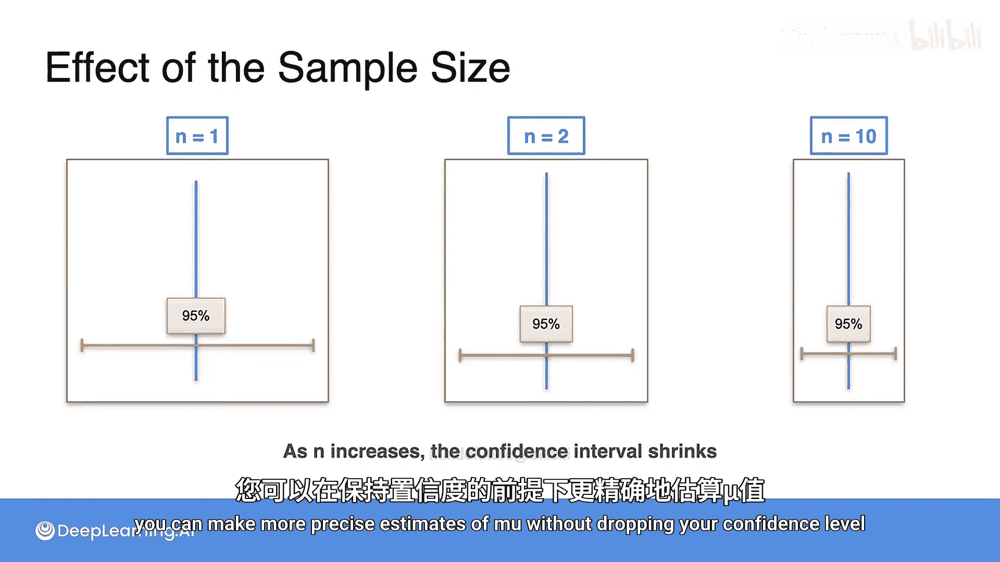

When your conference level is 95%， here's what the margins of error will look like。

Suppose you' are willing to settle for a lower confidence level of 70%。

 If you place a 70% confidence interval around a randomly generated sample。

 mu will be captured 70% of the time。 The distribution will still be the same normal curve as before。

 but you will be able to use smaller margins of error since now your sample mean only needs to fall within them with 70% probability。

Now let's see what happens if you generate many confidence intervals of both types。

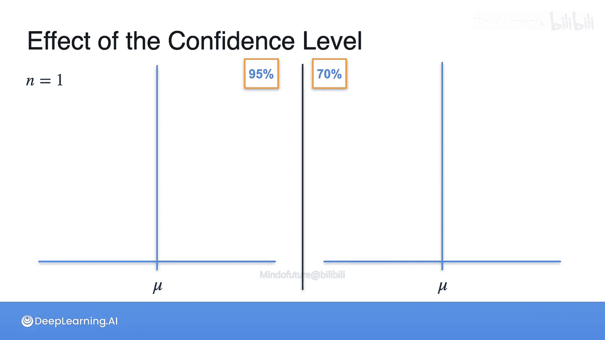

Here are many samples of size1 with a 95% confidence interval drawn around them。

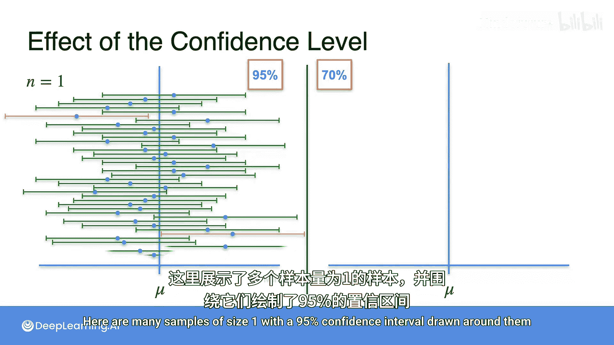

And here's another set of samples of size 1 with a 70% confidence interval drawn around them。

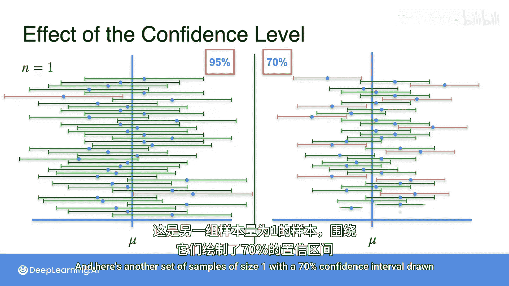

If you did this many times， the confidence intervals on the left would contain the population mean 95% of the time and 5% of time they won't。

The interval on the right， meanwhile， only contain the population means 70% of the time and 30% of the time they don't。

The difference here isn't that the sample means on the right tend to be farther away from the population mean。

 but simply that you've chosen to use small margins of error。

 And so there are more instances where the overall confidence interval does not contain you。 Now。

 let's return to that same simulator。 This time， I will keep the sample size constant and only adjust the confidence level。

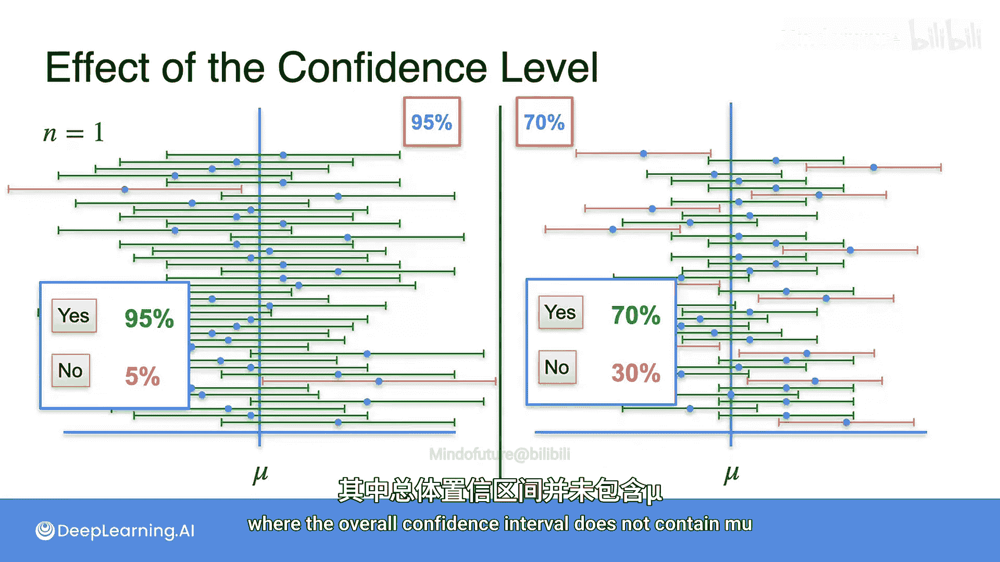

Notice that as I change the confidence level， the margins of error change。

 the actual distribution of the sample means generated stays the same。

This is the same tradeoff you saw way back when you were thinking about searching for that lost key。

 if you want a higher probability that your interval contains the population mean。

 or in that instance， your lost key， you'll need to use larger margins of error。

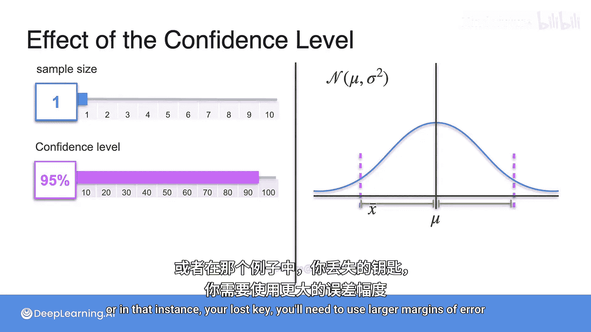

Let's summarize the key points you've seen。Confidence intervals have two ingredients。

 a randomly generated sample mean and a margin of error added to each side。

 Since the mean of the sample you collect will， to some degree be up to random chance。

 the confidence interval is also random。The confidence level is the probability that a confidence interval generated this way contains mu。

 a typical value of 0。95 or 95%。Youll never actually be able to confirm whether your confidence interval contains mu since the whole point is that mu is fixed but unknown。

 Ily， your confidence level would be high， and your confidence interval would be narrow。

 You'd love to say with 99% confidence that the value you're looking for is within a tiny range。

 Unfortunately， you can't just get smaller margins of error and a high confidence level for free。

 As you saw， the most straightforward weight to shrink a confidence interval is to collect more data。

 Having a larger sample will lead to a sampling distribution with a smaller variance。

 And you'll therefore be able to use smaller margins of error to capture the same amount of that sampling distribution。

 choosinging a lower confidence level also leads to a narrower interval。 That said。

 you rarely see confidence intervals below 90% used and 95% is the most common。 At some point。

 if you want more accurate estimates。 you'll just need more data。

So far you've learned about all this concepts at a high level。

 in the next video you'll learn how margins of error and therefore confidence intervals are actually calculated。

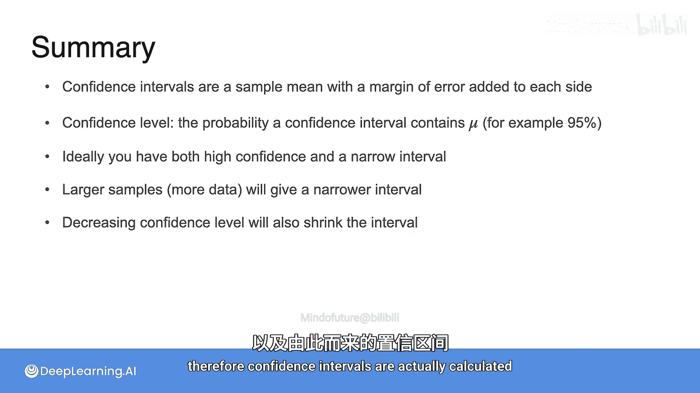