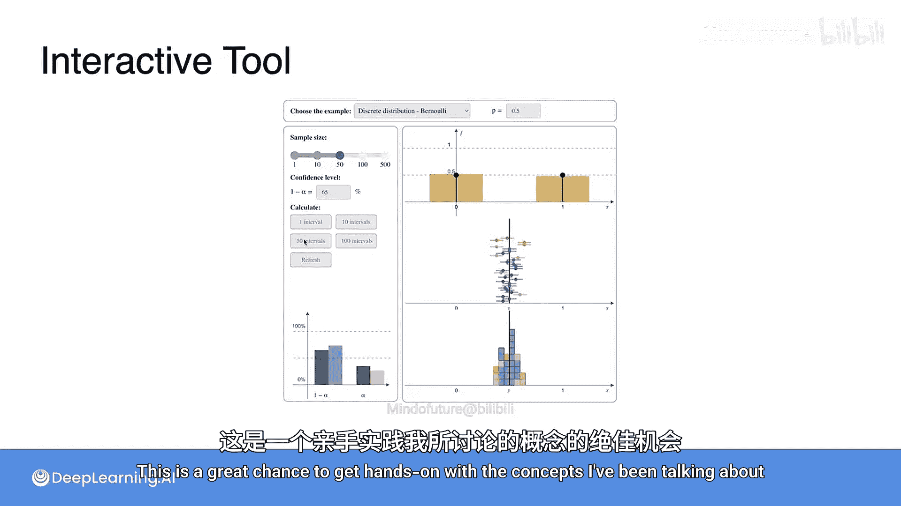

# 【Deeplearning】机器学习和数据科学概率与统计3 ｜ Machine Learning Probability And Statistics 吴恩达 p80 P80_置信区间误差幅度_04_01_03 -BV1c86VBrE93_p80-

Now you're going to learn how to construct a confidence interval to help。

 let's go back to this illustration。 Each of this is a different sample of size1。

 since there's only one observation in each sample。

 the sample mean is just the height of the person in that sample the orange parts around each sample are the confidence intervals in order to generate them。

 you first need to calculate the margin of error As you saw in the last video。

 the margin of error is determined by the size of the sample you collected and the confidence level you're aiming for once you have your margin of error。

 you add and subtracted to your sample mean in order to get the lower and upper limit of your confidence interval。

So the two main ingredients of a confidence interval are the sample mean and the margin of error。

 since you already know how to calculate the sample mean。

 let's look more closely at how to calculate the margin of error。To start。

 I'll show you a very general case， S you're studying a population of people whose heights follow a normal distribution with unknown mean mu and known variance sigma squared。

As before， this random variable will be called X， your goal is to figure out mu the average height of the population。

To do that， you take a sample of size n and calculate the sample mean x bar。

 You would measure the heights of n people and calculate their average height。

 You know that sample mean probably isn't exactly the average height of the overall population。

 but it's also probably close your goal is to quantify how close。

 if you randomly happen to choose many short people， x bar will be lower than mu。

 if you randomly happen to choose many tall people。

 x bar will be higher than mu X bar is itself a random variable。 As you saw in the last video。

 it will be normally distributed with a mean of mu and a variance of sigma squared divided by n。

The distribution is centered around muu and as you take larger samples。

 the spread of your distribution shrinks， increasing the probability your sample means is closer to mu。

The main thing to remember here is that you still don't know mu and you're only taking one sample All you have is x bar and the value of sigma。

 which we've assumed for now you magically have access to since x bar is normally distributed and centered around mu。

 you know your sample mean is probably close to mu。

 but there's always a chance it's an outlier sample。

 So if all you have is your sample mean and Sigma， let's see how you can make your confidence interval。

To do that， recall some useful facts you learn about the shape of the normal distribution back in week2。

You learn that for any normal distribution， roughly 68% of the curve lies within one standard deviation of the mean。

And roughly 95% lies within two standard deviations of the mean。

 If you know the standard deviation of a normal distribution。

 you can establish the range around mu in which any percentage of the distribution lies。

 These points that are a specified number of standard deviation away from the mean have a special name。

 Z scores or z statistics。 The point，2 standard deviations greater than the mean has a C score of2。

 and the point1 standard deviation below the mean has a C score of negative1。

The name Z score is taken from the standard normal distribution。

 which is often called the Z distribution， you can easily convert normal distributions to the standard normal by subtracting the mean and dividing by the standard deviation。

The Z distribution has a mean of0 and a variance of1。Notice that when using the Z distribution。

 the Z scores are simply the value of the point。For example， at the number two。

 you are two standard deviations above the mean of 0 when working with the standard normal。

 you also know roughly 95% of the distribution lies between the values of minus 2 and 2。

Since it makes the math simpler， you will often see this concept talked about from the perspective of this standard normal distribution。

If you want exactly 95% of distribution， then the Z scores to 2 decimal places are -1。

96 and positive 1。96。 If you randomly sample from the standard normal distribution，95% of the time。

 The result will be inside of that range。5% of the time your sample will fall outside of this range。

 Ne 1。96 and positive 1。96 are called critical values。

 they are cut off points inside of which an exact percentage of a probability distribution is contained to find these values。

 you'd either look them up in a precomputed lookup table or use a software library。

 this isn't something you would calculate by hand。The first critical value is z。025。

 This notation means find me the z score of the point which has 2。

5% of the distribution curve to its left。 This shaded region has a probability of 0025 from your lookup table or software library you would get the result of -1。

96。The second critical value is z。975。 Once again it is shorthand for the z's score which has 97。

5% of the distribution curve to its left these two values were chosen because you know the normal curve is symmetric and you want the region around the mean that contains 95% of the distribution。

In other words， you want your critical values to exclude 5% of the distribution。

 this is just a significance level alpha which you learn about in the last video and in this case it's equal to 0。

05。That means this left critical value is z of alpha divided by 2。

 and the right critical value is z of 1 minus alpha divided by 2。The same holds of alpha is 0。

1 your critical values are now at z。05 and z。95， which in this case would be the z scores。

 negative 1。65 and positive 1。65 between these two values lies 90% of the distribution。

Returning to a nonstandardized normal distribution， you can still use these critical values。

 but since the distribution isn't normalized， you need to multiply them by the standard deviation In this case。

 95% of the distribution lies within 1。96 standard deviations of the mean。

 so you just multiply that critical value by sigma。

You're finally ready to calculate your margins of error。

 You know that x bar has a normal distribution centered around mu and with variance sigma squared divided by n。

 the number of observations in your sample， This means the standard deviation is just sigma。

The population standard deviation divided by the square root of n。

 This is also referred to as the standard error， So let's update the range of values accordingly to use this standard deviation。

 You now know the range of values that will contain 95% of all sample means and from there you can get your margins of error which will just be 1。

96 times your standard error which is sigma divided by the square root of n。

If you have chosen a different value of alpha， youll have a different margin of error。

 you'll look up z of1 minus alpha divided by 2 and multiply that by your standard error。

You've now established margins of error。 so let's complete a few more steps to generate a confidence interval。

 Remember， your entire goal in this process was to find a lower and upper limit that bound mu the population mean。

What you just found is that with probability 0。95， your sample mean will fall within the range shown here。

 Not you actually haven't found a bound from mu。 you' found a bound for x bar。

 So let's change this in equality to get the result you actually want。

 Start by subtracting mu from all the terms。Now let's subtract X bar。You're almost done。

 you just need to multiply everything by 1 to clean up that negative mu in the middle Just remember that if you multiply an inequality by a negative number。

 the inequality switch the directions as a result you get this and now you flipped the inequality to face the other direction。

And that's it， you manage to get an interval that bounds mu。

And so your confidence interval ends up being the interval obtained by adding and subtracting the margin of error to the sample mean。

Let me address one more point about how you built this confidence intervalroll。

 so far you've assumed that you were working with a population that followed the normal distribution。

In this case， if you had a sample size n， then the sample mean will also have a normal distribution with the same mean as the population mean。

 but variance and times smaller。However， data isn't always normally distributed。

 maybe you don't even know how the population behaves。Does anything you just learned still work？Well。

 remember， you didn't actually care about the population distribution here。

 All you needed was the distribution of the sample mean。

 and this is where the central limit theorem swoops in to save the day。

 if n is large enough then by the central limit theorem your sample mean will still have an approximately normal distribution and it even has the same parameters as mu sigma squared over n。

 so nothing actually changes。The process you just learned to develop your margins of error will still hold so long as you pick a large enough sample。

After this you'll find an interactive tool in which you can generate your own confidence intervals for both Berulli and normal distributions。

 you'll be able to set the confidence level you're aiming for and see the impact on both the size of the confidence interval as well as the share of the confidence intervals that contain the population mean this is a great chance to get hands on with the concepts I've been talking about。

Enjoy and I'll see you once you're done。