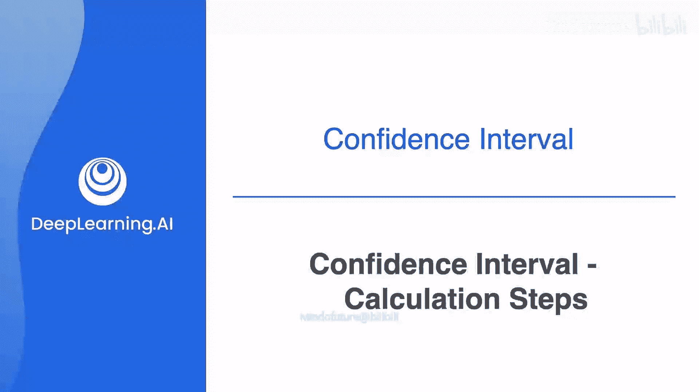
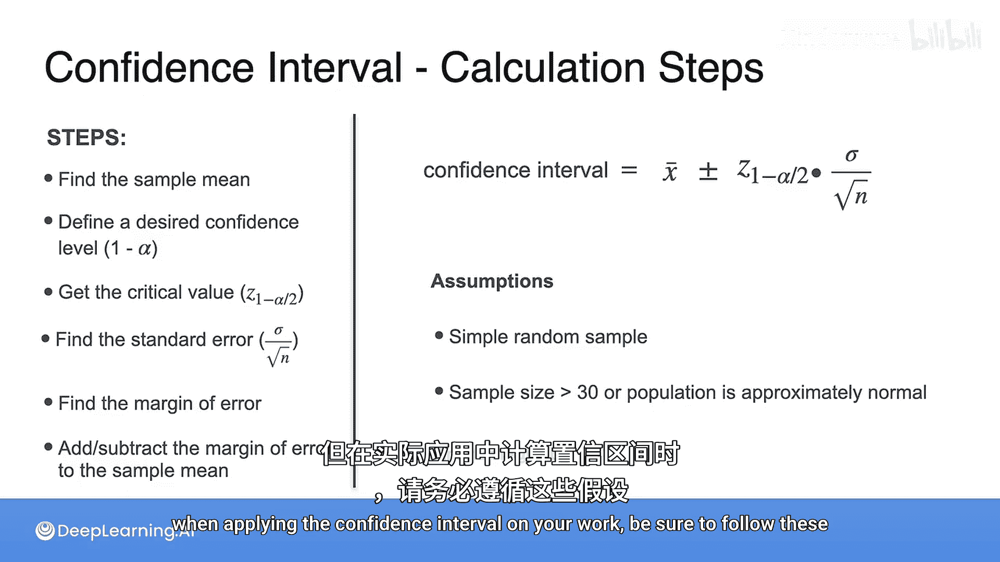

# 【Deeplearning】机器学习和数据科学概率与统计3 ｜ Machine Learning Probability And Statistics 吴恩达 p81 P81_置信区间计算步骤_04_01_05 -BV1c86VBrE93_p81-

So here are the calculation steps for finding the confidence interval first you find the sample mean。

 then you define a desired confidence level， you next find the critical value for this desired confidence level one minus alphapha which is 95%。

Then you find the standard error， this is the standard deviation of the distribution of sample means。

You multiply the critical value and this standard error to get the margin of error。Finally。

 you add and subtract the margin of error to a sample min to obtain the desired confidenced interval。

And there you have it that's how you calculate the confidence interval there are some assumptions under which computing this confidence interval works the first is that the sample used is random the second one is that the sample size is bigger than 30 or the population is approximately normal so even though in our illustrations we use sample size is less than 30 when applying count work be sure to follow these assumptions。

