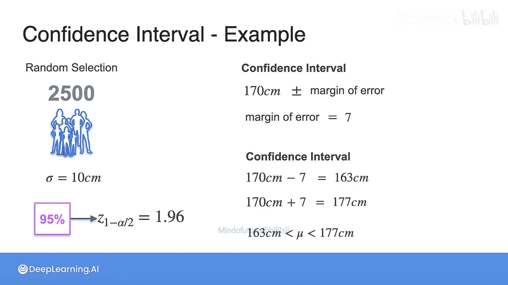

# 【Deeplearning】机器学习和数据科学概率与统计3 ｜ Machine Learning Probability And Statistics 吴恩达 p82 P82_置信区间示例_04_01_06 -BV1c86VBrE93_p82-

So let's go back to a running example， I'm trying to estimate the average height of the world's population。

 so I take a small sample of the population and I take the average of their heights。

 so let's say that value is here and let's say that the actual average of the human height is here。

 so a 95% confidence interval is going to tell me an interval where the actual average is very likely to be。

Let me elaborate now let me show you an example of a confidence interval calculation。

 let's say we go back to the island of Statopia and that there are 6。

000 adults there and we want to find the average height of the people of Statopia or at least have some interval where it's very likely that this mean lies so since we can't measure all the 6000 adults。

 you pick 49 of them at random and you found that the mean height of the sample is 1 me 70 centimeters and the population standard deviation is 25 centimeters。

So let's find a 95% confidence interval for the average height of adults on Statopia We know that it's probably close to 170。

 but let's find an interval for which we're 95% sure that the average of the height of the people in Statopia lies within recall that the critical value for a 95% confidence level is 1。

96 as we saw before so let's start with the margin of error we know that the formula for the margin of error is 1 minus z of alpha over 2 times the standard deviation sigma divided by square root of n so that's 1。

96 times 25 the standard deviation divided by the root of 49 which is very conveniently 7 so this number is going to be 7 Therefore the confidence interval is going to be 1m 70 or 170 centimeters plus or minus the margin of error which we know is 7 Therefore the confidence interval is。

Between 163 centimeters and 177 centimeters， that is the interval where we're 95% sure that the average height of the people in Statopia lives。

