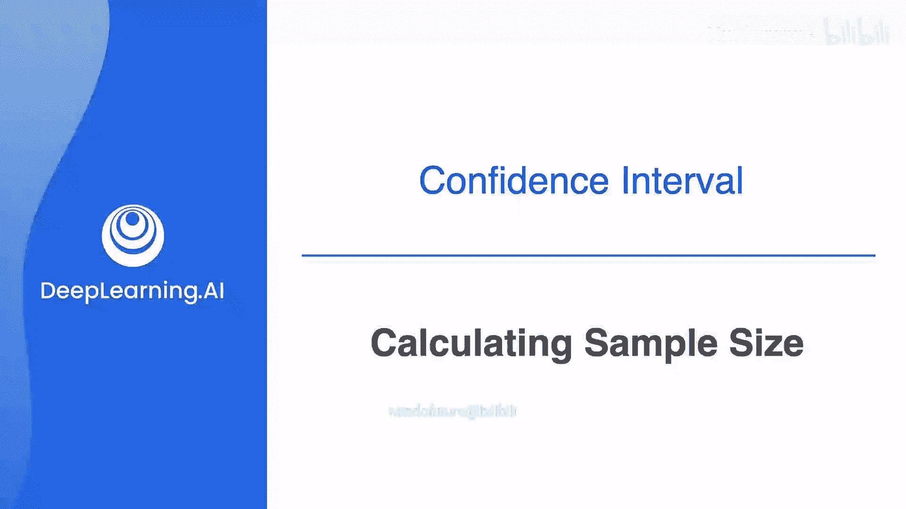
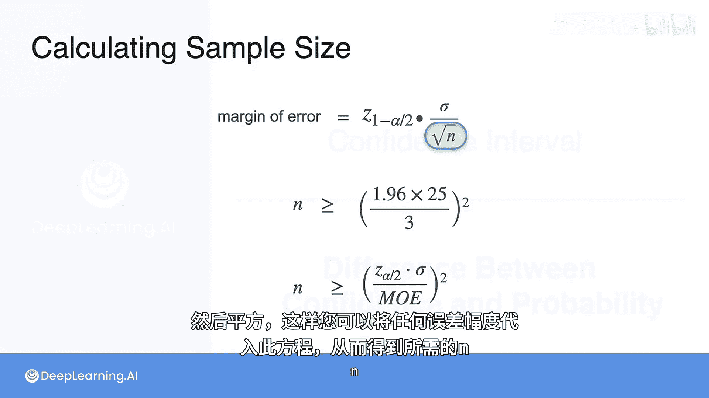

# 【Deeplearning】机器学习和数据科学概率与统计3 ｜ Machine Learning Probability And Statistics 吴恩达 p83 P83_计算样本大小_04_01_07 -BV1c86VBrE93_p83-

In the last example， we had a population of 6000 adults and wanted to calculate a 95% confidence interval for sample of 49 adults with a mean height of 170 centimeters and a standard deviation of 25 we got a margin of error telling us that 95% of the time the population mean was between x bar plus or minus7 centimeters that gave us a confidence interval of 163 centimeters on one end and 177 centimeters on the other end but let's say that we're not happy with that 7 centimeters is too much。

 we want to have a margin of error that is much smaller we want for example3 centimeters because we want to have a more exact estimate of the population mean so all of a sudden 49 is too small so we need a bigger number of people we need a bigger sample in order to give us more confident and the question is what is the smallest sample size that will help us。

Otain the desired margin of error。 So we're going to do similar methods in the previous example。

 except backwards。So recall that the formula for the margin of error is this one over here Now we know the value for everything here except for n so let's go ahead and substitute the margin of error into the equation so now we have the3 is equal21 minus Z alpha divided by2 times the sigma divided by root n but since we want a margin of error of3 that means that getting anything less than3 is even better if you have a margin of error of2 or1 then that's much better so we can substitute the equal by a greater than or equal and keep the right hi the same so now we get3 bigger than or equal then one minus z of alpha over 2 times sigma divided by n3 is a maximum margin of error that we're allowed to have。

Now replacing all the values we know into our inequality， we get that  three is because of 1。

96 times 25 divided by root n from which we can solve4 n and get that n is bigger than or equal to 1。

96 times 25 divided by 3 squared。And that is going to be the value that we want What is that value that value is 266。

78 and since we're talking about people then we can round it to 267 that means that we need a sample of at least 267 adults from the population in order to get a margin of error of three centimeters now let's generalize the formula we just used to calculate the sample size for a particular margin of error here called Me we want the sample to be at least one minus z of alpha over 2 where alpha is the confidence interval times the standard deviation sigma divided by the margin of error squared so you can plug in any margin of error into this equation and get the desired n。

