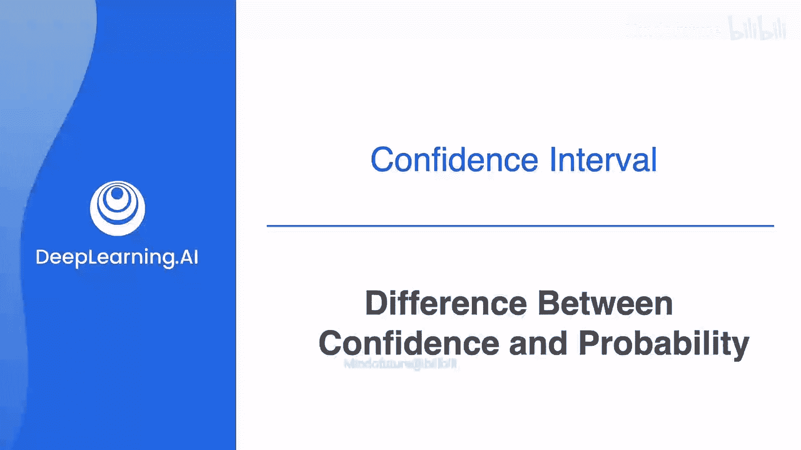
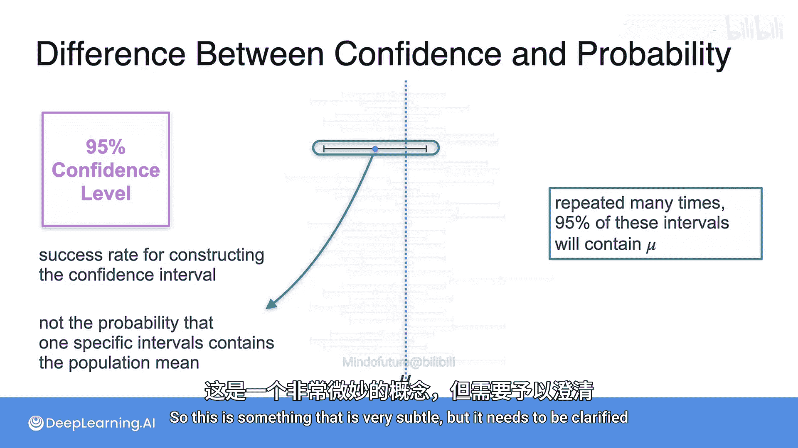

# 【Deeplearning】机器学习和数据科学概率与统计3 ｜ Machine Learning Probability And Statistics 吴恩达 p84 P84_置信度与概率之间的区别_04_01_08 -BV1c86VBrE93_p84-

So say you compute a sample estimate x bar and you calculate a confidence interval of 95% and in your interpretation you say this the confidence interval contains the true population parameter 95% of the time you could be correct Now what if you said there is a 95% probably that the population parameter falls within the confidence interval you would be wrong。

 There's a subtle difference between these two and we're going to see what it is。

So consider the population parameter mu， which is the population mean。

A defining characteristic of mu is that it's fixed。

 but it's unknown is the one we're trying to estimate and note that mule does not have a probability distribution because it is not random。

 it's just unknown， so it's always the same value for a given population。

And because mu is fixed for a given interval， it is in the interval or it is not in the interval。

It does not change， so it's not going to fall within a specified interval 95% of the time or not。

 the sample mean on the other hand has a probability distribution。

 the sampling distribution of the sample means this value changes given the sample taken so the concept of the confidence interval is tied to the sample mean and it changes depending on the value of the sample mean。

Saying that yourre 95% confident has to do with repeating the sampling experiment many times and calculating the intervals for each sample estimate。

 95% of times those confidence intervals will contain the mean this confidence level has to do with the success rate of contracting the confidence interval。

It is not the probability that a specific interval contains the population mean because as we've seen the population mean is either on the interval or not。

 so this is something that is very subtle but it needs to be clarified。😊。

