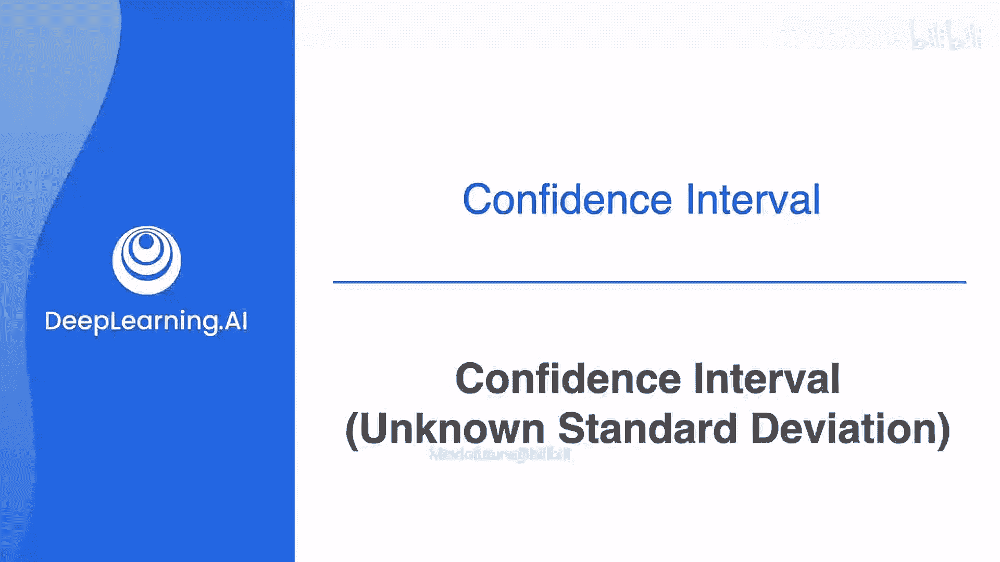
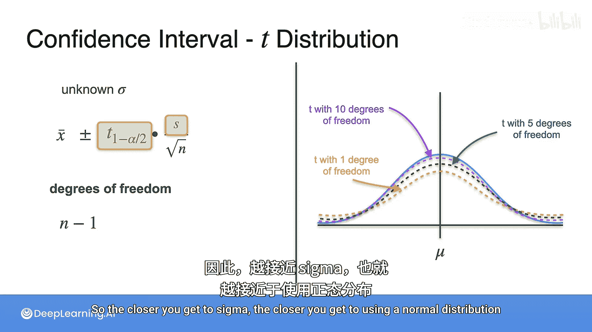

# 【Deeplearning】机器学习和数据科学概率与统计3 ｜ Machine Learning Probability And Statistics 吴恩达 p85 P85_未知标准差_04_01_09 -BV1c86VBrE93_p85-

So in this course we've done a lot of point estimates， however。

 for all of them we've assumed that we know the standard deviation of the total population。

This is not always the case many times we don't know it， but that's no problem when we don't know it。

 all we have to do is make a small change in our calculations by introducing something called the student T distribution。

Let me show you how so recall call that the formula to find the confidence interval given some point estimate x bar is this one over here and as you know this only works because we actually know this sigma。

 we know the population standard deviation which gives the sampling and distribution quantity that generates a normal distribution around the population mean as shown。

 and this is because of this normal property that we're able to use the critical value one minus z of alpha over 2。

However， more often than not， we do not know this standard deviation of the population and that's a problem because we can't use that sigma in the formula。

 so what do we do in this case if we want to have a confidence interval？

So you may have guessed we have to use the actual sample standard deviation S so we can't use the population standard deviation but we took a sample and we can use the sample standard deviation S this gives us this sampling distribution where we simply change the sigma into an S however。

 this quantity is no longer a normal distribution。Now it's a different distribution is called the student's T distribution。

And using the normal distribution as a reference， the student T distribution looks like this is very similar to the normal distribution。

 but it has much fatter tails， meaning that more of the points can be found on these sides compared to the normal distribution if you were to sample a point out of the student t distribution it's more likely to be far from the center than if you pick it from the normal distribution so how do we then adjust for this variability in the distribution to still give us some more accurate confidence intervals well let's do a quick recap with a known sigma we have a sampling distribution quantity with a normal distribution and that's why it's okay to use the C score in scaling to find the confidence interval Now what happens with an unknown sigma。

Well， we can replace sigma with s the sample standard deviation。

 and then this quantity becomes this quantity with s instead of sigma and。

That's a student t distribution and if we just replace the sigma in the margin of error with S without adjusting the C score used for scaling to match the distribution we would be wrong because this C score actually depends on the normal distribution 1 minus z of alpha over to is define over the normal distribution so what do we do then well since we're not using the normal distribution but we're using the student t distribution then the C changes to a T that is the T score so we don't use a Z score we use a T score to calculate the margin of error to fix the scaling issue。

So to recap here are the two formulas for the conference interval compared side by side。

 the main difference is that if we happen to know sigma。😊。

Then we put it here on the calculation for the margin of error， but if we don't know Sigma。

 which is most of the time， then we put an S， the sample standard deviation。

 the one that comes from our samples on the case where we know Sigma。

 we use the C score that comes from the normal distribution and in the case that we don't know Sigma。

 then we use the T score that comes from the student T distribution。

Now you already know the formula to find the margin of error and confidence interval when sigma is unknown we introduce the T statistic and mention how it's related to the T distribution now it turns out that there are several t distributions defined by something we call the degree of freedom the degree of freedom of a T distribution is given by the number of samples that we used minus1 now what is the effect of the degree of freedom and the t distribution well let's use the normal distribution as a comparison the degree of freedom defines how high and tight the t distribution is so for a t with degree freedom 1 you have larger tails。

😊，And when you compare this to one of five degrees of freedom。

 then you have smaller tails and it's closer to the normal distribution and here's one of 10 degrees of freedom。

 you know that now it has smaller tails and it's even closer to the normal distribution。

 the larger the number of degrees of freedom， the closer and closer you get to a normal distribution and this makes sense right because the more samples you use the bigger n is the closer and closer that your sample standard deviation S is to the population standard deviation sigma and if you know sigma you use a normal distribution so the closer you get to sigma。

 the closer you get to using a normal distribution。

